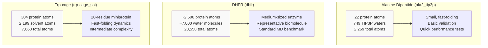
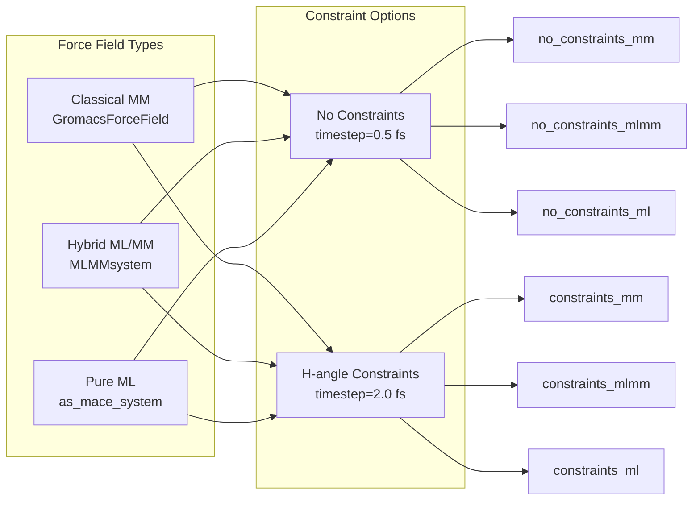
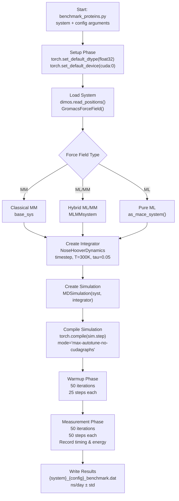
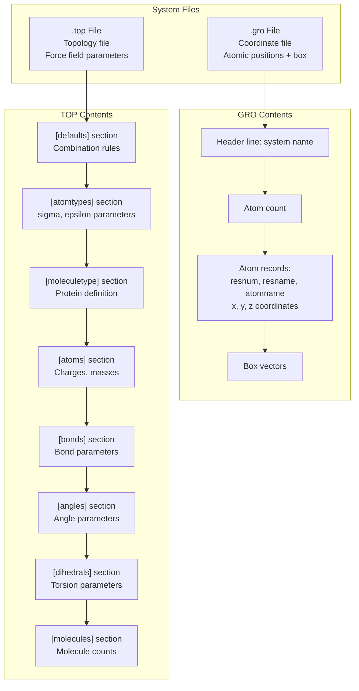
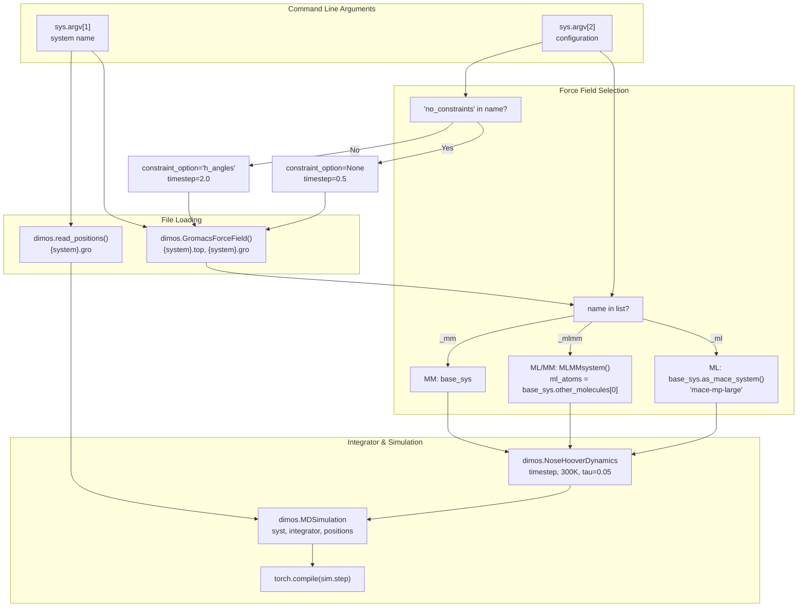
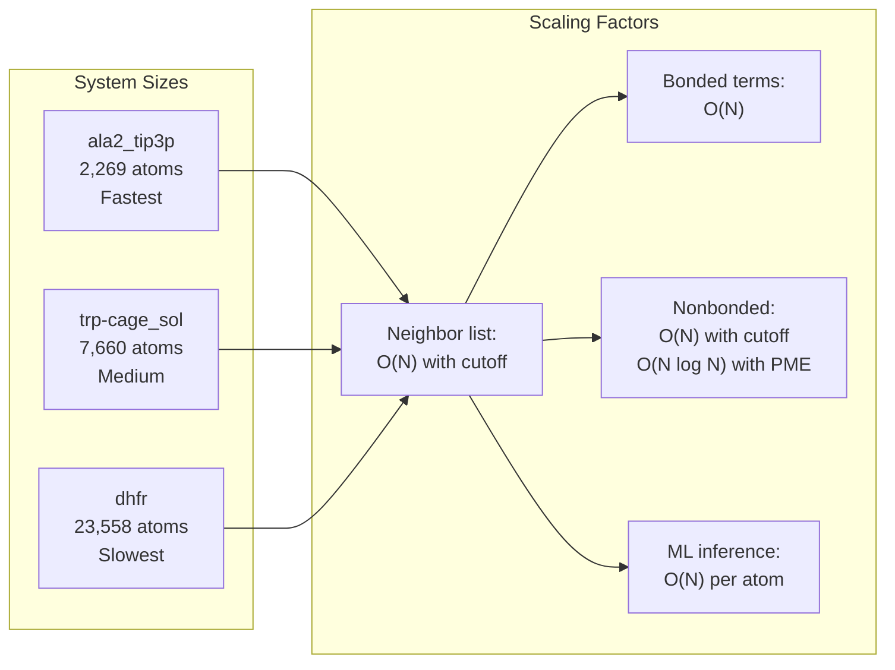
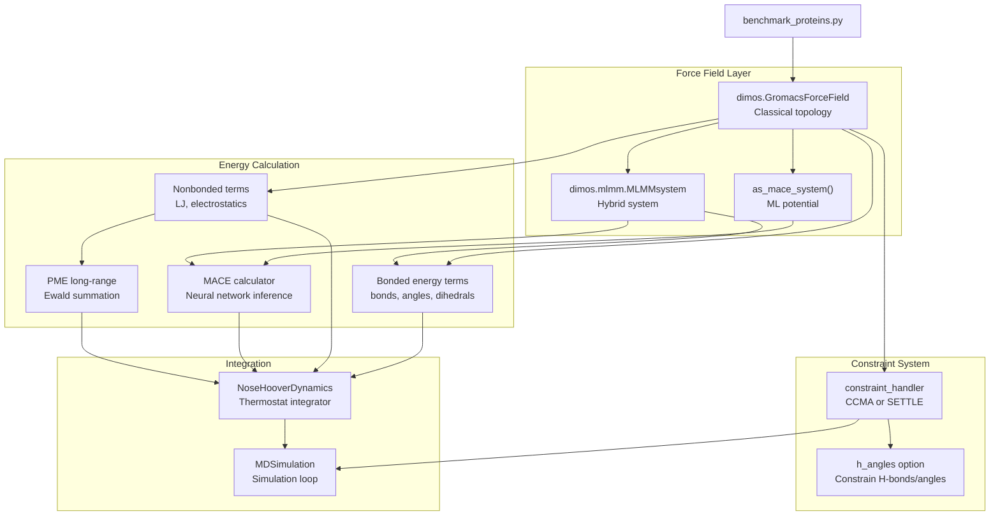

# Protein Benchmark Systems

<details>
<summary>Relevant source files</summary>

The following files were used as context for generating this wiki page:

- [benchmark/proteins/ala2_tip3p.gro](benchmark/proteins/ala2_tip3p.gro)
- [benchmark/proteins/ala2_tip3p.top](benchmark/proteins/ala2_tip3p.top)
- [benchmark/proteins/benchmark_proteins.py](benchmark/proteins/benchmark_proteins.py)
- [benchmark/proteins/dhfr.gro](benchmark/proteins/dhfr.gro)
- [benchmark/proteins/dhfr.top](benchmark/proteins/dhfr.top)
- [benchmark/proteins/trp-cage_sol.gro](benchmark/proteins/trp-cage_sol.gro)
- [benchmark/proteins/trp-cage_sol.top](benchmark/proteins/trp-cage_sol.top)

</details>


## Purpose and Scope

This document describes the protein benchmark systems included in DIMOS for performance testing and validation. These benchmarks test molecular dynamics simulations of protein systems with varying complexity, constraint configurations, and force field types. The protein benchmarks complement the water system benchmarks (see [6.2](#6.2)) and are used for platform comparison (see [6.3](#6.3)).

The three protein test systems—alanine dipeptide, DHFR, and Trp-cage—span a range of system sizes and computational complexity. Each system can be simulated using classical molecular mechanics (MM), hybrid ML/MM, or pure machine learning force fields with or without constraints.

## Benchmark Test Systems

DIMOS includes three standard protein systems for benchmarking, each representing different complexity levels and simulation characteristics:



**Sources:** [benchmark/proteins/ala2_tip3p.gro:1-2](), [benchmark/proteins/dhfr.gro:1-2](), [benchmark/proteins/trp-cage_sol.gro:1-2]()

### Alanine Dipeptide (ala2_tip3p)

The smallest benchmark system consists of an alanine dipeptide capped with ACE and NME groups, solvated in 749 TIP3P water molecules. This system contains 2,269 atoms total with 22 protein atoms.

| Property | Value |
|----------|-------|
| Protein atoms | 22 (ACE-ALA-NME) |
| Water molecules | 749 (TIP3P model) |
| Total atoms | 2,269 |
| Box dimensions | ~3.0 nm cubic |
| Primary use | Fast validation, constraint testing |

The structure file [benchmark/proteins/ala2_tip3p.gro]() contains coordinates in GROMACS format, and the topology [benchmark/proteins/ala2_tip3p.top]() defines the Amber force field parameters including atom types, bonds, angles, dihedrals, and the TIP3P water model.

**Sources:** [benchmark/proteins/ala2_tip3p.gro:1-2269](), [benchmark/proteins/ala2_tip3p.top:1-278]()

### DHFR (dhfr)

DHFR (dihydrofolate reductase) is a medium-sized enzyme with approximately 160 residues, representing a realistic biomolecular system. The complete system includes roughly 7,000 water molecules for a total of 23,558 atoms.

| Property | Value |
|----------|-------|
| Protein residues | ~160 (full enzyme) |
| Protein atoms | ~2,500 |
| Water molecules | ~7,000 |
| Total atoms | 23,558 |
| Primary use | Standard MD benchmark, realistic system size |

This system tests performance on typical protein simulations encountered in computational biology research. The larger system size better represents production MD workloads.

**Sources:** [benchmark/proteins/dhfr.gro:1-2](), [benchmark/proteins/dhfr.top:1-40]()

### Trp-cage (trp-cage_sol)

Trp-cage is a 20-residue miniprotein known for its fast folding dynamics. The benchmark includes 304 protein atoms and 2,199 solvent atoms, totaling 7,660 atoms. This intermediate-sized system bridges the gap between the minimal alanine dipeptide and the larger DHFR enzyme.

| Property | Value |
|----------|-------|
| Protein residues | 20 |
| Protein atoms | 304 |
| Solvent atoms | 2,199 |
| Total atoms | 7,660 |
| Primary use | Folding studies, intermediate-size benchmark |

**Sources:** [benchmark/proteins/trp-cage_sol.gro:1-2](), [benchmark/proteins/trp-cage_sol.top:1-40]()

## Benchmark Configurations

The protein benchmarking script [benchmark/proteins/benchmark_proteins.py]() tests six different simulation configurations for each protein system, varying the force field type and constraint settings:



**Sources:** [benchmark/proteins/benchmark_proteins.py:21-44]()

### Configuration Details

The benchmark script accepts two command-line arguments: the system name and the configuration name.

**System names:**
- `ala2_tip3p` - Alanine dipeptide with TIP3P water
- `dhfr` - DHFR enzyme
- `trp-cage_sol` - Trp-cage miniprotein

**Configuration names:**
- `no_constraints_mm` - Classical MM without constraints (0.5 fs timestep)
- `constraints_mm` - Classical MM with H-angle constraints (2.0 fs timestep)
- `no_constraints_mlmm` - Hybrid ML/MM without constraints (0.5 fs timestep)
- `constraints_mlmm` - Hybrid ML/MM with H-angle constraints (2.0 fs timestep)
- `no_constraints_ml` - Pure ML without constraints (0.5 fs timestep)
- `constraints_ml` - Pure ML with H-angle constraints (2.0 fs timestep)

The constraint option `constraint_option="h_angles"` constrains hydrogen bonds and angles, enabling a 4× larger timestep (2.0 fs vs 0.5 fs) for improved performance without sacrificing accuracy.

**Sources:** [benchmark/proteins/benchmark_proteins.py:16-29]()

### Force Field Implementations

Each configuration uses a different force field setup, implemented through distinct code paths:

**Classical MM (no_constraints_mm, constraints_mm):**
```python
# Line 31
base_sys = dimos.GromacsForceField(f"{system}.top", f"{system}.gro",
                                    cutoff=10, switch_distance=7.5, 
                                    nonbonded_type="PME", 
                                    constraint_option=constraint_option)
```

**Hybrid ML/MM (no_constraints_mlmm, constraints_mlmm):**
```python
# Lines 36-41
ml_atoms = base_sys.other_molecules[0]
system_excluding_protein = dimos.GromacsForceField(..., 
                                                     excluded_bonded_atoms=ml_atoms)
smaller_gromacs_ml_system = system_excluding_protein.as_mace_system(
                                "mace-mp-large", atom_range=(0,len(ml_atoms)))
syst = dimos.mlmm.MLMMsystem(ml_atoms, smaller_gromacs_ml_system, 
                              system_excluding_protein)
```

**Pure ML (no_constraints_ml, constraints_ml):**
```python
# Lines 43-44
syst = base_sys.as_mace_system("mace-mp-large")
syst.constraint_handler = base_sys.constraint_handler
```

The hybrid ML/MM approach treats the protein with the MACE machine learning potential while using classical force fields for the solvent environment, providing a balance between accuracy and computational cost.

**Sources:** [benchmark/proteins/benchmark_proteins.py:31-44]()

## Benchmark Execution Workflow

The benchmarking process follows a structured workflow to ensure accurate performance measurements:



**Sources:** [benchmark/proteins/benchmark_proteins.py:1-73]()

### Initialization Parameters

The benchmark script uses consistent parameters across all configurations:

| Parameter | Value | Purpose |
|-----------|-------|---------|
| `torch.float32` | Default dtype | Balance precision and performance |
| `cuda:0` | Default device | GPU acceleration |
| `c_graph` | `False` | Disable CUDA graphs |
| `warmup_iterations` | 50 | Stabilize compilation and caching |
| `steps_per_warmup` | 25 | Steps per warmup iteration |
| `measure_iterations` | 50 | Number of timed measurements |
| `steps_per_measure` | 50 | Steps per measurement iteration |
| Temperature | 300.0 K | Thermostat temperature |
| Nose-Hoover tau | 0.05 | Coupling time constant |

**Sources:** [benchmark/proteins/benchmark_proteins.py:8-15](), [benchmark/proteins/benchmark_proteins.py:46-47]()

### Compilation Strategy

The benchmark uses PyTorch's `torch.compile()` to optimize the simulation step function:

```python
# Lines 49-51
torch.compiler.reset()
torch._dynamo.reset()
sim_step = torch.compile(sim.step, mode="max-autotune-no-cudagraphs")
```

The `"max-autotune-no-cudagraphs"` mode enables aggressive optimizations without CUDA graphs, which provides better compatibility while maintaining high performance. The compiler is reset before compilation to ensure clean state.

**Sources:** [benchmark/proteins/benchmark_proteins.py:49-51]()

### Warmup and Measurement Phases

The benchmark separates warmup and measurement to account for compilation overhead:

**Warmup Phase (50 iterations × 25 steps):**
- Allows PyTorch compilation to complete
- Stabilizes GPU kernel caching
- Ensures thermal equilibrium of hardware

**Measurement Phase (50 iterations × 50 steps):**
- Records wall-clock time per iteration
- Calculates ns/day throughput
- Measures potential energy for validation

Each measurement iteration records:
- Total elapsed time
- Time per step
- Throughput in ns/day (nanoseconds simulated per 24-hour period)
- Current potential energy

**Sources:** [benchmark/proteins/benchmark_proteins.py:53-69]()

## File Structure and Formats

Each protein benchmark system consists of paired GROMACS-format files:



**Sources:** [benchmark/proteins/ala2_tip3p.gro:1-2269](), [benchmark/proteins/ala2_tip3p.top:1-278]()

### GROMACS Structure File (.gro)

The `.gro` file contains atomic coordinates in a fixed-format ASCII layout:

**Line 1:** System description (comment line)
**Line 2:** Total number of atoms
**Lines 3-N:** Atom records with format:
- Residue number (5 digits)
- Residue name (5 characters)
- Atom name (5 characters)
- Atom serial number (5 digits)
- x, y, z coordinates (3 × 8.3 format, nm)

**Last line:** Box vectors (3 or 9 values, nm)

Example from ala2_tip3p.gro:
```
GROningen MAchine for Chemical Simulation
 2269
    1ACE     H1    1   1.591   1.197   1.609
    1ACE    CH3    2   1.538   1.290   1.589
    ...
   3.088000   3.088000   3.088000
```

**Sources:** [benchmark/proteins/ala2_tip3p.gro:1-10]()

### GROMACS Topology File (.top)

The `.top` file defines the force field in multiple sections:

**`[defaults]`** - Fundamental parameters:
- `nbfunc=1`: Lennard-Jones 12-6 potential
- `comb-rule=2`: Lorentz-Berthelot combining rules
- `gen-pairs=no`: Explicit 1-4 interactions
- `fudgeLJ=1.0`, `fudgeQQ=0.833333`: 1-4 scaling factors

**`[atomtypes]`** - Defines atom types with sigma and epsilon parameters

**`[moleculetype]`** - Declares molecule definitions

**`[atoms]`** - Lists atoms with charges and masses

**`[bonds]`, `[angles]`, `[dihedrals]`** - Bonded interaction parameters

**`[pairs]`** - 1-4 nonbonded interactions

**`[molecules]`** - Final section listing molecule counts

**Sources:** [benchmark/proteins/ala2_tip3p.top:17-278]()

## Force Field Parameters

The topology files use Amber-compatible force field parameters with specific conventions:

### Nonbonded Parameters

Atom types are defined with Lennard-Jones parameters:

| Parameter | Unit | Description |
|-----------|------|-------------|
| sigma | nm | Distance parameter (σ) |
| epsilon | kJ/mol | Well depth (ε) |

Example from ala2_tip3p.top:
```
[ atomtypes ]
; name    at.num    mass    charge ptype  sigma      epsilon
H1             1   1.007947  0.00000000  A     0.26495328      0.0656888
C1             6  12.010780  0.00000000  A     0.33996695      0.4577296
O1             8  15.999430  0.00000000  A     0.29599219        0.87864
```

**Sources:** [benchmark/proteins/ala2_tip3p.top:22-31]()

### Bonded Parameters

**Bonds** use harmonic potential: V = (k/2) × (r - r₀)²
```
[ bonds ]
;    ai     aj funct         c0         c1
      2      3     1   0.10900 284512.000000
```
- `c0` = equilibrium length (nm)
- `c1` = force constant (kJ/mol/nm²)

**Angles** use harmonic potential: V = (k/2) × (θ - θ₀)²
```
[ angles ]
;    ai     aj     ak funct         c0         c1
      5      7      8     1   120.0000514 251.040000
```
- `c0` = equilibrium angle (degrees)
- `c1` = force constant (kJ/mol/rad²)

**Dihedrals** use periodic potential: V = k × [1 + cos(nφ - φ₀)]
```
[ dihedrals ]
;    ai     aj     ak     al funct         c0         c1         c2
      6      5      7      8     1  0.0000000  8.3680000  1
```
- `c0` = phase angle (degrees)
- `c1` = force constant (kJ/mol)
- `c2` = multiplicity (n)

**Sources:** [benchmark/proteins/ala2_tip3p.top:66-227]()

## Running Protein Benchmarks

### Command-Line Usage

Execute the benchmark script with system and configuration arguments:

```bash
cd benchmark/proteins
python benchmark_proteins.py <system> <configuration>
```

Example commands:
```bash
# Classical MM with constraints
python benchmark_proteins.py ala2_tip3p constraints_mm

# Hybrid ML/MM without constraints
python benchmark_proteins.py dhfr no_constraints_mlmm

# Pure ML with constraints
python benchmark_proteins.py trp-cage_sol constraints_ml
```

**Sources:** [benchmark/proteins/benchmark_proteins.py:16-17]()

### Code Entity Mapping

The benchmark script maps system names to file paths and configurations to force field setups:



**Sources:** [benchmark/proteins/benchmark_proteins.py:16-51]()

### Output Format

The benchmark produces a `.dat` file with performance statistics:

**Filename:** `{system}_{configuration}_benchmark.dat`

**Content:** Two tab-separated values per line:
```
<mean_ns_per_day>    <std_error_ns_per_day>
```

Example output file `ala2_tip3p_constraints_mm_benchmark.dat`:
```
45.3    0.8
```

The standard error is calculated as: `std_dev / sqrt(N)` where N is the number of measurement iterations (50).

**Console output during measurement:**
```
constraints_mm 1.234 0.0247 45.3 -12345.67
```
- Configuration name
- Total time (seconds)
- Time per step (seconds)
- Throughput (ns/day)
- Potential energy (kJ/mol or kcal/mol)

**Sources:** [benchmark/proteins/benchmark_proteins.py:57-73]()

## Performance Metrics and Interpretation

### Throughput Calculation

The primary performance metric is throughput measured in nanoseconds per day (ns/day):

```
ns/day = (timestep × steps_per_measure × 1e-6) / (time_period / 86400)
```

Where:
- `timestep`: Integration timestep in femtoseconds
- `steps_per_measure`: Number of MD steps (50)
- `time_period`: Wall-clock time in seconds
- `86400`: Seconds per day

This metric represents how much simulation time can be produced in 24 hours of computation.

**Sources:** [benchmark/proteins/benchmark_proteins.py:65-68]()

### Expected Performance Characteristics

Different configurations exhibit characteristic performance profiles:

| Configuration | Typical Speed | Constraint Benefit | Notes |
|--------------|---------------|-------------------|-------|
| `constraints_mm` | Baseline | 4× faster | Reference classical MD |
| `no_constraints_mm` | Baseline/4 | N/A | Smaller timestep required |
| `constraints_mlmm` | 0.3-0.5× MM | 4× faster | ML overhead on protein |
| `no_constraints_mlmm` | 0.1-0.2× MM | N/A | Small timestep + ML cost |
| `constraints_ml` | 0.1-0.3× MM | 4× faster | Full ML potential |
| `no_constraints_ml` | 0.03-0.1× MM | N/A | Most expensive option |

The constraint benefit (4×) comes from the larger timestep (2.0 fs vs 0.5 fs) when hydrogen bonds/angles are constrained.

**Sources:** [benchmark/proteins/benchmark_proteins.py:24-29]()

### System Size Scaling

Performance scales with system size:



For classical MM with PME electrostatics, performance typically scales between O(N) and O(N log N) due to the fast Fourier transform. For ML potentials, the scaling depends on the model architecture and message-passing depth.

**Sources:** [benchmark/proteins/benchmark_proteins.py:31]()

### Energy Conservation

The potential energy output serves as a validation metric:

- **Classical MM:** Energy should be stable (constant mean, small fluctuations)
- **With thermostat:** Total energy fluctuates, potential energy should be reasonable
- **Constraints:** May show small energy drift due to constraint violations
- **ML potentials:** Energy depends on training data quality

Large energy changes or unphysical values indicate:
- Numerical instability
- Incorrect force field setup
- Constraint failures
- ML model artifacts

**Sources:** [benchmark/proteins/benchmark_proteins.py:65]()

## Integration with DIMOS Components

The protein benchmarks exercise multiple DIMOS subsystems:

### Force Field System Integration



**Sources:** [benchmark/proteins/benchmark_proteins.py:31-47]()

### Compilation and Optimization

The benchmarks test PyTorch compilation effectiveness:

- **`torch.compile()`** with `"max-autotune-no-cudagraphs"` mode
- **Compiler reset** before compilation for clean state
- **Warmup iterations** to complete compilation
- **float32 precision** for GPU performance
- **CUDA device** placement

The compilation strategy is critical for ML and ML/MM configurations where the neural network inference must be optimized.

**Sources:** [benchmark/proteins/benchmark_proteins.py:8-9](), [benchmark/proteins/benchmark_proteins.py:49-51]()

---

This completes the documentation for protein benchmark systems in DIMOS. For water-based benchmarks, see [6.2](#6.2). For detailed platform comparison results and optimization strategies, see [6.3](#6.3). For information on the force field systems themselves, see [4.1](#4.1) (Classical), [4.2](#4.2) (ML), and [4.3](#4.3) (Hybrid).

---