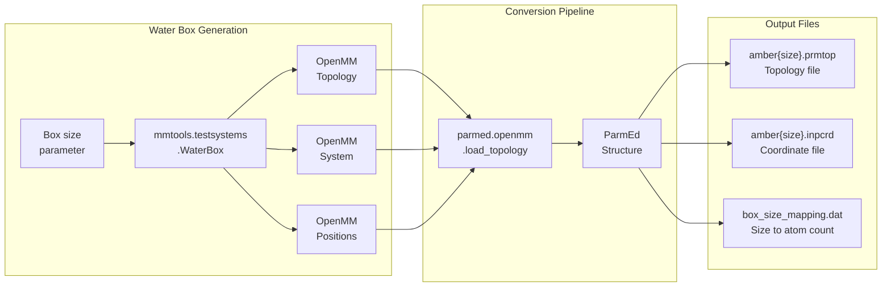
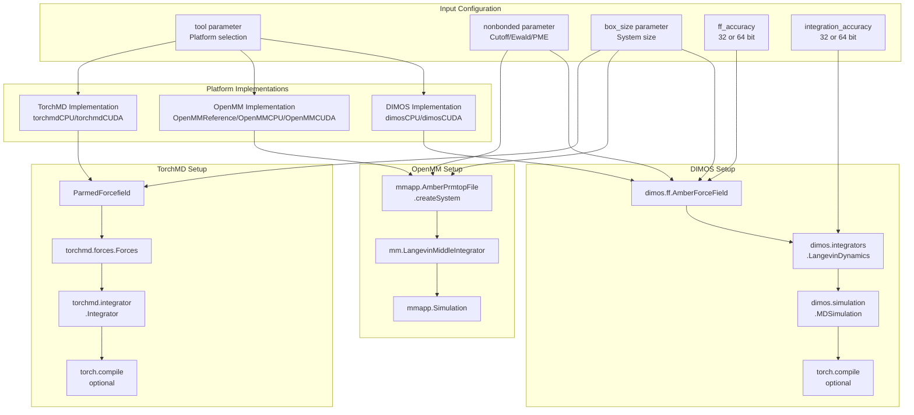
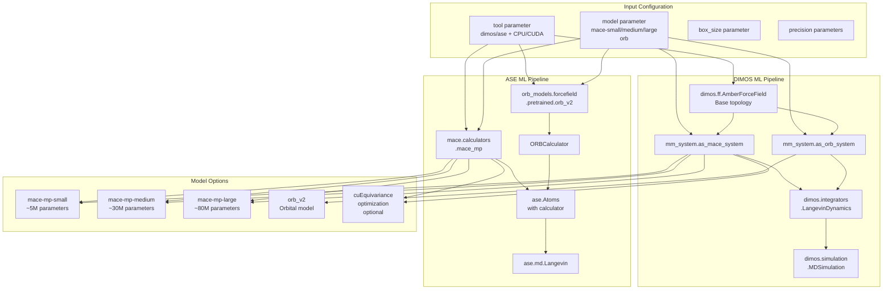
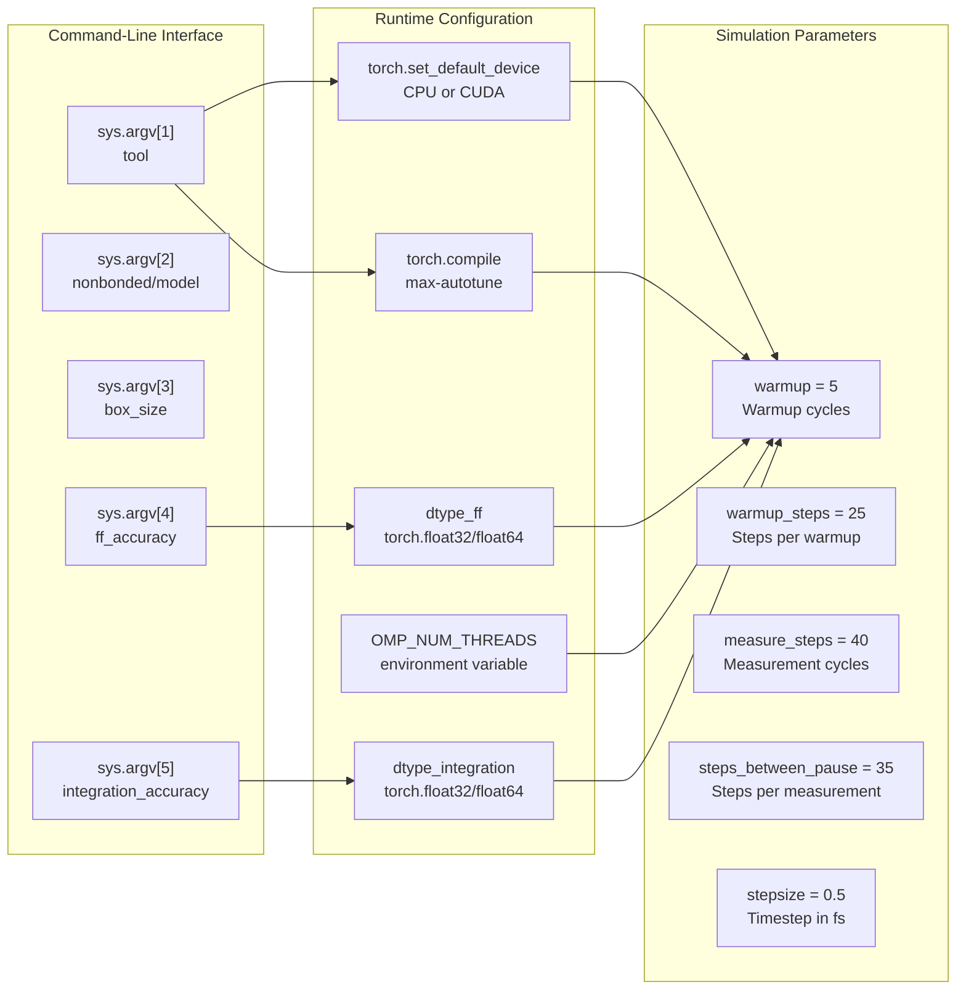
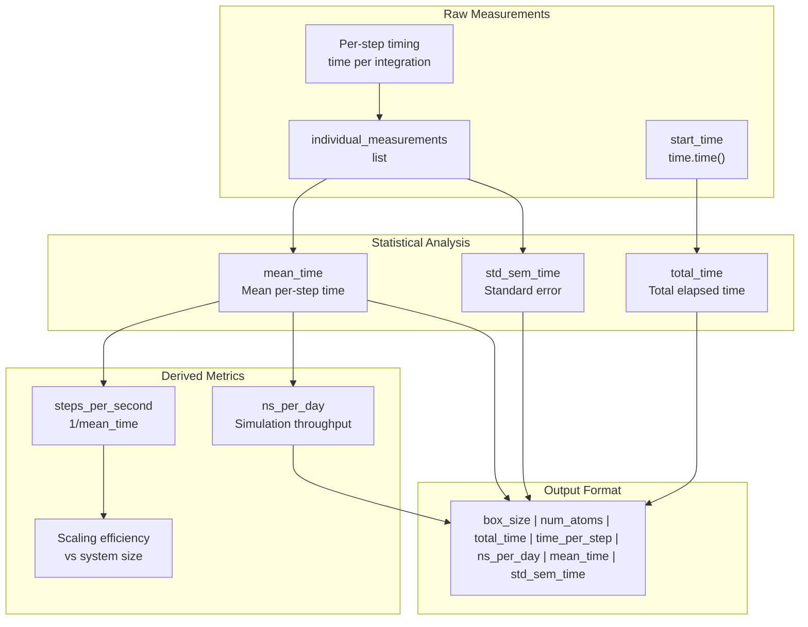
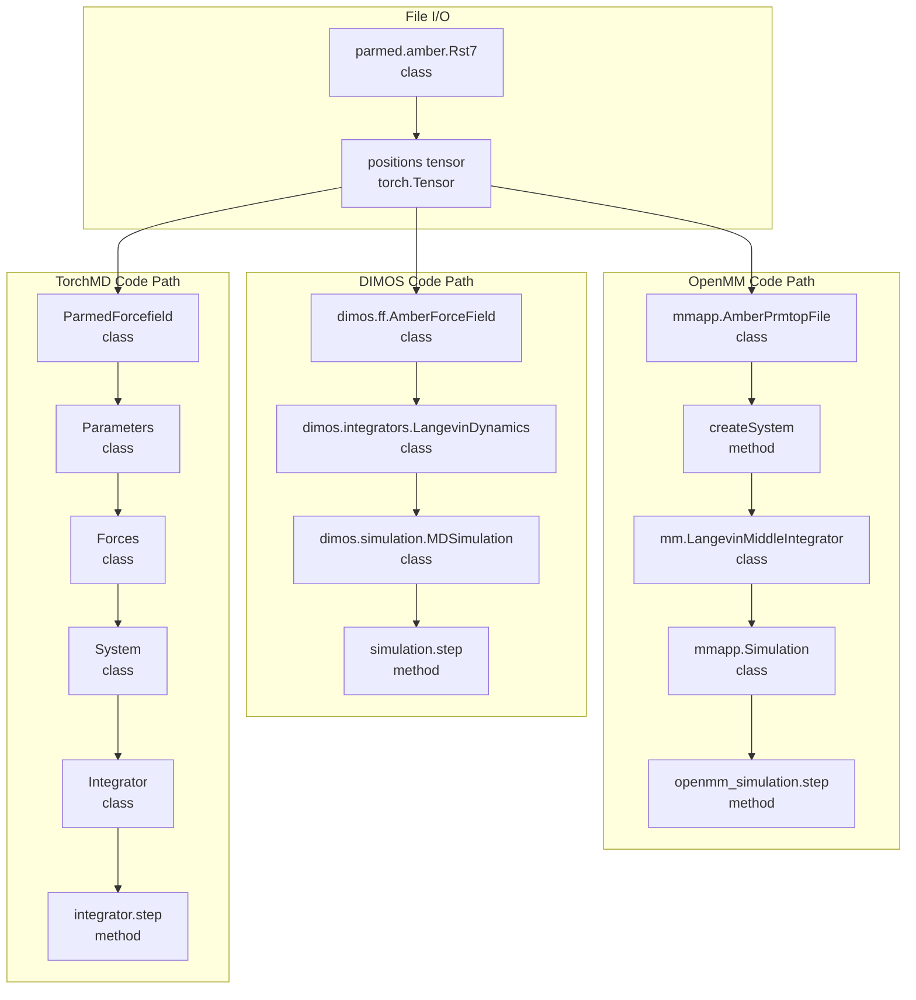

# Water System Benchmarks

<details>
<summary>Relevant source files</summary>

The following files were used as context for generating this wiki page:

- [benchmark/water/dimos_water.py](benchmark/water/dimos_water.py)
- [benchmark/water/dimos_water_ml.py](benchmark/water/dimos_water_ml.py)
- [benchmark/water/generate_water_box_amber.py](benchmark/water/generate_water_box_amber.py)

</details>


## Purpose and Scope

This document describes the water system benchmarking suite in DIMOS, which provides comprehensive performance testing for both classical and machine learning force fields on periodic water boxes. The benchmarks compare DIMOS performance against established MD engines (OpenMM, TorchMD) and ML frameworks (ASE) across varying system sizes, precision settings, and computational platforms.

For protein benchmarking systems, see [Protein Benchmark Systems](#6.1). For analysis of cross-platform performance comparisons, see [Platform Comparison and Performance](#6.3).

**Sources:** [benchmark/water/dimos_water.py:1-223](), [benchmark/water/dimos_water_ml.py:1-207]()

---

## Water Box Generation

Water boxes of varying sizes are generated using the `generate_water_box_amber.py` script, which creates periodic TIP3P water systems using OpenMMTools. The script generates Amber format topology (`.prmtop`) and coordinate (`.inpcrd`) files for box sizes ranging from 10 Å to 120 Å in 5 Å increments.

### Generation Workflow



### File Output Format

The generated files follow standard Amber conventions:

| File Type | Naming Pattern | Content | Format |
|-----------|---------------|---------|--------|
| Topology | `amber{size}.prmtop` | Force field parameters, atom types, connectivity | Amber PRMTOP |
| Coordinates | `amber{size}.inpcrd` | Initial atomic positions, box vectors | Amber restart |
| Mapping | `box_size_mapping.dat` | Box size to atom count mapping | Plain text |

The water molecules are unconstrained (flexible bonds and angles) to allow direct comparison with ML potentials that do not support constraints.

**Sources:** [benchmark/water/generate_water_box_amber.py:1-18]()

---

## Classical Water Benchmarks

The `dimos_water.py` script benchmarks classical TIP3P water using various nonbonded methods across multiple simulation platforms. It supports mixed precision configurations with independent control over force field and integration precision.

### Classical Benchmark Architecture



### Platform-Specific Configuration

#### DIMOS Platform

DIMOS initialization creates an `AmberForceField` with specified nonbonded treatment and precision:

```python
# Example from dimos_water.py:61-65
dimos_system = dimos.ff.AmberForceField(
    f'amber{box_size}.prmtop', 
    cutoff=10, 
    switch_distance=7.5, 
    nonbonded_type=nonbonded,  # "Cutoff", "Ewald", or "PME"
    periodic=True, 
    dtype=dtype_ff
)
integrator = dimos.integrators.LangevinDynamics(
    stepsize, 300, 1.0, dimos_system, 
    dtype=dtype_integration
)
```

The benchmark supports optional `torch.compile` mode for JIT optimization [benchmark/water/dimos_water.py:67-73]().

#### OpenMM Platform

OpenMM systems are created with matching nonbonded methods and precision settings:

```python
# Precision mapping from dimos_water.py:95-100
if dtype_ff == torch.float64 and dtype_integration == torch.float64:
    properties["Precision"] = "double"
elif dtype_ff == torch.float32 and dtype_integration == torch.float32:
    properties["Precision"] = "single"
else:
    properties["Precision"] = "mixed"
```

Supported platforms include Reference (CPU single-threaded), CPU (multi-threaded), and CUDA (GPU) [benchmark/water/dimos_water.py:90-104]().

#### TorchMD Platform

TorchMD requires manual construction of molecular topology with explicit bond and angle definitions [benchmark/water/dimos_water.py:128-149](). It uses reaction field approximation (RFA) for long-range electrostatics [benchmark/water/dimos_water.py:160-170]().

**Sources:** [benchmark/water/dimos_water.py:26-191]()

---

## ML Potential Water Benchmarks

The `dimos_water_ml.py` script benchmarks machine learning potentials (MACE and ORB) on water systems. It compares DIMOS ML integration against ASE calculators, testing various model sizes and compilation options.

### ML Benchmark Architecture



### DIMOS ML System Conversion

DIMOS provides seamless conversion from classical force fields to ML systems:

```python
# MACE system creation from dimos_water_ml.py:69-82
mm_system = dimos.ff.AmberForceField(
    f'amber{box_size}.prmtop', 
    cutoff=5.0, 
    switch_distance=3.5, 
    nonbonded_type="Cutoff", 
    periodic=True, 
    dtype=dtype_ff
)

if "mace" in model:
    dimos_system = mm_system.as_mace_system(
        mace_name=mace_name,  # "mace-mp-small/medium/large"
        enable_cueq=True/False
    )
elif "orb" in model:
    dimos_system = mm_system.as_orb_system()
```

The `as_mace_system` method preserves topology information (masses, atomic numbers, box dimensions) while replacing energy calculations with the MACE ML potential. The `enable_cueq` flag activates cuEquivariance for optimized equivariant operations on CUDA devices [benchmark/water/dimos_water_ml.py:79-84]().

### ASE Calculator Integration

For comparison, ASE requires manual construction of `Atoms` objects:

```python
# ASE atoms creation from dimos_water_ml.py:129-146
water = molecule("H2O")
water_symbols = water.get_chemical_symbols()

symbols = []
for _ in range(positions.size(0)//3):
    symbols.extend(water_symbols)

atoms = Atoms(
    symbols=symbols, 
    positions=positions.detach().cpu().numpy(), 
    cell=[box_size] * 3, 
    pbc=True
)

atoms.calc = macemp  # or ORBCalculator
dyn = Langevin(atoms, stepsize * units.fs, 300 * units.kB, 0.1/units.fs)
```

### Model Size Options

| Model | Parameters | Memory Usage | Accuracy | Typical Use Case |
|-------|-----------|--------------|----------|------------------|
| `mace-mp-small` | ~5M | Low | Good | Large-scale screening |
| `mace-mp-medium` | ~30M | Medium | Better | Production simulations |
| `mace-mp-large` | ~80M | High | Best | High-accuracy studies |
| `orb_v2` | Variable | Medium | High | General purpose |

The ORB model uses graph neural networks with radial basis functions and requires configuration of neighbor list parameters via `SystemConfig` [benchmark/water/dimos_water_ml.py:163]().

**Sources:** [benchmark/water/dimos_water_ml.py:65-176]()

---

## Benchmark Configuration Options

Both classical and ML benchmarks share a common configuration structure with command-line arguments controlling execution parameters.

### Command-Line Arguments



### Configuration Parameters Table

| Parameter | Classical Script | ML Script | Values | Purpose |
|-----------|-----------------|-----------|---------|---------|
| `tool` | Platform name | Platform name | `dimosCPU`, `dimosCUDA`, `dimosCPUcompile`, `dimosCUDAcompile`, `OpenMMReference`, `OpenMMCPU`, `OpenMMCUDA`, `torchmdCPU`, `torchmdCUDA`, `aseCPU`, `aseCUDA` | Selects simulation platform and compilation |
| `nonbonded` | Cutoff method | N/A | `Cutoff`, `Ewald`, `PME` | Nonbonded treatment method |
| `model` | N/A | ML model | `mace-small`, `mace-medium`, `mace-large`, `orb` | ML potential selection |
| `box_size` | Box edge | Box edge | 10-120 Å | System size |
| `ff_accuracy` | Force precision | Force precision | 32, 64 | Floating point precision for forces |
| `integration_accuracy` | Integration precision | Integration precision | 32, 64 | Floating point precision for integration |

### Timing Protocol

The benchmark protocol ensures reliable timing measurements:

1. **Warmup Phase**: 5 cycles of 25 steps each to initialize JIT compilation, GPU kernels, and neighbor lists [benchmark/water/dimos_water.py:18-19]()
2. **Measurement Phase**: 40 cycles of 35 steps each for statistics collection [benchmark/water/dimos_water.py:20-21]()
3. **Individual Timing**: Each cycle is timed separately to compute mean and standard error [benchmark/water/dimos_water.py:204-217]()

### Output File Naming

Output files follow a structured naming convention encoding all configuration parameters:

```
{tool}_nonbonded{method}_dtypeff{ff_prec}_dtypeint{int_prec}_device{device}_threads{threads}.dat
{tool}model{model}_dtypeff{ff_prec}_dtypeint{int_prec}_device{device}_threads{threads}_ml.dat
```

**Sources:** [benchmark/water/dimos_water.py:18-46](), [benchmark/water/dimos_water_ml.py:26-54]()

---

## Performance Metrics

The benchmark scripts collect comprehensive performance data for each system configuration.

### Collected Metrics



### Output Data Format

Each benchmark run appends a line to the output file with tab-separated values:

| Column | Name | Units | Formula | Purpose |
|--------|------|-------|---------|---------|
| 1 | `box_size` | Å | Input parameter | System size identifier |
| 2 | `num_atoms` | count | `positions.shape[0]` | Total atom count |
| 3 | `total_time` | seconds | Measured elapsed | Total measurement time |
| 4 | `time_per_step` | seconds | `total_time / (measure_steps * steps_between_pause)` | Average step time |
| 5 | `ns_per_day` | ns/day | `total_time * measure_steps * steps_between_pause * stepsize * 1e-6 / (24*60*60)` | Simulation throughput |
| 6 | `mean_time` | seconds | `np.mean(individual_measurements)` | Mean per-cycle time |
| 7 | `std_sem_time` | seconds | `np.std(individual_measurements, ddof=1) / sqrt(n)` | Standard error |

The calculation of `ns_per_day` converts femtosecond timesteps to nanoseconds and normalizes by 24-hour periods [benchmark/water/dimos_water.py:218]().

### Trajectory Output

For DIMOS runs, PDB trajectory files are optionally generated:

```python
# From dimos_water.py:201-211
if "dimos" in tool:
    config_file = open(f"dimos{box_size}.pdb","w")
    # Inside measurement loop:
    simulation.sys.write_pdb(simulation.pos, config_file, unwrap_bonds=False)
```

Similarly, ML benchmarks output trajectories in PDB format for DIMOS or using `ase.io.write` for ASE [benchmark/water/dimos_water_ml.py:183-195]().

**Sources:** [benchmark/water/dimos_water.py:203-218](), [benchmark/water/dimos_water_ml.py:185-202]()

---

## Platform-Specific Implementation Details

### Code Entity Mapping for Classical Benchmarks



### Code Entity Mapping for ML Benchmarks

```mermaid
graph TB
    subgraph "DIMOS ML Code Path"
        BASE_FF["dimos.ff.AmberForceField<br/>mm_system"]
        AS_MACE["mm_system.as_mace_system<br/>method"]
        AS_ORB["mm_system.as_orb_system<br/>method"]
        ML_SYSTEM["ML system<br/>with calculator"]
        INT_ML["dimos.integrators.LangevinDynamics<br/>integrator"]
        SIM_ML["dimos.simulation.MDSimulation<br/>simulation"]
        STEP_ML["simulation.step<br/>method"]
    end
    
    subgraph "ASE MACE Code Path"
        MACE_CALC["mace.calculators.mace_mp<br/>function"]
        MACE_CALC_OBJ["MACE Calculator<br/>object"]
        ASE_ATOMS_MACE["ase.Atoms<br/>atoms with calc"]
        ASE_DYN_MACE["ase.md.Langevin<br/>dyn"]
        ASE_STEP_MACE["dyn.run<br/>method"]
    end
    
    subgraph "ASE ORB Code Path"
        ORB_PRETRAIN["orb_models.forcefield.pretrained.orb_v2<br/>function"]
        ORB_CALC_CLASS["ORBCalculator<br/>class"]
        ASE_ATOMS_ORB["ase.Atoms<br/>atoms with calc"]
        ASE_DYN_ORB["ase.md.Langevin<br/>dyn"]
        ASE_STEP_ORB["dyn.run<br/>method"]
    end
    
    BASE_FF --> AS_MACE
    BASE_FF --> AS_ORB
    AS_MACE --> ML_SYSTEM
    AS_ORB --> ML_SYSTEM
    ML_SYSTEM --> INT_ML
    INT_ML --> SIM_ML
    SIM_ML --> STEP_ML
    
    MACE_CALC --> MACE_CALC_OBJ
    MACE_CALC_OBJ --> ASE_ATOMS_MACE
    ASE_ATOMS_MACE --> ASE_DYN_MACE
    ASE_DYN_MACE --> ASE_STEP_MACE
    
    ORB_PRETRAIN --> ORB_CALC_CLASS
    ORB_CALC_CLASS --> ASE_ATOMS_ORB
    ASE_ATOMS_ORB --> ASE_DYN_ORB
    ASE_DYN_ORB --> ASE_STEP_ORB
```



### Key Differences Between Platforms

| Aspect | DIMOS | OpenMM | TorchMD | ASE |
|--------|-------|--------|---------|-----|
| **Force Field Loading** | `dimos.ff.AmberForceField` | `mmapp.AmberPrmtopFile.createSystem` | `ParmedForcefield` + manual topology | N/A (ML only) |
| **Integrator** | `dimos.integrators.LangevinDynamics` | `mm.LangevinMiddleIntegrator` | `torchmd.integrator.Integrator` | `ase.md.Langevin` |
| **Compilation** | `torch.compile` with mode selection | Not supported | `torch.compile` | `torch.compile` |
| **Precision Control** | Independent force field and integration | Global or mixed | Global dtype | Global dtype |
| **Long-Range** | Cutoff, Ewald, PME | Cutoff, Ewald, PME | RFA only | N/A |
| **ML Support** | Native via `as_mace_system`, `as_orb_system` | Limited via plugins | Not shown | Native calculators |

**Sources:** [benchmark/water/dimos_water.py:50-191](), [benchmark/water/dimos_water_ml.py:58-176]()

---

## Execution Examples

### Running Classical Benchmarks

```bash
# DIMOS CPU with PME and double precision
python dimos_water.py dimosCPU PME 40 64 64

# DIMOS CUDA with compilation and mixed precision
python dimos_water.py dimosCUDAcompile Cutoff 80 32 64

# OpenMM CUDA with single precision
python dimos_water.py OpenMMCUDA PME 60 32 32

# TorchMD CUDA with compilation
python dimos_water.py torchmdCUDAcompile Cutoff 50 32 32
```

### Running ML Benchmarks

```bash
# DIMOS CUDA with MACE medium model and compilation
python dimos_water_ml.py dimosCUDAcompile mace-medium 40 32 64

# DIMOS CPU with ORB model
python dimos_water_ml.py dimosCPU orb 30 64 64

# ASE CUDA with MACE large model
python dimos_water_ml.py aseCUDA mace-large 50 32 32

# DIMOS with cuEquivariance optimization
python dimos_water_ml.py dimosCUDAcuEqcompile mace-small 60 32 32
```

### Environment Configuration

```bash
# Set thread count for CPU platforms
export OMP_NUM_THREADS=8

# Disable TF32 for accurate benchmarking
# (already configured in scripts)
```

The `OMP_NUM_THREADS` environment variable controls CPU parallelization and is automatically propagated to OpenMM via `OPENMM_CPU_THREADS` [benchmark/water/dimos_water.py:42-43]().

**Sources:** [benchmark/water/dimos_water.py:24-46](), [benchmark/water/dimos_water_ml.py:34-54]()

---