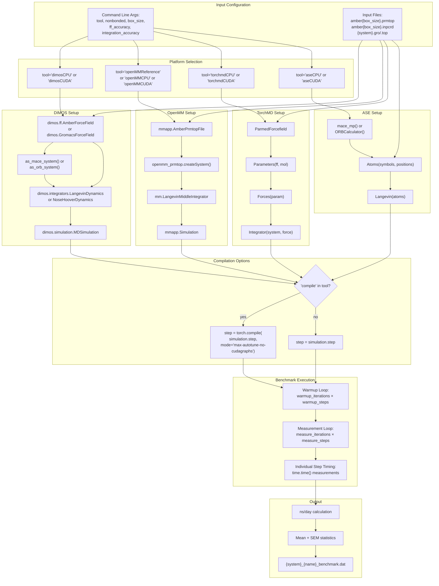
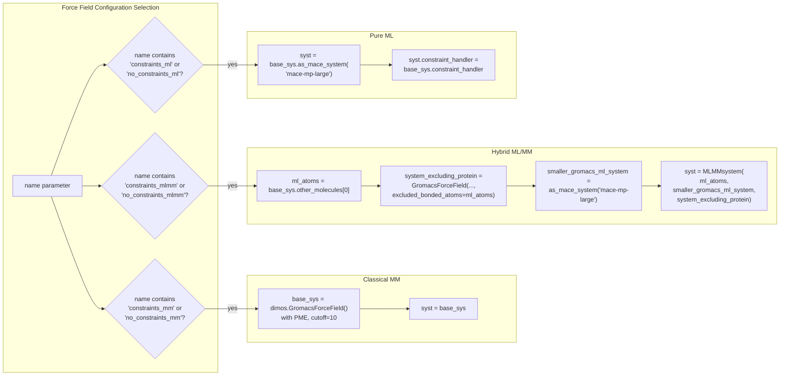

# Platform Comparison and Performance

<details>
<summary>Relevant source files</summary>

The following files were used as context for generating this wiki page:

- [benchmark/proteins/benchmark_proteins.py](benchmark/proteins/benchmark_proteins.py)
- [benchmark/water/dimos_water.py](benchmark/water/dimos_water.py)
- [benchmark/water/dimos_water_ml.py](benchmark/water/dimos_water_ml.py)

</details>


This document describes DIMOS's benchmarking capabilities for comparing performance against other molecular dynamics platforms, understanding optimization strategies, and interpreting performance metrics. The benchmarking suite enables systematic evaluation of DIMOS against established MD engines (OpenMM, TorchMD) and ML potential frameworks (ASE) across different hardware backends, precision settings, and system configurations.

For information about specific benchmark test systems, see [Protein Benchmark Systems](#6.1) and [Water System Benchmarks](#6.2).

## Overview

The DIMOS benchmarking suite provides three main comparison workflows:

| Benchmark Type | Platforms Compared | Key Features | Script Location |
|----------------|-------------------|--------------|-----------------|
| **Protein Benchmarks** | DIMOS only | Multi-configuration testing (MM/ML/ML-MM), constraint comparison, compilation analysis | [benchmark/proteins/benchmark_proteins.py]() |
| **Classical Water** | DIMOS, OpenMM, TorchMD | Platform comparison, nonbonded method comparison, scaling studies | [benchmark/water/dimos_water.py]() |
| **ML Water** | DIMOS, ASE | ML potential comparison (MACE, ORB), cuEq optimization analysis | [benchmark/water/dimos_water_ml.py]() |

The benchmarking framework emphasizes:
- **Mixed precision support**: Independent control of force field and integration precision
- **Compilation overhead analysis**: Performance with and without `torch.compile`
- **Scaling studies**: System size dependence from small to large boxes
- **Fair comparisons**: Equivalent settings across platforms where possible

**Sources:** [benchmark/proteins/benchmark_proteins.py](), [benchmark/water/dimos_water.py](), [benchmark/water/dimos_water_ml.py]()

## Benchmark Workflow Architecture

The following diagram shows how benchmarking scripts configure and execute simulations across different platforms:



**Sources:** [benchmark/water/dimos_water.py:24-108](), [benchmark/water/dimos_water_ml.py:34-176](), [benchmark/proteins/benchmark_proteins.py:11-55]()

## Platform Support Matrix

### Classical Force Fields

DIMOS benchmarks can compare against two major classical MD platforms:

| Platform | Backend Options | Precision Support | Compilation | Status |
|----------|----------------|-------------------|-------------|--------|
| **DIMOS** | CPU, CUDA | float32, float64, mixed | `torch.compile` | Full support |
| **OpenMM** | Reference, CPU, CUDA | single, double, mixed | N/A (C++) | Full support |
| **TorchMD** | CPU, CUDA | float32, float64 | `torch.compile` | Limited support |

The platform is selected via the `tool` command-line argument in benchmark scripts:

```python
# DIMOS platforms
tool = "dimosCPUcompile"    # CPU with compilation
tool = "dimosCUDA"          # CUDA without compilation

# OpenMM platforms  
tool = "openMMReference"    # Reference (slow, CPU)
tool = "openMMCPU"          # Optimized CPU
tool = "openMMCUDA"         # CUDA

# TorchMD platforms
tool = "torchmdCPUcompile"  # CPU with compilation
tool = "torchmdCUDA"        # CUDA without compilation
```

**Sources:** [benchmark/water/dimos_water.py:26-108]()

### Machine Learning Potentials

ML potential benchmarks compare DIMOS against ASE with different ML calculators:

| Platform | ML Models | Backend | Compilation | cuEq Support |
|----------|-----------|---------|-------------|--------------|
| **DIMOS** | MACE (small/medium/large), ORB | CPU, CUDA | `torch.compile` | Yes (MACE) |
| **ASE** | MACE (small/medium/large), ORB | CPU, CUDA | `torch.compile` | Yes (MACE) |

ML model and optimization options are specified via command-line arguments:

```python
# MACE models
model = "mace-small"        # Smallest MACE model
model = "mace-medium"       # Medium MACE model  
model = "mace-large"        # Largest MACE model

# ORB model
model = "orb"               # ORB v2 model

# Optimization options
tool = "dimosCUDAcompile"   # With compilation
tool = "dimosCUDAcompilecuEq"  # With compilation and cuEq
```

**Sources:** [benchmark/water/dimos_water_ml.py:35-176]()

## Precision Configuration

DIMOS supports independent precision control for force field calculations and numerical integration, enabling mixed-precision workflows:

### Precision Specification

Precision is controlled via `ff_accuracy` and `integration_accuracy` command-line arguments:

```python
# Command line arguments
ff_accuracy = int(sys.argv[4])              # 32 or 64
integration_accuracy = int(sys.argv[5])     # 32 or 64

# Convert to torch dtypes
dtype_ff = torch.float32 if ff_accuracy == 32 else torch.float64
dtype_integration = torch.float32 if integration_accuracy == 32 else torch.float64
```

### DIMOS Mixed Precision Setup

```python
# Force field with specified precision
dimos_system = dimos.ff.AmberForceField(
    f'amber{box_size}.prmtop',
    cutoff=10,
    switch_distance=7.5,
    nonbonded_type=nonbonded,
    periodic=True,
    dtype=dtype_ff  # Force field precision
)

# Integrator with specified precision
integrator = dimos.integrators.LangevinDynamics(
    stepsize,
    300,
    1.0,
    dimos_system,
    dtype=dtype_integration  # Integration precision
)
```

**Sources:** [benchmark/water/dimos_water.py:30-63]()

### OpenMM Precision Mapping

OpenMM's precision model differs from PyTorch. The benchmark maps DIMOS precision settings to OpenMM equivalents:

```python
properties = {}
if dtype_ff == torch.float64 and dtype_integration == torch.float64:
    properties["Precision"] = "double"     # Full double precision
elif dtype_ff == torch.float32 and dtype_integration == torch.float32:
    properties["Precision"] = "single"     # Full single precision
else:
    properties["Precision"] = "mixed"      # Mixed precision
```

OpenMM's "mixed" precision uses float32 for force calculations and float64 for integration, which may not exactly match DIMOS's mixed precision configuration.

**Sources:** [benchmark/water/dimos_water.py:95-100]()

### Precision vs Performance Trade-offs

| Configuration | Accuracy | Speed | Memory | Typical Use Case |
|--------------|----------|-------|--------|------------------|
| **ff=32, int=32** | Lower | Fastest | Lowest | Quick screening, large systems |
| **ff=64, int=32** | Moderate | Fast | Moderate | Force field validation |
| **ff=32, int=64** | Moderate | Fast | Moderate | Long trajectories with stability |
| **ff=64, int=64** | Highest | Slowest | Highest | Production, energy conservation |

## Performance Metrics

### Primary Metric: ns/day

The primary performance metric is **nanoseconds per day** (ns/day), representing simulated time per wall-clock day:

```python
# Calculate ns/day in protein benchmarks
fraction_of_day = time_period / (24*60*60)
ns_per_day = sim.integrator.get_timestep() * steps_per_measure * 1e-6 / fraction_of_day

# Calculate ns/day in water benchmarks
ns_per_day = total_time * measure_steps * steps_between_pause * stepsize * 1e-6 / (24*60*60)
```

Where:
- `timestep` or `stepsize`: Integration timestep in femtoseconds
- `steps_per_measure`: Number of MD steps per measurement
- `1e-6`: Convert fs to ns
- `24*60*60`: Seconds per day

**Sources:** [benchmark/proteins/benchmark_proteins.py:65-68](), [benchmark/water/dimos_water.py:218]()

### Statistical Analysis

Benchmarks compute mean and standard error of the mean (SEM) over multiple measurements:

```python
# Protein benchmarks
measurements = np.zeros((measure_iterations, 3))
for meas_it in range(measure_iterations):
    # ... timing code ...
    measurements[meas_it, 2] = ns_per_day

ns_per_day_mean = measurements[:, 2].mean()
ns_per_day_std = measurements[:, 2].std(ddof=1) / np.sqrt(measure_iterations)
```

The SEM quantifies uncertainty in the performance measurement, accounting for variability across runs.

**Sources:** [benchmark/proteins/benchmark_proteins.py:58-72]()

### Timing Breakdown

Water benchmarks provide detailed timing information:

```python
# Output format: box_size, num_atoms, total_time, time_per_step, ns_per_day, mean_time, std_sem_time
print(f"{box_size}\t{positions.shape[0]}\t{total_time}\t{total_time/(measure_steps*steps_between_pause)}\t"
      f"{total_time*measure_steps*steps_between_pause*stepsize*1e-6/(24*60*60)}\t{mean_time}\t{std_sem_time}")
```

This provides:
- Total benchmark time (wall-clock seconds)
- Time per MD step (seconds/step)
- Throughput (ns/day)
- Mean step time over measurements
- Standard error of mean step time

**Sources:** [benchmark/water/dimos_water.py:218]()

## Benchmark Configuration Options

### Constraint Handling

Protein benchmarks test with and without molecular constraints:

```python
if "no_constraints" in name:
    constraint_option = None
    timestep = 0.5   # fs - smaller timestep without constraints
else:
    constraint_option = "h_angles"
    timestep = 2.0   # fs - larger timestep with constraints
```

Constraints allow 4× larger timesteps by freezing high-frequency bond vibrations, significantly impacting performance and trajectory properties.

**Sources:** [benchmark/proteins/benchmark_proteins.py:24-29]()

### Nonbonded Methods

Water benchmarks test different long-range electrostatic treatments:

| Method | Description | Accuracy | Performance | Use Case |
|--------|-------------|----------|-------------|----------|
| **Cutoff** | Simple cutoff with switching | Lower | Fastest | Screening, implicit solvent |
| **Ewald** | Full Ewald summation | High | Slow | Small systems, validation |
| **PME** | Particle Mesh Ewald | High | Fast | Production simulations |

Selection in DIMOS:

```python
dimos_system = dimos.ff.AmberForceField(
    f'amber{box_size}.prmtop',
    cutoff=10,
    switch_distance=7.5,
    nonbonded_type=nonbonded,  # "Cutoff", "Ewald", or "PME"
    periodic=True
)
```

**Sources:** [benchmark/water/dimos_water.py:61](), [benchmark/water/dimos_water.py:80-86]()

### Force Field Configurations

Protein benchmarks test three force field configurations:



**Sources:** [benchmark/proteins/benchmark_proteins.py:33-44]()

### System Size Scaling

Water benchmarks test multiple box sizes to evaluate scaling behavior:

```python
# Box sizes tested (Angstroms)
box_sizes = [10, 20, 30, 40, 50, 60, 70, 80, 90, 100, 110, 115]

# Corresponding number of water molecules scales as box_size^3
# Each water = 3 atoms (O, H, H)
num_atoms = num_waters * 3
```

This enables analysis of:
- Linear scaling (ideal for cutoff methods)
- N×log(N) scaling (typical for PME)
- Algorithm efficiency as system size grows

**Sources:** [benchmark/water/dimos_water.py:28]()

## Compilation and Optimization

### torch.compile Integration

DIMOS and TorchMD simulations can be JIT-compiled using `torch.compile`:

```python
if "compile" in tool:
    print("Compilation started")
    torch.compiler.reset()
    step = torch.compile(
        simulation.step,
        mode="max-autotune-no-cudagraphs"
    )
    print("...done")
else:
    step = simulation.step
```

The `"max-autotune-no-cudagraphs"` mode:
- Enables aggressive optimization (max-autotune)
- Disables CUDA graphs to avoid memory overhead
- Suitable for iterative benchmarking workflows

**Sources:** [benchmark/water/dimos_water.py:67-73](), [benchmark/water/dimos_water_ml.py:90-96]()

### Compilation Overhead

Benchmarks include a warmup phase to amortize compilation costs:

```python
# Protein benchmarks
warmup_iterations = 50
steps_per_warmup = 25

for warm_it in range(warmup_iterations):
    print(warm_it)
    sim_step(steps_per_warmup)

# Water benchmarks  
warmup = 5
warmup_steps_between_pause = 25

for s in range(warmup):
    print(f"WarmUp step {s+1}/{warmup}")
    step(warmup_steps_between_pause)
```

Warmup ensures:
- PyTorch lazy initialization is complete
- Compilation is finished before timing
- GPU kernels are loaded and optimized
- Memory allocation is stable

**Sources:** [benchmark/proteins/benchmark_proteins.py:12-55](), [benchmark/water/dimos_water.py:18-195]()

### ML Model Optimization

ML potential benchmarks test additional optimization strategies:

#### cuEq Optimization (MACE only)

cuEquivariance provides optimized equivariant operations:

```python
# DIMOS with cuEq
if "cuEq" in tool:
    dimos_system = mm_system.as_mace_system(
        mace_name=mace_name,
        enable_cueq=True
    )
else:
    dimos_system = mm_system.as_mace_system(
        mace_name=mace_name,
        enable_cueq=False
    )

# ASE with cuEq (requires special initialization)
if "cuEq" in tool:
    if "CPU" in tool:
        macemp = mace_mp(enable_cueq=True, model=size)
    else:
        torch.set_default_device("cpu")  # Load on CPU first
        macemp = mace_mp(enable_cueq=True, model=size)
        torch.set_default_device("cuda:0")  # Move to GPU
```

cuEq can provide 2-3× speedups for MACE models on GPU but requires careful device management.

**Sources:** [benchmark/water/dimos_water_ml.py:79-82](), [benchmark/water/dimos_water_ml.py:119-126]()

#### Model Size Selection

MACE offers three pre-trained model sizes with accuracy/speed trade-offs:

| Model | Parameters | Accuracy | Speed | Typical Use |
|-------|-----------|----------|-------|-------------|
| **mace-mp-small** | ~5M | Lower | Fastest | Screening, large systems |
| **mace-mp-medium** | ~10M | Moderate | Moderate | Balanced simulations |
| **mace-mp-large** | ~20M | Higher | Slowest | High-accuracy production |

**Sources:** [benchmark/water/dimos_water_ml.py:72-78]()

## Running Benchmarks

### Protein Benchmark Execution

```bash
# Run protein benchmark
cd benchmark/proteins
python benchmark_proteins.py <system> <name>

# Examples:
python benchmark_proteins.py ala2_tip3p constraints_mm
python benchmark_proteins.py dhfr no_constraints_mlmm
python benchmark_proteins.py trp-cage_sol constraints_ml

# Available systems:
# - ala2_tip3p: Alanine dipeptide in TIP3P water
# - dhfr: DHFR enzyme in water
# - trp-cage_sol: Trp-cage protein in water

# Available configurations:
# - no_constraints_mm: Classical MM, 0.5 fs timestep
# - constraints_mm: Classical MM with constraints, 2.0 fs timestep
# - no_constraints_mlmm: Hybrid ML/MM, 0.5 fs timestep
# - constraints_mlmm: Hybrid ML/MM with constraints, 2.0 fs timestep
# - no_constraints_ml: Pure ML potential, 0.5 fs timestep
# - constraints_ml: Pure ML potential with constraints, 2.0 fs timestep
```

Output is written to `{system}_{name}_benchmark.dat` containing:
```
ns_per_day    ns_per_day_std_error
```

**Sources:** [benchmark/proteins/benchmark_proteins.py:16-73]()

### Classical Water Benchmark Execution

```bash
# Set number of threads for CPU benchmarks
export OMP_NUM_THREADS=8

# Run classical water benchmark
cd benchmark/water
python dimos_water.py <tool> <nonbonded> <box_size> <ff_accuracy> <integration_accuracy>

# Examples:
python dimos_water.py dimosCUDAcompile PME 60 32 64
python dimos_water.py openMMCUDA PME 60 64 64
python dimos_water.py torchmdCPU Cutoff 40 32 32

# tool options:
# - dimosCPU, dimosCPUcompile, dimosCUDA, dimosCUDAcompile
# - openMMReference, openMMCPU, openMMCUDA
# - torchmdCPU, torchmdCPUcompile, torchmdCUDA, torchmdCUDAcompile

# nonbonded options:
# - Cutoff, Ewald, PME

# box_size: 10-115 Angstroms (water boxes must be pre-generated)

# accuracy: 32 or 64 (bits)
```

Output is appended to `{tool}_nonbonded{nonbonded}_dtypeff{dtype_ff}_dtypeint{dtype_integration}_device{device}_threads{num_threads}.dat`:

```
box_size  num_atoms  total_time  time_per_step  ns_per_day  mean_time  std_sem_time
```

**Sources:** [benchmark/water/dimos_water.py:26-218]()

### ML Water Benchmark Execution

```bash
# Run ML water benchmark
cd benchmark/water
python dimos_water_ml.py <tool> <model> <box_size> <ff_accuracy> <integration_accuracy>

# Examples:
python dimos_water_ml.py dimosCUDAcompile mace-small 40 32 64
python dimos_water_ml.py dimosCUDAcompilecuEq mace-large 60 32 64
python dimos_water_ml.py aseCUDAcompile orb 40 64 64

# tool options:
# - dimosCPU, dimosCPUcompile, dimosCUDA, dimosCUDAcompile, dimosCUDAcompilecuEq
# - aseCPU, aseCPUcompile, aseCUDA, aseCUDAcompile, aseCUDAcompilecuEq

# model options:
# - mace-small, mace-medium, mace-large
# - orb

# box_size: 10-115 Angstroms

# accuracy: 32 or 64 (bits)
```

Output format is identical to classical water benchmarks.

**Sources:** [benchmark/water/dimos_water_ml.py:34-202]()

## Platform-Specific Considerations

### DIMOS

**Advantages:**
- Full PyTorch integration enables `torch.compile` optimization
- Mixed precision support at force field and integrator levels
- Seamless switching between classical, ML, and hybrid force fields
- Direct GPU memory management

**Configuration:**
```python
# Device selection
torch.set_default_device("cuda:0")  # or "cpu"

# Precision control
torch.set_default_dtype(torch.float32)  # Default for new tensors

# Compilation
torch.backends.cuda.matmul.allow_tf32 = False  # Disable TF32 for reproducibility
```

**Sources:** [benchmark/water/dimos_water.py:8-14](), [benchmark/proteins/benchmark_proteins.py:8-9]()

### OpenMM

**Advantages:**
- Highly optimized C++ codebase
- Mature platform with extensive validation
- Broad hardware support (Reference, CPU, CUDA, OpenCL)
- Production-ready for large-scale simulations

**Limitations:**
- No native PyTorch integration
- Limited ML potential support
- Fixed precision model per platform
- Cannot use `torch.compile`

**Configuration:**
```python
# Platform and precision
properties = {
    "DeviceIndex": "0",
    "Precision": "mixed"  # or "single", "double"
}
openmm_platform = mm.Platform.getPlatformByName('CUDA')
openmm_simulation = mmapp.Simulation(
    topology, system, integrator, 
    openmm_platform, properties
)
```

OpenMM's CPU platform respects `OPENMM_CPU_THREADS` environment variable for threading control.

**Sources:** [benchmark/water/dimos_water.py:76-108]()

### TorchMD

**Advantages:**
- PyTorch-based implementation
- Supports `torch.compile`
- Differentiable force calculations

**Limitations:**
- Limited to reaction field approximation (RFA) for long-range electrostatics
- Less mature than OpenMM
- Smaller feature set
- Custom force field format

**Configuration:**
```python
# Force field setup requires manual bond/angle definitions
force = Forces(
    param,
    cutoff=10.0,
    rfa=True,  # Reaction field approximation
    switch_dist=7.5,
    terms=["bonds", "angles", "electrostatics", "lj"]
)

# Integration
integrator = Integrator(
    system, force, timestep, device,
    gamma=langevin_gamma, T=langevin_temperature
)
```

**Sources:** [benchmark/water/dimos_water.py:109-189]()

### ASE with ML Calculators

**Advantages:**
- Standard interface for ML potentials
- Well-integrated with ML frameworks (MACE, ORB, etc.)
- Mature MD integration layer

**Limitations:**
- Overhead from ASE abstraction layer
- Limited optimization compared to direct usage
- No classical force field support
- Compilation requires careful setup

**MACE Configuration:**
```python
from mace.calculators import mace_mp

macemp = mace_mp(
    enable_cueq=True,
    model="large",
    default_dtype="float32",
    device="cuda:0"
)

# Compilation (if enabled)
macemp = torch.compile(macemp, mode="max-autotune-no-cudagraphs")

atoms.calc = macemp
```

**ORB Configuration:**
```python
from orb_models.forcefield import pretrained
from orb_models.forcefield.calculator import ORBCalculator

orbff = pretrained.orb_v2(device="cuda:0")
system_config = atomic_system.SystemConfig(
    radius=6.0,
    max_num_neighbors=150
)
calc = ORBCalculator(orbff, system_config=system_config, device="cuda:0")
atoms.calc = calc
```

**Sources:** [benchmark/water/dimos_water_ml.py:98-172]()

## Interpreting Results

### Performance Comparison Matrix

When comparing platforms, construct a matrix showing relative performance:

| Configuration | DIMOS ns/day | OpenMM ns/day | Ratio (DIMOS/OpenMM) |
|--------------|--------------|---------------|----------------------|
| CPU, float64, PME | X₁ | Y₁ | X₁/Y₁ |
| CUDA, float32, PME | X₂ | Y₂ | X₂/Y₂ |
| CUDA + compile, mixed, PME | X₃ | N/A | - |

Higher ns/day indicates better performance. Ratios >1 mean DIMOS is faster; <1 means the comparison platform is faster.

### Compilation Impact Analysis

Quantify compilation benefits by comparing with and without compilation:

```
Speedup = (ns/day with compilation) / (ns/day without compilation)
```

Typical speedups:
- **Classical force fields:** 1.5-3× on CUDA with `torch.compile`
- **ML potentials:** 2-4× on CUDA with `torch.compile`
- **Small systems:** Lower speedup due to overhead
- **Large systems:** Higher speedup from better kernel fusion

### Scaling Analysis

For system size scaling studies, plot ns/day vs. number of atoms on log-log axes:

- **Ideal scaling:** Horizontal line (constant ns/day regardless of size)
- **Linear scaling:** Diagonal line with slope -1
- **PME scaling:** Diagonal line with slope ≈ -1.2 to -1.5

Deviations from expected scaling indicate:
- Communication overhead (multi-GPU)
- Memory bandwidth limitations
- Algorithmic inefficiencies

### Mixed Precision Impact

Compare energy conservation and performance across precision settings:

| Precision (FF/Int) | Energy Drift | Performance | Recommended Use |
|-------------------|--------------|-------------|-----------------|
| 32/32 | Moderate | Fastest | Equilibration, screening |
| 32/64 | Low | Fast | Production with stability |
| 64/32 | Moderate | Fast | Force field validation |
| 64/64 | Minimal | Slowest | High-accuracy production |

Energy drift can be quantified by tracking total energy over long trajectories in NVE simulations.

### Statistical Significance

Standard error of the mean (SEM) indicates measurement precision:

```
Confidence Interval (95%) ≈ mean ± 1.96 × SEM
```

For performance differences to be statistically significant:
```
|mean₁ - mean₂| > 1.96 × √(SEM₁² + SEM₂²)
```

Increase `measure_iterations` in benchmark scripts to reduce SEM if differences are small.

**Sources:** [benchmark/proteins/benchmark_proteins.py:70-72](), [benchmark/water/dimos_water.py:199-201]()

## Optimization Strategies

### For Classical Force Fields

1. **Use compilation:** Enable `torch.compile` for 1.5-3× speedup
   ```python
   sim_step = torch.compile(sim.step, mode="max-autotune-no-cudagraphs")
   ```

2. **Choose appropriate nonbonded method:**
   - Small systems (<5000 atoms): Cutoff or Ewald
   - Large systems (>5000 atoms): PME

3. **Use mixed precision (32/64):**
   - Fast force calculations (float32)
   - Stable integration (float64)

4. **Enable constraints:** 4× larger timestep possible with `constraint_option="h_angles"`

5. **Tune cutoffs:** Balance accuracy vs. performance
   ```python
   cutoff=10.0          # Interaction cutoff
   switch_distance=7.5  # Start switching here
   ```

**Sources:** [benchmark/water/dimos_water.py:61-73]()

### For ML Potentials

1. **Enable cuEq (MACE only):** 2-3× speedup on GPU
   ```python
   system = mm_system.as_mace_system("mace-mp-large", enable_cueq=True)
   ```

2. **Use compilation:** Essential for ML potentials (2-4× speedup)
   ```python
   step = torch.compile(simulation.step, mode="max-autotune-no-cudagraphs")
   ```

3. **Select appropriate model size:**
   - Screening: `mace-mp-small`
   - Production: `mace-mp-large`

4. **Use float32 for force field:** ML models are typically trained in float32
   ```python
   dtype_ff = torch.float32
   dtype_integration = torch.float64  # Keep integration stable
   ```

5. **Batch neighbor list updates:** Reduce overhead from graph construction

**Sources:** [benchmark/water/dimos_water_ml.py:72-96]()

### General Optimization Tips

1. **Adequate warmup:** Ensure compilation is complete
   ```python
   warmup_iterations = 50
   steps_per_warmup = 25
   ```

2. **Thread configuration (CPU):** Set `OMP_NUM_THREADS` appropriately
   ```bash
   export OMP_NUM_THREADS=8  # Match physical cores
   ```

3. **GPU memory management:**
   ```python
   torch.backends.cuda.matmul.allow_tf32 = False  # Reproducibility
   torch.set_float32_matmul_precision('high')     # Speed (optional)
   ```

4. **Profile-guided optimization:** Use PyTorch profiler to identify bottlenecks
   ```python
   with torch.profiler.profile() as prof:
       step(100)
   print(prof.key_averages().table(sort_by="cuda_time_total"))
   ```

**Sources:** [benchmark/proteins/benchmark_proteins.py:12-13](), [benchmark/water/dimos_water.py:14-19](), [benchmark/water/dimos_water.py:42-43]()

---