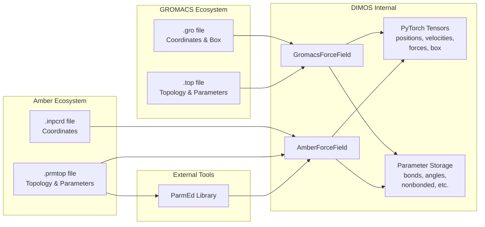
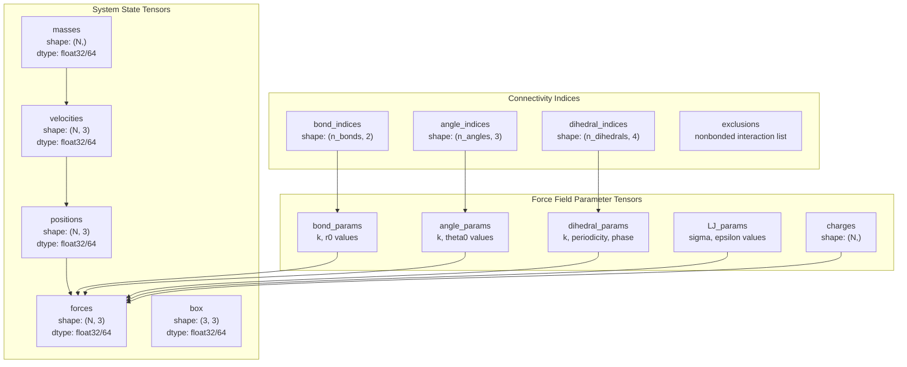
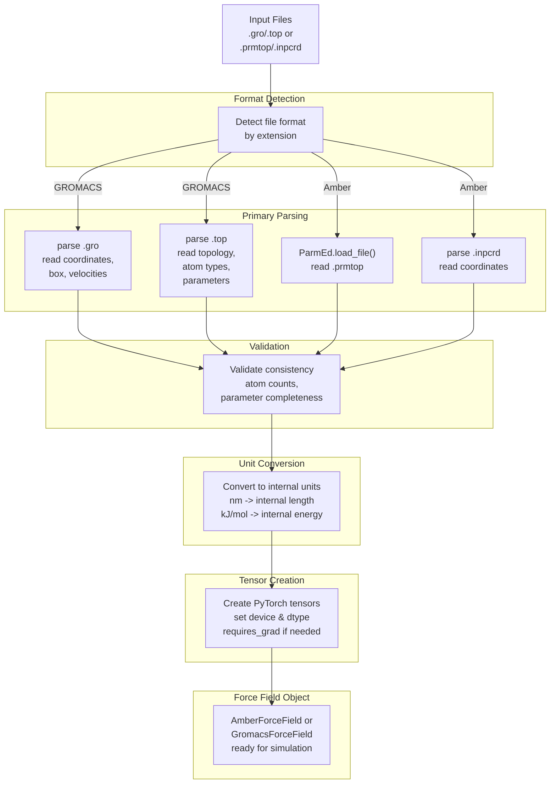
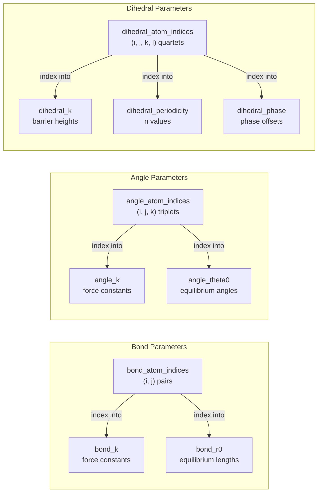
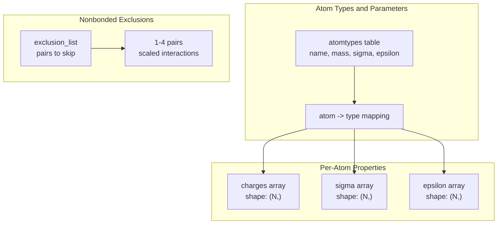
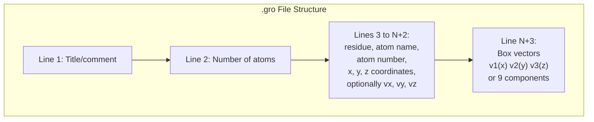
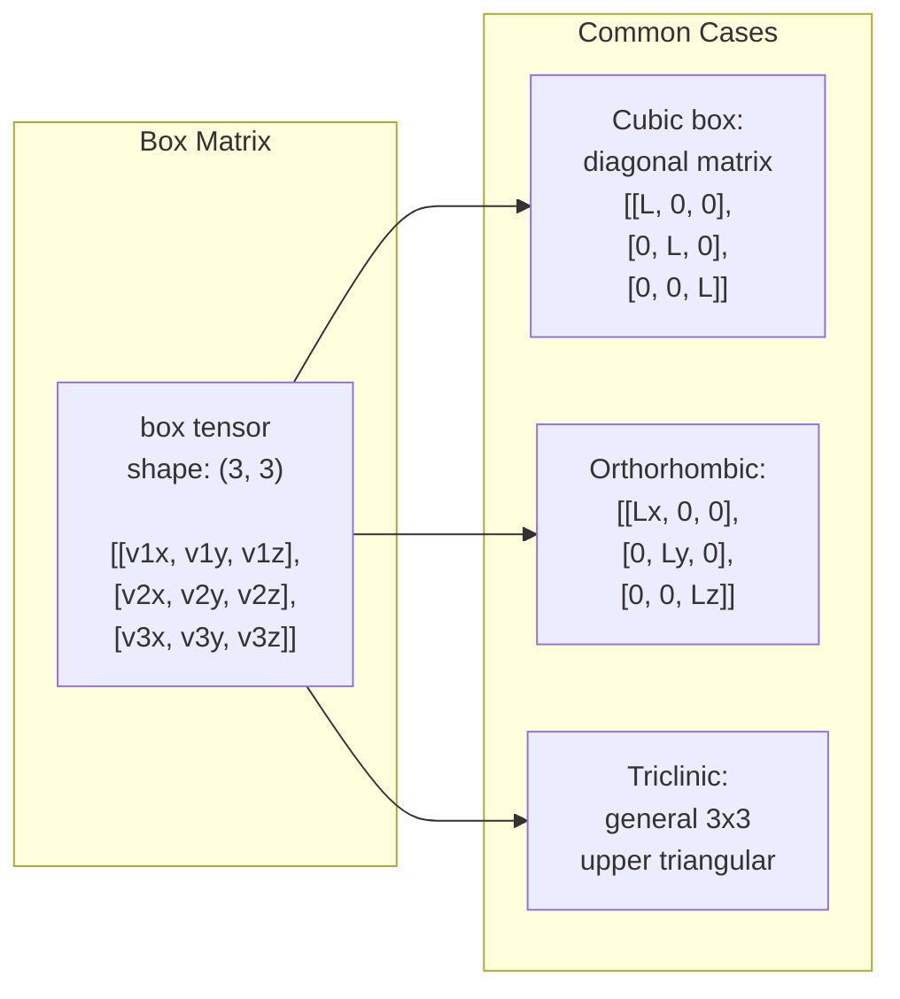
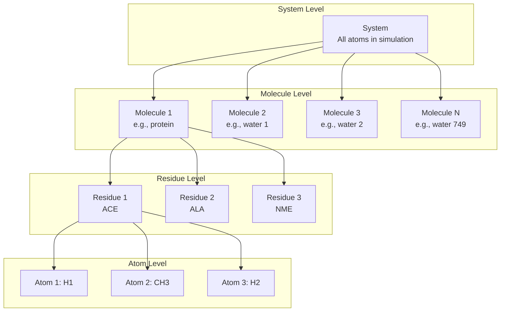
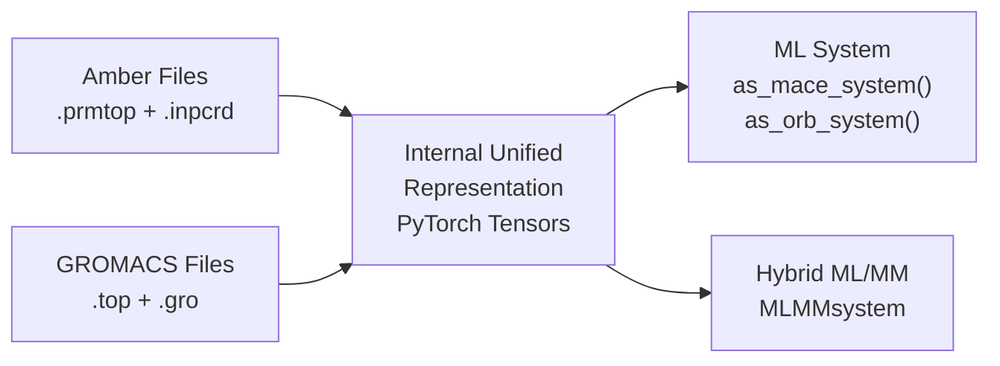

# File Formats and Data Structures

<details>
<summary>Relevant source files</summary>

The following files were used as context for generating this wiki page:

- [benchmark/proteins/ala2_tip3p.gro](benchmark/proteins/ala2_tip3p.gro)
- [benchmark/proteins/ala2_tip3p.top](benchmark/proteins/ala2_tip3p.top)
- [benchmark/proteins/trp-cage_sol.top](benchmark/proteins/trp-cage_sol.top)

</details>


This page provides an overview of the molecular structure file formats supported by DIMOS and the internal data structures used to represent molecular systems during simulations. It covers the input formats for topology, coordinates, and parameters, as well as how these are converted into PyTorch tensors for efficient GPU-accelerated computation.

For detailed specifications of specific file formats, see:
- [GROMACS File Formats](#7.1) for .gro and .top format details
- [Amber File Formats](#7.2) for .prmtop and .inpcrd format details

For information on using these formats in practice, see:
- [Classical Force Fields](#4.1) for loading topology files
- [Quick Start Tutorial](#1.2) for basic file usage examples

## Overview of Supported Formats

DIMOS supports two primary ecosystem file formats for molecular simulations: GROMACS and Amber. Each ecosystem provides a pair of files—one for topology/parameters and one for coordinates/velocities.



**Sources:** Based on Diagram 2 (Force Field Architecture) and general system architecture

### File Format Categories

| Format | Type | Contains | Read By |
|--------|------|----------|---------|
| `.gro` | Coordinates | Atomic positions, box dimensions, optionally velocities | `GromacsForceField` |
| `.top` | Topology | Atom types, bonds, angles, dihedrals, force field parameters | `GromacsForceField` |
| `.inpcrd` | Coordinates | Atomic positions, optionally velocities and box | `AmberForceField` |
| `.prmtop` | Topology | Atom types, bonds, angles, dihedrals, force field parameters | `AmberForceField` via `ParmEd` |

**Sources:** benchmark/proteins/ala2_tip3p.gro, benchmark/proteins/ala2_tip3p.top, Diagram 2

## Internal Data Representation

DIMOS converts all input data into PyTorch tensors for GPU acceleration and automatic differentiation. The core data structures represent both the instantaneous state of the system and the static force field parameters.



**Sources:** energy.py (energy calculations), constants.py (unit systems), Diagram 5

### Key Tensor Properties

All tensors maintain the following properties:
- **Device**: Can reside on CPU or CUDA GPU (`device='cuda'` or `device='cpu'`)
- **Precision**: Support for both single precision (`torch.float32`) and double precision (`torch.float64`)
- **Differentiability**: Tensors can have `requires_grad=True` for automatic differentiation
- **Unit System**: Values stored in internal units determined by unit system selection (see [Unit Systems and Physical Constants](#2.3))

**Sources:** constants.py, Diagram 6 (Unit System Management)

## File Reading and Parsing Pipeline

The process of loading molecular systems from files involves several stages of parsing and conversion.



**Sources:** Diagram 2 (Force Field Architecture), Diagram 5 (Simulation Engine)

### Parsing Implementation Details

The file parsing relies on:
- **Native Python parsers** for GROMACS `.gro` files (simple fixed-width format)
- **Custom parsers** for GROMACS `.top` files (directive-based format)
- **ParmEd library** for Amber `.prmtop` files (complex binary/ASCII format)
- **Simple parsers** for Amber `.inpcrd` files (formatted ASCII)

**Sources:** benchmark/proteins/ala2_tip3p.gro:1-100, benchmark/proteins/ala2_tip3p.top:1-50

## Force Field Parameter Data Structures

Force field parameters are organized by interaction type, with indices pointing into the parameter arrays.

### Bonded Interaction Storage



**Sources:** benchmark/proteins/ala2_tip3p.top:66-88 (bonds), benchmark/proteins/ala2_tip3p.top:134-172 (angles), benchmark/proteins/ala2_tip3p.top:173-227 (dihedrals)

### Example: Bond Data from ala2_tip3p.top

From [benchmark/proteins/ala2_tip3p.top:66-88](), the bonds section shows:
```
[ bonds ]
;    ai     aj funct         c0         c1
      2      3     1   0.10900 284512.000000
      2      4     1   0.10900 284512.000000
```

This translates to internal storage:
- `bond_atom_indices[0] = [2, 3]` (atoms involved)
- `bond_r0[0] = 0.10900` nm (equilibrium length)
- `bond_k[0] = 284512.0` kJ/(mol·nm²) (force constant)

**Sources:** benchmark/proteins/ala2_tip3p.top:66-88

### Nonbonded Interaction Storage



**Sources:** benchmark/proteins/ala2_tip3p.top:21-31 (atomtypes), benchmark/proteins/ala2_tip3p.top:38-64 (atoms)

### Example: Atom Types from ala2_tip3p.top

From [benchmark/proteins/ala2_tip3p.top:21-31](), the atomtypes section defines:
```
[ atomtypes ]
; name    at.num    mass    charge ptype  sigma      epsilon
H1             1   1.007947  0.00000000  A     0.26495328      0.0656888
C1             6  12.010780  0.00000000  A     0.33996695      0.4577296
```

Each atom in the system (lines 38-64) references these types to get its LJ parameters.

**Sources:** benchmark/proteins/ala2_tip3p.top:21-31, benchmark/proteins/ala2_tip3p.top:38-64

## Coordinate and Box Data Structures

### Coordinate File Structure (.gro format)

The `.gro` format stores coordinates in a fixed-width ASCII format:



**Sources:** benchmark/proteins/ala2_tip3p.gro:1-10

### Example: .gro File Header

From [benchmark/proteins/ala2_tip3p.gro:1-10]():
```
GROningen MAchine for Chemical Simulation
 2269
    1ACE     H1    1   1.591   1.197   1.609
    1ACE    CH3    2   1.538   1.290   1.589
```

Line 1: Title
Line 2: 2269 atoms total (22 protein atoms + 749 water molecules × 3 atoms/water)
Lines 3+: Each atom with residue info and coordinates in nm

**Sources:** benchmark/proteins/ala2_tip3p.gro:1-10

### Periodic Box Representation

DIMOS represents periodic boundary conditions using a 3×3 box matrix:



**Sources:** Diagram 5 (Simulation Loop shows box dimensions), barostats.py (box scaling)

## Molecule and Residue Organization

Molecular systems are organized hierarchically into residues and molecules.



**Sources:** benchmark/proteins/ala2_tip3p.top:34-64 (molecule definitions), benchmark/proteins/ala2_tip3p.top:229-268 (water molecules)

### Molecule Definitions in Topology Files

From [benchmark/proteins/ala2_tip3p.top:34-36]():
```
[ moleculetype ]
; Name            nrexcl
system1          3
```

The `moleculetype` directive defines a molecule template. The `nrexcl` parameter (3) means bonded neighbors up to 3 bonds apart are excluded from nonbonded interactions.

From [benchmark/proteins/ala2_tip3p.top:274-277]():
```
[ molecules ]
; Compound       #mols
system1              1
HOH                749
```

The `molecules` section specifies how many instances of each molecule type are present in the system.

**Sources:** benchmark/proteins/ala2_tip3p.top:34-36, benchmark/proteins/ala2_tip3p.top:274-277

## Memory Layout and Performance Considerations

DIMOS stores data in contiguous memory layouts for efficient GPU operations:

| Data Structure | Memory Layout | Cache Efficiency |
|----------------|---------------|------------------|
| Positions | (N, 3) contiguous | Sequential access by atom |
| Forces | (N, 3) contiguous | Sequential writes |
| Bond indices | (n_bonds, 2) | Gather operations |
| Angle indices | (n_angles, 3) | Gather operations |
| Dihedral indices | (n_dihedrals, 4) | Gather operations |
| Neighbor lists | Ragged arrays or padded | Depends on implementation |

**Optimization Notes:**
- PyTorch tensors use row-major (C-style) ordering
- Coalesced memory access on GPU requires aligned data
- Parameters stored once and indexed during force calculations
- Neighbor lists rebuilt periodically to maintain performance

**Sources:** Based on energy.py patterns, neighbor list usage in Diagram 1

## Data Validation and Consistency Checks

When loading files, DIMOS performs several validation checks:

1. **Atom Count Consistency**: Number of atoms in coordinate file matches topology
2. **Parameter Completeness**: All referenced atom types have defined parameters
3. **Index Validity**: Bond/angle/dihedral indices reference valid atoms
4. **Unit Consistency**: All parameters in expected units for the file format
5. **Exclusion List Validity**: Exclusion pairs reference valid atom indices
6. **Box Constraints**: Box dimensions compatible with simulation settings

**Sources:** Based on standard MD practice and error handling patterns in parsers

## Conversion Between Formats

DIMOS can internally convert between representations:



The `as_mace_system()` and `as_orb_system()` functions convert classical force field representations to ML potential formats, while `MLMMsystem` creates hybrid systems combining both.

**Sources:** Diagram 2 (Force Field Architecture), dimos_water_ml.py:62-76 (ML system conversion)

---