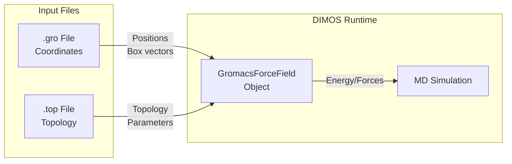
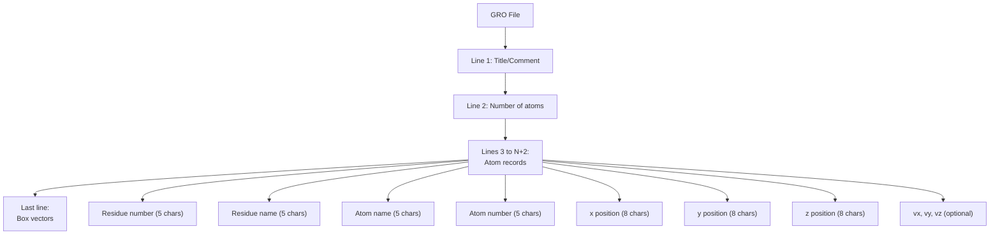
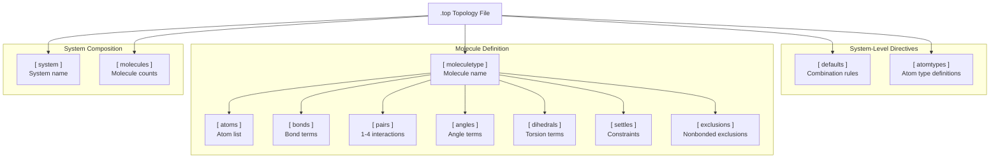
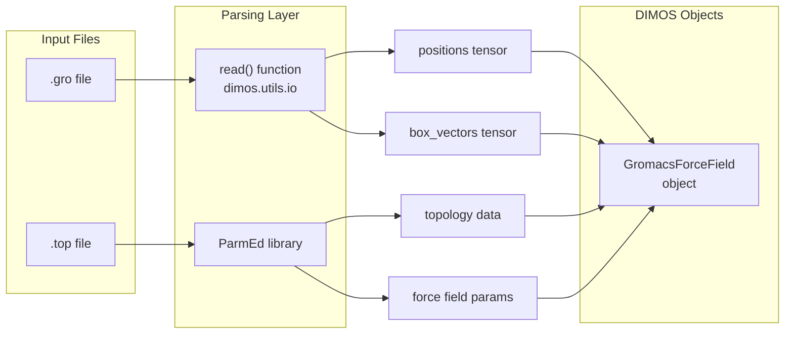

# GROMACS File Formats

<details>
<summary>Relevant source files</summary>

The following files were used as context for generating this wiki page:

- [benchmark/proteins/ala2_tip3p.gro](benchmark/proteins/ala2_tip3p.gro)
- [benchmark/proteins/ala2_tip3p.top](benchmark/proteins/ala2_tip3p.top)
- [benchmark/proteins/trp-cage_sol.gro](benchmark/proteins/trp-cage_sol.gro)
- [benchmark/proteins/trp-cage_sol.top](benchmark/proteins/trp-cage_sol.top)

</details>


This page provides a detailed specification of the GROMACS file formats used by DIMOS for molecular structure and topology input. GROMACS is a widely-used molecular dynamics package, and DIMOS supports reading its native file formats for system initialization and force field configuration.

For Amber file formats (`.prmtop` and `.inpcrd`), see [Amber File Formats](#7.2). For information on how to use these files to initialize force field objects in DIMOS, see [Classical Force Fields](#4.1).

---

## Overview

DIMOS uses two primary GROMACS file formats:

| File Type | Extension | Purpose | Contains |
|-----------|-----------|---------|----------|
| Structure File | `.gro` | Atomic coordinates and box dimensions | Atom positions, velocities (optional), box vectors |
| Topology File | `.top` | System topology and force field parameters | Atom types, bonds, angles, dihedrals, force constants |

These files work together to fully specify a molecular system: the `.gro` file provides the initial coordinates, while the `.top` file defines the connectivity, atom types, and force field parameters.

**File Format Relationship**



**Sources:** [benchmark/proteins/ala2_tip3p.gro](), [benchmark/proteins/ala2_tip3p.top]()

---

## .gro File Format (Structure Files)

The GROMACS `.gro` format is a human-readable text format for storing atomic coordinates and box dimensions. It uses fixed-width columns with positions specified in nanometers.

### File Structure



**Sources:** [benchmark/proteins/ala2_tip3p.gro:1-50]()

### Line Format Specification

| Field | Columns | Format | Units | Description |
|-------|---------|--------|-------|-------------|
| Residue number | 1-5 | `%5d` | - | Residue sequence number (right-justified) |
| Residue name | 6-10 | `%-5s` | - | Residue name (left-justified) |
| Atom name | 11-15 | `%5s` | - | Atom name (right-justified) |
| Atom number | 16-20 | `%5d` | - | Serial atom number (right-justified) |
| Position X | 21-28 | `%8.3f` | nm | X coordinate in nanometers |
| Position Y | 29-36 | `%8.3f` | nm | Y coordinate in nanometers |
| Position Z | 37-44 | `%8.3f` | nm | Z coordinate in nanometers |
| Velocity X | 45-52 | `%8.4f` | nm/ps | X velocity (optional) |
| Velocity Y | 53-60 | `%8.4f` | nm/ps | Y velocity (optional) |
| Velocity Z | 61-68 | `%8.4f` | nm/ps | Z velocity (optional) |

The last line contains box vectors:
- **Cubic box:** `v1(x) v2(y) v3(z)` (3 values)
- **Triclinic box:** `v1(x) v2(y) v3(z) v1(y) v1(z) v2(x) v2(z) v3(x) v3(y)` (9 values)

### Example Structure File

```
GROningen MAchine for Chemical Simulation
 2269
    1ACE     H1    1   1.591   1.197   1.609
    1ACE    CH3    2   1.538   1.290   1.589
    1ACE     H2    3   1.447   1.294   1.649
    1ACE     H3    4   1.511   1.294   1.483
    1ACE      C    5   1.624   1.411   1.623
    1ACE      O    6   1.738   1.396   1.666
    2ALA      N    7   1.570   1.531   1.602
    2ALA      H    8   1.476   1.539   1.566
    ...
   3.1085000  3.1085000  3.1085000
```

Key observations from the example [benchmark/proteins/ala2_tip3p.gro:1-10]():
- Line 1: Title line (free format, often contains file origin info)
- Line 2: `2269` indicates 2269 atoms total
- Atom records use 1-based indexing
- Coordinates are in nanometers (nm), not Angstroms
- Box line shows cubic box with dimensions 3.1085 × 3.1085 × 3.1085 nm

**Sources:** [benchmark/proteins/ala2_tip3p.gro:1-1075](), [benchmark/proteins/trp-cage_sol.gro:1-100]()

---

## .top File Format (Topology Files)

The GROMACS `.top` format defines the molecular topology, including atom types, bonded interactions, and force field parameters. It is a structured text format organized into sections.

### File Structure Overview



**Sources:** [benchmark/proteins/ala2_tip3p.top:17-278]()

### Section Descriptions

#### `[ defaults ]` Section

Defines system-wide defaults for nonbonded interactions.

| Column | Parameter | Description |
|--------|-----------|-------------|
| 1 | `nbfunc` | Nonbonded function type (1 = Lennard-Jones) |
| 2 | `comb-rule` | Combination rule (1 = geometric mean, 2 = Lorentz-Berthelot, 3 = geometric) |
| 3 | `gen-pairs` | Generate 1-4 pairs automatically (`yes`/`no`) |
| 4 | `fudgeLJ` | Scaling factor for LJ 1-4 interactions |
| 5 | `fudgeQQ` | Scaling factor for Coulomb 1-4 interactions |

Example from [benchmark/proteins/ala2_tip3p.top:17-19]():
```
[ defaults ]
; nbfunc  comb-rule  gen-pairs  fudgeLJ  fudgeQQ
1         2          no         1        0.83333333
```

#### `[ atomtypes ]` Section

Defines Lennard-Jones parameters for each atom type.

| Column | Parameter | Description | Units |
|--------|-----------|-------------|-------|
| 1 | `name` | Atom type identifier | - |
| 2 | `at.num` | Atomic number | - |
| 3 | `mass` | Atomic mass | amu |
| 4 | `charge` | Default charge (usually 0 in this section) | e |
| 5 | `ptype` | Particle type (A = atom, S = shell) | - |
| 6 | `sigma` | LJ sigma parameter | nm |
| 7 | `epsilon` | LJ epsilon parameter | kJ/mol |

Example from [benchmark/proteins/ala2_tip3p.top:21-31]():
```
[ atomtypes ]
; name  at.num  mass      charge   ptype  sigma      epsilon
H1      1       1.007947  0.00     A      0.26495328 0.0656888
C1      6       12.010780 0.00     A      0.33996695 0.4577296
O2      8       15.999430 0.00     A      0.31507524 0.635968
```

#### `[ moleculetype ]` Section

Begins a molecule definition.

| Column | Parameter | Description |
|--------|-----------|-------------|
| 1 | `name` | Molecule name identifier |
| 2 | `nrexcl` | Number of bonded neighbors to exclude from nonbonded interactions |

Example from [benchmark/proteins/ala2_tip3p.top:34-36]():
```
[ moleculetype ]
; Name      nrexcl
system1     3
```

The `nrexcl` value of 3 means atoms separated by up to 3 bonds are excluded from nonbonded interactions (typical for all-atom force fields).

#### `[ atoms ]` Section

Lists all atoms in the molecule with their properties.

| Column | Parameter | Description | Units |
|--------|-----------|-------------|-------|
| 1 | `nr` | Atom number (sequential) | - |
| 2 | `type` | Atom type (references `[ atomtypes ]`) | - |
| 3 | `resnr` | Residue number | - |
| 4 | `residue` | Residue name | - |
| 5 | `atom` | Atom name | - |
| 6 | `cgnr` | Charge group number | - |
| 7 | `charge` | Partial charge | e |
| 8 | `mass` | Mass | amu |

Example from [benchmark/proteins/ala2_tip3p.top:38-46]():
```
[ atoms ]
;   nr  type  resnr residue  atom  cgnr  charge      mass
     1  H1    1     ACE      H1    1     0.11230000  1.007947
     2  C1    1     ACE      CH3   2    -0.36620000  12.010780
     7  N1    2     ALA      N     7    -0.41570000  14.006720
```

#### `[ bonds ]` Section

Defines harmonic bond interactions.

| Column | Parameter | Description | Units |
|--------|-----------|-------------|-------|
| 1 | `ai` | First atom index | - |
| 2 | `aj` | Second atom index | - |
| 3 | `funct` | Function type (1 = harmonic) | - |
| 4 | `c0` | Equilibrium bond length | nm |
| 5 | `c1` | Force constant | kJ/(mol·nm²) |

Example from [benchmark/proteins/ala2_tip3p.top:66-82]():
```
[ bonds ]
;  ai  aj  funct  c0      c1
    2   3   1      0.10900 284512.000000
    5   6   1      0.12290 476976.000000
```

The energy function is: `E = 0.5 * c1 * (r - c0)²`

#### `[ pairs ]` Section

Defines 1-4 (separated by exactly 3 bonds) interactions with modified parameters.

| Column | Parameter | Description | Units |
|--------|-----------|-------------|-------|
| 1 | `ai` | First atom index | - |
| 2 | `aj` | Second atom index | - |
| 3 | `funct` | Function type (1 = standard) | - |
| 4 | `c0` | Sigma for 1-4 LJ | nm |
| 5 | `c1` | Epsilon for 1-4 LJ | kJ/mol |

Example from [benchmark/proteins/ala2_tip3p.top:90-100]():
```
[ pairs ]
;  ai  aj  funct  c0          c1
    6   8   1      0.201450018 0.120121612
    5  10   1      0.293551128 0.076870682
```

These interactions use special parameters (often geometric mean) and are scaled by `fudgeLJ` and `fudgeQQ` from `[ defaults ]`.

#### `[ angles ]` Section

Defines harmonic angle interactions.

| Column | Parameter | Description | Units |
|--------|-----------|-------------|-------|
| 1 | `ai` | First atom index | - |
| 2 | `aj` | Central atom index | - |
| 3 | `ak` | Third atom index | - |
| 4 | `funct` | Function type (1 = harmonic) | - |
| 5 | `c0` | Equilibrium angle | degrees |
| 6 | `c1` | Force constant | kJ/(mol·rad²) |

Example from [benchmark/proteins/ala2_tip3p.top:134-145]():
```
[ angles ]
;  ai  aj  ak  funct  c0          c1
    5   7   8   1      120.000051  251.040000
    4   2   5   1      109.500047  418.400000
```

The energy function is: `E = 0.5 * c1 * (θ - c0)²`

#### `[ dihedrals ]` Section

Defines torsional (dihedral) interactions.

| Column | Parameter | Description | Units |
|--------|-----------|-------------|-------|
| 1 | `ai` | First atom index | - |
| 2 | `aj` | Second atom index | - |
| 3 | `ak` | Third atom index | - |
| 4 | `al` | Fourth atom index | - |
| 5 | `funct` | Function type (1=periodic, 4=improper) | - |
| 6+ | `c0-c5` | Function-specific parameters | varies |

**Function Type 1 (Periodic/Proper Dihedral):**
```
[ dihedrals ]
;  ai  aj  ak  al  funct  phase     force   multiplicity
    6   5   7   8   1      0.000000  8.3680  1
    6   5   7   8   1      180.00    10.460  2
```
Energy: `E = c1 * (1 + cos(c2*φ - c0))`

**Function Type 4 (Improper Dihedral):**
```
[ dihedrals ]
;  ai  aj  ak  al  funct  phase     force   
    5   9   7   8   4      180.00    4.1840  2
```
Used for planarity constraints and chirality.

Example from [benchmark/proteins/ala2_tip3p.top:173-210]().

**Sources:** [benchmark/proteins/ala2_tip3p.top:134-227]()

#### `[ settles ]` Section

Defines SETTLE constraints for rigid water molecules (computational efficiency).

| Column | Parameter | Description | Units |
|--------|-----------|-------------|-------|
| 1 | `OW` | Oxygen atom index | - |
| 2 | `funct` | Function type (1 = SETTLE) | - |
| 3 | `doh` | O-H bond length | nm |
| 4 | `dhh` | H-H distance | nm |

Example from [benchmark/proteins/ala2_tip3p.top:242-244]():
```
[ settles ]
; OW  funct  doh     dhh
1     1      0.09572 0.15139
```

This is used for TIP3P water molecules. See [Molecular Constraints](#3.3) for how DIMOS handles SETTLE constraints.

#### `[ exclusions ]` Section

Explicitly lists nonbonded exclusions (atoms that should not interact via LJ or Coulomb).

```
[ exclusions ]
1  2  3
2  1  3
3  1  2
```

This format lists each atom followed by atoms it excludes. Typically generated automatically based on `nrexcl`, but can be specified explicitly for special cases like rigid water.

Example from [benchmark/proteins/ala2_tip3p.top:246-249](), [benchmark/proteins/ala2_tip3p.top:265-268]().

#### `[ system ]` Section

Provides a descriptive name for the entire system.

```
[ system ]
; Name
Generic title
```

This is purely informational and does not affect the simulation.

#### `[ molecules ]` Section

Specifies the composition of the system by listing molecule types and counts.

| Column | Parameter | Description |
|--------|-----------|-------------|
| 1 | `Compound` | Molecule name (must match a `[ moleculetype ]`) |
| 2 | `#mols` | Number of copies of this molecule |

Example from [benchmark/proteins/ala2_tip3p.top:274-277]():
```
[ molecules ]
; Compound    #mols
system1       1
HOH           749
```

This system contains 1 copy of "system1" (the alanine dipeptide) and 749 water molecules ("HOH"). The total number of atoms must match the `.gro` file: 22 (peptide) + 749×3 (water) = 2269 atoms.

**Sources:** [benchmark/proteins/ala2_tip3p.top:270-277]()

---

## Preprocessor Directives

GROMACS topology files support C-style preprocessor directives:

| Directive | Usage | Description |
|-----------|-------|-------------|
| `#include` | `#include "file.itp"` | Include another topology file |
| `#define` | `#define FLEXIBLE` | Define a macro |
| `#ifndef` | `#ifndef FLEXIBLE` | Conditional compilation (if not defined) |
| `#else` | `#else` | Alternative branch |
| `#endif` | `#endif` | End conditional block |

Example from [benchmark/proteins/ala2_tip3p.top:240-263]():
```
#ifndef FLEXIBLE

[ settles ]
; Use rigid SETTLE constraints

#else

[ bonds ]
; Use flexible bonds

#endif
```

This allows toggling between rigid and flexible water models at preprocessing time.

**Sources:** [benchmark/proteins/ala2_tip3p.top:240-263]()

---

## Usage in DIMOS

DIMOS reads GROMACS files through the `GromacsForceField` class and related utilities.

### File Reading Workflow



**Sources:** Referenced in context from [Classical Force Fields](#4.1)

### Loading GROMACS Files

While the exact implementation details are in the `dimos` package (not shown in the provided files), the typical usage pattern would be:

```python
import torch
from dimos import read  # Read .gro file
from dimos.force_field import GromacsForceField

# Read coordinates and box from .gro file
positions, box_vectors = read("system.gro")

# Initialize force field from .top file
# (uses ParmEd internally to parse topology)
force_field = GromacsForceField("system.top")

# Compute energy
energy = force_field.energy(positions, box_vectors)
```

### Force Field Parameter Mapping

GROMACS topology sections map to DIMOS energy calculation components:

| Topology Section | DIMOS Component | Energy Function |
|------------------|-----------------|-----------------|
| `[ bonds ]` | Harmonic bond terms | See [Bonded Interactions](#3.1.1) |
| `[ angles ]` | Harmonic angle terms | See [Bonded Interactions](#3.1.1) |
| `[ dihedrals ]` (type 1) | Periodic torsion terms | See [Bonded Interactions](#3.1.1) |
| `[ dihedrals ]` (type 4) | Improper torsion terms | See [Bonded Interactions](#3.1.1) |
| `[ pairs ]` | 1-4 LJ and Coulomb | See [Nonbonded Interactions](#3.1.2) |
| `[ atomtypes ]` | LJ parameters | See [Nonbonded Interactions](#3.1.2) |
| `[ settles ]` | SETTLE constraints | See [Molecular Constraints](#3.3) |
| `[ exclusions ]` | Nonbonded exclusion list | See [Nonbonded Interactions](#3.1.2) |

The `GromacsForceField` object internally stores these parameters as PyTorch tensors for efficient GPU computation.

### Unit Conversion

DIMOS performs automatic unit conversion when reading GROMACS files:

| Quantity | GROMACS Units | DIMOS Internal Units |
|----------|---------------|----------------------|
| Length | nm | Depends on `unit_system` setting |
| Energy | kJ/mol | Matches GROMACS/OpenMM convention |
| Force constants | kJ/(mol·nm²) or kJ/(mol·rad²) | Converted internally |
| Charges | e (elementary charge) | e |
| Masses | amu | amu |

See [Unit Systems and Physical Constants](#2.3) for details on unit system configuration.

**Sources:** [benchmark/proteins/ala2_tip3p.gro](), [benchmark/proteins/ala2_tip3p.top]()

---

## Benchmark System Examples

### Alanine Dipeptide in Water

The `ala2_tip3p` system is a standard benchmark:
- **Protein:** Alanine dipeptide (ACE-ALA-NME, 22 atoms)
- **Solvent:** 749 TIP3P water molecules (2247 atoms)
- **Total atoms:** 2269
- **Box:** Cubic, 3.1085 × 3.1085 × 3.1085 nm³

Files: [benchmark/proteins/ala2_tip3p.gro](), [benchmark/proteins/ala2_tip3p.top]()

### Trp-cage Miniprotein in Water

The `trp-cage_sol` system is a fast-folding protein benchmark:
- **Protein:** Trp-cage TC5B (20 residues, 304 atoms)
- **Solvent:** ~2400 water molecules (~7200 atoms)
- **Total atoms:** 7660
- **Box:** Cubic, larger than ala2_tip3p

Structure file: [benchmark/proteins/trp-cage_sol.gro:1-100]()

These benchmark systems are used in [Protein Benchmark Systems](#6.1) to evaluate DIMOS performance against OpenMM and TorchMD.

**Sources:** [benchmark/proteins/ala2_tip3p.gro:1-10](), [benchmark/proteins/ala2_tip3p.top:1-20](), [benchmark/proteins/trp-cage_sol.gro:1-100]()

---

## Comparison with Amber Formats

GROMACS and Amber formats serve similar purposes but have different structures:

| Aspect | GROMACS (.gro/.top) | Amber (.prmtop/.inpcrd) |
|--------|---------------------|-------------------------|
| Readability | Human-readable text | Binary-like text (fixed format) |
| File split | Separate structure/topology | Separate structure/topology |
| Coordinates | Nanometers | Angstroms |
| Topology sections | Named sections with keywords | Formatted blocks with %FLAG |
| Force field | Explicit in .top | Embedded in .prmtop |
| Water constraints | SETTLE keyword | Implied in SHAKE list |
| Preprocessor | C-style directives | None |

Both formats can be loaded into DIMOS through their respective force field classes (`GromacsForceField` and `AmberForceField`), which present a unified interface for energy calculations despite the different file structures.

For details on Amber formats, see [Amber File Formats](#7.2).

**Sources:** [benchmark/proteins/ala2_tip3p.gro](), [benchmark/proteins/ala2_tip3p.top]()

---