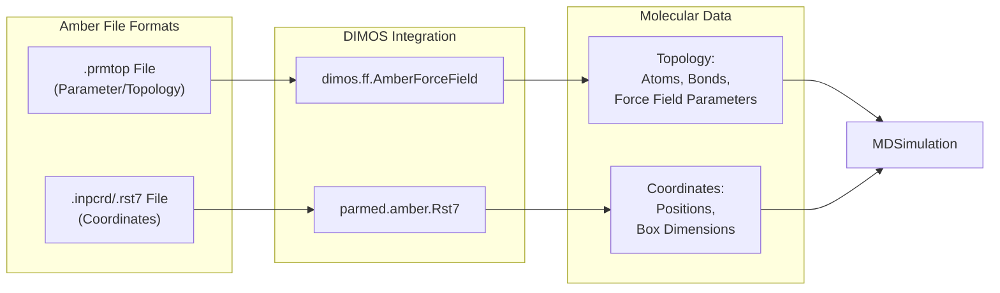
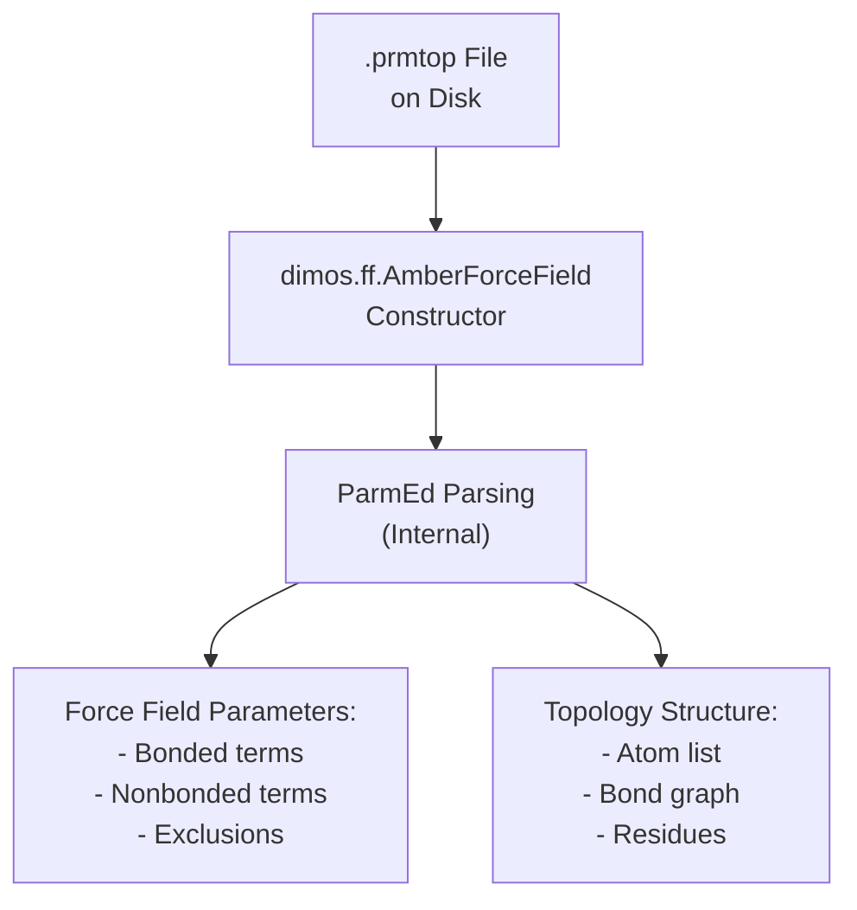
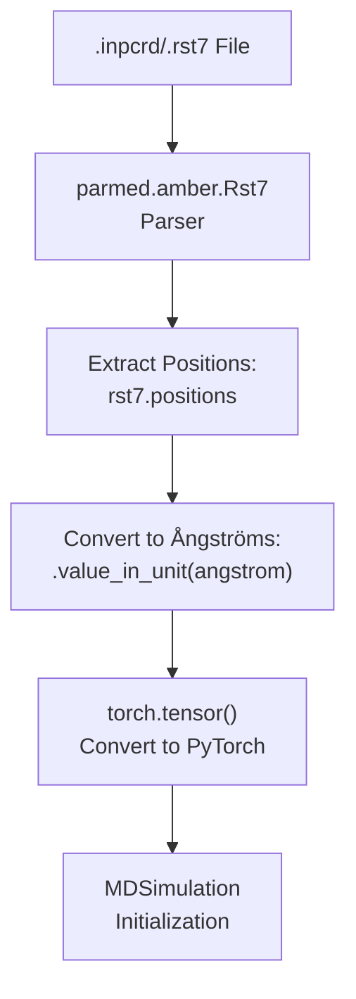
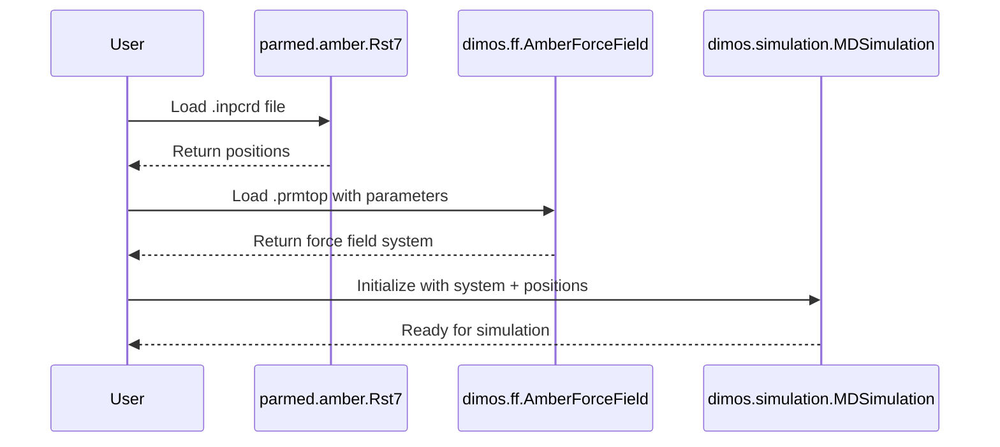
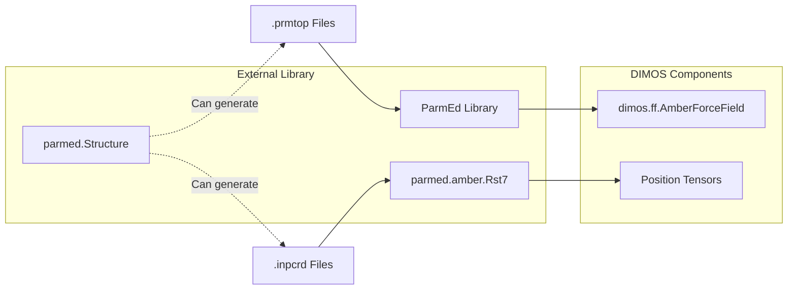
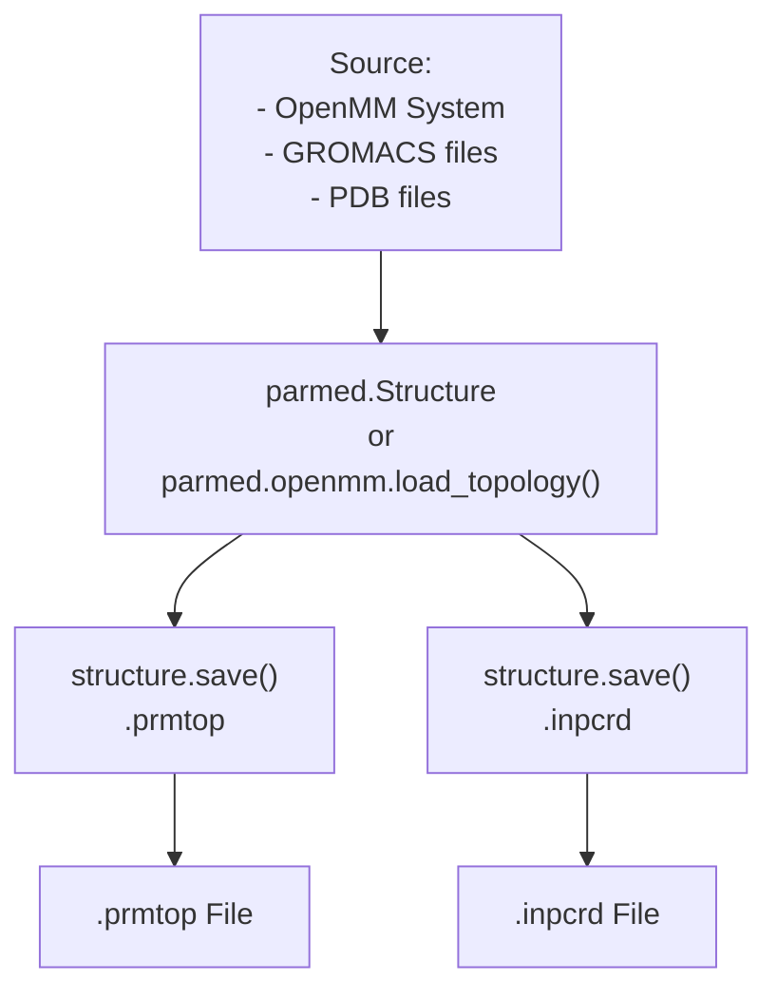
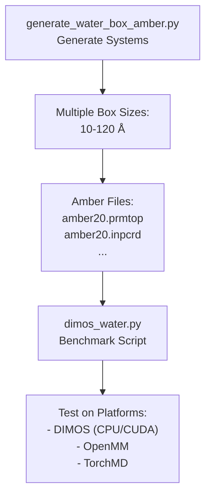

# Amber File Formats

<details>
<summary>Relevant source files</summary>

The following files were used as context for generating this wiki page:

- [benchmark/water/dimos_water.py](benchmark/water/dimos_water.py)
- [benchmark/water/generate_water_box_amber.py](benchmark/water/generate_water_box_amber.py)

</details>


## Purpose and Scope

This page documents the Amber file formats used by DIMOS for defining molecular topologies and coordinates. Amber formats are one of the two primary classical force field input methods supported by DIMOS, alongside GROMACS formats (see [GROMACS File Formats](#7.1)). 

The two key Amber file types covered here are:
- **`.prmtop`** - Parameter/topology files containing force field parameters and molecular structure
- **`.inpcrd`/`.rst7`** - Coordinate/restart files containing atomic positions and box dimensions

For information on how these files are used with the `AmberForceField` class, see [Classical Force Fields](#4.1).

---

## Overview

Amber file formats originate from the AMBER (Assisted Model Building with Energy Refinement) molecular dynamics package. DIMOS uses these formats through the ParmEd library, which provides parsing and structure manipulation capabilities.



**Sources:** [benchmark/water/dimos_water.py:58-61](), [benchmark/water/generate_water_box_amber.py:16-18]()

---

## .prmtop File Format

### Purpose and Contents

The `.prmtop` file (parameter/topology file) is a binary or ASCII file containing complete force field parameter information and molecular topology. It stores:

| Category | Contents |
|----------|----------|
| **Atom Information** | Atom types, masses, charges, Lennard-Jones parameters |
| **Connectivity** | Bond lists, angle lists, dihedral lists, improper lists |
| **Force Field Parameters** | Bond force constants and equilibrium lengths, angle parameters, torsion parameters |
| **Exclusions** | Nonbonded exclusion lists (1-2, 1-3, 1-4 interactions) |
| **Periodicity** | Box type and dimensions (if periodic) |

### File Structure

The `.prmtop` file uses a flag-based format where each section begins with a `%FLAG` marker followed by the data format specification `%FORMAT`. Common flags include:

```
%FLAG POINTERS
%FLAG ATOM_NAME
%FLAG CHARGE
%FLAG MASS
%FLAG BONDS_INC_HYDROGEN
%FLAG BONDS_WITHOUT_HYDROGEN
%FLAG ANGLES_INC_HYDROGEN
%FLAG ANGLES_WITHOUT_HYDROGEN
%FLAG DIHEDRALS_INC_HYDROGEN
%FLAG DIHEDRALS_WITHOUT_HYDROGEN
%FLAG LENNARD_JONES_ACOEF
%FLAG LENNARD_JONES_BCOEF
```

### Loading .prmtop Files in DIMOS



The `AmberForceField` class constructor accepts a `.prmtop` file path:

```python
dimos_system = dimos.ff.AmberForceField(
    'amber100.prmtop',
    cutoff=10,
    switch_distance=7.5,
    nonbonded_type='PME',
    periodic=True,
    dtype=torch.float64
)
```

**Sources:** [benchmark/water/dimos_water.py:61]()

---

## .inpcrd/.rst7 File Format

### Purpose and Contents

The `.inpcrd` (input coordinate) or `.rst7` (restart) file contains atomic coordinates and optionally velocities and box dimensions. Both extensions refer to the same format, with `.rst7` typically used for restart files from simulations.

| Field | Description | Required |
|-------|-------------|----------|
| **Title Line** | Descriptive text | Yes |
| **Atom Count** | Number of atoms | Yes |
| **Coordinates** | X, Y, Z positions in Ångströms | Yes |
| **Velocities** | X, Y, Z velocities (optional) | No |
| **Box Dimensions** | a, b, c, α, β, γ for periodic systems | If periodic |

### File Format Specification

The coordinate file follows a fixed-format structure:

```
Line 1: Title (free format string)
Line 2: NATOM (number of atoms), optionally TIME (simulation time)
Lines 3+: Coordinates (6 values per line in format 12.7)
         X1, Y1, Z1, X2, Y2, Z2, ... (in Ångströms)
Last line (optional): Box dimensions a, b, c, α, β, γ
```

Coordinates are written in Fortran format `(6F12.7)`, meaning 6 floating-point values per line, each occupying 12 characters with 7 decimal places.

### Loading .inpcrd Files in DIMOS



Loading coordinates in DIMOS uses ParmEd's `Rst7` class:

```python
rst7_file = parmed.amber.Rst7('amber100.inpcrd')
positions = torch.tensor(
    rst7_file.positions.value_in_unit(parmed.unit.angstrom)
)
```

**Sources:** [benchmark/water/dimos_water.py:58-59]()

---

## Complete Workflow: Loading Amber Files

### Standard Loading Pattern

The typical pattern for loading Amber files in DIMOS combines topology and coordinate loading:



### Code Example

```python
# Load coordinate file
rst7_file = parmed.amber.Rst7('system.inpcrd')
positions = torch.tensor(
    rst7_file.positions.value_in_unit(parmed.unit.angstrom)
)

# Load topology and create force field
dimos_system = dimos.ff.AmberForceField(
    'system.prmtop',
    cutoff=10.0,
    switch_distance=7.5,
    nonbonded_type='PME',
    periodic=True,
    dtype=torch.float64
)

# Create integrator
integrator = dimos.integrators.LangevinDynamics(
    stepsize=2.0,
    temperature=300,
    friction=1.0,
    system=dimos_system,
    dtype=torch.float64
)

# Initialize simulation
simulation = dimos.simulation.MDSimulation(
    dimos_system,
    integrator,
    positions,
    temperature=300
)
```

**Sources:** [benchmark/water/dimos_water.py:58-65]()

---

## ParmEd Integration

### Role of ParmEd Library

DIMOS relies on the ParmEd library for Amber file parsing. ParmEd provides:

| Capability | Description |
|------------|-------------|
| **File Parsing** | Reads `.prmtop` and `.inpcrd` formats |
| **Structure Manipulation** | Allows topology modifications |
| **Unit Handling** | Manages physical units and conversions |
| **Format Conversion** | Can convert between Amber/GROMACS/PDB formats |



### Unit Conversion

ParmEd handles unit conversions automatically. When extracting positions, always specify the desired unit:

```python
# Correct: Specify units explicitly
positions_angstrom = rst7_file.positions.value_in_unit(parmed.unit.angstrom)

# ParmEd also supports other units
positions_nm = rst7_file.positions.value_in_unit(parmed.unit.nanometer)
```

**Sources:** [benchmark/water/dimos_water.py:58-59]()

---

## Generating Amber Files

### Using ParmEd to Create Files

ParmEd structures can be saved to Amber format files:



### Example: Generating Water Box Files

The water box generation script demonstrates file creation:

```python
# Create system using OpenMM tools
waterbox = mmtools.testsystems.WaterBox(
    box_edge=100*parmed.unit.angstrom,
    constrained=False
)

# Convert to ParmEd structure
structure = parmed.openmm.load_topology(
    waterbox.topology,
    waterbox.system,
    waterbox.positions
)

# Save to Amber format
structure.save('amber100.prmtop', overwrite=True)
structure.save('amber100.inpcrd', overwrite=True)
```

**Sources:** [benchmark/water/generate_water_box_amber.py:7-18]()

---

## Amber Format Advantages and Limitations

### Advantages

| Advantage | Description |
|-----------|-------------|
| **Compact** | Binary format is space-efficient |
| **Complete** | Single `.prmtop` contains all force field data |
| **Widely Used** | Compatible with AMBER, OpenMM, and many tools |
| **Well-Documented** | Extensive documentation and examples available |

### Limitations

| Limitation | Description |
|------------|-------------|
| **Binary Format** | `.prmtop` not easily human-readable |
| **Fixed Precision** | Coordinate precision limited by format specification |
| **No Velocities in Basic Format** | Standard `.inpcrd` doesn't include velocities (`.rst7` does) |
| **Amber-Specific** | Primarily designed for AMBER force fields |

### Comparison with GROMACS Formats

| Feature | Amber (.prmtop/.inpcrd) | GROMACS (.top/.gro) |
|---------|-------------------------|---------------------|
| **Topology Format** | Binary/ASCII hybrid | Human-readable text |
| **Coordinate Format** | Fixed-width ASCII | Fixed-width ASCII |
| **Editability** | Difficult | Easy (text-based) |
| **Tool Support** | AMBER, OpenMM, ParmEd | GROMACS, OpenMM, ParmEd |
| **Force Field Flexibility** | Amber FF primarily | Multiple FF support |

---

## Usage in DIMOS Benchmarking

### Water System Benchmarks

The DIMOS benchmarking suite extensively uses Amber formats for water simulations:



The benchmark loads systems across multiple sizes:

```python
# Parameterized by box size
box_size = int(sys.argv[3])

# Load corresponding files
rst7_file = parmed.amber.Rst7(f'amber{box_size}.inpcrd')
dimos_system = dimos.ff.AmberForceField(
    f'amber{box_size}.prmtop',
    cutoff=10,
    switch_distance=7.5,
    nonbonded_type=nonbonded,
    periodic=True,
    dtype=dtype_ff
)
```

This allows systematic performance testing across system sizes ranging from ~900 atoms (10 Å box) to ~165,000 atoms (120 Å box).

**Sources:** [benchmark/water/dimos_water.py:28, 58-61](), [benchmark/water/generate_water_box_amber.py:6-18]()

---

## Advanced: OpenMM Integration

### Loading Amber Files in OpenMM

DIMOS benchmarks also compare against OpenMM, which has native Amber format support:

```python
# OpenMM's native Amber loader
openmm_prmtop = mmapp.AmberPrmtopFile('amber100.prmtop')

# Create OpenMM system with parameters
openmm_system = openmm_prmtop.createSystem(
    removeCMMotion=False,
    constraints=None,
    rigidWater=False,
    nonbondedMethod=mmapp.forcefield.PME,
    nonbondedCutoff=10*mm.unit.angstrom,
    switchDistance=7.5*mm.unit.angstrom
)
```

This allows direct performance comparisons between DIMOS and OpenMM using identical input files.

**Sources:** [benchmark/water/dimos_water.py:79-86]()

---

## File Format Summary

### Quick Reference Table

| File Type | Extension | Contains | Load Method | DIMOS Use |
|-----------|-----------|----------|-------------|-----------|
| **Topology** | `.prmtop` | Force field parameters, connectivity | `dimos.ff.AmberForceField(path)` | System initialization |
| **Coordinates** | `.inpcrd`, `.rst7` | Atomic positions, box dimensions | `parmed.amber.Rst7(path)` | Initial positions |

### Typical File Sizes

For water systems (TIP3P model):

| Box Size | Atoms | .prmtop Size | .inpcrd Size |
|----------|-------|--------------|--------------|
| 20 Å | ~900 | ~50 KB | ~20 KB |
| 50 Å | ~14,000 | ~700 KB | ~300 KB |
| 100 Å | ~110,000 | ~5 MB | ~2 MB |

**Sources:** [benchmark/water/generate_water_box_amber.py:6-18]()

---

## Best Practices

### File Management

1. **Keep Topology and Coordinates Together**: Always maintain `.prmtop` and `.inpcrd` pairs with matching names
2. **Version Control**: Topology files should be version controlled; large coordinate files may be stored separately
3. **Backup Restart Files**: `.rst7` files from production runs should be backed up regularly
4. **Validate Loading**: Always verify system size matches expectations after loading

### Performance Considerations

1. **File I/O**: Amber file loading is fast but not instantaneous for large systems
2. **Precision**: Coordinate precision in `.inpcrd` is sufficient for most applications
3. **Periodic Boundaries**: Ensure box dimensions are correctly loaded for periodic simulations
4. **Unit Consistency**: Always explicitly specify units when extracting values from ParmEd

### Troubleshooting Common Issues

| Issue | Cause | Solution |
|-------|-------|----------|
| **Atom count mismatch** | `.prmtop` and `.inpcrd` from different systems | Verify files correspond to same system |
| **Missing box dimensions** | Non-periodic system or old format | Check file has box info line |
| **Unit errors** | Forgetting to specify units | Always use `.value_in_unit()` |
| **ParmEd import errors** | Missing dependency | Install with `pip install parmed` |

**Sources:** [benchmark/water/dimos_water.py:58-61]()

---