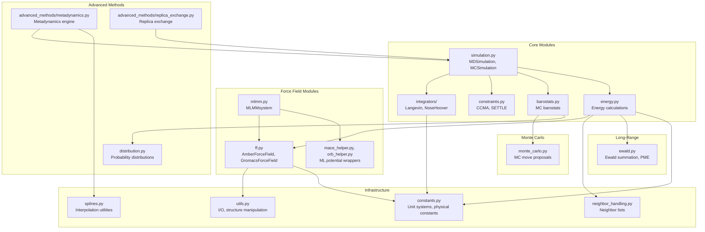
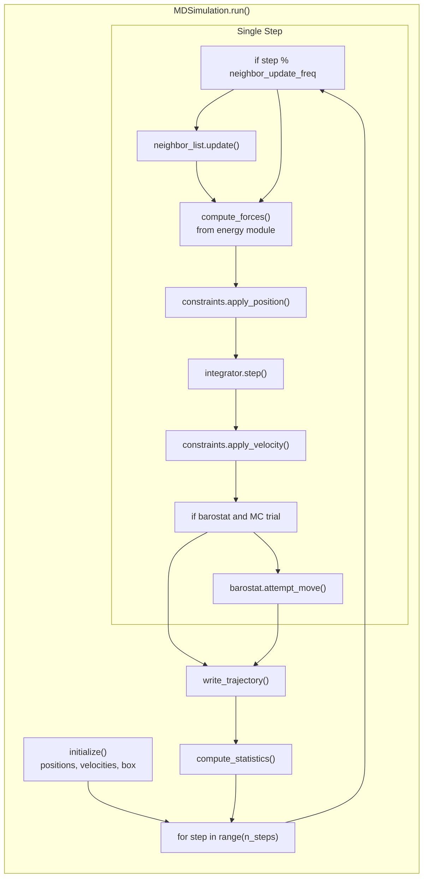
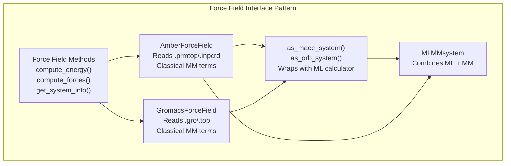
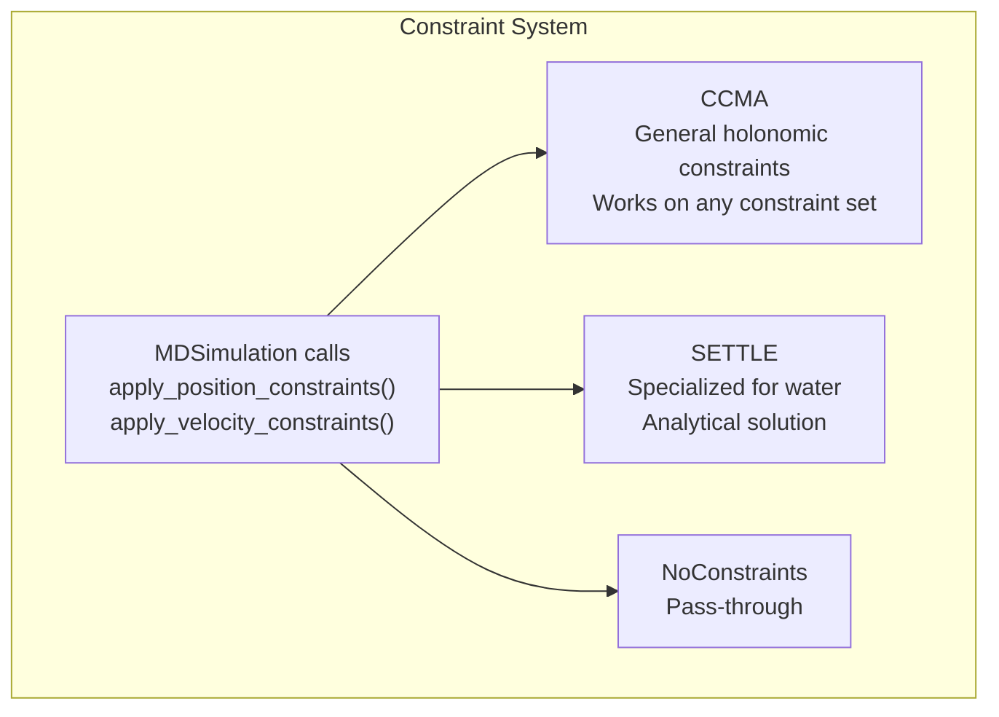

# Developer Guide

<details>
<summary>Relevant source files</summary>

The following files were used as context for generating this wiki page:

- [.gitignore](.gitignore)
- [LICENSE](LICENSE)
- [dimos/__init__.py](dimos/__init__.py)

</details>


This guide provides technical information for developers who want to contribute to DIMOS, extend its functionality, or create derivative works. It covers the codebase architecture, module organization, design patterns, and extension points.

For setting up your development environment and running tests, see [Development Environment Setup](#8.2). For guidelines on creating derivative works under the academic license, see [Creating Derivative Works](#8.3). For understanding the module organization in detail, see [Project Structure and Architecture](#8.1).

---

## Architectural Philosophy

DIMOS is designed as a modular, PyTorch-based molecular dynamics framework with three core architectural principles:

1. **Modularity**: Components are loosely coupled and can be mixed and matched (e.g., different integrators, constraints, force fields)
2. **Differentiability**: All operations use PyTorch tensors, enabling automatic differentiation through the entire simulation
3. **Extensibility**: Clear extension points for adding new force fields, integrators, sampling methods, and analysis tools

The framework follows a layered architecture where high-level simulation orchestration depends on lower-level computational kernels, with a clear separation between physics algorithms and computational infrastructure.

**Sources**: [dimos/__init__.py:1-389](), high-level architecture diagrams

---

## Module Organization

The DIMOS codebase is organized into focused modules, each handling a specific aspect of molecular simulation. The following diagram shows the primary modules and their dependencies:

### Package Structure



**Sources**: [dimos/__init__.py:374-388]()

---

## Key Classes and Their Responsibilities

The following table summarizes the primary classes in DIMOS and their roles:

| Class/Module | File | Responsibility |
|--------------|------|----------------|
| `MDSimulation` | `simulation.py` | Orchestrates MD simulation loop with integrator, constraints, and optional barostat |
| `MCSimulation` | `simulation.py` | Orchestrates Monte Carlo simulations |
| `AmberForceField` | `ff.py` | Loads and evaluates Amber topology/parameter files |
| `GromacsForceField` | `ff.py` | Loads and evaluates GROMACS topology files |
| `MLMMsystem` | `mlmm.py` | Hybrid ML/MM system combining ML potentials with classical force fields |
| `LangevinIntegrator` | `integrators/langevin.py` | Langevin dynamics integration |
| `NoseHooverIntegrator` | `integrators/nosehoover.py` | Nosé-Hoover thermostat integration |
| `CCMA` | `constraints.py` | General holonomic constraint solver using CCMA algorithm |
| `SETTLE` | `constraints.py` | Fast water molecule constraint solver |
| `MCBarostat`, `MCAnisotropicBarostat` | `barostats.py` | Monte Carlo pressure control for NPT ensembles |
| `Metadynamics` | `advanced_methods/metadynamics.py` | Metadynamics enhanced sampling |
| `ReplicaExchange` | `advanced_methods/replica_exchange.py` | Temperature replica exchange implementation |
| `NeighborList` | `neighbor_handling.py` | Cell-list based neighbor list construction |

**Sources**: [dimos/__init__.py:374-388]()

---

## Core Simulation Flow

Understanding the simulation loop is essential for extending DIMOS. The following diagram shows the data flow and method calls during a typical MD simulation step:



**Sources**: Inferred from simulation architecture diagrams and module structure

---

## Architectural Patterns

### 1. Unit System Management

DIMOS uses a centralized constant management system to ensure consistency across all calculations. The `constants.py` module provides:

```python
# Unit system initialization pattern
from dimos import constants
constants.init_constants_in_unit_system('kcal/mol')  # or 'kJ/mol' or 'lj'

# Access constants throughout codebase
coulomb_constant = constants.ONE_BY_4_PI_EPSILON_0
boltzmann = constants.BOLTZMANN
```

**Pattern**: All physical constants are accessed through module-level variables in `constants.py`. The `init_constants_in_unit_system()` function sets these values based on the chosen unit convention (Amber, GROMACS, or reduced units). This ensures all components use consistent units without passing unit information through every function call.

**Sources**: [dimos/__init__.py:376](), constants module reference from diagrams

---

### 2. Force Field Plugin Architecture

Force fields in DIMOS follow an interface pattern where different implementations provide the same core methods:



**Pattern**: Force field classes implement a common interface for energy/force computation. Conversion functions (`as_mace_system()`, `as_orb_system()`) wrap existing force fields with ML calculators. This allows seamless substitution and hybrid combinations.

**Extension Point**: To add a new force field:
1. Implement `compute_energy()` and `compute_forces()` methods returning tensors
2. Provide `get_system_info()` returning atom counts, masses, box dimensions
3. Optionally support conversion to ML-based systems

**Sources**: [dimos/__init__.py:379](), [dimos/__init__.py:381](), force field architecture diagram

---

### 3. Integrator Interface

Integrators follow a strategy pattern where different integration schemes implement a common interface:

```python
# Integrator interface pattern
class IntegratorBase:
    def step(self, positions, velocities, forces, dt):
        """Single integration step, returns updated positions/velocities"""
        pass
```

**Extension Point**: To implement a new integrator:
1. Create a class in the `integrators/` directory
2. Implement `step()` method taking positions, velocities, forces, timestep
3. Use `constants.FS_TO_INTERNAL` for time unit conversion
4. Return updated positions and velocities as PyTorch tensors
5. Import in `integrators/__init__.py`

**Sources**: [dimos/__init__.py:380](), integrator module structure

---

### 4. Constraint Algorithm Plugin

Constraints use a plugin pattern where specific algorithms can be swapped:



**Extension Point**: To add a new constraint algorithm:
1. Implement `apply_position_constraints(positions, velocities, ...)` 
2. Implement `apply_velocity_constraints(positions, velocities, ...)`
3. Handle periodic boundary conditions if applicable
4. Ensure constraint satisfaction to specified tolerance

**Sources**: [dimos/__init__.py:375](), constraints module

---

## Extension Points for Advanced Sampling

### Collective Variables

Metadynamics uses an abstract `CollectiveVariable` interface:

```python
# CV interface pattern
class CollectiveVariable:
    def compute(self, positions, box):
        """Compute CV value and derivatives"""
        return cv_value, cv_derivatives
```

**Extension Point**: To add a new collective variable:
1. Inherit from `CollectiveVariable` base class
2. Implement `compute()` returning CV value and gradients w.r.t. positions
3. Specify periodicity bounds if CV is periodic (e.g., dihedral angles)
4. Register with metadynamics engine

**Sources**: [dimos/__init__.py:387](), advanced_methods module, metadynamics diagram

---

### Distribution Classes for Sampling

The `distribution.py` module provides probability distribution classes used in advanced sampling:

| Class | Purpose | Use Case |
|-------|---------|----------|
| `ContinuousDistribution` | Standard normal distribution | Langevin noise, MC proposals |
| `DiscretizedDistribution` | Histogram-based distribution | Bias potential representation |
| `TruncatedNormalDistribution` | Bounded normal distribution | Constrained sampling |
| `FoldedNormalDistribution` | Periodic distribution | Angular sampling |

**Extension Point**: Add new distributions by implementing `sample()` and `log_prob()` methods.

**Sources**: [dimos/__init__.py:387](), distribution module

---

## PyTorch Integration and Differentiability

DIMOS is built on PyTorch, which provides several key capabilities:

### Automatic Differentiation

All force calculations naturally support `torch.autograd`:

```python
# Energy is differentiable
positions.requires_grad_(True)
energy = forcefield.compute_energy(positions, box)
forces = -torch.autograd.grad(energy.sum(), positions)[0]
```

### JIT Compilation

DIMOS supports `torch.compile()` for performance:

```python
# Compilation pattern used in benchmarks
compiled_step = torch.compile(simulation_step_function)
```

**Note**: Compilation adds overhead on first call but accelerates subsequent iterations. Best for long simulations (>1000 steps).

**Sources**: Benchmark files show compilation patterns, PyTorch architecture

---

## Working with Neighbor Lists

The `neighbor_handling.py` module provides efficient neighbor list construction using cell lists:

```python
# Neighbor list usage pattern
from dimos import NeighborList

neighbor_list = NeighborList(cutoff=12.0, skin=2.0)
neighbors = neighbor_list.compute(positions, box)
# neighbors is sparse tensor or pair list
```

**Key Parameters**:
- `cutoff`: Interaction cutoff distance
- `skin`: Extra distance for neighbor list buffering (reduces rebuild frequency)
- Update frequency: Typically every 10-20 steps depending on temperature

**Extension Point**: Custom neighbor list implementations can be added by implementing the same interface.

**Sources**: [dimos/__init__.py:383](), neighbor_handling module

---

## File I/O and Structure Manipulation

The `utils.py` module provides functions for reading/writing molecular structure files:

```python
# Common I/O patterns
from dimos.utils import read_gromacs_files, write_pdb

positions, box, topology = read_gromacs_files('system.gro', 'system.top')
write_pdb(positions, box, topology, 'output.pdb')
```

**Supported Formats**:
- Input: `.gro`, `.top`, `.prmtop`, `.inpcrd`, `.pdb`
- Output: `.pdb`, `.xtc` (trajectory)

**Extension Point**: Add new file format parsers by implementing reader functions in `utils.py`.

**Sources**: [dimos/__init__.py:386](), utils module

---

## Testing and Validation

DIMOS includes comprehensive benchmarking infrastructure for validation:

### Test Systems

Located in `benchmarks/`:
- `benchmark_proteins.py`: Protein system benchmarks (ala2, DHFR, Trp-cage)
- `dimos_water.py`: Classical water benchmarks
- `dimos_water_ml.py`: ML potential water benchmarks

### Benchmark Patterns

```python
# Typical benchmark structure
1. Load system from files
2. Initialize force field with specific parameters
3. Run simulation with/without compilation
4. Compare against reference (OpenMM, TorchMD)
5. Report timing and energy conservation
```

**Extension Point**: Add new benchmarks by following the existing patterns in the `benchmarks/` directory.

**Sources**: Benchmark suite diagram, benchmark file references

---

## Code Style and Conventions

### Naming Conventions

- **Classes**: `PascalCase` (e.g., `LangevinIntegrator`, `AmberForceField`)
- **Functions**: `snake_case` (e.g., `compute_energy`, `apply_constraints`)
- **Constants**: `UPPER_SNAKE_CASE` (e.g., `BOLTZMANN`, `ONE_BY_4_PI_EPSILON_0`)
- **Private methods**: Prefix with `_` (e.g., `_update_internal_state`)

### Documentation

- All public functions and classes should have docstrings
- Include parameter types and return types
- Note units for physical quantities
- Reference papers for algorithms when applicable

### License Headers

All source files must include the NEC Software Library Academic Use License header as shown in [dimos/__init__.py:1-372](). This is required for both core code and derivative works.

**Sources**: [dimos/__init__.py:1-389](), [LICENSE:1-372]()

---

## Key Design Decisions

### Why PyTorch?

1. **Automatic differentiation**: Enables ML/MM hybrid approaches and force field parameterization
2. **GPU acceleration**: Native CUDA support without custom kernels
3. **Ecosystem integration**: Easy integration with ML frameworks (MACE, ORB)
4. **JIT compilation**: `torch.compile()` provides performance competitive with C++

### Why Not OpenMM Integration?

DIMOS is a standalone implementation rather than wrapping OpenMM because:
1. Full control over differentiability
2. Simpler integration with ML potentials
3. Easier modification and extension for research
4. Transparent implementation for educational purposes

OpenMM is used as a validation reference in benchmarks but not as a backend.

**Sources**: Architecture philosophy from diagrams and README context

---

## Next Steps for Developers

1. **Set up development environment**: See [Development Environment Setup](#8.2) for installation instructions, running tests, and optional dependencies
2. **Understand project structure**: See [Project Structure and Architecture](#8.1) for detailed module organization
3. **Review licensing requirements**: See [Creating Derivative Works](#8.3) for academic license compliance when extending DIMOS
4. **Explore benchmark code**: The `benchmarks/` directory contains practical examples of setting up and running simulations
5. **Join the community**: Contribute via GitHub pull requests following the license requirements in [LICENSE:70-99]()

---

## Getting Help

For questions about extending DIMOS:
- Review existing implementations in similar modules
- Check benchmark scripts for usage examples  
- Refer to cited papers in comments for algorithm details
- Ensure compliance with license terms in [LICENSE:1-372]()

**Sources**: [LICENSE:1-372](), [dimos/__init__.py:1-389](), [.gitignore:1-181]()

---