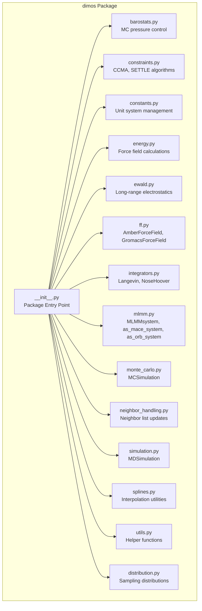
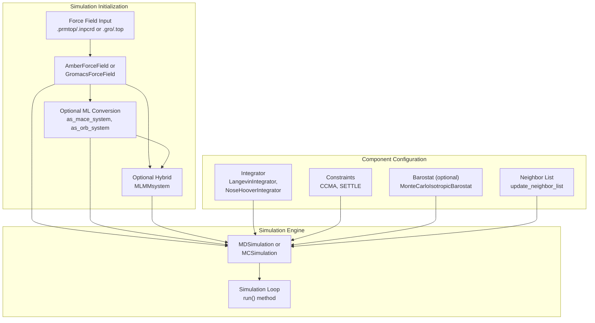
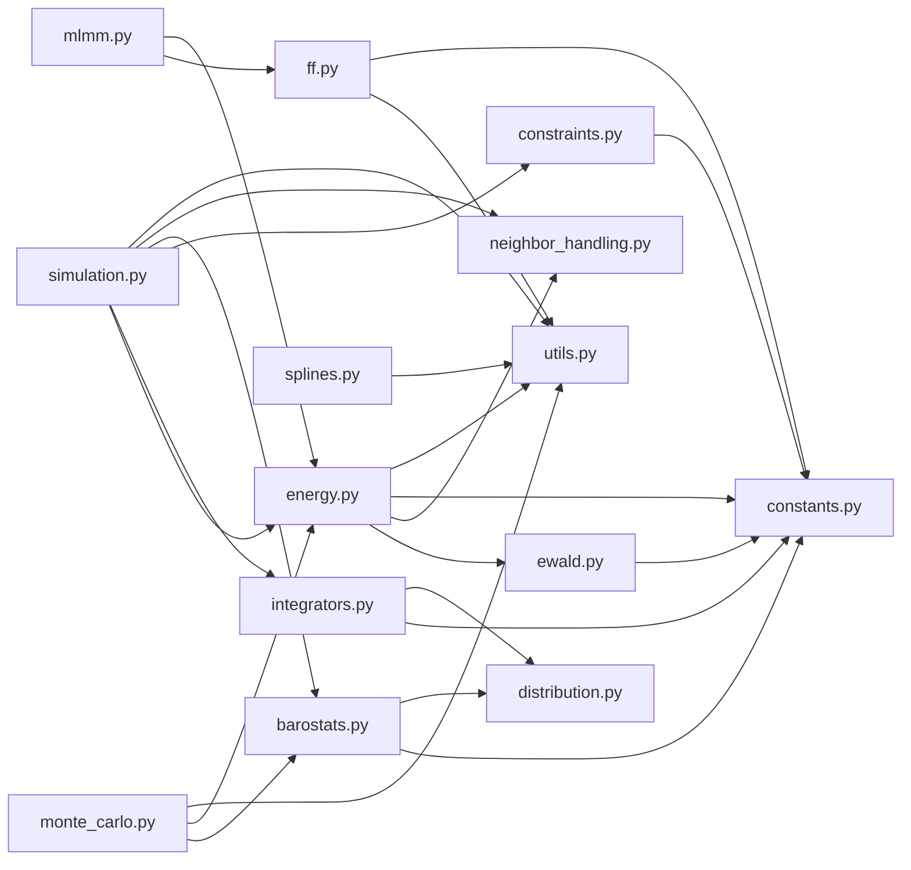
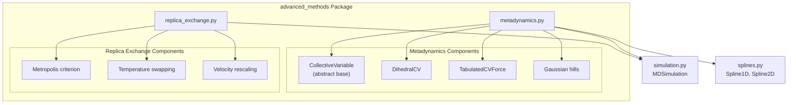
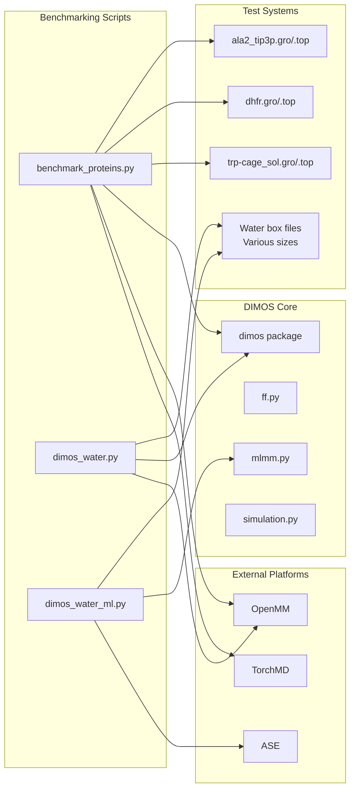
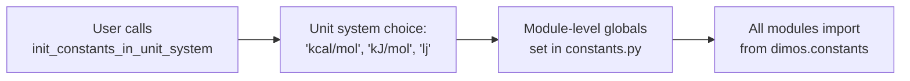
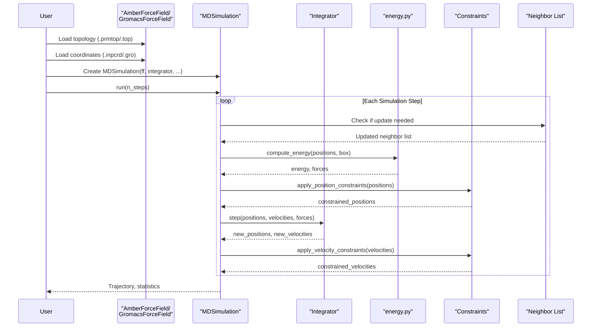

# Project Structure and Architecture

<details>
<summary>Relevant source files</summary>

The following files were used as context for generating this wiki page:

- [.gitignore](.gitignore)
- [dimos/__init__.py](dimos/__init__.py)

</details>


## Purpose and Scope

This document describes the organizational structure of the DIMOS codebase, including the module hierarchy, package organization, and key architectural patterns. It provides a map from conceptual components to actual code entities (classes, modules, functions) to help developers navigate and extend the framework.

For information about setting up a development environment and running tests, see [Development Environment Setup](#8.2). For guidelines on creating derivative works, see [Creating Derivative Works](#8.3).

## Directory Structure Overview

The DIMOS repository follows a standard Python package structure with clear separation between core library code, benchmarking scripts, and test systems:

```
DIMOS/
├── dimos/                    # Core library package
│   ├── __init__.py          # Package exports and license
│   ├── barostats.py         # Pressure control implementations
│   ├── constraints.py       # Molecular constraint algorithms
│   ├── constants.py         # Physical constants and unit systems
│   ├── energy.py            # Energy calculation functions
│   ├── ewald.py             # Long-range electrostatics
│   ├── ff.py                # Force field implementations
│   ├── integrators.py       # Time integration schemes
│   ├── mlmm.py              # Hybrid ML/MM systems
│   ├── monte_carlo.py       # Monte Carlo simulation engine
│   ├── neighbor_handling.py # Neighbor list management
│   ├── simulation.py        # Molecular dynamics simulation engine
│   ├── splines.py           # Interpolation utilities
│   ├── utils.py             # General utilities
│   └── distribution.py      # Probability distributions
├── advanced_methods/         # Enhanced sampling techniques
│   ├── metadynamics.py      # Metadynamics implementation
│   └── replica_exchange.py  # Replica exchange implementation
├── benchmarking/            # Performance benchmarking scripts
│   ├── benchmark_proteins.py
│   ├── dimos_water.py
│   └── dimos_water_ml.py
└── test_systems/            # Molecular system files (.gro, .top, etc.)
```

The [`.gitignore:1-181`]() file specifies standard Python exclusions plus project-specific patterns for data files, models, and trajectory outputs.

**Sources:** `.gitignore`, repository structure from high-level diagrams

## Core Package Organization

The `dimos` package is structured as a flat module hierarchy where each module has a focused responsibility. The main package initialization file [`dimos/__init__.py:374-388`]() exports all public APIs through star imports:



**Sources:** `dimos/__init__.py:374-388`

## Module Responsibilities and Key Classes

The following table maps each core module to its primary classes, functions, and responsibilities:

| Module | Key Entities | Primary Responsibility |
|--------|-------------|----------------------|
| `simulation.py` | `MDSimulation` | Main molecular dynamics simulation loop, trajectory management, statistics collection |
| `monte_carlo.py` | `MCSimulation` | Monte Carlo simulation engine for configurational sampling |
| `energy.py` | `compute_*_energy` functions | Bonded and nonbonded energy calculations, force computation |
| `ff.py` | `AmberForceField`, `GromacsForceField` | Force field parameter loading and management from topology files |
| `integrators.py` | `LangevinIntegrator`, `NoseHooverIntegrator` | Time integration schemes for MD trajectories |
| `constraints.py` | `CCMA`, `SETTLE` | Constraint algorithms for fixed bond lengths and rigid water |
| `barostats.py` | `MonteCarloIsotropicBarostat`, `MonteCarloAnisotropicBarostat` | NPT ensemble pressure control via volume moves |
| `ewald.py` | `compute_ewald_energy`, `compute_pme_energy` | Long-range electrostatic interactions |
| `neighbor_handling.py` | `update_neighbor_list` | Efficient neighbor list construction and updates |
| `constants.py` | `init_constants_in_unit_system`, physical constants | Unit system initialization (Amber, GROMACS, reduced) |
| `mlmm.py` | `MLMMsystem`, `as_mace_system`, `as_orb_system` | ML potential integration and hybrid ML/MM setup |
| `splines.py` | `Spline1D`, `Spline2D` | Interpolation for tabulated potentials |
| `distribution.py` | `ContinuousDistribution`, `DiscretizedDistribution` | Probability distributions for enhanced sampling |
| `utils.py` | Helper functions | File I/O, coordinate transformations, utilities |

**Sources:** `dimos/__init__.py:374-388`, high-level system architecture diagram

## Architectural Pattern: Modular Simulation Engine

DIMOS follows a **modular composition pattern** where the simulation engine (`MDSimulation` or `MCSimulation`) orchestrates loosely-coupled components:



This design allows developers to:
- Swap integrators without modifying energy calculations
- Enable/disable constraints independently
- Add new force field types by implementing the force field interface
- Mix classical and ML potentials through the hybrid system

**Sources:** High-level system architecture diagram (Diagram 1), force field architecture diagram (Diagram 2)

## Dependency Graph: Core Module Interactions

The following diagram shows the dependency relationships between core modules. Arrows indicate "imports from" or "depends on":



**Key architectural observations:**

1. **`constants.py` is a foundation module** - It has no dependencies and is used by `energy.py`, `ewald.py`, `integrators.py`, `barostats.py`, and `constraints.py` to ensure consistent physical constants.

2. **`energy.py` is a central computation hub** - It depends on `ewald.py` for long-range interactions, `neighbor_handling.py` for efficiency, and provides force calculations to both `simulation.py` and `monte_carlo.py`.

3. **`simulation.py` orchestrates everything** - The MD simulation engine composes energy calculations, integrators, constraints, barostats, and neighbor lists.

4. **`mlmm.py` bridges classical and ML** - It depends on `ff.py` for classical force field infrastructure and provides conversion functions to ML-based systems.

**Sources:** `dimos/__init__.py:374-388`, inferred from module responsibilities

## Advanced Methods Subsystem

Enhanced sampling methods are implemented as a separate subsystem that extends the core simulation engine:



The `advanced_methods` package provides experimental features that integrate with the base `MDSimulation` class. For detailed information on these methods, see [Metadynamics](#5.1) and [Replica Exchange and Parallel Tempering](#5.2).

**Sources:** High-level system architecture diagram (Diagram 4), advanced methods subsystem description

## Benchmarking Infrastructure

The benchmarking suite is organized as standalone scripts that use the core `dimos` library:



Benchmarking scripts are located in the `benchmarking/` directory and are not part of the core package. They demonstrate usage patterns and provide performance comparisons. For details on running benchmarks, see [Protein Benchmark Systems](#6.1) and [Water System Benchmarks](#6.2).

**Sources:** High-level system architecture diagram (Diagram 3), benchmarking ecosystem diagram

## Key Architectural Patterns

### 1. PyTorch-First Design

All computation is implemented using PyTorch tensors and operations, enabling:
- **GPU acceleration**: Automatic CUDA support when tensors are on GPU
- **Automatic differentiation**: Full gradient tracking through force calculations
- **JIT compilation**: `torch.compile` optimization of simulation loops and energy functions

### 2. Unit System Abstraction

The [`constants.py`]() module implements a **global state pattern** for unit system management:



This ensures consistency across all calculations. See [Unit Systems and Physical Constants](#2.3) for details on available unit systems.

### 3. Force Field Interface Pattern

Force field classes (`AmberForceField`, `GromacsForceField`) provide a **factory pattern** for creating simulation systems:

- Load topology and coordinate files
- Parse force field parameters
- Provide methods to compute energies and forces
- Can be converted to ML-based systems via `as_mace_system()` or `as_orb_system()`

This abstraction allows swapping force fields without changing simulation code. See [Force Field Systems](#4) for comprehensive coverage.

### 4. Constraint Algorithm Strategy Pattern

The constraint system uses a **strategy pattern** where different constraint algorithms implement the same interface but use different mathematical approaches:

| Class | Algorithm | Use Case |
|-------|-----------|----------|
| `CCMA` | Cascading Coordinate Method | General holonomic constraints |
| `SETTLE` | Analytical solution | Rigid water molecules (optimized) |

Constraints are applied in two stages within the integration loop: position constraints after force calculation, and velocity constraints after integration. See [Molecular Constraints](#3.3) for implementation details.

### 5. Neighbor List Optimization

The [`neighbor_handling.py`]() module implements a **caching strategy** to avoid recomputing pairwise distances every step:

- Maintain a neighbor list with a buffer distance (`skin_distance`)
- Only update when atoms move beyond the buffer
- Reduce computational complexity from O(N²) to O(N) for most steps

**Sources:** High-level system architecture diagram (Diagram 5), inferred from module organization

## Extension Points for Developers

DIMOS provides several well-defined extension points:

### Adding New Integrators

Implement a new class in `integrators.py` with a `step()` method that updates positions and velocities. Must respect the constraint interface if enabled.

### Adding New Force Field Types

Create a new force field class in `ff.py` that:
- Loads system parameters from files
- Provides energy and force calculation methods
- Maintains parameter tensors (bonds, angles, charges, etc.)

### Adding New Collective Variables for Metadynamics

Subclass `CollectiveVariable` in `advanced_methods/metadynamics.py` and implement:
- `compute()`: Calculate CV value from coordinates
- `get_gradient()`: Compute derivative with respect to positions

### Adding New ML Potential Integrations

Add conversion functions in `mlmm.py` following the pattern of `as_mace_system()` and `as_orb_system()`:
- Accept a classical force field object
- Return a system compatible with the simulation engine
- Handle atom type mappings and unit conversions

**Sources:** High-level system architecture and inferred from modular design patterns

## Data Flow in a Typical Simulation

The following sequence shows how data flows through the system during initialization and execution:



**Sources:** High-level system architecture diagram (Diagram 5), core simulation engine data flow

## Build and Distribution Structure

The project follows standard Python packaging conventions:

- **Package definition**: `setup.py` or `pyproject.toml` (not shown in provided files, but standard practice)
- **License inclusion**: Full academic use license in [`dimos/__init__.py:1-371`]()
- **Namespace management**: All public APIs exported via [`dimos/__init__.py:374-388`]()
- **Git exclusions**: Standard Python patterns in [`.gitignore:1-181`]()

The flat module structure (no deep nesting) simplifies imports and makes the API surface obvious. All core functionality is accessible via `from dimos import *` or selective imports like `from dimos import MDSimulation, AmberForceField`.

**Sources:** `dimos/__init__.py:1-389`, `.gitignore:1-181`

---

This architecture supports DIMOS's goals of being a differentiable, flexible, and performant molecular dynamics framework while maintaining clear separation of concerns and extensibility for research applications.

---