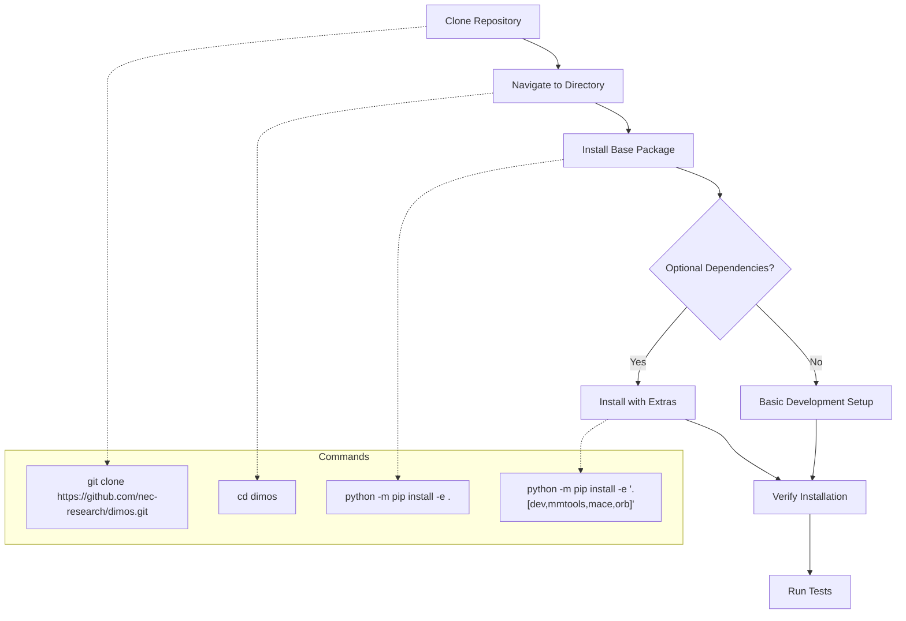
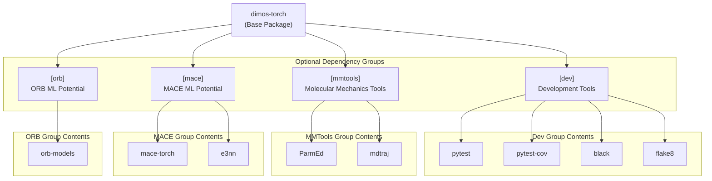
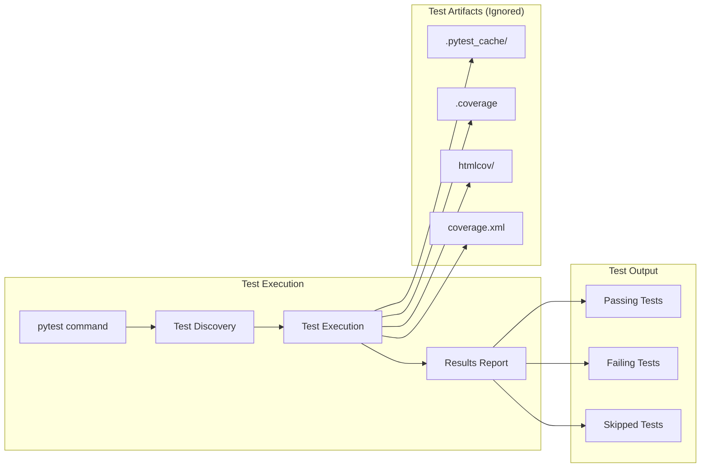
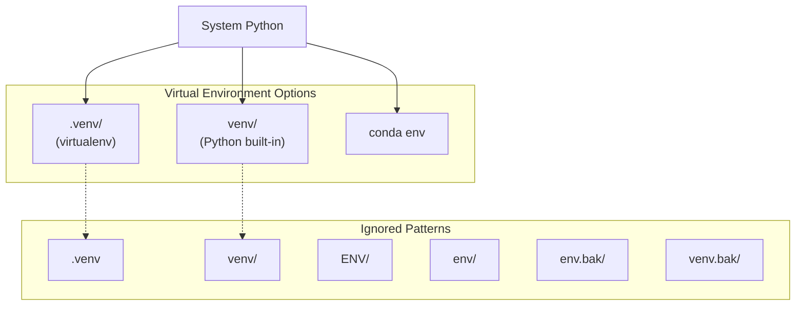
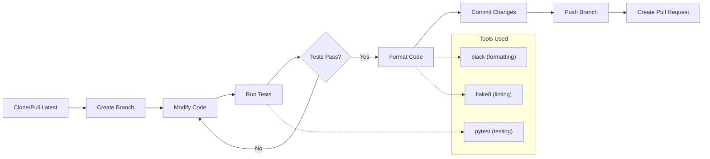

# Development Environment Setup

<details>
<summary>Relevant source files</summary>

The following files were used as context for generating this wiki page:

- [.gitignore](.gitignore)
- [README.md](README.md)

</details>


## Purpose and Scope

This page describes how to configure a development environment for contributing to DIMOS. It covers cloning the repository, installing dependencies (including optional packages for ML potentials and testing), running the test suite, and setting up development tools.

For information about the overall project structure and module organization, see [Project Structure and Architecture](#8.1). For guidelines on creating derivative works under the academic license, see [Creating Derivative Works](#8.3).

**Sources:** README.md:1-55

---

## Prerequisites

DIMOS requires Python 3.8 or later and depends on PyTorch as its core computational backend. Before setting up the development environment, ensure you have:

- Python 3.8+
- Git for version control
- A CUDA-capable GPU (optional, but recommended for performance testing)

**Sources:** README.md:26-55

---

## Repository Structure and Ignored Files

The repository uses a standard Python package layout with specific patterns for ignored files that help maintain a clean development environment.

### Ignored File Categories

The `.gitignore` configuration excludes several categories of files from version control:

| Category | Patterns | Purpose |
|----------|----------|---------|
| Python bytecode | `__pycache__/`, `*.py[cod]`, `*$py.class` | Compiled Python files |
| Distribution | `build/`, `dist/`, `*.egg-info/` | Package build artifacts |
| Testing | `.pytest_cache/`, `.coverage`, `htmlcov/` | Test execution artifacts |
| Virtual environments | `.venv`, `venv/`, `ENV/` | Isolated Python environments |
| IDE configurations | `.vscode/`, `.idea/`, `*.code-workspace` | Editor-specific settings |
| Data files | `*.pt`, `*.npy`, `*.h5`, `*.pkl`, `*.csv` | Model checkpoints and datasets |
| Trajectory files | `*.pdb`, `*.dat` | Simulation outputs |
| HPC outputs | `slurm*.out` | Batch job logs |

**Sources:** .gitignore:1-181

---

## Installation Methods

### Standard User Installation

For users who want to use DIMOS without modifying the source code:

```bash
pip install dimos-torch
```

This installs the package from PyPI with core dependencies only.

**Sources:** README.md:28-31

### Development Installation

For contributors who need to modify and test the codebase:



**Diagram: Development Installation Workflow**

#### Clone the Repository

```bash
git clone https://github.com/nec-research/dimos.git
cd dimos
```

#### Install in Editable Mode

The editable installation (`-e` flag) creates a link to the source directory, allowing code changes to take effect immediately without reinstallation:

```bash
python -m pip install -e .
```

For full development capabilities with all optional dependencies:

```bash
python -m pip install -e '.[dev,mmtools,mace,orb]'
```

**Sources:** README.md:33-39

---

## Dependency Groups

DIMOS organizes dependencies into functional groups using setuptools extras. Each group serves a specific purpose in the development and testing workflow.



**Diagram: Dependency Groups and Their Components**

### Dependency Group Purposes

| Group | Purpose | Key Packages |
|-------|---------|--------------|
| `dev` | Testing, code formatting, linting | pytest, pytest-cov, black, flake8 |
| `mmtools` | Parsing Amber/GROMACS files | ParmEd, mdtraj |
| `mace` | MACE machine learning potential | mace-torch, e3nn |
| `orb` | ORB machine learning potential | orb-models |

**Sources:** README.md:37-39

---

## Test Platform Dependencies

For running benchmark comparisons against other MD engines, additional test dependencies are required.

### TorchMD Installation

The benchmarking suite includes comparisons with TorchMD (see [Platform Comparison and Performance](#6.3)). To install TorchMD without its proprietary `moleculekit` dependency:

```bash
pip install torchmd scipy networkx pandas tqdm pyyaml --no-deps
```

The `--no-deps` flag prevents installation of moleculekit, which is not required for the DIMOS benchmark workflows.

**Sources:** README.md:41-44

---

## Testing Infrastructure

### Running Tests

The project uses pytest as its testing framework. Test artifacts are automatically excluded from version control.



**Diagram: Testing Infrastructure and Artifact Management**

### Test Commands

```bash
# Run all tests
pytest

# Run tests with coverage report
pytest --cov=dimos --cov-report=html

# Run specific test module
pytest tests/test_energy.py

# Run tests verbosely
pytest -v
```

### Test Artifacts

The following test-related files and directories are excluded from version control:

- `.pytest_cache/` - Pytest cache directory
- `.coverage` - Coverage data file
- `htmlcov/` - HTML coverage report
- `coverage.xml` - XML coverage report (for CI/CD)
- `.hypothesis/` - Hypothesis testing framework cache

**Sources:** .gitignore:40-52, README.md:37-39

---

## IDE Configuration

### Supported IDEs

The repository is configured to work with multiple development environments. IDE-specific settings are partially tracked in version control with sensible defaults.

#### Visual Studio Code

The repository includes selected VS Code configuration while excluding personal workspace files:

**Tracked:**
- `.vscode/settings.json` - Project-wide settings
- `.vscode/tasks.json` - Build and test tasks
- `.vscode/launch.json` - Debug configurations
- `.vscode/extensions.json` - Recommended extensions

**Ignored:**
- `*.code-workspace` - Personal workspace configurations
- `.vscode/` in subdirectories

#### PyCharm / IntelliJ IDEA

All JetBrains IDE configurations are excluded:
- `.idea/` directory

**Sources:** .gitignore:130-141

---

## Virtual Environment Management

### Recommended Virtual Environment Setup

Using virtual environments isolates dependencies and prevents conflicts with system packages. Multiple virtual environment patterns are excluded from version control:



**Diagram: Virtual Environment Patterns**

### Creating a Virtual Environment

```bash
# Using Python's built-in venv
python -m venv venv
source venv/bin/activate  # Linux/macOS
venv\Scripts\activate     # Windows

# Install DIMOS in editable mode
python -m pip install -e '.[dev,mmtools,mace,orb]'
```

### Deactivating the Environment

```bash
deactivate
```

**Sources:** .gitignore:104-111

---

## Development Workflow

### Code Modification Workflow



**Diagram: Development Contribution Workflow**

### Code Quality Tools

When the `[dev]` dependency group is installed, several code quality tools become available:

```bash
# Format code with black
black dimos/

# Check code style with flake8
flake8 dimos/

# Run type checking (if mypy is available)
mypy dimos/
```

**Sources:** .gitignore:122-128

---

## Working with Data Files

### Excluded Data Patterns

The development environment automatically excludes large data files from version control to keep the repository size manageable:

**Model Files:**
- `*.pt` - PyTorch model checkpoints
- `*.h5`, `*.h5ad` - HDF5 data files
- `*.pkl` - Python pickle files
- `*.tar`, `*.tar.gz` - Compressed archives

**Simulation Data:**
- `*.npy`, `*.npz` - NumPy arrays
- `*.csv` - Tabular data
- `*.pdb` - Protein Data Bank files (except reference structures)
- `*.dat` - Generic data files

**Images and Documents:**
- `*.png`, `*.svg`, `*.gif`, `*.jpg` - Image files
- `*.pdf` - PDF documents

**Sources:** .gitignore:156-181

---

## High-Performance Computing Integration

### SLURM Job Management

For developers working on HPC clusters, SLURM job output files are automatically excluded:

```bash
# Pattern matched by .gitignore
slurm*.out
```

This prevents cluttering the repository with job log files when running benchmarks or large-scale simulations on compute clusters.

**Sources:** .gitignore:153-154

---

## Verification and Troubleshooting

### Verifying Installation

After installation, verify the setup by importing the package and checking available modules:

```python
import dimos

# Check core functionality
print(dimos.__version__)

# Verify force field modules
from dimos import AmberForceField
from dimos import GromacsForceField

# Verify integrators
from dimos import LangevinDynamics
from dimos import NoseHooverDynamics

# Check optional ML modules (if installed)
try:
    from dimos import as_mace_system
    print("MACE support available")
except ImportError:
    print("MACE not installed")

try:
    from dimos import as_orb_system
    print("ORB support available")
except ImportError:
    print("ORB not installed")
```

### Common Installation Issues

| Issue | Likely Cause | Solution |
|-------|--------------|----------|
| Import errors for ML potentials | Missing optional dependencies | Install with `pip install -e '.[mace,orb]'` |
| Test failures | Missing test dependencies | Install with `pip install -e '.[dev]'` |
| TorchMD comparison errors | Moleculekit dependency | Install with `--no-deps` flag as shown |
| CUDA errors | PyTorch CUDA version mismatch | Reinstall PyTorch with correct CUDA version |

**Sources:** README.md:48-54

---

## Environment Configuration Files

### Configuration File Patterns

The repository includes several configuration patterns that are excluded from version control:

**Environment Files:**
- `.env` - Environment variables
- `.autoenv` - Automatic environment activation
- `configs/local/default.yaml` - Local configuration overrides

**Python Environment:**
- `.python-version` - pyenv Python version specification
- `ipython_config.py` - IPython configuration
- `profile_default/` - IPython profile directory

These exclusions allow developers to maintain local configurations without affecting the shared codebase.

**Sources:** .gitignore:85-92, 143-148

---

## Getting Started with Development

### Minimal Setup Example

For a minimal development setup that allows running the core test suite:

```bash
# 1. Clone repository
git clone https://github.com/nec-research/dimos.git
cd dimos

# 2. Create virtual environment
python -m venv venv
source venv/bin/activate

# 3. Install with dev dependencies
python -m pip install -e '.[dev,mmtools]'

# 4. Run tests to verify setup
pytest
```

### Full Setup Example

For a complete development environment with all optional features:

```bash
# 1. Clone repository
git clone https://github.com/nec-research/dimos.git
cd dimos

# 2. Create virtual environment
python -m venv venv
source venv/bin/activate

# 3. Install all optional dependencies
python -m pip install -e '.[dev,mmtools,mace,orb]'

# 4. Install test platform dependencies
pip install torchmd scipy networkx pandas tqdm pyyaml --no-deps

# 5. Run full test suite
pytest -v

# 6. Run benchmark suite (optional)
python benchmarks/benchmark_proteins.py
```

**Sources:** README.md:33-54

---

## Summary

This page covered the essential steps for setting up a DIMOS development environment:

1. **Installation**: Editable installation with optional dependency groups
2. **Dependencies**: Core, dev tools, molecular mechanics tools, and ML potentials
3. **Testing**: pytest infrastructure and test artifact management
4. **IDE Support**: VS Code and JetBrains IDE configurations
5. **Virtual Environments**: Isolation of project dependencies
6. **Data Management**: Exclusion patterns for large files and simulation outputs
7. **HPC Integration**: SLURM job output handling

Developers should install at minimum the `[dev]` and `[mmtools]` extras to access the full development workflow. The `[mace]` and `[orb]` extras are required for testing ML potential functionality.

**Sources:** README.md:1-55, .gitignore:1-181

---