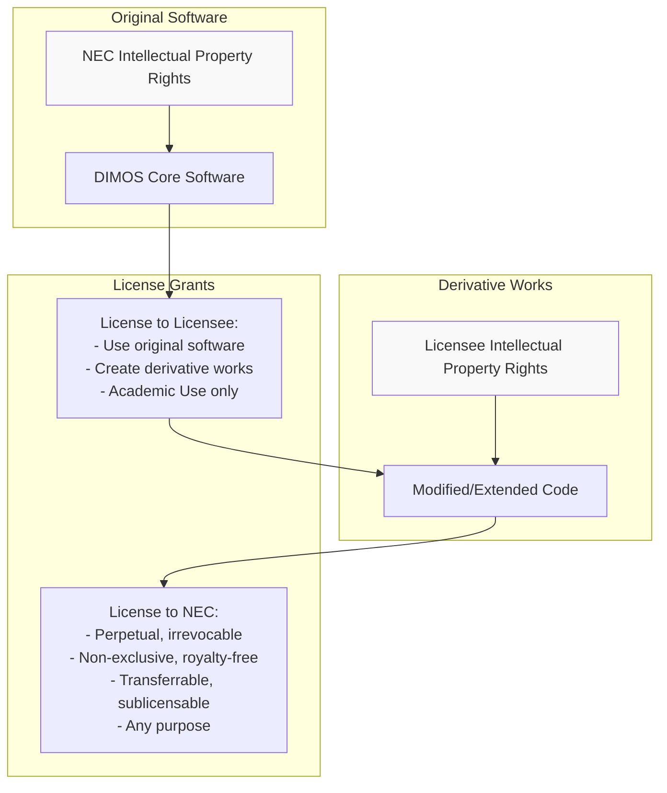
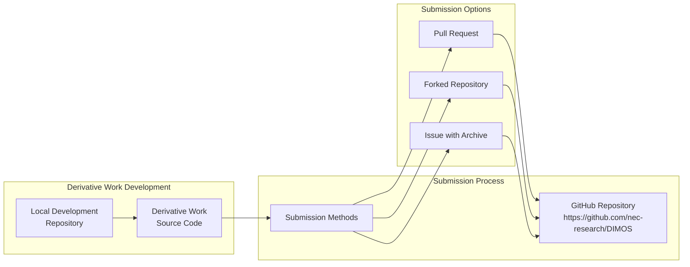
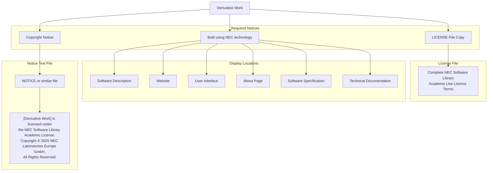
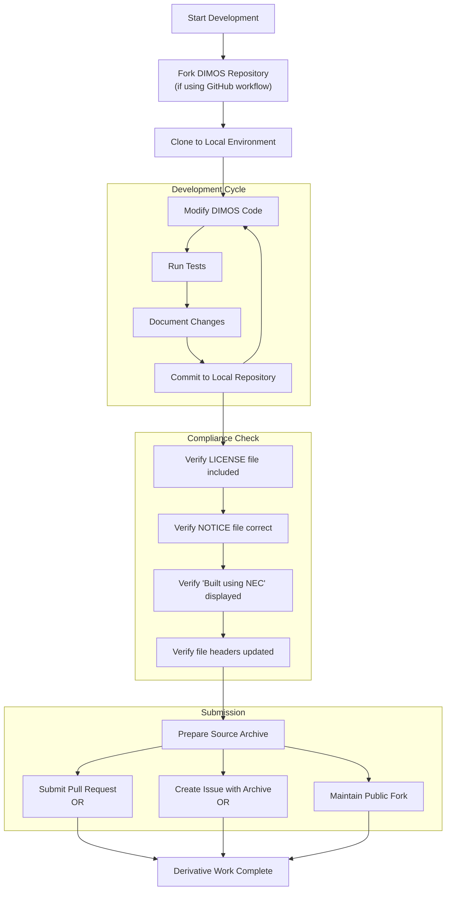

# Creating Derivative Works

<details>
<summary>Relevant source files</summary>

The following files were used as context for generating this wiki page:

- [LICENSE](LICENSE)
- [dimos/__init__.py](dimos/__init__.py)

</details>


## Purpose and Scope

This document provides technical and legal guidance for creating derivative works of the DIMOS software under the NEC Software Library Academic Use License. It covers ownership rights, mandatory compliance requirements, source code provision procedures, attribution requirements, and practical development workflows.

For general license terms and permitted uses, see [License and Academic Use Terms](#1.3). For development environment setup and contribution guidelines, see [Development Environment Setup](#8.2).

**Sources:** [LICENSE:1-372](), [dimos/__init__.py:1-372]()

---

## Definition of Derivative Works

Under the license terms, a **Derivative Work** is defined as any of the following:

| Category | Definition | Examples |
|----------|------------|----------|
| **Modifications** | Changes to existing DIMOS source code | Bug fixes, performance improvements, algorithm changes |
| **Derivative Works** | New code derived from DIMOS | Modified versions, forks, extended implementations |
| **Incorporated Software** | Products or services that use or incorporate DIMOS | Applications embedding DIMOS, research tools built on DIMOS |
| **Pull Requests** | Contributions submitted to NEC repository | Code contributions via GitHub pull requests |

A derivative work is created when:
- You modify any file in the `dimos/` package hierarchy
- You create new modules that inherit from or extend DIMOS classes
- You build software products that incorporate DIMOS functionality
- You develop services that use DIMOS as a component

**Sources:** [LICENSE:72-76](), [dimos/__init__.py:72-76]()

---

## Ownership and Licensing Model

### Intellectual Property Rights

The license establishes a dual-ownership model:



**Key Ownership Principles:**

| Aspect | Original Software | Derivative Works |
|--------|------------------|------------------|
| **IP Rights Owner** | NEC Laboratories Europe GmbH | Licensee (your organization) |
| **License Grant** | Limited license to Licensee | Perpetual license to NEC |
| **Usage Rights** | Academic Use only | NEC: any purpose<br/>Licensee: Academic Use only |
| **Transferability** | Non-transferrable | NEC can transfer/sublicense |

**Sources:** [LICENSE:77-83](), [dimos/__init__.py:77-83]()

### Academic Use Restriction

Both the original software and all derivative works are restricted to Academic Use:

- **Permitted:** Use by accredited educational or research institutions for non-commercial purposes (academic research, teaching)
- **Prohibited:** Commercial use, distribution, resale, academic-commercial collaborations, commercial entity non-commercial use

For commercial use of derivative works, a separate commercial license agreement with NEC is required.

**Sources:** [LICENSE:96-99](), [LICENSE:307-309](), [dimos/__init__.py:96-99]()

---

## Source Code Provision Requirements

### Mandatory Repository Submission

All derivative works **must** be provided to NEC via the official repository:



**Repository Location:** `https://github.com/nec-research/DIMOS`

**Submission Methods:**

1. **Pull Request (Preferred):** Submit changes via GitHub pull request to the main repository
2. **Forked Repository:** Maintain a public fork linked to the original repository
3. **Issue Attachment:** Create an issue with source code archive attached

**Required Content:**

- Complete source code of all modifications
- All new files and modules created
- Modified versions of existing files (full file, not just diffs)
- Build scripts, configuration files if modified
- Test files for new functionality

**Sources:** [LICENSE:84-85](), [dimos/__init__.py:84-85]()

### Source Code Format Requirements

When providing source code:

| Requirement | Details |
|-------------|---------|
| **File Format** | Source files in original format (.py for Python) |
| **Structure** | Preserve directory structure relative to `dimos/` |
| **Completeness** | Include all dependencies not part of standard DIMOS |
| **Documentation** | Include inline comments explaining modifications |
| **Build Instructions** | Document any changes to build/installation process |

---

## Attribution Requirements

### Mandatory Notices

Three specific attribution requirements must be satisfied:



**Sources:** [LICENSE:86-94](), [dimos/__init__.py:86-94]()

### 1. License Terms Copy

**Requirement:** Include a complete copy of the license terms with the derivative work.

**Implementation:**
- Copy [LICENSE:1-372]() file to your derivative work's root directory
- Name it `LICENSE` or `LICENSE.txt`
- Do not modify the content
- Ensure it's included in all distributions

**Example Directory Structure:**
```
my-derivative-work/
├── LICENSE           # Copy of NEC Software Library Academic Use Licence Terms
├── README.md
├── setup.py
└── my_dimos_extension/
    └── __init__.py
```

### 2. "Built using NEC technology" Notice

**Requirement:** Prominently display the text "Built using NEC technology" in multiple locations.

**Display Locations:**

| Location | Implementation Example |
|----------|----------------------|
| **Software Description** | Include in package description in `setup.py` or `pyproject.toml` |
| **Website** | Add to homepage, footer, or about section |
| **User Interface** | Display in application about dialog or help screen |
| **About Page** | Create dedicated section for acknowledgments |
| **Software Specification** | Include in technical specifications document |
| **Technical Documentation** | Add to README.md and API documentation |

**Example Implementation (README.md):**
```markdown
# My Derivative Work

A molecular dynamics extension built on DIMOS.

**Built using NEC technology**

This software is built using the DIMOS framework developed by 
NEC Laboratories Europe GmbH.
```

**Example Implementation (Python About Function):**
```python
def display_about():
    print("My Derivative Work v1.0")
    print("Built using NEC technology")
    print("Based on DIMOS framework")
```

### 3. Copyright Notice in NOTICE File

**Requirement:** Include a specific copyright notice in a notice text file.

**Notice Text Template:**
```
[Derivative Work Name] is licensed under the NEC Software Library Academic 
License. Copyright © 2025 NEC Laboratories Europe GmbH. All Rights Reserved.
```

**Implementation:**
- Create a file named `NOTICE`, `NOTICE.txt`, or similar
- Include the complete notice text
- Replace `[Derivative Work Name]` with your actual project name
- Distribute this file with all copies of the derivative work

**Example NOTICE File:**
```
MyDIMOS Extension is licensed under the NEC Software Library Academic License. 
Copyright © 2025 NEC Laboratories Europe GmbH. All Rights Reserved.

This software is a derivative work based on DIMOS (Differentiable Molecular 
Simulator), developed by NEC Laboratories Europe GmbH.

For the complete license terms, see the LICENSE file.
```

**Sources:** [LICENSE:91-94](), [dimos/__init__.py:91-94]()

---

## Documentation Requirements

### Required Documentation Files

Create and maintain the following documentation:

| File | Purpose | Required Content |
|------|---------|-----------------|
| **README.md** | Project overview | Purpose, installation, usage, NEC attribution |
| **LICENSE** | License terms | Complete copy of NEC license |
| **NOTICE** | Copyright notice | Required copyright statement |
| **CHANGELOG.md** | Modification history | List of changes from original DIMOS |
| **CONTRIBUTING.md** | Contribution guide | How others can contribute to derivative work |

### Code Documentation

**In-File Headers:**

Every modified or new file should include:

```python
# This file is part of [Derivative Work Name], a derivative work of DIMOS
# DIMOS Copyright © 2025 NEC Laboratories Europe GmbH
# 
# [Derivative Work Name] modifications Copyright © [Year] [Your Organization]
# Licensed under the NEC Software Library Academic Use License
#
# Original DIMOS source: [path to original file if applicable]
# Modifications: [brief description of changes]

# [Rest of file content...]
```

**Modification Comments:**

Mark significant changes in code:

```python
def calculate_energy(self, positions):
    # Original DIMOS implementation
    energy = self._compute_bonded(positions)
    
    # MODIFICATION: Added custom correction term for [specific purpose]
    # Author: [Your Name], [Date]
    energy += self._custom_correction(positions)
    
    return energy
```

**Sources:** [LICENSE:86-87](), [dimos/__init__.py:86-87]()

---

## Practical Development Workflow

### Development Process



**Sources:** [LICENSE:72-99](), [dimos/__init__.py:72-99]()

### File Organization Best Practices

Organize your derivative work to clearly distinguish original and modified code:

```
my-dimos-derivative/
├── LICENSE                          # Required: NEC license copy
├── NOTICE                           # Required: Copyright notice
├── README.md                        # Required: Include attribution
├── setup.py                         # Include attribution in description
├── dimos/                          # Original DIMOS code (if including)
│   ├── __init__.py
│   ├── energy.py
│   └── ...
├── dimos_extensions/               # Your new modules
│   ├── __init__.py
│   ├── custom_integrator.py       # New integration methods
│   └── enhanced_constraints.py    # New constraint algorithms
├── modified/                       # Modified DIMOS files (clearly separated)
│   ├── README.md                  # Explain what was modified and why
│   ├── energy_modified.py         # Modified version of dimos/energy.py
│   └── constraints_modified.py    # Modified version of dimos/constraints.py
├── tests/                          # Tests for modifications
│   ├── test_custom_integrator.py
│   └── test_enhanced_constraints.py
└── docs/                           # Documentation
    ├── modifications.md           # Detailed change log
    └── api.md                     # API documentation
```

### Compliance Checklist

Before submission, verify:

- [ ] **Source Code Provision**
  - [ ] All modified files included
  - [ ] All new files included
  - [ ] Directory structure preserved
  - [ ] Submission method chosen (PR/fork/issue)

- [ ] **License Files**
  - [ ] LICENSE file copied from original DIMOS
  - [ ] LICENSE file unmodified
  - [ ] LICENSE file in root directory

- [ ] **Attribution**
  - [ ] NOTICE file created with required text
  - [ ] "Built using NEC technology" in README.md
  - [ ] "Built using NEC technology" in software description
  - [ ] "Built using NEC technology" in UI/about page (if applicable)
  - [ ] "Built using NEC technology" in technical documentation

- [ ] **File Headers**
  - [ ] Copyright headers in all modified files
  - [ ] Copyright headers in all new files
  - [ ] Original file references included (for modified files)

- [ ] **Documentation**
  - [ ] README.md explains modifications
  - [ ] CHANGELOG.md documents changes
  - [ ] Inline code comments explain modifications
  - [ ] Modification markers in code

- [ ] **Repository Submission**
  - [ ] GitHub repository URL: `https://github.com/nec-research/DIMOS`
  - [ ] Pull request created OR
  - [ ] Public fork maintained OR
  - [ ] Issue with archive created

**Sources:** [LICENSE:84-94](), [dimos/__init__.py:84-94]()

---

## Common Scenarios

### Scenario 1: Bug Fix

**Situation:** You discover and fix a bug in [dimos/energy.py]().

**Requirements:**
1. Submit fixed version via pull request
2. Include license terms with submission
3. Add modification comment in code
4. If distributing separately, include all attribution

**Example Modification:**
```python
# File: dimos/energy.py
# MODIFICATION: Fixed numerical stability issue in Ewald summation
# Author: [Your Name], [Date]
# Original issue: Division by zero when cutoff equals box size

def compute_ewald_correction(self, positions, cutoff, box_size):
    # Original code had potential division by zero
    # if cutoff == box_size / 2:
    #     factor = 1.0 / (cutoff - box_size / 2)  # Division by zero!
    
    # FIXED: Added safety check
    denominator = cutoff - box_size / 2
    if abs(denominator) < 1e-10:
        denominator = 1e-10
    factor = 1.0 / denominator
    
    return factor * self._correction_term(positions)
```

### Scenario 2: New Feature Module

**Situation:** You develop a new integrator class that extends DIMOS functionality.

**Requirements:**
1. Create new module file with proper header
2. If distributing as package, include LICENSE, NOTICE, README.md
3. Display "Built using NEC technology" in package description
4. Submit source code to NEC repository

**Example New File:**
```python
# custom_integrator.py
# Part of MyDIMOS Extension
# Copyright © 2025 [Your Organization]
#
# Built using NEC technology
# This is a derivative work of DIMOS, developed by NEC Laboratories Europe GmbH
# Licensed under the NEC Software Library Academic Use License

from dimos.integrators import Integrator
import torch

class AdaptiveTimestepIntegrator(Integrator):
    """
    Custom integrator with adaptive timestep control.
    
    This is a derivative work extending the DIMOS Integrator class
    with automatic timestep adjustment based on energy conservation.
    """
    
    def __init__(self, initial_timestep=0.001, tolerance=1e-5):
        super().__init__()
        self.timestep = initial_timestep
        self.tolerance = tolerance
    
    # ... implementation ...
```

### Scenario 3: Modified Simulation Loop

**Situation:** You modify [dimos/simulation.py]() to add custom logging.

**Requirements:**
1. Provide complete modified simulation.py file
2. Document all changes in file and CHANGELOG
3. Include modification markers in code
4. Submit via GitHub

**Example Project Structure:**
```
enhanced-dimos-logging/
├── LICENSE                    # Copy of NEC license
├── NOTICE                     # Required copyright notice
├── README.md                  # Includes "Built using NEC technology"
├── CHANGELOG.md              # Documents simulation.py changes
├── modified/
│   └── simulation.py         # Modified version with change markers
└── examples/
    └── demo_enhanced_logging.py
```

**Sources:** [LICENSE:72-99](), [dimos/__init__.py:72-99]()

---

## Legal Considerations

### Commercial Use Prohibition

**Important:** Derivative works are subject to the same Academic Use restriction as the original software.

**Prohibited Activities:**
- Commercial distribution of derivative works
- Use in commercial products or services
- Academic-commercial collaborations using derivative works
- Any commercial entity use (even non-commercial purposes)

**Remedy:** For commercial use, contact NEC to negotiate a commercial license agreement.

**Sources:** [LICENSE:96-99](), [LICENSE:307-309](), [dimos/__init__.py:96-99]()

### Indemnification

The licensee is responsible for:
- Ensuring compliance with all terms
- Indemnifying NEC against third-party claims related to derivative works
- Proper use of derivative works by representatives (employees, students, contractors)

**Sources:** [LICENSE:192-197](), [dimos/__init__.py:192-197]()

### License Termination

The license can be terminated if:
- Requirements for derivative works are not met
- Source code is not provided to NEC
- Attribution requirements are not satisfied
- Commercial use occurs without separate agreement

Upon termination, all use must cease and copies must be destroyed.

**Sources:** [LICENSE:223-246](), [dimos/__init__.py:223-246]()

---

## Summary

### Essential Requirements Table

| Requirement | Mandatory | Location |
|-------------|-----------|----------|
| Provide source code to NEC | ✓ Yes | https://github.com/nec-research/DIMOS |
| Include LICENSE file copy | ✓ Yes | Root directory of derivative work |
| Include NOTICE file | ✓ Yes | Root directory with specific text |
| Display "Built using NEC technology" | ✓ Yes | Multiple visible locations |
| Grant license to NEC | ✓ Yes | Automatic upon creation |
| Academic Use only | ✓ Yes | All uses of derivative work |
| Maintain file headers | ✓ Recommended | All modified and new files |
| Document changes | ✓ Recommended | CHANGELOG.md and inline comments |

### Contact Information

For questions about derivative works or to negotiate commercial licensing:

**NEC Laboratories Europe GmbH**  
Kurfuersten-Anlage 36  
69115 Heidelberg, Germany  

**GitHub Repository:** https://github.com/nec-research/DIMOS

**Sources:** [LICENSE:328-333](), [dimos/__init__.py:328-333]()