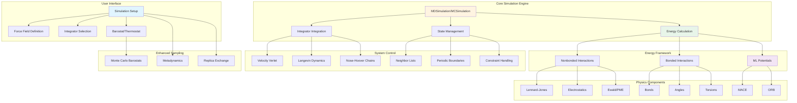

DIMOS (Differentiable Molecular Simulator) is a PyTorch-based framework designed for molecular dynamics (MD) and Monte Carlo (MC) simulations that bridges the gap between traditional simulation engines and modern machine learning workflows. The framework is built for flexibility, performance, and end-to-end differentiability, enabling seamless integration with contemporary ML pipelines for scientific computing. DIMOS supports both classical force fields and modern machine learning potentials, making it suitable for a wide range of computational chemistry and materials science applications.


Sources: [README.md](/README.md#L1-L15)

## What Makes DIMOS Different

DIMOS distinguishes itself through its differentiable architecture and PyTorch foundation. Unlike traditional molecular simulation packages that operate as black boxes, DIMOS exposes every computation through PyTorch's automatic differentiation system. This design choice enables gradient-based optimization of simulation parameters, end-to-end training of neural network potentials, and innovative hybrid approaches that combine classical molecular mechanics with machine learning methods. The framework leverages PyTorch's GPU acceleration capabilities to achieve competitive performance while maintaining the flexibility to implement custom force fields and sampling methods.

The framework supports multiple integrators, thermostats, barostats, and enhanced sampling techniques through a modular architecture. Users can seamlessly switch between different simulation ensembles (NVE, NVT, NPT), choose from various nonbonded interaction methods (cutoff, Ewald, PME), and even combine classical force fields with machine learning potentials for hybrid simulations. This modularity makes DIMOS ideal for research applications requiring methodological flexibility.

Sources: [README.md](/README.md#L1-L55), [simulation.py](/dimos/simulation.py#L374-L395)

## System Architecture

DIMOS follows a layered architectural design that separates concerns clearly while enabling efficient data flow between components. The system is organized around core modules that handle distinct aspects of molecular simulations:



This architecture enables developers to mix and match components according to their needs. For example, you can combine a classical AMBER force field with a machine learning potential using the MLMMsystem, or switch between Langevin dynamics and Nose-Hoover chains while keeping everything else constant. The differentiable nature of PyTorch tensors propagates through all components, enabling gradient computation through entire simulation workflows.

Sources: [simulation.py](/dimos/simulation.py#L403-L858), [energy.py](/dimos/energy.py#L374-L384), [ff.py](/dimos/ff.py#L374-L386)

## Project Structure

The DIMOS repository is organized to support modular development while providing clear separation between core functionality, examples, benchmarks, and tests:

```
dimos/
├── dimos/                  # Core simulation framework
│   ├── advanced_methods/   # Enhanced sampling techniques
│   ├── mlip/              # Machine learning potential interfaces
│   ├── simulation.py      # MD/MC simulation orchestration
│   ├── energy.py          # Energy calculation framework
│   ├── ff.py              # Force field implementations
│   ├── integrators.py     # Time integration methods
│   ├── barostats.py       # Pressure control
│   └── neighbor_handling.py # Neighbor list algorithms
├── examples/              # Example input files
├── benchmark/             # Performance benchmarks
├── experiments/           # Research experiments
└── tests/                 # Test suites
```

The core `dimos/` directory contains the complete simulation framework, with each module handling a specific aspect of molecular simulation. The `advanced_methods/` subdirectory provides implementations of enhanced sampling techniques like metadynamics and replica exchange molecular dynamics. The `mlip/` subdirectory contains interfaces to machine learning interatomic potentials, specifically MACE and ORB models.

Sources: [Repository Structure](/), [advanced_methods/metadynamics.py](/dimos/advanced_methods/metadynamics.py#L374-L393), [mlip/mace.py](/dimos/mlip/mace.py#L374-L387)

## Core Capabilities

DIMOS provides a comprehensive set of capabilities for molecular simulations through its modular components:

### Force Field Support

The framework supports multiple force field formats through unified interfaces:

| Force Field Type | Format | Class | Key Features |
|------------------|--------|-------|--------------|
| AMBER | prmtop/rst7 | `AmberForceField` | Standard AMBER force fields, periodic boundary conditions, multiple nonbonded methods |
| GROMACS | gro/top | `GromacsForceField` | GROMACS topology support, CHARMM-style dihedrals |
| Machine Learning | Pre-trained models | `MaceFoundationalSystem`, `OrbFoundationalSystem` | MACE and ORB potentials, periodic support, CuEq acceleration |
| Hybrid ML/MM | Combination | `MLMMsystem` | ML regions + MM regions, configurable electrostatic coupling |

This support enables users to leverage existing force field parameters while also exploring modern machine learning potentials. The hybrid ML/MM system allows treating specific atoms or regions with ML potentials while using classical force fields for the rest of the system, balancing accuracy and computational efficiency.

Sources: [ff.py](/dimos/ff.py#L374-L386), [mlmm.py](/dimos/mlmm.py#L374-L390), [mlip/mace.py](/dimos/mlip/mace.py#L374-L387)

### Integration Methods

DIMOS provides a comprehensive suite of integrators for different simulation scenarios:

| Integrator | Ensemble | Thermostat | Key Use Case |
|------------|----------|------------|--------------|
| Velocity Verlet | NVE | None | Energy conservation testing, microcanonical dynamics |
| Langevin Dynamics | NVT | Langevin | Canonical ensemble, biomolecular simulations |
| Brownian Dynamics | NVT | Friction/Noise | Overdamped dynamics, implicit solvent |
| Andersen Dynamics | NVT | Stochastic collisions | Alternative canonical thermostat |
| Berendsen Dynamics | NVT | Weak coupling | Temperature relaxation (production) |
| Lowe-Andersen | NVT | Stochastic collisions | Improved canonical thermostat |
| Nose-Hoover | NVT | Deterministic | Extended system thermostat |
| Nose-Hoover Chain | NVT | Multiple thermostats | High-performance canonical sampling |

The integrators all inherit from `CommonIntegrator`, ensuring consistent interfaces for timestep management, acceleration updates, and computation graph handling. This design makes it straightforward to switch between different thermostats without changing other simulation components.

Sources: [integrators.py](/dimos/integrators.py#L374-L381)

### Nonbonded Interactions

DIMOS implements multiple methods for computing nonbonded interactions with different trade-offs between accuracy and computational cost:

| Method | Description | Periodic | Cutoff | Best For |
|--------|-------------|----------|--------|----------|
| `NonbondedInteractionsNoCutoff` | Full pair-wise calculation | Yes | No | Small systems, validation |
| `NonbondedInteractionsCutoff` | Truncated with switching function | Yes | Yes | General-purpose simulations |
| `NonbondedInteractionsEwald` | Ewald summation | Yes | Yes | Charged systems without PME |
| `NonbondedInteractionsPME` | Particle Mesh Ewald | Yes | Yes | Large periodic charged systems |

Each method supports Lennard-Jones and electrostatic contributions, with configurable cutoff distances, switching functions, and exclusion handling for bonded atoms. The implementations leverage PyTorch's vectorized operations for efficient computation on CPU and GPU.

Sources: [energy.py](/dimos/energy.py#L402-L932)

## Key Features

### End-to-End Differentiability

Every calculation in DIMOS flows through PyTorch's automatic differentiation system, enabling gradient computation through entire simulation workflows. This differentiability supports several advanced use cases: parameter optimization for force fields, training neural network potentials, and gradient-based sampling methods like Hamiltonian Monte Carlo. The framework provides `detach_()` methods to selectively disconnect tensors from the computation graph, balancing memory efficiency with gradient requirements.

Sources: [simulation.py](/dimos/simulation.py#L668-L676), [simulation.py](/dimos/simulation.py#L845-L852)

### GPU Acceleration

DIMOS leverages PyTorch's native GPU support for accelerated computation. The framework uses vectorized operations optimized for both CPU and GPU execution, with PyTorch's `torch.compile` feature available for additional performance gains. Benchmarks demonstrate competitive performance against traditional simulation engines like OpenMM, especially for larger systems.

Sources: [benchmark/water/dimos_water.py](/benchmark/water/dimos_water.py#L66-L72)

### Neighbor List Management

Efficient neighbor list algorithms are crucial for scaling simulations to large system sizes. DIMOS implements cell list algorithms with Verlet neighbor lists, supporting both periodic and non-periodic boundary conditions. The system automatically updates neighbor lists based on atomic displacements, with configurable skin distances to balance between update frequency and computational overhead.

Sources: [neighbor_handling.py](/dimos/neighbor_handling.py#L374-L388)

### Enhanced Sampling

The framework includes advanced sampling methods for exploring complex energy landscapes:

- **Metadynamics**: History-dependent bias potentials along collective variables to help systems escape local minima, with well-tempered metadynamics for controlled bias growth
- **Replica Exchange**: Multiple replicas at different temperatures enabling crossing of high energy barriers
- **Monte Carlo Barostats**: Isotropic and anisotropic pressure control for constant pressure simulations

These methods integrate seamlessly with the simulation infrastructure, enabling users to apply them to any force field or potential implementation.

Sources: [advanced_methods/metadynamics.py](/dimos/advanced_methods/metadynamics.py#L374-L393), [barostats.py](/dimos/barostats.py#L374-L385)

## Installation and Dependencies

DIMOS requires Python 3.10 or higher and can be installed via pip or from source. The core dependencies include PyTorch (≥2.4.1), ParmEd (≥4.2.2), and NumPy (<2.0.0). Optional dependencies provide extended functionality:

| Optional Group | Packages | Purpose |
|----------------|----------|---------|
| `dev` | OpenMM, Sphinx, matplotlib | Development and documentation |
| `mmtools` | openmmtools, mdtraj, pymbar | Enhanced sampling and analysis |
| `mace` | mace-torch, cuequivariance-ops-torch-cu12 | MACE ML potentials |
| `orb` | orb-models, pynanoflann | ORB ML potentials |

The modular dependency structure allows users to install only the components they need, keeping the installation footprint minimal for basic use cases while providing access to advanced features when required.

Sources: [pyproject.toml](/pyproject.toml#L1-L60), [README.md](/README.md#L17-L30)

## Getting Started Guide

The typical workflow for running a DIMOS simulation involves three main steps: defining the force field system, creating an integrator, and setting up the simulation. Here's a minimal example that demonstrates this pattern:

```python
import dimos

# 1. Define force field system from AMBER topology
system = dimos.AmberForceField("config.prmtop", 
                               cutoff=9, 
                               switch_distance=7.5,
                               nonbonded_type="PME",
                               periodic=True)

# 2. Create integrator with timestep 0.5 fs, temperature 300 K, friction 1.0 ps⁻¹
integrator = dimos.LangevinDynamics(dt=0.5, T=300, gamma=1.0, system=system)

# 3. Initialize simulation with starting positions
simulation = dimos.MDSimulation(system, integrator, positions, T=300)

# 4. Run simulation for specified number of steps
simulation.step(num_steps=10000)
```

This example uses the AMBER force field format with PME electrostatics and Langevin dynamics for temperature control. The simulation automatically handles neighbor list updates, periodic boundary conditions, and energy calculations. For different requirements, you can substitute different force fields (e.g., `GromacsForceField`, `MaceFoundationalSystem`), integrators (e.g., `VelocityVerlet`, `NoseHooverChainDynamics`), or add barostats for pressure control.

Sources: [README.md](/README.md#L33-L42)

## Next Steps

This overview provides a high-level introduction to DIMOS and its capabilities. For hands-on experience, proceed to [Quick Start](2-quick-start) for detailed installation instructions and your first running simulation. To understand the fundamental concepts for running simulations effectively, continue to [Installation and Setup](3-installation-and-setup) and [Basic MD Simulation Workflow](4-basic-md-simulation-workflow).

For deeper exploration of DIMOS's technical architecture, the [Deep Dive](6-force-field-systems-architecture) section covers force field implementation, energy calculations, integrators, and machine learning integration in detail.