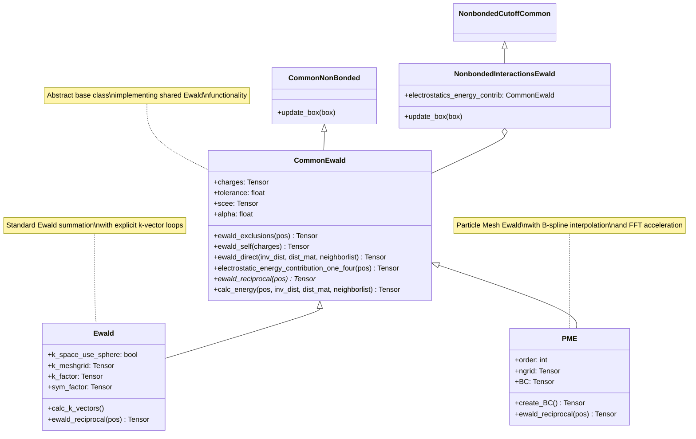
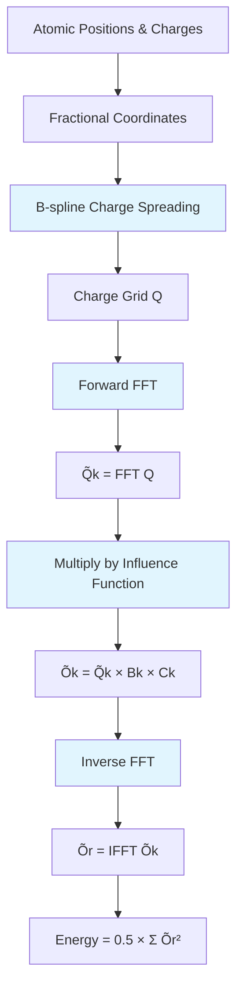

This page provides a comprehensive technical overview of electrostatic interactions in periodic molecular systems through Ewald summation and Particle Mesh Ewald (PME) methods. These algorithms enable accurate treatment of long-range Coulomb forces that are essential for realistic molecular dynamics simulations of biomolecules and condensed-phase systems. The implementation leverages PyTorch's automatic differentiation and GPU acceleration for efficient computation.

## Architectural Overview

The Ewald summation framework follows a carefully designed class hierarchy that separates common functionality from method-specific implementations. At the foundation lies `CommonEwald`, which provides the base infrastructure for both standard Ewald and PME calculations, including direct space evaluation, self-energy corrections, exclusion handling, and 1-4 interaction management. The two concrete implementations—`Ewald` and `PME`—inherit from this base and implement their respective reciprocal space calculation strategies. The system integrates with the broader energy calculation framework through `NonbondedInteractionsEwald`, which manages Lennard-Jones and electrostatic interactions together.

Sources: [dimos/ewald.py](dimos/ewald.py#L416-L513), [dimos/energy.py](dimos/energy.py#L812-L920)



## Mathematical Foundation

Ewald summation decomposes the conditionally convergent electrostatic sum into rapidly converging components through a charge screening transformation. The method introduces Gaussian charge distributions around each point charge, with the screening parameter α controlling the split between direct and reciprocal space contributions. The total electrostatic energy comprises five terms: the direct space sum using the complementary error function erfc, the reciprocal space sum computed in Fourier space, the self-energy correction accounting for Gaussian self-interaction, the exclusion correction for excluded atom pairs, and the scaled 1-4 interactions for atoms separated by three bonds.

Sources: [dimos/ewald.py](dimos/ewald.py#L416-L464)

The direct space contribution evaluates short-range interactions using erfc(αr)/r, where α determines the screening strength and the cutoff radius ensures only nearby interactions are computed explicitly. The complementary error function ensures smooth convergence of the direct sum as erfc decays rapidly to zero at distances greater than 1/α. This allows truncation at a relatively short cutoff while maintaining accuracy, with the remaining long-range contribution handled efficiently in reciprocal space.

Sources: [dimos/ewald.py](dimos/ewald.py#L560-L586)

## Direct Space Calculation

The direct space evaluation computes pairwise interactions for atoms within the cutoff radius using the screened Coulomb potential. For each pair in the neighbor list, the energy contribution is calculated as the product of charges multiplied by erfc(αr)/r, where the inverse distances and precomputed distance matrix enable efficient batched operations. This approach leverages PyTorch's vectorized operations to compute all direct space interactions simultaneously, significantly improving performance over iterative implementations.

Sources: [dimos/ewald.py](dimos/ewald.py#L560-L586)

The implementation integrates seamlessly with the neighbor list system, accepting precomputed inverse distances and distance matrices within the cutoff. This design minimizes redundant distance calculations and allows the direct space computation to scale linearly with the number of atom pairs rather than quadratically with system size. The method automatically handles periodic boundary conditions through the distance matrix computation, ensuring correct minimum image conventions for all short-range pairs.

Sources: [dimos/ewald.py](dimos/ewald.py#L632-L666)

## Reciprocal Space Methods

The reciprocal space calculation represents the algorithmic core where standard Ewald and PME diverge significantly. Both methods compute the long-range contribution using Fourier transforms, but differ in their computational strategies. Standard Ewald explicitly sums over a mesh of k-vectors determined by the box dimensions and Ewald parameter, while PME employs B-spline interpolation combined with Fast Fourier Transforms to achieve O(N log N) scaling. The choice between methods involves trade-offs between accuracy, computational efficiency, and memory requirements.

Sources: [dimos/ewald.py](dimos/ewald.py#L613-L630), [dimos/ewald.py](dimos/ewald.py#L845-L899)

### Standard Ewald Reciprocal Space

The standard Ewald implementation computes the reciprocal space contribution through explicit summation over k-vectors. The method first determines the optimal k-vector mesh dimensions using an error estimation function that ensures the truncation error remains below the specified tolerance. For each k-vector, it computes the structure factor as the sum over all atoms of charges multiplied by complex exponentials, then evaluates the reciprocal energy using the precomputed k-factor weighting that incorporates the Gaussian decay factor exp(-k²/4α²) and the k-vector magnitude.

Sources: [dimos/ewald.py](dimos/ewald.py#L845-L930)

The implementation optimizes this calculation through several techniques. It creates a meshgrid of all k-vectors with appropriate symmetry considerations, applies optional spherical cutoffs in k-space to reduce computational cost, and precomputes all distance-independent factors. The structure factor calculation uses Einstein summation for efficient computation of k·r products across all atom-k-vector combinations. Symmetry factors account for the trigonometric identity that reduces the complex exponential sum to cosine terms for k-vectors with zero components, further accelerating the computation.

Sources: [dimos/ewald.py](dimos/ewald.py#L901-L930)

| Parameter | Description | Default Value | Optimization Strategy |
|-----------|-------------|---------------|----------------------|
| `k_space_use_sphere` | Use spherical k-space cutoff | False | Reduces k-vectors by ~50% for cubic boxes |
| `sym_factor` | Trigonometric symmetry factor | 1.0 or 2.0 | Exploits cos(k·r) = cos(-k·r) identity |
| `k_factor` | Gaussian decay weighting | Precomputed | Combines exp(-k²/4α²)/k² factors |
| `tolerance` | Error tolerance | User-specified | Determines k_max through root-finding |

### Particle Mesh Ewald (PME)

PME dramatically improves computational efficiency through grid-based interpolation and FFT acceleration. The method discretizes the charge distribution onto a regular grid using B-spline interpolation of specified order, computes the convolution in Fourier space using FFT, and employs an influence function to correct for the discretization error. This approach reduces the O(N²) complexity of standard Ewald to O(N log N), making large-scale simulations feasible.

Sources: [dimos/ewald.py](dimos/ewald.py#L1050-L1164)

The PME implementation initializes by computing the optimal grid dimensions based on the Ewald parameter, box size, and tolerance. The grid spacing is chosen to balance accuracy and computational cost, typically with 1.0-1.5 Å spacing corresponding to grid sizes of 64-128 points per dimension for typical biomolecular systems. The method precomputes the B and C matrices that encode the B-spline interpolation coefficients and the reciprocal space influence function, respectively.

Sources: [dimos/ewald.py](dimos/ewald.py#L1002-L1048)

During energy evaluation, PME performs four main operations. First, it maps atomic charges to the grid using B-spline interpolation, where each atom contributes to order³ neighboring grid points based on its fractional coordinates. Second, it applies the 3D FFT to transform the gridded charge distribution to reciprocal space. Third, it multiplies by the precomputed influence function that corrects for the finite grid spacing and B-spline approximation. Finally, it performs the inverse FFT and computes the energy from the squared magnitude of the transformed grid, with the zero mode appropriately removed to handle charge neutrality.

Sources: [dimos/ewald.py](dimos/ewald.py#L1108-L1164)



> [!TIP]
> The PME implementation currently supports only orthorhombic boxes due to the diagonal box matrix assumption at line 997. Triclinic systems require additional transformations and are not yet implemented.

## Special Energy Terms

Several correction terms ensure the electrostatic energy is computed correctly for molecular force fields. The self-energy correction removes the artificial interaction of each Gaussian charge distribution with itself, which would otherwise be included in the reciprocal space sum. This term is proportional to α times the sum of squared charges and provides a constant offset that ensures energy consistency.

Sources: [dimos/ewald.py](dimos/ewald.py#L541-L558)

Exclusion corrections handle bonded atom pairs (1-2, 1-3, and other exclusions) that are excluded from nonbonded interactions. Since these excluded pairs are not computed in the direct space sum but would be included in the reciprocal space calculation through the structure factor, a correction term subtracts their contribution. The implementation computes distances for all excluded pairs and applies the appropriate correction using the error function erf(αr)/r for pairs within a cutoff or a short-range approximation for distant pairs.

Sources: [dimos/ewald.py](dimos/ewald.py#L514-L539)

1-4 electrostatic interactions receive special treatment with a scaling factor (typically 0.8333 for AMBER force fields) that reduces their contribution relative to standard nonbonded pairs. The implementation computes these interactions separately using the scaled charges and standard Coulomb's law without the erfc screening, as 1-4 pairs are typically within the cutoff and handled explicitly. The scaled charges are precomputed during initialization for efficiency.

Sources: [dimos/ewald.py](dimos/ewald.py#L505-L508), [dimos/ewald.py](dimos/ewald.py#L588-L611)

## Parameter Selection and Optimization

The Ewald parameter α controls the critical balance between direct and reciprocal space computation. Larger α values make the direct sum converge faster (allowing shorter cutoffs) but increase the number of k-vectors needed for reciprocal space convergence. The implementation automatically determines α from the specified tolerance and cutoff using α = √(-ln(2·tolerance))/cutoff, ensuring that both contributions meet the accuracy requirement simultaneously. This relationship derives from the error analysis of erfc decay in direct space and Gaussian decay in reciprocal space.

Sources: [dimos/ewald.py](dimos/ewald.py#L841-L842)

For standard Ewald, the maximum k-vector magnitude k_max is determined for each box dimension using a root-finding algorithm on the reciprocal space error estimate. The error function accounts for both the exponential decay factor and the polynomial growth from the number of k-vectors, providing an upper bound on the truncation error. The implementation optionally applies a spherical cutoff in k-space by removing k-vectors with magnitude exceeding the spherical cutoff radius, which can reduce computational cost for highly asymmetric boxes.

Sources: [dimos/ewald.py](dimos/ewald.py#L758-L782), [dimos/ewald.py](dimos/ewald.py#L853-L883)

PME requires selecting the B-spline order and grid dimensions. Higher-order B-splines provide better accuracy but increase computational cost and communication overhead in parallel implementations. The default order of 5 represents a good compromise for most applications. The grid dimensions are automatically calculated to satisfy the tolerance specification, with the formula incorporating α, box dimensions, and a power of the tolerance that reflects the discretization error's polynomial dependence on grid spacing.

Sources: [dimos/ewald.py](dimos/ewald.py#L1040-L1041)

## Performance Characteristics

The computational complexity and memory requirements differ significantly between standard Ewald and PME. Standard Ewald scales as O(N^(3/2)) for optimal parameter choices, with the direct space contributing O(N) and the reciprocal space contributing O(Nk_max³). The memory usage is primarily dominated by storing k-vectors and precomputed factors, typically requiring several megabytes for typical systems.

Sources: [dimos/ewald.py](dimos/ewald.py#L866-L899)

PME achieves O(N log N) scaling through the FFT algorithm, making it substantially faster for large systems. The memory requirements include the charge grid and its Fourier transform, scaling as ngrid³ but independent of the number of atoms. For typical biomolecular systems with ~10,000 atoms, PME can be 5-10× faster than standard Ewald with similar accuracy, explaining its widespread adoption in production MD simulations.

Sources: [dimos/ewald.py](dimos/ewald.py#L1153-L1157)

| Method | Time Complexity | Space Complexity | Optimal System Size | Accuracy Control |
|--------|-----------------|-------------------|---------------------|------------------|
| Standard Ewald | O(N^(3/2)) | O(k_max³) | < 5,000 atoms | α, k_max, tolerance |
| PME | O(N log N) | O(ngrid³) | > 5,000 atoms | α, ngrid, order, tolerance |
| Cutoff | O(N) | O(N) | Small systems | cutoff distance |

## Integration with Force Fields

The Ewald implementation integrates with the broader force field infrastructure through the `NonbondedInteractionsEwald` class, which coordinates Lennard-Jones and electrostatic calculations. This class accepts the method parameter ("Ewald" or "PME") during initialization and instantiates the appropriate electrostatic calculator. Both methods use the same direct space cutoff and share the neighbor list infrastructure, ensuring consistent treatment of short-range interactions across different long-range algorithms.

Sources: [dimos/energy.py](dimos/energy.py#L856-L919)

The update_box method enables dynamic box resizing during simulations, such as constant-pressure ensembles. When the box dimensions change, the system automatically recomputes all precomputed quantities including k-vectors, grid dimensions, and influence functions. This ensures that Ewald parameters remain properly scaled as the simulation volume fluctuates, maintaining accuracy throughout NPT or NPγT simulations.

Sources: [dimos/ewald.py](dimos/ewald.py#L784-L797), [dimos/ewald.py](dimos/ewald.py#L983-L1000)

The implementation supports standard force field conventions for 1-4 scaling factors. The scee parameter (typically 1/1.2 or 0.8333 for AMBER) scales 1-4 electrostatic interactions, while the scnb parameter (typically 1/2 or 0.5 for AMBER) scales 1-4 Lennard-Jones interactions. These values are specified through the force field parameters and applied consistently across all energy calculations.

Sources: [dimos/ewald.py](dimos/ewald.py#L468-L474), [dimos/energy.py](dimos/energy.py#L856-L873)

## Usage Examples

Creating an electrostatic calculator involves specifying charges, tolerance, cutoff, and system parameters. The factory pattern in NonbondedInteractionsEwald allows switching between methods by changing the method parameter, making it straightforward to compare accuracy and performance:

```python
# PME electrostatics with 1e-5 tolerance and 10 Å cutoff
from dimos.ewald import PME
from dimos.energy import NonbondedInteractionsEwald

# Direct PME initialization
electrostatics = PME(
    charges=charges,
    tolerance=1e-5,
    cutoff=10.0,
    scee=1.2,
    all_exclusions_without_improper=exclusions,
    dihedral_exclusions=dihedrals,
    periodic=True,
    box=box_vectors,
    order=5
)

# Or through the unified interface
nonbonded = NonbondedInteractionsEwald(
    sigmas=sigmas,
    epsilons=epsilons,
    sigmas_adjust=sigmas_14,
    epsilons_adjust=epsilons_14,
    adjust_list=adjust_list,
    charges=charges,
    cutoff=10.0,
    switch_distance=8.0,
    tolerance=1e-5,
    scnb=2.0,
    scee=1.2,
    all_exclusions=exclusions,
    dihedral_exclusions=dihedrals,
    periodic=True,
    box=box_vectors,
    method="PME"  # or "Ewald"
)
```

Energy calculation during simulation requires precomputing neighbor lists and distance matrices:

```python
# Compute neighbor list and distances within cutoff
neighborlist, distance_matrix_cut, inverse_distance_cut = compute_neighbor_list(
    positions, cutoff=10.0, box=box_vectors, periodic=True
)

# Calculate total electrostatic energy
energy = electrostatics.calc_energy(
    pos=positions,
    inverse_distance_cut=inverse_distance_cut,
    distance_matrix_cut=distance_matrix_cut,
    neighborlist=neighborlist
)
```

Sources: [dimos/ewald.py](dimos/ewald.py#L632-L666), [dimos/energy.py](dimos/energy.py#L856-L920)

> [!TIP]
> The tolerance parameter directly controls accuracy: 1e-5 is suitable for production MD, while 1e-6 provides higher precision at increased computational cost. Energy conservation tests recommend tolerances of 1e-6 or tighter for NVE simulations.

## Testing and Validation

The Ewald implementation is validated through energy conservation tests in NVE ensembles, comparisons with analytical solutions for simple systems, and cross-validation against reference implementations. The test suite includes both small systems where standard Ewald can be computed with very high precision and larger systems where PME's accuracy can be verified against standard Ewald with tight convergence criteria.

Sources: [tests/test_energy_correctness.py](tests/test_energy_correctness.py), [tests/test_nve.py](tests/test_nve.py)

Benchmarking against OpenMM provides additional validation of both energy values and forces. The implementation reproduces OpenMM's PME energies within the specified tolerance for protein and water systems, demonstrating correctness of the algorithms. Force validation ensures that automatic differentiation through the energy calculations produces accurate gradients for dynamics and optimization applications.

Sources: [tests/test_energy_correctness_gromacs.py](tests/test_energy_correctness_gromacs.py)

## Further Reading

- For integration with bonded interactions and complete force field evaluation, see [Bonded Interactions: Bonds, Angles, and Torsions](9-bonded-interactions-bonds-angles-and-torsions)
- For cutoff-based electrostatics alternatives, see [Nonbonded Interactions: Electrostatics Methods](8-nonbonded-interactions-electrostatics-methods)
- For GPU acceleration details, refer to [GPU Acceleration and PyTorch Compilation](23-gpu-acceleration-and-pytorch-compilation)
- For energy conservation validation, see [Energy Conservation and NVE Tests](27-energy-conservation-and-nve-tests)