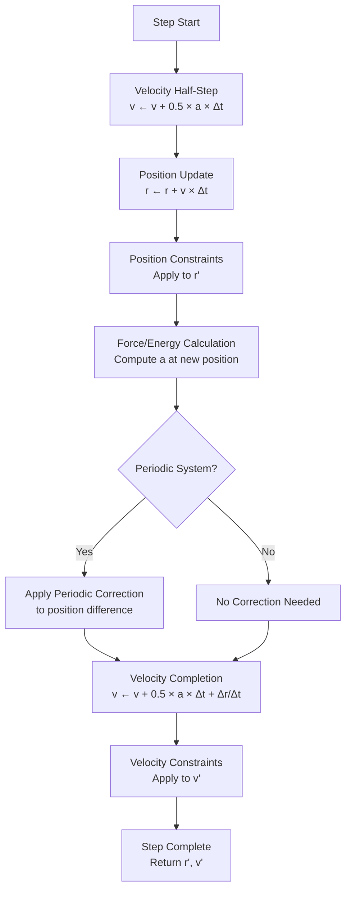

Velocity Verlet integration serves as the cornerstone algorithm for molecular dynamics simulations in DIMOS, providing a symplectic, time-reversible, and second-order accurate method for propagating the equations of motion. This documentation explores the mathematical foundations, architectural implementation, and practical usage patterns that make Velocity Verlet the preferred choice for energy-conserving NVE simulations and as a foundation for thermostatted ensembles.

Sources: [dimos/integrators.py](dimos/integrators.py#L836-L956), [dimos/simulation.py](dimos/simulation.py#L512-L680)

## Mathematical Foundation

The Velocity Verlet algorithm derives from a Taylor series expansion of position and velocity, cleverly combined to achieve second-order accuracy while preserving the symplectic structure of Hamiltonian dynamics. For a system with position **r**, velocity **v**, and acceleration **a** = F(**r**)/m, the algorithm updates the system over timestep Δt through a half-step velocity update followed by a full-step position update, then another half-step velocity update using forces evaluated at the new position.

The key equations governing the algorithm are:

**Velocity half-step update:**
```
v(t + Δt/2) = v(t) + (Δt/2) × a(t)
```

**Position full-step update:**
```
r(t + Δt) = r(t) + Δt × v(t + Δt/2)
```

**Velocity completion:**
```
v(t + Δt) = v(t + Δt/2) + (Δt/2) × a(t + Δt)
```

This formulation ensures that the algorithm is **time-reversible** and **symplectic**, meaning it preserves the phase space volume—a critical property for long-term stability in molecular dynamics simulations. The symplectic nature prevents energy drift that would accumulate over millions of timesteps in non-symplectic integrators.

Sources: [dimos/integrators.py](dimos/integrators.py#L836-L956)

## Architecture and Implementation

DIMOS implements Velocity Verlet through the `VelocityVerlet` class, which extends the `CommonIntegrator` base class. The architecture cleanly separates the core integration logic from constraint handling, energy calculation, and boundary condition management. This modular design allows the algorithm to work seamlessly with both constrained and unconstrained systems, periodic and non-periodic boundary conditions, and various force field types.

### Core Integration Step

The integration step method orchestrates six distinct operations, each designed to maintain the mathematical integrity of the algorithm:



The implementation begins with the first half-step velocity update, which advances velocities to the midpoint of the timestep. Then positions are updated using these mid-timestep velocities, providing a second-order accurate position update. Position constraints are immediately applied to ensure bond lengths and other geometric constraints are satisfied. Accelerations are recalculated at the new positions through energy gradient evaluation, and finally velocities are completed with the second half-step update. Velocity constraints are applied last to ensure constrained degrees of freedom have zero velocity components along constraint directions.

A critical implementation detail appears in the velocity completion step: `vel = vel + 0.5 * self.a * self.timestep + pos_difference / self.timestep`. The `pos_difference` term represents the correction applied by constraint algorithms. In constrained systems, applying position constraints changes positions in ways that would break the original velocity update scheme. The `pos_difference / self.timestep` term compensates for this, ensuring that velocities remain consistent with the constrained trajectory. For unconstrained systems, this term equals zero.

Sources: [dimos/integrators.py](dimos/integrators.py#L906-L956), [dimos/constraints.py](dimos/constraints.py#L625-L641)

### Acceleration Calculation

Acceleration updates occur through the `update_acceleration` method, which interfaces with the system's energy calculation infrastructure. The method calls `sys.calc_energy()` with the `return_forces=True` flag, requesting forces alongside the energy value. Forces are then divided by atomic masses to produce accelerations, with the results converted to the integrator's specified data type for numerical consistency.

Sources: [dimos/integrators.py](dimos/integrators.py#L878-L904)

### Periodic Boundary Conditions

For periodic systems, the algorithm must correctly handle particles crossing box boundaries. The implementation uses a `periodic_correction` function to compute the minimum image convention for position differences. When constraints modify positions, particles may be displaced across periodic boundaries. The correction function computes the vector difference between constrained and unconstrained positions, then applies the minimum image convention to ensure the difference represents the shortest path across periodic boundaries. This preserves the physical meaning of position corrections used in velocity updates.

Sources: [dimos/integrators.py](dimos/integrators.py#L906-L956), [dimos/utils.py](dimos/utils.py#L525-L543)

## Integration with Simulation Framework

The `VelocityVerlet` integrator operates within the broader simulation orchestration provided by the `MDSimulation` class. During simulation initialization, the integrator's constraint handler applies initial position and velocity constraints, then computes the initial acceleration from forces. This setup ensures the simulation begins in a physically valid state with correct initial accelerations for the first timestep.

Each simulation iteration calls the integrator's step method, passing current positions, velocities, neighbor list, and system object. The simulation framework handles neighbor list updates, periodic boundary condition applications, and optional barostat operations around the core integration step. After each step, the simulation optionally detaches tensors from the computation graph to prevent uncontrolled memory growth during long simulations, while keeping positions differentiable for gradient-based analyses.

Sources: [dimos/simulation.py](dimos/simulation.py#L572-L680), [dimos/integrators.py](dimos/integrators.py#L453-L460)

> [!TIP]
> The detach pattern is essential for production simulations running thousands of timesteps. By calling `detach_()` after each step, DIMOS releases intermediate computation graph references that would otherwise accumulate. The positions tensor is immediately re-attached with `requires_grad_()`, enabling gradient calculations for energy minimization or machine learning training while preventing memory overflow during integration.

## Comparison with Other Integrators

DIMOS provides multiple integration algorithms, each suited for different simulation scenarios. Understanding their trade-offs helps select the appropriate method for specific applications.

| **Integrator** | **Order** | **Symplectic** | **Constraints** | **Best Use Case** |
|----------------|-----------|----------------|-----------------|-------------------|
| Velocity Verlet | 2 | Yes | Yes | General purpose, NVE, NVT, NPT simulations |
| Verlet | 2 | Yes | Yes | Alternative symplectic implementation |
| Langevin Dynamics | 1 | No | Yes | NVT simulations with explicit thermostat |
| Brownian Dynamics | 1 | No | Yes | Overdamped dynamics, implicit solvent |
| Nose-Hoover | 2 | Yes | Yes | NVT with deterministic thermostat |
| Nose-Hoover Chain | 2 | Yes | Yes | High-precision NVT with better ergodicity |

Velocity Verlet distinguishes itself through its symmetric formulation and direct velocity handling, making it ideal for simulations where accurate kinetic energy representation matters. The Verlet variant provides equivalent accuracy but with a different velocity calculation approach, while stochastic integrators like Langevin Dynamics add random forces for temperature control at the cost of symplecticity.

Sources: [dimos/integrators.py](dimos/integrators.py#L608-L835), [dimos/integrators.py](dimos/integrators.py#L1084-L1238)

## Usage Patterns and Configuration

### Basic NVE Simulation Setup

A minimal Velocity Verlet simulation for energy conservation testing requires three components: a force field system, the integrator itself, and a simulation orchestrator. The following example demonstrates initializing a simulation with a 0.5 femtosecond timestep, which balances accuracy with computational efficiency for atomistic simulations:

```python
import dimos
import torch

# Load system from AMBER files
system = dimos.ff.AmberForceField(
    "system.prmtop",
    nonbonded_type="Cutoff",
    dispersion_correction=True
)

# Create Velocity Verlet integrator
timestep = 0.5  # femtoseconds
integrator = dimos.integrators.VelocityVerlet(timestep, system)

# Initialize simulation with positions and initial temperature
positions = torch.load("initial_positions.pt")
simulation = dimos.simulation.MDSimulation(
    system, integrator, positions, temperature=300.0
)

# Run simulation
for step in range(10000):
    simulation.step(10)  # Take 10 timesteps per iteration
```

Sources: [tests/test_nve.py](tests/test_nve.py#L394-L400)

### Timestep Selection Considerations

Timestep selection critically affects simulation stability and accuracy. The integrator validates that timesteps are positive and converts from femtoseconds to internal time units. The rule of thumb for Velocity Verlet is to use timesteps no larger than one-tenth the period of the fastest vibrational mode. For systems with hydrogen bonds involving light atoms, this typically means 0.5-1.0 fs. When constraints are applied to bonds involving hydrogen, larger timesteps (1.0-2.0 fs) become feasible because the constrained fastest vibrations are effectively removed from the simulation.

The timestep conversion uses the `FS_TO_INTERNAL` constant from the constants module, ensuring consistent internal time representation regardless of user-specified units. This design allows developers to specify timesteps in familiar femtosecond units while the integrator works with the internal time system used throughout DIMOS.

Sources: [dimos/integrators.py](dimos/integrators.py#L423-L441), [tests/test_nve.py](tests/test_nve.py#L387)

### Integration with Constraint Systems

Velocity Verlet seamlessly integrates with DIMOS's constraint handling infrastructure. The integrator accesses constraint handlers through the system object, which maintains references to `ConstraintsHandling`, `CCMA`, or `Settle` instances depending on constraint types. Position constraints apply after the position update, ensuring bond lengths and angles remain at equilibrium values. Velocity constraints apply after the velocity completion, ensuring zero velocity along constrained degrees of freedom.

The SETTLE algorithm specifically handles rigid water molecules using an analytic solution that maintains exact bond lengths and angles. For general distance constraints, the CCMA (Constant Constraint Matrix Approximation) algorithm iteratively satisfies constraints to specified tolerance. Both algorithms modify positions to satisfy constraints, and the Velocity Verlet implementation correctly accounts for these modifications through the `pos_difference` term in velocity updates.

Sources: [dimos/constraints.py](dimos/constraints.py#L400-L420), [dimos/constraints.py](dimos/constraints.py#L658-L874), [dimos/constraints.py](dimos/constraints.py#L916-L1133)

## Energy Conservation Validation

Velocity Verlet's symplectic nature makes it ideal for NVE simulations where energy conservation serves as a critical validation criterion. The test suite demonstrates energy conservation by comparing DIMOS against OpenMM reference implementations. Over 100 timesteps of a 0.5 fs simulation on alanine dipeptide in solvent, both DIMOS and OpenMM maintain nearly identical total energy values, confirming the correctness of the implementation.

The validation framework tracks potential and kinetic energy separately, summing them to compute total energy. The relative difference between DIMOS and OpenMM total energies remains small throughout the simulation, with deviations attributable to numerical precision differences rather than algorithmic flaws. This energy conservation property extends to much longer simulations, where symplectic integrators like Velocity Verlet show bounded energy fluctuations without secular drift.

Sources: [tests/test_nve.py](tests/test_nve.py#L382-L465), [dimos/utils.py](dimos/utils.py#L621-L665)

## Performance Characteristics

The computational cost of Velocity Verlet scales linearly with system size, dominated by force calculations rather than the integration overhead itself. Each timestep requires one force evaluation at the new position, making it comparable in cost to other second-order integrators. The constraint handling adds computational overhead proportional to the number of constraints, but this overhead is typically small compared to force calculations for large systems.

Memory usage is controlled through the `get_variables_to_detach` method, which returns the acceleration tensor for detachment from the computation graph after each step. This pattern prevents accumulation of intermediate values through backpropagation history while maintaining the current acceleration for the next timestep's force evaluation.

Sources: [dimos/integrators.py](dimos/integrators.py#L895-L904), [dimos/simulation.py](dimos/simulation.py#L668-L676)

## Advanced Considerations

### Velocity Initialization

The simulation framework supports both explicit velocity specification and Maxwell-Boltzmann sampling at a specified temperature. When explicit velocities are provided, they must be pre-attached to the integrator's data type and detached from any existing computation graph. When sampled from Maxwell-Boltzmann distributions, the velocities are drawn according to the system's masses and the specified temperature, ensuring the initial kinetic energy matches the desired temperature.

Initial velocities are corrected for any velocity shifts applied by constraint algorithms, ensuring that constrained degrees of freedom have appropriate initial velocity components. This correction subtracts `shift × a` from velocities, where `shift` represents the half-timestep offset used in some integration schemes.

Sources: [dimos/simulation.py](dimos/simulation.py#L588-L600), [dimos/utils.py](dimos/utils.py#L588-L620)

### Extension to Thermostatted Ensembles

While Velocity Verlet itself preserves energy (NVE ensemble), it serves as the foundation for thermostatted ensembles through velocity rescaling. The [Langevin Dynamics](12-langevin-dynamics-and-thermostats) and [Nose-Hoover](13-nose-hoover-chains-and-advanced-thermostats) integrators build upon Velocity Verlet's symmetric structure, adding thermostatting forces while preserving symplecticity in the Nose-Hoover case. The velocity Verlet half-step updates provide the natural framework for integrating stochastic forces from Langevin dynamics or deterministic thermostat equations from Nose-Hoover chains.

Sources: [dimos/integrators.py](dimos/integrators.py#L1084-L1238), [dimos/integrators.py](dimos/integrators.py#L1653-L1843)

## Troubleshooting and Common Issues

### Energy Drift

While Velocity Verlet is symplectic and should conserve energy in NVE simulations, several factors can cause apparent energy drift. Large timesteps exceeding system stability limits can lead to numerical instability. Incorrect force field parameters or missing energy components in calculations can also cause drift. Periodic boundary condition errors, particularly in systems with long-range electrostatics, may introduce energy artifacts. Verify that the timestep is appropriate for the fastest vibrational mode in the system and that all energy terms (bonded, nonbonded, constraints) are correctly configured.

Sources: [tests/test_nve.py](tests/test_nve.py#L421-L464)

### Constraint Violations

Constraint violations manifest as bond lengths or angles deviating from equilibrium values. This typically occurs when constraints are not properly initialized or when timestep is too large for the constraint solver tolerance. The SETTLE algorithm has built-in analytic solutions that are exact to numerical precision, but CCMA iterative solvers may require more iterations for convergence with larger timesteps. Check the constraint tolerance settings and reduce timestep if constraint violations persist.

Sources: [dimos/constraints.py](dimos/constraints.py#L658-L874)

### Velocity Inconsistency After Constraints

Velocities may become inconsistent with positions after constraint application if the `pos_difference / timestep` correction is not applied correctly. This manifests as unphysical kinetic energy changes after constraint satisfaction. The implementation correctly handles this correction, but custom constraint handlers must ensure they return the appropriate position differences for velocity correction.

Sources: [dimos/integrators.py](dimos/integrators.py#L906-L956)

## Next Steps

Having mastered Velocity Verlet integration, explore more advanced simulation techniques:

- **Temperature Control**: Learn about [Langevin Dynamics and Thermostats](12-langevin-dynamics-and-thermostats) to perform NVT simulations with explicit temperature control
- **Advanced Thermostatting**: Discover [Nose-Hoover Chains and Advanced Thermostats](13-nose-hoover-chains-and-advanced-thermostats) for deterministic ensemble control
- **Hamiltonian Methods**: Understand [Hamiltonian Monte Carlo and MALA](14-hamiltonian-monte-carlo-and-mala) for enhanced sampling
- **Energy Validation**: Review [Energy Conservation and NVE Tests](27-energy-conservation-and-nve-tests) for validation methodologies

Velocity Verlet integration provides the fundamental time propagation mechanism that underpins all molecular dynamics simulations in DIMOS. Its symplectic nature, second-order accuracy, and seamless integration with constraint handling make it the default choice for most simulation scenarios, serving as a solid foundation for exploring more advanced dynamics methods.