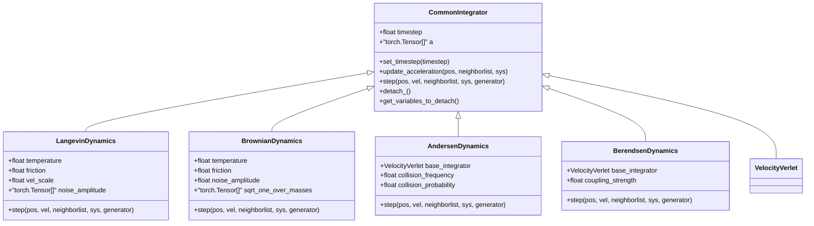

This page explores the implementation of stochastic dynamics methods and temperature control strategies in DIMOS. Langevin dynamics and related thermostats enable molecular simulations to sample the canonical (NVT) ensemble by coupling the system to an implicit heat bath through friction and random forces. These methods are essential for maintaining constant temperature in molecular dynamics simulations while preserving realistic dynamics.

## Theoretical Foundations of Langevin Dynamics

Langevin dynamics extends Newtonian mechanics by adding two key terms that model interactions with an implicit solvent or heat bath: a frictional drag force proportional to velocity and a random thermal noise force. The stochastic equation of motion for each particle i is:

**mᵢ(dvᵢ/dt) = -∇U(r) - γmᵢvᵢ + √(2kBTγmᵢ)Rᵢ(t)**

where γ is the friction coefficient, kBT is thermal energy, and Rᵢ(t) is Gaussian white noise. This formulation naturally produces the canonical ensemble and is particularly valuable when simulating solvent implicitly or when studying dynamics in viscous environments.

Sources: [dimos/integrators.py](dimos/integrators.py#L1084-L1091)

## Implementation Architecture

DIMOS implements thermostat classes through a common inheritance hierarchy centered on the `CommonIntegrator` base class. Each thermostat provides a unified interface for time integration while encapsulating its specific temperature control mechanism. The architecture ensures consistency across different thermostats and enables seamless substitution within simulation workflows.



Sources: [dimos/integrators.py](dimos/integrators.py#L392-L565)

## Langevin Dynamics Integrator

The `LangevinDynamics` class implements a simplified Langevin integration scheme that balances computational efficiency with proper canonical ensemble sampling. The implementation uses an analytical velocity update with exponential friction decay followed by thermal noise injection.

### Initialization and Parameters

```python
integrator = dimos.integrators.LangevinDynamics(
    timestep=0.5,              # femtoseconds
    temperature=300.0,         # Kelvin
    friction=0.1,             # fs^-1
    sys=system
)
```

The initialization converts input parameters to internal units and pre-computes integration constants. The velocity scaling factor `vel_scale = exp(-γΔt)` is calculated once during initialization, as is the noise amplitude which depends on particle masses through `noise_amplitude = sqrt(kBT(1 - vel_scale²)/m)`. This pre-computation strategy optimizes performance during the simulation loop.

Sources: [dimos/integrators.py](dimos/integrators.py#L1133-L1166)

### Integration Algorithm

The Langevin integration step follows a two-stage velocity update:

```mermaid
flowchart TD
    A[Start: v, r, F] --> B[Update v: v = v + FΔt/m]
    B --> C[Update r: r = r + v·Δt/2]
    C --> D[Apply friction: v = v·e^(-γΔt)]
    D --> E[Add noise: v = v + ξ]
    E --> F[Update r: r = r + v·Δt/2]
    F --> G[Recalculate forces]
    G --> H[Return v, r]
```

The friction term is applied through exponential decay, which provides exact treatment of the deterministic friction component. Thermal noise is added with mass-dependent amplitude to ensure proper temperature equilibration. The algorithm performs only one force evaluation per timestep, making it computationally efficient compared to some alternative implementations.

Sources: [dimos/integrators.py](dimos/integrators.py#L1196-L1235)

### Constraint Handling Considerations

The current implementation explicitly raises a `NotImplementedError` when constraints are specified, as the simplified integration scheme does not support constrained dynamics. This design choice reflects the theoretical challenge of properly applying constraints in stochastic integrators where the random force component can violate constraint conditions. For constrained systems, alternative thermostat approaches like Andersen or Berendsen may be more appropriate.

Sources: [dimos/integrators.py](dimos/integrators.py#L1165-L1166)

## Brownian Dynamics: The Overdamped Limit

`BrownianDynamics` implements the overdamped limit of Langevin dynamics where inertial effects are negligible. This approximation is valid when the friction coefficient is large and the system responds rapidly to forces, making it suitable for studying diffusive processes or systems in highly viscous environments.

The integration updates positions directly based on forces and thermal noise, with velocities reconstructed from position differences for analysis purposes:

**r(t+Δt) = r(t) + (Δt/γ)F(r(t)) + √(2kBTΔt/γ)R(t)**

where the force scaling factor `force_scale = Δt/γ` and the noise amplitude incorporates mass dependence through `sqrt_one_over_masses`.

Sources: [dimos/integrators.py](dimos/integrators.py#L957-L1081)

## Stochastic Thermostats

### Andersen Thermostat

The `AndersenDynamics` class implements a collision-based thermostat that maintains temperature by randomly reassigning particle velocities from a Maxwell-Boltzmann distribution. Each particle has a probability `p = 1 - exp(-νΔt)` of colliding with the heat bath per timestep, where ν is the collision frequency.

```python
integrator = dimos.integrators.AndersenDynamics(
    timestep=0.5,
    temperature=300.0,
    collision_frequency=0.01,  # fs^-1
    sys=system
)
```

The thermostat wraps a standard Velocity Verlet integrator, adding stochastic velocity rescaling after deterministic motion. This approach preserves Hamiltonian dynamics between collisions while ensuring proper canonical ensemble sampling through random thermalization events.

Sources: [dimos/integrators.py](dimos/integrators.py#L1238-L1362)

### Berendsen Thermostat

The `BerendsenDynamics` class implements a weak-coupling thermostat that gradually scales velocities to correct temperature deviations. The scaling factor is computed as:

**λ = sqrt(1 + (Δt/τ)(T_target/T_current - 1))**

where τ is the coupling time constant. This approach smoothly drives the system toward the target temperature but does not generate the canonical ensemble, making it primarily useful for equilibration rather than production simulations.

> [!TIP]
> The Berendsen thermostat implementation is marked as experimental with no OpenMM reference implementation for validation. Use this thermostat with caution and verify ensemble properties for your specific application.

Sources: [dimos/integrators.py](dimos/integrators.py#L1365-L1487)

## Thermostat Comparison and Selection

| Thermostat | Friction Parameter | Ensemble | Constraints | Use Case |
|------------|-------------------|----------|-------------|----------|
| Langevin Dynamics | Friction coefficient (fs⁻¹) | Canonical (NVT) | ❌ Not supported | Implicit solvent, dynamics with friction |
| Brownian Dynamics | Friction coefficient (fs⁻¹) | Canonical (NVT) | ❌ Not supported | Overdamped systems, diffusive processes |
| Andersen Thermostat | Collision frequency (fs⁻¹) | Canonical (NVT) | ✅ Via VelocityVerlet | General NVT, flexible coupling |
| Berendsen Thermostat | Coupling strength (fs) | Non-canonical | ✅ Via VelocityVerlet | Equilibration only |

## Memory Management and Computation Graphs

All thermostat classes implement the `get_variables_to_detach()` method to enable efficient memory management during long simulations. By detaching specific tensors from the computation graph, DIMOS prevents unbounded memory growth while preserving differentiability where needed for machine learning applications. Langevin and Brownian dynamics detach only the acceleration tensor, while composite thermostats like Andersen and Berendsen detach the underlying integrator's acceleration tensor.

Sources: [dimos/integrators.py](dimos/integrators.py#L1185-L1194)

## Practical Implementation

Setting up a thermostat-controlled simulation involves initializing the integrator and passing it to the `MDSimulation` class:

```python
import torch
import dimos

# Load system and prepare initial conditions
system = dimos.ff.AmberForceField("system.prmtop", nonbonded_type="Cutoff")
positions = torch.tensor(initial_positions)

# Create Langevin thermostat
integrator = dimos.integrators.LangevinDynamics(
    timestep=0.5,
    temperature=300.0,
    friction=0.1,
    sys=system
)

# Initialize simulation
simulation = dimos.simulation.MDSimulation(
    sys=system,
    integrator=integrator,
    initial_pos=positions,
    temperature=300.0
)

# Run simulation
for step in range(1000):
    simulation.step(num_steps=10)
    if step % 100 == 0:
        temp = simulation.measure_temperature()
        print(f"Step {step}, Temperature: {temp:.2f} K")
```

Sources: [tests/test_nvt.py](tests/test_nvt.py#L382-L463)

## Performance Considerations

The choice of thermostat significantly impacts simulation efficiency and physical realism. Langevin dynamics requires careful selection of friction coefficient: too small values produce unrealistic dynamics with weak coupling, while too large values overdamp the system. Typical friction coefficients for biological simulations range from 0.01 to 10 fs⁻¹ depending on the desired coupling strength and the physical system being modeled.

For large-scale simulations, the random number generator passed through the `generator` parameter can be crucial for reproducibility. PyTorch's random number generation is GPU-accelerated, making stochastic integrators efficient even for large systems.

> [!TIP]
> When using Langevin dynamics for production simulations, validate ensemble properties by measuring temperature distributions and checking that kinetic energy follows the expected chi-squared distribution with 3N degrees of freedom.

Sources: [dimos/integrators.py](dimos/integrators.py#L1230-L1231)

## Integration with Machine Learning Workflows

DIMOS's thermostat implementations are designed with machine learning applications in mind. The PyTorch-native implementation allows gradients to flow through force calculations when needed for differentiable energy landscape optimization, while the detach mechanism prevents memory bloat during standard MD simulations. This dual compatibility makes these thermostats suitable for both traditional molecular dynamics and advanced ML/MM hybrid approaches.

## Next Steps

To deepen your understanding of temperature control in DIMOS:

- Explore [Nose-Hoover Chains and Advanced Thermostats](13-nose-hoover-chains-and-advanced-thermostats) for deterministic thermostat approaches
- Learn about [Velocity Verlet Integration](11-velocity-verlet-integration) as the underlying deterministic integrator
- Review [Temperature Control and NVT Validation](28-temperature-control-and-nvt-validation) for testing and verification procedures
- Understand [Hamiltonian Monte Carlo and MALA](14-hamiltonian-monte-carlo-and-mala) for advanced sampling methods that use different thermostatic principles
