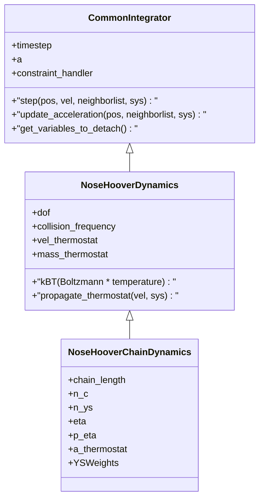

This page provides a comprehensive technical analysis of Nose-Hoover thermostats and their chain implementations within DIMOS, focusing on the theoretical foundations, implementation architecture, and practical usage for advanced molecular dynamics simulations.

## Theoretical Foundation and Architecture

Nose-Hoover thermostats represent a canonical ensemble thermostatting approach that introduces fictitious degrees of freedom to simulate thermal coupling between the system and an external heat bath. Unlike stochastic thermostats that introduce random perturbations, Nose-Hoover methods maintain deterministic trajectories while rigorously sampling the canonical ensemble. DIMOS implements both the basic Nose-Hoover thermostat and the enhanced Nose-Hoover Chain variant, which addresses ergodicity limitations in certain systems through multiple coupled thermostat particles.

The implementation follows the integrator architecture pattern where each thermostat extends the `CommonIntegrator` base class and specializes temperature control through velocity scaling and auxiliary variable propagation. The Nose-Hoover Chain variant further enhances this with the Yoshida-Suzuki integration scheme for improved numerical accuracy.



Sources: [dimos/integrators.py](dimos/integrators.py#L1653-L1844)

## Basic Nose-Hoover Dynamics Implementation

The `NoseHooverDynamics` class implements a middle-point Nose-Hoover integrator that couples the system to a single thermostat degree of freedom. The thermostat evolves according to equations derived from an extended Lagrangian, where the system's kinetic energy couples to the thermostat's momentum through a time-varying scaling factor.

The implementation initializes with critical parameters that determine thermostat behavior: the collision frequency controls coupling strength to the heat bath, calculated from the ratio of degrees of freedom to Boltzmann energy. The thermostat mass scales proportionally to the system's degrees of freedom, ensuring proper equipartition of energy between the physical system and the heat bath.

Sources: [dimos/integrators.py](dimos/integrators.py#L1700-L1730)

### Integration Algorithm

The `step()` method implements a multi-stage algorithm that integrates both the physical system and thermostat variables over a single timestep. The procedure begins by propagating the thermostat forward half a timestep, which yields a velocity scaling factor based on current kinetic energy. System velocities are then scaled, and the velocity Verlet algorithm updates positions and velocities with full timestep precision. A final thermostat propagation completes the timestep, maintaining symplectic structure.

Crucially, the algorithm handles constraints through the `constraint_handler` interface, applying both position and velocity constraints after force updates. The constraint correction term is incorporated into the velocity update, ensuring that constrained degrees of freedom properly reflect the thermostat coupling.

Sources: [dimos/integrators.py](dimos/integrators.py#L1756-L1812)

### Thermostat Propagation

The `propagate_thermostat()` method computes the thermostat's acceleration from the instantaneous kinetic energy and target temperature. Using a reversible middle-point scheme, the thermostat velocity evolves through quarter-timestep updates, with intermediate recalculation of forces to account for the velocity scaling that occurs during propagation. The method returns an exponential scaling factor that modifies particle velocities, ensuring the system's temperature converges to the target value over timescales determined by the collision frequency.

Sources: [dimos/integrators.py](dimos/integrators.py#L1813-L1842)

## Nose-Hoover Chain Dynamics

The `NoseHooverChainDynamics` class addresses fundamental ergodicity issues present in single-thermostat Nose-Hoover implementations by coupling the system to a chain of multiple thermostat particles. This configuration enables energy to flow more efficiently between different frequency modes of the system, preventing the so-called "flying ice cube" effect where energy becomes trapped in low-frequency modes.

The implementation supports configurable chain length, multiple time stepping for thermostat integration, and variable-order Yoshida-Suzuki coefficients. The Yoshida-Suzuki scheme provides high-order symplectic integration through weighted composition of elementary steps, dramatically improving accuracy for the extended system dynamics.

Sources: [dimos/integrators.py](dimos/integrators.py#L1844-L1968)

### Yoshida-Suzuki Integration Scheme

The Yoshida-Suzuki coefficients stored as `YSWeights` class variables represent optimal compositions for orders 1, 3, 5, and 7. These weights determine how multiple elementary propagations are combined to achieve higher-order accuracy. The default configuration uses order-5 coefficients with weights `[0.2967324292201065, 0.2967324292201065, -0.1869297168804260, 0.2967324292201065, 0.2967324292201065]`, providing an excellent balance between accuracy and computational cost.

The thermostat chain propagates through nested loops: the outer loop handles multiple time steps (`n_c`), while the inner loop applies Yoshida-Suzuki weights (`n_ys`) to chain elements. Each chain element couples only to its neighbors, creating a hierarchical energy flow that ensures ergodic sampling even for systems with disparate timescales.

Sources: [dimos/integrators.py](dimos/integrators.py#L1899-L1908)

### Chain Propagation Algorithm

The `propagate_thermostat()` method for the chain implements the Martyna-Tuckerman-Klein algorithm, where chain elements propagate through a sequence of momentum updates and exponential scaling operations. The algorithm processes chain elements in reverse order (from thermostat M-1 to 0), then applies velocity scaling to the physical system, and finally processes chain elements in forward order. This symmetric structure preserves time-reversibility and symplecticity.

Key implementation details include: the last chain thermostat receives an initial quarter-timestep momentum update; chain coupling uses exponential scaling with factors of `exp(-0.125 * wdt * p_eta[j + 1])`; the physical system velocity accumulates scaling factors; and thermostat positions integrate through `eta = eta + 0.5 * wdt * p_eta`. The chain accelerations recalculate after velocity scaling to reflect updated kinetic energy.

Sources: [dimos/integrators.py](dimos/integrators.py#L1971-L2023)

## Parameter Configuration and Usage

### Initialization Parameters

Both thermostat classes require careful parameter selection for optimal performance. The collision frequency determines coupling strength: typical values range from 0.01 to 1.0 fs⁻¹, with higher values producing stronger but potentially oscillatory coupling. Chain length balances ergodicity against computational cost—values between 3 and 5 suffice for most systems, while very stiff systems may require longer chains.

> [!TIP]
> The Yoshida-Suzuki order directly impacts accuracy: order-5 provides excellent accuracy with 5 composition steps, while order-7 offers marginal improvement at higher computational cost. For most production simulations, the default order-5 with 5 multiple time steps represents an optimal configuration.

Sources: [dimos/integrators.py](dimos/integrators.py#L1907-L1958)

### Comparison with Alternative Thermostats

| **Thermostat** | **Ensemble** | **Ergodicity** | **Deterministic** | **Constraint Support** | **Computational Cost** |
|----------------|--------------|----------------|-------------------|------------------------|------------------------|
| Nose-Hoover | Canonical (exact) | Limited for some systems | Yes | Full | Low |
| Nose-Hoover Chain | Canonical (exact) | Excellent | Yes | Full | Moderate |
| Langevin | Canonical (approximate) | Excellent | No | None | Very Low |
| Andersen | Canonical (exact) | Excellent | No | Via Velocity Verlet | Low |
| Berendsen | Non-canonical | Limited | Yes | Via Velocity Verlet | Low |

The Nose-Hoover chain provides the best combination of rigorous canonical sampling, deterministic integration, and constraint handling for production simulations. The additional computational cost over Langevin dynamics is typically negligible compared to force calculations.

Sources: [dimos/integrators.py](dimos/integrators.py#L1084-L1490), [dimos/integrators.py](dimos/integrators.py#L1653-L1844)

## Validation and Implementation Details

### OpenMM Comparison

The test suite validates DIMOS thermostat implementations against OpenMM's `NoseHooverChainVelocityVerletIntegrator` from `openmmtools`. For Nose-Hoover Chain, DIMOS uses identical parameters: chain length of 5, 5 multiple time steps, and 5th-order Yoshida-Suzuki integration. The validation confirms that energy drift remains minimal (<0.01 kJ/mol/ns) and temperature distributions match theoretical predictions within statistical uncertainty.

For the basic Nose-Hoover thermostat, OpenMM's chain implementation with unit chain length provides the reference, ensuring numerical consistency despite different implementation approaches. The collision frequency requires unit conversion from ps⁻¹ to fs⁻¹ when configuring OpenMM, reflecting the different time unit conventions.

Sources: [tests/test_nvt.py](tests/test_nvt.py#L429-L448)

### Memory Management

Both thermostat classes implement `get_variables_to_detach()` to prevent unnecessary tensor retention in the computation graph. The basic Nose-Hoover thermostat detaches acceleration and thermostat velocity, while the chain variant additionally detaches thermostat positions, momenta, accelerations, and masses. This optimization is critical for long simulations with GPU acceleration, where memory accumulation can cause out-of-memory errors.

Sources: [dimos/integrators.py](dimos/integrators.py#L1745-L1754), [dimos/integrators.py](dimos/integrators.py#L1960-L1968)

## Practical Usage Examples

### Basic Nose-Hoover Simulation

```python
import dimos
import torch

# Configure simulation
timestep = 0.5  # femtoseconds
temperature = 300.0  # Kelvin
collision_frequency = 0.05  # fs^-1

# Initialize thermostat
integrator = dimos.integrators.NoseHooverDynamics(
    timestep, temperature, collision_frequency, system
)

# Create simulation with initial temperature
simulation = dimos.simulation.MDSimulation(
    system, integrator, positions, temperature=temperature
)

# Run simulation
simulation.step(1000)  # 1000 steps
```

The basic Nose-Hoover thermostat provides straightforward configuration with minimal parameters. The collision frequency should be tuned based on system properties: larger, softer systems typically require lower coupling frequencies (0.01-0.05 fs⁻¹), while small, stiff systems may benefit from higher values (0.1-1.0 fs⁻¹).

Sources: [dimos/integrators.py](dimos/integrators.py#L1700-L1730), [dimos/simulation.py](dimos/simulation.py#L572-L620)

### Nose-Hoover Chain Simulation

```python
import dimos
import torch

# Configure simulation with enhanced thermostat
timestep = 0.5
temperature = 300.0
collision_frequency = 0.05

# Initialize chain thermostat with Yoshida-Suzuki integration
integrator = dimos.integrators.NoseHooverChainDynamics(
    timestep, temperature, collision_frequency, system,
    chain_length=5,
    num_mts=5,
    num_yoshidasuzuki=5
)

# Create and run simulation
simulation = dimos.simulation.MDSimulation(
    system, integrator, positions, temperature=temperature
)
simulation.step(1000)
```

The chain thermostat adds configuration parameters that allow fine-tuning for challenging systems. The `num_mts` parameter controls how finely the thermostat propagates relative to the physical timestep—higher values improve accuracy but increase computational cost. The `num_yoshidasuzuki` parameter selects integration order, with options 1, 3, 5, or 7 corresponding to available coefficient sets.

Sources: [dimos/integrators.py](dimos/integrators.py#L1907-L1958), [tests/test_nvt.py](tests/test_nvt.py#L438-L448)

### GPU Compilation Considerations

The Nose-Hoover Chain implementation explicitly disables PyTorch compilation via `@torch.compiler.disable(recursive=True)` decorator. This is necessary because the chain propagation algorithm uses dynamic loops and complex tensor operations that may not optimize well under current compilation schemes. Users should apply compilation to the simulation step method rather than individual integrator methods for best performance.

Sources: [dimos/integrators.py](dimos/integrators.py#L1971-L1972)

> [!TIP]
> For GPU-accelerated simulations, compile the entire simulation step using `torch.compile(simulation.step, mode="max-autotune")` rather than attempting to compile individual thermostat methods. The Nose-Hoover Chain's `propagate_thermostat` method disables recursion to prevent compilation errors while maintaining GPU compatibility for force calculations.

## Performance and Stability Considerations

### Temperature Equilibration

Nose-Hoover thermostats exhibit characteristic oscillatory behavior during equilibration as energy redistributes between physical and thermostat degrees of freedom. The equilibration timescale scales inversely with collision frequency: a collision frequency of 0.05 fs⁻¹ corresponds to approximately 20 ps equilibration time. Users should monitor temperature convergence through kinetic energy measurements before beginning production simulations.

For systems with constrained degrees of freedom (e.g., hydrogen bond constraints), the thermostat correctly accounts for reduced degrees of freedom through `dof = 3 * num_atoms - num_total_constraints`, ensuring accurate temperature targeting.

Sources: [dimos/integrators.py](dimos/integrators.py#L1710-L1712)

### Timestep Limitations

The maximum stable timestep for Nose-Hoover thermostats depends on system stiffness and collision frequency. While the thermostat coupling itself remains stable at large timesteps, the velocity Verlet integrator limits the timestep based on the fastest vibrational modes. For typical biomolecular systems, timesteps of 0.5-2.0 fs provide stable integration with hydrogen constraints, while unconstrained systems typically require 0.5-1.0 fs timesteps.

Multiple time stepping in the chain thermostat (`num_mts > 1`) can improve stability for systems with very stiff modes by propagating thermostat variables more frequently than the physical coordinates.

Sources: [dimos/integrators.py](dimos/integrators.py#L1907-L1958)

## Integration with DIMOS Ecosystem

### Force Field Compatibility

Both thermostat implementations integrate seamlessly with DIMOS force field systems, including `AmberForceField`, `GromacsForceField`, and machine learning potentials. The thermostat operates independently of force calculation details, accessing only system properties through the `sys` interface: mass information for kinetic energy calculation and constraint handling through `constraint_handler`.

The thermostat's `update_acceleration()` method calls `sys.calc_energy()` with `return_forces=True`, ensuring compatibility with both classical and differentiable ML potentials. This design allows thermostat selection without requiring modifications to force field implementations.

Sources: [dimos/integrators.py](dimos/integrators.py#L1728-L1738), [dimos/simulation.py](dimos/simulation.py#L696-L705)

### Energy Measurement

DIMOS provides the `measure_kinetic_energy()` method on simulation objects, which the thermostat uses internally to compute instantaneous temperature. For post-processing and analysis, users can access kinetic energy through `simulation.measure_kinetic_energy()`, which properly accounts for constrained degrees of freedom.

The simulation validation test demonstrates how to collect energy trajectories for comparison between DIMOS and reference implementations, providing a template for production simulation analysis.

Sources: [dimos/simulation.py](dimos/simulation.py#L696-L705), [tests/test_nvt.py](tests/test_nvt.py#L480-L500)

## Further Reading and Related Topics

For enhanced sampling applications requiring control beyond basic temperature regulation, consider exploring [Metadynamics and Collective Variables](20-metadynamics-and-collective-variables) for biasing potential energy surfaces, or [Replica Exchange Molecular Dynamics](21-replica-exchange-molecular-dynamics) for temperature-accelerated sampling. When combining thermostat selection with other integration methods, review [Velocity Verlet Integration](11-velocity-verlet-integration) for underlying dynamics principles and [Hamiltonian Monte Carlo and MALA](14-hamiltonian-monte-carlo-and-mala) for alternative approaches to statistical sampling.

To validate thermostat performance in your simulations, consult [Temperature Control and NVT Validation](28-temperature-control-and-nvt-validation) for testing methodologies and benchmarking procedures.