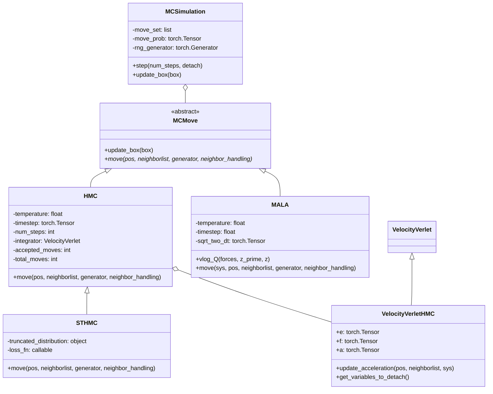
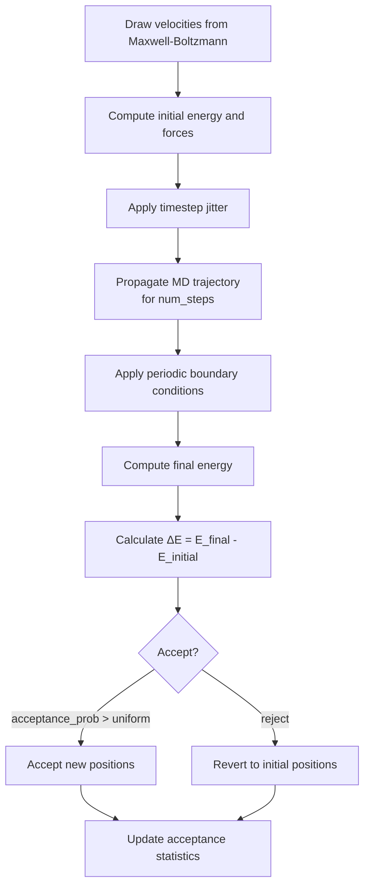

This page examines DIMOS's implementation of advanced Monte Carlo sampling methods—Hamiltonian Monte Carlo (HMC), Self-Tuning HMC (STHMC), and Metropolis-Adjusted Langevin Algorithm (MALA)—which provide efficient configuration space sampling for molecular simulations by combining molecular dynamics trajectories with Metropolis-Hastings acceptance criteria.

Sources: [dimos/monte_carlo.py](dimos/monte_carlo.py#L374-L391)

## Monte Carlo Architecture Overview

The Monte Carlo framework in DIMOS is built around a modular class hierarchy that separates move proposal logic from simulation orchestration. At the foundation lies the `MCMove` abstract base class, which defines the interface that all Monte Carlo moves must implement. This design enables flexible combination of different move types within a single simulation, with probability-weighted selection handled by the `MCSimulation` orchestrator.



The architecture supports three distinct sampling strategies: standard HMC generates proposals through deterministic MD trajectories with Metropolis correction; STHMC introduces adaptive trajectory length and loss-based biasing; and MALA proposes moves using Langevin dynamics with gradient-based guidance and detailed balance corrections. Each method maintains proper statistical mechanics while offering different trade-offs between computational efficiency and sampling effectiveness.

Sources: [dimos/monte_carlo.py](dimos/monte_carlo.py#L463-L519), [dimos/simulation.py](dimos/simulation.py#L718-L858)

## Hamiltonian Monte Carlo (HMC)

Hamiltonian Monte Carlo addresses the random walk behavior of standard Metropolis Monte Carlo by generating proposals through molecular dynamics trajectories that follow physical dynamics. This approach enables large moves through configuration space while maintaining high acceptance probabilities, significantly improving sampling efficiency for complex molecular systems.

The HMC implementation operates through a five-step algorithm. First, velocities are drawn from a Maxwell-Boltzmann distribution at the target temperature using atomic masses to properly scale the random momentum components. Second, the system's initial potential energy, forces, and accelerations are computed to establish the starting Hamiltonian. Third, a deterministic MD trajectory is propagated using Velocity Verlet integration for a fixed number of steps. Fourth, the final system state is evaluated to compute the new Hamiltonian. Fifth, the move is accepted or rejected based on the Metropolis criterion using the total energy difference divided by kBT.

Sources: [dimos/monte_carlo.py](dimos/monte_carlo.py#L520-L683), [dimos/utils.py](dimos/utils.py#L588-L621)

### HMC Implementation Details

The `HMC` class implements this algorithm with several important features for practical molecular simulations. It maintains statistics on accepted and total moves to monitor sampling efficiency, and incorporates a small random jitter in the timestep (default 10% variation) to prevent resonance artifacts that could reduce acceptance rates during long trajectories.

The integration process uses a specialized `VelocityVerletHMC` integrator that extends the standard Velocity Verlet with energy and force tracking capabilities required for the acceptance decision. During trajectory propagation, the system optionally detaches intermediate tensors from the PyTorch computation graph to prevent memory growth while maintaining differentiability of the final state. Periodic boundary conditions are applied after each integration step to maintain physical consistency in confined systems.

Sources: [dimos/monte_carlo.py](dimos/monte_carlo.py#L403-L461), [dimos/monte_carlo.py](dimos/monte_carlo.py#L571-L683)



### HMC Configuration Parameters

The HMC implementation exposes several key parameters that control the balance between computational cost and sampling efficiency:

| Parameter | Type | Default | Purpose |
|-----------|------|---------|---------|
| `temperature` | float | required | Target temperature for Maxwell-Boltzmann distribution and acceptance criterion |
| `timestep` | float | required | Integration timestep in femtoseconds (typically 0.5-2.0 fs) |
| `num_steps` | int | required | Number of MD integration steps per HMC proposal |
| `jitter_timestep` | float | 0.1 | Relative magnitude of random timestep variation to prevent resonance |
| `neighbor_check_interval` | int | 1 | Frequency of neighbor list updates during trajectory |
| `detach` | bool | True | Whether to detach computation graph during trajectory for memory efficiency |

Selecting appropriate timestep and trajectory length parameters is critical for HMC performance. The timestep must be small enough to maintain energy conservation during integration while the trajectory length should be optimized to maximize distance traveled through configuration space while preserving reasonable acceptance rates.

Sources: [dimos/monte_carlo.py](dimos/monte_carlo.py#L571-L579)

## Self-Tuning Hamiltonian Monte Carlo (STHMC)

Self-Tuning HMC extends the standard HMC framework by introducing adaptive trajectory length determination and loss-based biasing. This variant is particularly valuable for enhanced sampling applications where the optimal trajectory length varies across different regions of configuration space or when specific objectives need to be optimized during sampling.

The key innovation in STHMC is the use of a `truncated_distribution` object that determines both the number of integration steps and selection weights for each potential configuration along the trajectory. Instead of always accepting the endpoint of the MD trajectory, STHMC samples a configuration from the trajectory according to weights computed by the truncated distribution. This enables more flexible exploration and can bias sampling toward configurations that satisfy certain criteria.

Sources: [dimos/monte_carlo.py](dimos/monte_carlo.py#L684-L834)

### Loss Function Integration

STHMC incorporates a `loss_fn` callable that is evaluated at each step of the trajectory, accumulating a total loss that can be used for training or biasing purposes. This loss function receives the HMC move object, step index, current positions, and velocities as arguments, enabling complex objective functions that depend on system state.

In the experimental protein simulation, the loss function is used to optimize dihedral angles, monitor energy conservation, or track heavy atom movements. The accumulated loss is accessible after each move for use in gradient-based optimization or analysis, enabling tight integration between Monte Carlo sampling and machine learning workflows.

Sources: [experiments/dimos_hmc.py](experiments/dimos_hmc.py#L100-L179), [dimos/monte_carlo.py](dimos/monte_carlo.py#L725-L735)

> [!TIP]
> The loss function in STHMC serves dual purposes: it can guide sampling toward regions of interest through biased selection weights, and it can provide gradients for optimizing force field parameters or sampling hyperparameters when combined with automatic differentiation.

### STHMC Workflow

The STHMC move extends standard HMC with three additional steps: trajectory truncation sampling selects a random number of steps and corresponding weights; configuration selection chooses a specific trajectory step according to the weights; and loss accumulation evaluates the objective function throughout the trajectory. This enables more sophisticated sampling strategies that can adapt to system characteristics or target specific collective variables.

Sources: [dimos/monte_carlo.py](dimos/monte_carlo.py#L742-L834)

```python
# Example STHMC configuration for dihedral optimization
from dimos import monte_carlo, distribution
import torch

# Define objective function
def loss_fn(hmc_move, step, pos, vel):
    phi = compute_dihedral_angle(pos, phi_atoms)
    psi = compute_dihedral_angle(pos, psi_atoms)
    # Penalize deviation from target angles
    return (phi - target_phi)**2 + (psi - target_psi)**2

# Create truncated distribution
truncated_normal = distribution.TruncatedDistribution(
    threshold=0.999,
    base_distribution=torch.distributions.Normal(loc=10.0, scale=1.0)
)

# Initialize STHMC move
hmc_move = monte_carlo.STHMC(
    temperature=300.0,
    timestep=0.1,
    truncated_distribution=truncated_normal,
    loss_fn=loss_fn,
    sys=force_field_system,
    jitter_timestep=0.01
)
```

## Metropolis-Adjusted Langevin Algorithm (MALA)

MALA represents a fundamentally different approach from HMC, combining overdamped Langevin dynamics with Metropolis-Hastings correction to ensure detailed balance. Rather than using deterministic MD trajectories, MALA proposes moves using a single Langevin integration step that incorporates both gradient information and stochastic noise.

The proposal mechanism follows the Langevin equation: the proposed position equals the current position minus the product of timestep and acceleration (force divided by mass) plus a scaled random noise term with variance proportional to the timestep. This proposal naturally drifts toward lower energy regions due to the gradient term while maintaining exploration through the stochastic component.

Sources: [dimos/monte_carlo.py](dimos/monte_carlo.py#L835-L954)

### Detailed Balance Correction

MALA's acceptance criterion accounts for the asymmetric nature of the proposal distribution. Unlike standard Metropolis Monte Carlo with symmetric proposals, MALA must compute the probability density of proposing the new state from the current state and the reverse probability. The acceptance ratio includes both the energy difference and the log-proposal densities for forward and reverse moves.

The `vlog_Q` method computes the logarithm of the proposal density, which depends on the magnitude of displacement relative to the gradient direction. This detailed balance correction ensures that MALA samples from the correct Boltzmann distribution despite the asymmetric proposal mechanism.

> [!TIP]
> MALA is marked as experimental in DIMOS due to potential numerical instability and limited testing. For production simulations, HMC or STHMC are generally recommended unless specific requirements demand MALA's single-step proposal structure.

Sources: [dimos/monte_carlo.py](dimos/monte_carlo.py#L880-L902)

### MALA Implementation

The current MALA implementation uses acceleration rather than force for the gradient term, which is mathematically equivalent when using atomic masses but may require careful unit handling. The proposal calculates `acceleration = forces/masses`, then proposes new positions using this acceleration scaled by timestep plus the stochastic noise term.

The acceptance calculation computes the log-ratio of proposal densities forward and backward, adds the energy difference, and applies the Metropolis criterion. A uniform random number is compared to the exponential of this log-ratio minus another uniform random number, implementing the Metropolis-Hastings acceptance rule.

Sources: [dimos/monte_carlo.py](dimos/monte_carlo.py#L903-L954)

## Monte Carlo Simulation Orchestration

The `MCSimulation` class provides the framework for executing Monte Carlo simulations with flexible move selection. It maintains a set of possible moves with corresponding probability weights, enabling mixed sampling strategies that combine different move types in a single simulation.

The simulation step process involves three key operations: move selection chooses which move to apply based on the provided probabilities using cumulative probability search; move execution calls the selected move's `move` method with current positions and neighbor list; and boundary condition enforcement applies periodic boundary conditions if the system is periodic. After each step, tensors can be optionally detached from the computation graph to prevent memory accumulation.

Sources: [dimos/simulation.py](dimos/simulation.py#L803-L853)

### Multi-Move Simulations

The move probability system enables sophisticated sampling strategies. For example, one might combine 80% HMC moves for efficient exploration with 20% smaller MALA moves for local refinement, or mix unbiased HMC moves with biased STHMC moves targeting specific collective variables. The `cum_move_prob` tensor enables efficient weighted sampling using binary search.

```python
# Example: Mixed move set with HMC and MALA
move_set = [
    hmc_move,    # Primary exploration
    mala_move    # Local refinement
]

# Weight HMC higher for global exploration
move_prob = [0.8, 0.2]

mc_sim = simulation.MCSimulation(
    sys=force_field_system,
    initial_pos=positions,
    move_set=move_set,
    move_prob=move_prob,
    temperature=300.0,
    neighbor_check_interval=10
)
```

Sources: [dimos/simulation.py](dimos/simulation.py#L774-L802)

## Performance Considerations

### Memory Management

Both HMC and MALA implementations support automatic computation graph detachment during trajectory propagation to prevent memory growth in long simulations. The `detach` parameter controls this behavior: when enabled, positions, velocities, and integrator states are detached from the PyTorch computation graph after each integration step. This is essential for production simulations where maintaining the full gradient history would exhaust GPU memory.

The `get_variables_to_detach` method in the integrator classes specifies which tensors should be detached. For Velocity Verlet, this includes the acceleration tensor, while MALA doesn't maintain persistent state requiring detachment. The `MCSimulation.detach_` method systematically detaches move integrators and positions while preserving position differentiability for subsequent energy calculations.

Sources: [dimos/monte_carlo.py](dimos/monte_carlo.py#L453-L461), [dimos/simulation.py](dimos/simulation.py#L845-L853)

### Neighbor List Integration

Efficient neighbor list management is critical for molecular simulations with large particle counts. Both HMC and MALA support optional neighbor list updates during moves, controlled by the `neighbor_check_interval` parameter. This specifies how frequently to check and rebuild the neighbor list during trajectory propagation.

The neighbor handling system tracks particle movements and rebuilds the neighbor list only when particles have moved beyond a threshold distance, avoiding unnecessary recomputation. During MC moves, the neighbor list is checked at the beginning of the move and optionally at regular intervals during trajectory propagation for HMC-based methods.

Sources: [dimos/monte_carlo.py](dimos/monte_carlo.py#L571-L579), [dimos/simulation.py](dimos/simulation.py#L774-L802)

### Comparison of Sampling Methods

| Method | Proposal Mechanism | Trajectory Length | Gradient Usage | Best Use Cases |
|--------|-------------------|-------------------|----------------|----------------|
| HMC | Deterministic MD trajectory | Fixed (num_steps) | Via forces | General-purpose sampling, large systems |
| STHMC | MD with adaptive length | Random (from distribution) | Via forces + loss function | Enhanced sampling, biased simulations, ML training |
| MALA | Single Langevin step | 1 | Via acceleration | Local refinement, small systems, experimental use |

HMC provides the best balance of computational efficiency and sampling quality for most molecular systems. STHMC adds flexibility for complex sampling objectives at increased computational cost. MALA offers minimal computational overhead per move but may require more steps to achieve equivalent sampling efficiency due to its single-step proposals.

Sources: [dimos/monte_carlo.py](dimos/monte_carlo.py#L520-L954)

## Practical Usage Example

The following example demonstrates a complete HMC simulation setup for an alanine dipeptide system, illustrating the integration of force field, move selection, and simulation orchestration:

```python
import dimos
import torch

# Load molecular system
topology = dimos.project_path("benchmark/proteins/ala2_tip3p.top")
coordinates = dimos.project_path("benchmark/proteins/ala2_tip3p.gro")
system = dimos.GromacsForceField(topology, coordinates, nonbonded_type="PME")
positions = dimos.read_positions(coordinates)

# Configure HMC move
hmc_move = dimos.monte_carlo.HMC(
    temperature=300.0,
    timestep=0.5,          # 0.5 fs timestep
    num_steps=20,          # 20-step trajectories
    sys=system,
    jitter_timestep=0.1,
    neighbor_check_interval=5
)

# Initialize MC simulation
mc_sim = dimos.MCSimulation(
    sys=system,
    initial_pos=positions,
    move_set=[hmc_move],
    move_prob=[1.0],
    temperature=300.0,
    neighbor_check_interval=10
)

# Run equilibration
mc_sim.minimize_energy(100)
mc_sim.step(num_steps=1000)

# Monitor acceptance rate
acceptance_rate = hmc_move.accepted_moves / hmc_move.total_moves
print(f"HMC acceptance rate: {acceptance_rate:.2%}")
```

Sources: [experiments/dimos_hmc.py](experiments/dimos_hmc.py#L56-L196)

## Next Steps

After mastering Hamiltonian Monte Carlo and MALA implementations, explore the broader DIMOS simulation framework through these related topics:

- **[Simulation Orchestration and State Management](15-simulation-orchestration-and-state-management)** - Learn about the full simulation architecture including both MD and MC simulation classes
- **[Velocity Verlet Integration](11-velocity-verlet-integration)** - Understand the underlying integrator used by HMC trajectories
- **[Langevin Dynamics and Thermostats](12-langevin-dynamics-and-thermostats)** - Explore continuous dynamics methods that complement MC sampling
- **[Metadynamics and Collective Variables](20-metadynamics-and-collective-variables)** - Discover enhanced sampling methods that can be integrated with STHMC's loss function framework
- **[Differentiable Energy Landscapes for ML Training](19-differentiable-energy-landscapes-for-ml-training)** - See how MC sampling gradients can be used for machine learning applications

These topics provide the foundation for building sophisticated sampling strategies that combine molecular dynamics, Monte Carlo methods, and machine learning for complex molecular simulation challenges.
