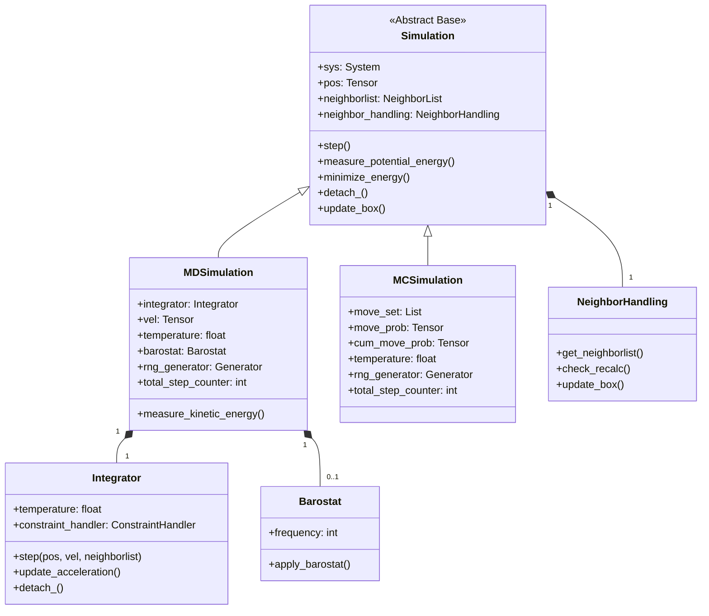

This page documents DIMOS's simulation orchestration framework—the control layer that coordinates energy calculations, integration schemes, constraint handling, and ensemble controllers while managing the evolving state of molecular systems. The architecture separates the simulation orchestration logic from the underlying physics calculations, enabling flexible composition of different simulation types (MD, MC, HMC) with various thermostats, barostats, and integrators.

Sources: [dimos/simulation.py](dimos/simulation.py#L374-L395), [dimos/__init__.py](dimos/__init__.py#L374-L384)

## Simulation Architecture Overview

The simulation framework follows a hierarchical class structure with a common base class providing shared functionality, and specialized subclasses implementing simulation-type-specific behavior. This design enables consistent interfaces for energy calculations and state management across different simulation methodologies while allowing algorithmic specialization where needed.

The orchestration layer serves as the central coordinator, managing the interaction between system configuration, force fields, integrators, and ensemble controllers. It maintains the canonical state of the simulation (positions, velocities, neighbor lists) and ensures all components operate on consistent data representations throughout the simulation lifecycle.




## Base Simulation Class

The `Simulation` class defines the abstract interface and shared functionality for all simulation types. It serves as the foundation, managing system configuration, neighbor lists, and providing common energy measurement and minimization capabilities that apply across MD, MC, and hybrid simulation methods.

The base class maintains references to the system object (containing force field parameters and topology), the current atomic positions, and neighbor list infrastructure. The neighbor handling system integrates with periodic boundary condition enforcement to ensure efficient force calculations while maintaining consistency with the simulation box geometry.

### Energy Measurement and Minimization

The base class provides a `measure_potential_energy()` method that calculates the current potential energy by computing forces at the current configuration. This method triggers neighbor list recalculation if needed before invoking the system's energy calculation routine, ensuring all interatomic distances are correctly evaluated within the cutoff scheme.

The `minimize_energy()` method implements gradient-based energy minimization using PyTorch optimizers, supporting LBFGS, SGD, and Adam optimizers with customizable parameters. For periodic systems, the method applies boundary conditions after each optimization step to maintain atom positions within the primary simulation cell. The implementation handles neighbor list updates during minimization to ensure force calculations remain accurate as atoms move.

Sources: [dimos/simulation.py](dimos/simulation.py#L437-L509)

## Molecular Dynamics Orchestration

The `MDSimulation` class implements the complete orchestration for molecular dynamics simulations, managing the integration of equations of motion, temperature control, and pressure control through configurable integrators, thermostats, and barostats. The class maintains the evolving state of positions and velocities throughout the simulation, coordinating with constraint handlers to maintain geometric constraints such as bond lengths and angles.

### Initialization and State Setup

During initialization, the simulation validates that either initial velocities are provided or a temperature is specified for Maxwell-Boltzmann distribution sampling. The random number generator is seeded for reproducibility, and initial velocities are drawn from the appropriate thermal distribution if not explicitly provided. The system positions are converted to the integrator's data type precision, and boundary conditions are applied for periodic systems.

Neighbor list infrastructure is initialized for systems requiring cutoff-based nonbonded calculations, with configurable update intervals. Positional constraints are applied immediately after initialization to ensure geometric consistency before integration begins. The integrator updates its acceleration cache using the initial configuration, and all tensors are detached from the computation graph to establish the initial simulation state.

Sources: [dimos/simulation.py](dimos/simulation.py#L572-L619)

### Step Execution Flow

The `step()` method executes the core MD integration loop, advancing the simulation through a specified number of timesteps while maintaining all orchestration contracts. For periodic systems, boundary conditions are applied at the beginning of each step to wrap atoms into the primary cell before force calculation.

The integration process follows this sequence: neighbor list verification and recalculation (if needed), integrator step execution producing new positions and velocities, boundary condition application for periodic systems, barostat application (if configured) at specified intervals, and computation graph detachment to control memory usage. The total step counter increments after each successful step, and assertion checks validate that no NaN values appear in positions or velocities.

> [!TIP]
> The detach parameter controls whether tensors are detached from PyTorch's computation graph after each step. Setting `detach=True` (default) is essential for production simulations to prevent unbounded memory growth, but `detach=False` is required when differentiating through simulation steps for gradient-based optimization tasks.

Sources: [dimos/simulation.py](dimos/simulation.py#L620-L666)

### Computation Graph Management

The `detach_()` method provides explicit control over memory usage by detaching tensors from PyTorch's autograd computation graph while preserving the positions' differentiability for energy calculations. This selective detachment strategy detaches the integrator's internal state and velocities completely while keeping positions detached but re-attachable, enabling efficient memory management for long simulations while maintaining the ability to compute forces and energies at any configuration.

For machine learning workflows requiring gradients through the simulation, the detach step can be skipped entirely, allowing backpropagation through the entire trajectory. However, this approach requires substantial memory and is typically only feasible for short simulation segments or when using gradient checkpointing techniques.

Sources: [dimos/simulation.py](dimos/simulation.py#L668-L678)

### Energy Measurement

The `measure_kinetic_energy()` method calculates the instantaneous kinetic energy from atomic velocities, with special handling for velocity Verlet-like integrators that use a non-zero shift parameter. These integrators store a shifted velocity that differs from the physical velocity by a term proportional to the acceleration, requiring a correction before kinetic energy computation. The method recomputes the current acceleration and applies the shift correction to obtain the physical velocity used in kinetic energy calculation.

This careful handling ensures accurate energy measurements even with integrators that use modified velocity representations for numerical stability or efficiency. The kinetic energy calculation integrates with the system's mass data to compute the instantaneous temperature and other thermodynamic properties during analysis.

Sources: [dimos/simulation.py](dimos/simulation.py#L696-L715)

## Monte Carlo Orchestration

The `MCSimulation` class provides orchestration for Monte Carlo simulations, managing move selection, acceptance/rejection decisions, and configuration updates. The class supports arbitrary move sets with user-specified probabilities, enabling flexible composition of different move types such as translational moves, rotational moves, and hybrid MC/MD proposals.

### Move Set Configuration

The simulation accepts a list of move objects and corresponding probability weights, normalizing them to form a probability distribution. Cumulative probabilities are precomputed for efficient move selection during simulation using binary search. The initialization validates that move probabilities sum to unity and that the move set and probability list have matching lengths.

For systems requiring neighbor lists, the neighbor handling infrastructure is initialized with configurable update intervals. Monte Carlo simulations typically use larger neighbor update intervals than MD since configurations change less frequently between accepted moves, reducing computational overhead.

Sources: [dimos/simulation.py](dimos/simulation.py#L774-L802)

### Step Execution and Move Selection

Each Monte Carlo step selects a move from the configured move set according to the specified probability distribution, using a uniform random number and binary search on the cumulative probability distribution. The selected move's `move()` method is invoked, returning updated positions and neighbor list information. The move object handles all acceptance/rejection logic internally, proposing configurations, calculating energy differences, and applying the Metropolis criterion.

For periodic systems, boundary conditions are applied after each move to wrap atoms into the primary cell. The computation graph can be optionally detached after each step for memory management, similar to the MD implementation. This selective detachment enables both traditional Monte Carlo simulations and differentiable gradient-based optimization through MC trajectories.

Sources: [dimos/simulation.py](dimos/simulation.py#L803-L827)

## State Management Mechanisms

The simulation framework employs several key mechanisms to maintain consistent and correct simulation state across components, addressing synchronization, memory management, and configuration updates.

### Box Dimension Updates

The `update_box()` method provides a unified interface for updating simulation box dimensions, propagating changes to all relevant components. When called, it updates the neighbor handling system (cutoff calculations and boundary enforcement), the system object (reciprocal space calculations for Ewald summations), the integrator (for MD simulations), and all move objects (for MC simulations). This centralized update ensures that all components operate on consistent box geometry, preventing inconsistencies that could corrupt force calculations or boundary condition enforcement.

Sources: [dimos/simulation.py](dimos/simulation.py#L680-L694), [dimos/simulation.py](dimos/simulation.py#L828-L843)

### Neighbor List Management

Neighbor list management follows a lazy recalculation strategy optimized for performance. The `NeighborHandling` class tracks the original positions used for the current neighbor list and the simulation box dimensions, comparing current positions against the stored reference to determine whether recalculation is necessary based on displacement thresholds. This check is performed at user-configurable intervals, with MD simulations typically checking every step and MC simulations using larger intervals (default 10 steps).

When recalculation is triggered, the neighbor handling system builds a new neighbor list considering the current atomic configuration, applying periodic boundary conditions and exclusion lists to identify atoms within the nonbonded interaction cutoff. The efficient neighbor list management is critical for performance, especially for large systems with many atoms.

Sources: [dimos/simulation.py](dimos/simulation.py#L445-L447), [dimos/simulation.py](dimos/simulation.py#L645-L646)

### Memory Management and Computation Graph Detachment

PyTorch's automatic differentiation system builds computation graphs that track tensor operations for gradient computation. While essential for backpropagation, these graphs consume substantial memory, particularly for long simulation trajectories. The simulation framework addresses this through the `detach_()` method, which selectively detaches tensors from the computation graph while preserving the ability to compute energies and forces at the current configuration.

The detachment strategy differs between simulation types and components. Velocities and integrator state are fully detached as they don't need to remain differentiable for standard energy calculations. Positions are detached but immediately marked as requiring gradients, allowing subsequent force calculations while breaking the backpropagation chain through previous steps. This selective detachment enables efficient memory usage while maintaining the flexibility needed for differentiable physics workflows.

> [!TIP]
> When implementing custom moves or integrators, ensure proper detachment logic is applied to internal state variables that accumulate gradients across steps. The pattern of detaching and re-enabling gradients on positions while fully detaching other state variables ensures correct behavior for both production and differentiable simulation modes.

## Integration with System Components

The simulation orchestration layer integrates with multiple system components to provide a complete simulation framework. These integrations are handled through well-defined interfaces that maintain separation of concerns while ensuring consistent behavior across the simulation pipeline.

### Force Field Integration

The simulation objects maintain a reference to the system object, which encapsulates force field parameters, topology information, and energy calculation logic. All energy and force calculations are delegated to the system object through methods like `calc_energy()`, with the simulation layer managing the orchestration and state while the system layer handles the physics. This separation allows different force field implementations (classical, ML potentials, hybrid systems) to be used interchangeably without modifying the simulation orchestration code.

### Integrator and Thermostat Coordination

MD simulations delegate integration to pluggable integrator objects, which implement specific algorithms such as velocity Verlet, Langevin dynamics, or Hamiltonian Monte Carlo. The integrator manages its internal state (positions, velocities, accelerations) and provides a `step()` method that advances the system configuration. Thermostats are typically embedded within integrators, handling temperature control through velocity rescaling, friction and noise terms (Langevin), or chain-based thermostats (Nose-Hoover).

The simulation class coordinates with the integrator during initialization, ensuring velocities are initialized at the specified temperature and constraints are applied before the first integration step. During simulation, the simulation passes positions, velocities, neighbor lists, and the system object to the integrator's step method, receiving updated state in return. This delegation pattern enables flexible composition of different integrators and thermostats without modifying the simulation orchestration logic.

Sources: [dimos/simulation.py](dimos/simulation.py#L608-L614), [dimos/simulation.py](dimos/simulation.py#L648)

### Barostat Integration

Pressure control is provided through optional barostat objects that are called at specified intervals during MD simulations. The barostat's `apply_barostat()` method receives the current positions and the simulation object, allowing it to access all necessary state information for volume rescaling and coordinate adjustments. The simulation ensures that barostats are only used with thermostats that control temperature, as required for physically meaningful NPT ensembles.

Barostats are invoked after integration and boundary condition application, modifying the simulation box and atom positions according to the specified barostat algorithm. After barostat application, the simulation continues with the next integration step using the updated box dimensions and atomic configuration. The frequency of barostat application is configurable, with typical values ranging from every step to every 100 steps depending on the system and barostat type.

Sources: [dimos/simulation.py](dimos/simulation.py#L583-L584), [dimos/simulation.py](dimos/simulation.py#L653-L655)

## Practical Usage Patterns

### Basic NVE MD Simulation

A standard NVE simulation requires a system object, integrator, and initial configuration. The integrator handles velocity initialization and integration, while the simulation object manages the main loop. Energy minimization is typically performed before production to remove clashes and ensure stable integration.

```python
import torch
import dimos

# Load system and configuration
system = dimos.GromacsForceField("topology.top", "coordinates.gro")
positions = dimos.read_positions("coordinates.gro")

# Create integrator (NVE ensemble)
integrator = integrators.VelocityVerlet(dt=0.002)

# Initialize simulation
sim = dimos.MDSimulation(
    sys=system,
    integrator=integrator,
    initial_pos=positions,
    initial_vel=torch.randn_like(positions) * 0.1,
    seed=42
)

# Minimize energy
sim.minimize_energy(1000)

# Production run
for i in range(10000):
    sim.step()
    if i % 100 == 0:
        pe = sim.measure_potential_energy()
        ke = sim.measure_kinetic_energy()
        print(f"Step {i}: PE={pe:.2f}, KE={ke:.2f}, Total={pe+ke:.2f}")
```

Sources: [dimos/simulation.py](dimos/simulation.py#L572-L614)

### NVT Simulation with Thermostat

Temperature-controlled simulations use thermostatted integrators such as Langevin dynamics. The integrator manages temperature control internally, requiring only the target temperature as a parameter. The simulation object coordinates with the integrator but doesn't need explicit thermostat configuration.

Sources: [tests/test_nvt.py](tests/test_nvt.py), [dimos/integrators.py](dimos/integrators.py)

### NPT Simulation with Barostat

Pressure-controlled simulations add a barostat to the simulation configuration. The barostat is passed during initialization and invoked at specified intervals during the simulation to adjust volume and coordinates according to the target pressure.

```python
# Create thermostatted integrator (required for barostat)
integrator = integrators.LangevinDynamics(dt=0.002, temperature=300.0)

# Create barostat
barostat = barostats.MonteCarloBarostat(pressure=1.0, temperature=300.0)

# Initialize simulation with barostat
sim = dimos.MDSimulation(
    sys=system,
    integrator=integrator,
    initial_pos=positions,
    temperature=300.0,
    barostat=barostat,
    seed=42
)
```

Sources: [dimos/simulation.py](dimos/simulation.py#L572-L584), [tests/test_barostats.py](tests/test_barostats.py)

### Monte Carlo Simulation

Monte Carlo simulations require specifying move types and probabilities. The move set can include different move types with appropriate weights, and the simulation object handles move selection and execution.

```python
# Define move set
move_set = [
    monte_carlo.TranslationMove(0.1),
    monte_carlo.RotationMove(0.1)
]
move_prob = [0.7, 0.3]  # 70% translations, 30% rotations

# Initialize MC simulation
sim = dimos.MCSimulation(
    sys=system,
    initial_pos=positions,
    move_set=move_set,
    move_prob=move_prob,
    temperature=300.0,
    seed=42
)

# Run simulation
for i in range(10000):
    sim.step()
    if i % 100 == 0:
        energy = sim.measure_potential_energy()
        print(f"Step {i}: Energy={energy:.2f}")
```

Sources: [dimos/simulation.py](dimos/simulation.py#L774-L827), [experiments/dimos_hmc.py](experiments/dimos_hmc.py#L181-L182)

### Differentiable Simulation for ML Training

Machine learning workflows require gradient computation through simulation steps. The `detach=False` parameter preserves the computation graph, enabling backpropagation through the trajectory.

```python
# Create simulation with differentiable integrator
integrator = integrators.VelocityVerlet(dt=0.002)
sim = dimos.MDSimulation(system, integrator, positions, temperature=300.0)

# Forward pass through simulation
for i in range(100):
    sim.step(detach=False)  # Keep computation graph

# Compute loss (e.g., match target conformation)
loss = objective_fn(sim.pos)

# Backward pass - gradients propagate through all steps
loss.backward()
```

Sources: [dimos/simulation.py](dimos/simulation.py#L657-L658), [experiments/dimos_hmc.py](experiments/dimos_hmc.py#L181-L196)

## Simulation Configuration Parameters

### MD Simulation Parameters

| Parameter | Type | Default | Description |
|-----------|------|---------|-------------|
| `sys` | System | Required | System object with force field and topology |
| `integrator` | Integrator | Required | Integration algorithm for MD |
| `initial_pos` | Tensor | Required | Initial atomic positions |
| `initial_vel` | Tensor | None | Initial velocities (if None, sampled from Maxwell-Boltzmann) |
| `temperature` | float | None | Temperature for velocity initialization |
| `barostat` | Barostat | None | Optional pressure controller |
| `seed` | int | 42 | Random number generator seed |
| `neighbor_check_interval` | int | 1 | Steps between neighbor list checks |

Sources: [dimos/simulation.py](dimos/simulation.py#L572-L607)

### MC Simulation Parameters

| Parameter | Type | Default | Description |
|-----------|------|---------|-------------|
| `sys` | System | Required | System object with force field and topology |
| `initial_pos` | Tensor | Required | Initial atomic positions |
| `move_set` | List | Required | List of move objects |
| `move_prob` | List | Required | Probability weights for each move |
| `temperature` | float | None | Simulation temperature |
| `seed` | int | 42 | Random number generator seed |
| `neighbor_check_interval` | int | 10 | Steps between neighbor list checks |

Sources: [dimos/simulation.py](dimos/simulation.py#L774-L801)

## Performance Considerations

### Memory Management

The `detach` parameter in the `step()` method provides control over the trade-off between memory usage and gradient capability. For production simulations, `detach=True` is essential to prevent unbounded memory growth during long trajectories. For differentiable ML workflows, `detach=False` enables backpropagation but requires substantial memory for storing intermediate states.

Consider using gradient checkpointing or shorter trajectories with periodic restarts when gradients are needed through long simulation segments. The selective detachment strategy in `detach_()` provides a template for implementing custom memory management strategies in extensions.

### Neighbor List Update Frequency

The `neighbor_check_interval` parameter controls the frequency of neighbor list verification and recalculation. MD simulations typically use `neighbor_check_interval=1` for accuracy, while MC simulations can use larger values (default 10) since configurations change less frequently between accepted moves. The optimal value depends on the system's diffusion rate and the displacement threshold used for neighbor list recalculation.

Larger intervals reduce computational overhead but may lead to errors if atoms move significantly between updates. The displacement threshold in the neighbor handling system should be tuned based on the typical atomic displacements between neighbor list checks.

### Batch Simulations

For parallel batch simulations (e.g., sampling or optimization), the framework supports vectorized operations where multiple configurations are simulated simultaneously. This requires careful management of batch dimensions in all tensors and compatible move sets and integrators. The memory management strategy becomes particularly important for batch simulations, as computation graph size scales with both trajectory length and batch size.

Sources: [dimos/simulation.py](dimos/simulation.py#L645-L660), [experiments/dimos_hmc.py](experiments/dimos_hmc.py#L26-L27)

## Next Steps

To deepen your understanding of DIMOS simulation capabilities, explore these related topics:

- **[Integrators and Dynamics](11-velocity-verlet-integration)**: Learn about the specific integration algorithms available in DIMOS and their numerical properties
- **[Langevin Dynamics and Thermostats](12-langevin-dynamics-and-thermostats)**: Understand temperature control mechanisms for NVT simulations
- **[Monte Carlo Barostats for Pressure Control](22-monte-carlo-barostats-for-pressure-control)**: Details on pressure control algorithms for NPT ensembles
- **[Energy Conservation and NVE Tests](27-energy-conservation-and-nve-tests)**: Validation strategies for ensuring simulation accuracy
- **[Hamiltonian Monte Carlo and MALA](14-hamiltonian-monte-carlo-and-mala)**: Advanced hybrid Monte Carlo methods combining MD and MC
