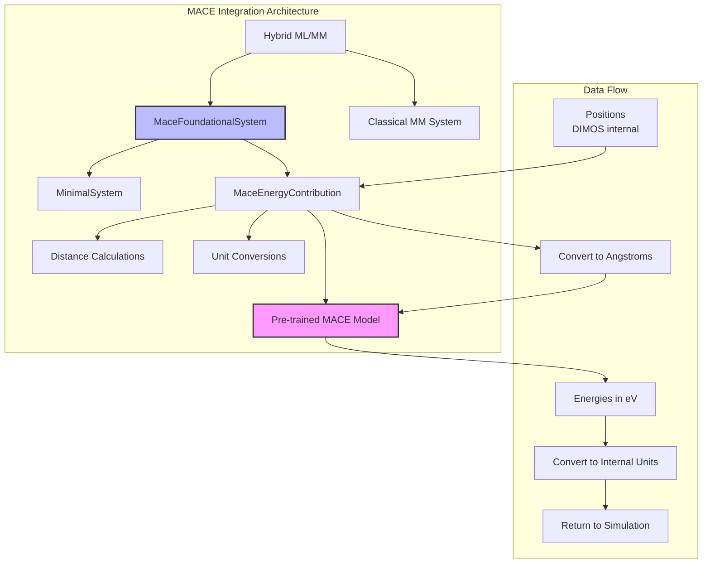

MACE (Materials and Chemical Environment) machine learning potentials represent a sophisticated integration of high-accuracy neural network interatomic potentials within the DIMOS molecular simulation framework. This implementation enables researchers to leverage pre-trained universal force field models that achieve near-DFT accuracy at computational costs comparable to classical force fields, dramatically expanding the accessible time and length scales for materials and biomolecular simulations. The architecture provides seamless integration with DIMOS's modular force field system, supporting both pure ML simulations and hybrid ML/MM approaches for computational efficiency while maintaining rigorous energy conservation and differentiability properties essential for machine learning workflows.

Sources: [dimos/mlip/mace.py](dimos/mlip/mace.py#L374-L388)

## Architecture Overview

The MACE integration in DIMOS follows a layered design pattern that bridges PyTorch-based ML models with classical molecular simulation infrastructure. The architecture consists of two primary components that work in concert: `MaceFoundationalSystem` provides a complete simulation system interface extending DIMOS's `MinimalSystem`, while `MaceEnergyContribution` encapsulates the neural network energy calculation as a modular force field component. This design allows MACE to function interchangeably with classical force fields or as part of hybrid ML/MM systems, maintaining consistency with DIMOS's energy evaluation and force computation interfaces.



The `MaceFoundationalSystem` constructor orchestrates initialization by loading pre-trained models, configuring periodic boundary conditions, establishing neighbor lists, and computing the cutoff radius from the model's `r_max` parameter. This system class automatically creates a `MaceEnergyContribution` instance and adds it to the `nonbonded_force_components` list, ensuring seamless integration with DIMOS's energy aggregation framework. The energy contribution class manages all interactions with the MACE neural network, including atomic number encoding, batch processing setup, and distance computation for periodic systems.

Sources: [dimos/mlip/mace.py](dimos/mlip/mace.py#L400-L499), [dimos/mlip/mace.py](dimos/mlip/mace.py#L533-L598)

## Model Variants and Selection

DIMOS provides access to multiple families of pre-trained MACE models through the `mace_name` parameter, each optimized for different chemical domains and computational requirements. The available model families include materials projector (MP) models trained on the Materials Project database for inorganic systems, off-equilibrium (OFF) models for organic molecules and drug-like compounds, and ANI-inspired models for chemical accuracy in molecular systems. Model sizes range from "small" variants offering maximum speed to "large" variants providing higher accuracy at increased computational cost.

| Model Family | Prefix | Use Case | Size Variants | Cutoff Radius |
|-------------|--------|----------|--------------|--------------|
| Materials Project | `mace-mp-` | Inorganic materials, metals, semiconductors | small, medium, large | 4.0-5.0 Å |
| Off-Equilibrium | `mace-off-` | Organic molecules, drug-like compounds | small, medium, large | 4.0-5.0 Å |
| ANI-inspired | `mace-ani` | Chemical accuracy, conformer sampling | single model | ~5.0 Å |

> [!TIP]
> The cutoff radius varies between model sizes and families; the large MACE-MP model uses a 5.0 Å cutoff compared to smaller models that typically use 4.0 Å. Always use the `mace_cutoff` attribute from the loaded model rather than hardcoding values, as this ensures correct neighbor list construction for each model variant.

Model loading occurs during initialization through conditional import statements that access `mace.calculators.foundations_models`. The implementation automatically handles device placement and dtype conversion, ensuring compatibility with both CPU and GPU execution contexts. For custom-trained MACE models, the architecture supports loading from file paths using `torch.load`, providing flexibility for research applications requiring specialized potentials.

Sources: [dimos/mlip/mace.py](dimos/mlip/mace.py#L550-L572), [tests/test_mace.py](tests/test_mace.py#L438-L444)

## CuEq Acceleration

A critical performance optimization in the MACE integration is the CuEq (Cu Equivariant) acceleration mechanism, which optimizes the spherical tensor operations within the MACE neural network architecture. When `enable_cueq=True`, the implementation automatically applies `mace.cli.convert_e3nn_cueq.run` to transform the loaded model, significantly accelerating the computationally expensive equivariant tensor operations that dominate MACE inference time. The conversion process carefully handles device and dtype management to prevent compatibility issues during the transformation.

The acceleration mechanism includes temporary device state management to work around known bugs in MACE and e3nn libraries. The implementation temporarily sets the default device to CPU during model conversion, then restores the original device configuration and applies the target dtype. This ensures consistent behavior across different hardware configurations while maintaining numerical precision requirements. In benchmark scenarios, CuEq acceleration can provide 2-4× speedups on modern GPU hardware, making large-scale ML-MD simulations practical for research applications.

Sources: [dimos/mlip/mace.py](dimos/mlip/mace.py#L574-L584), [benchmark/water/dimos_water_ml.py](benchmark/water/dimos_water_ml.py#L79-L82)

## Unit System Conversions

MACE models operate in a specific unit convention—positions in Angstroms and energies in electron volts (eV)—that differs from DIMOS's configurable internal unit systems. The energy contribution class manages these conversions transparently through conversion factors defined in `dimos.constants`. Position conversion uses `constants.internal_to_Angstrom` to transform DIMOS coordinates before passing them to the MACE model, while energy conversion uses `constants.eV_to_internal` to transform the model's output back to DIMOS's energy units.

The unit conversion factors depend on the selected unit system during `MaceFoundationalSystem` initialization. For the default Amber unit system (kcal/mol), the conversion factor is 23.0605 eV to kcal/mol, while OpenMM/Gromacs (kJ/mol) uses 96.4853 eV to kJ/mol. The initialization process calls `constants.init_constants_in_unit_system(unit_system)` to establish these global conversion factors, ensuring consistency across all energy components. This design allows MACE to function seamlessly with different force field conventions without requiring manual unit transformations.

Sources: [dimos/mlip/mace.py](dimos/mlip/mace.py#L647-L651), [dimos/constants.py](dimos/constants.py#L399-L445), [dimos/mlip/mace.py](dimos/mlip/mace.py#L465-L467)

## Energy Calculation Pipeline

The energy computation process in `calc_energy` follows a multi-stage pipeline that prepares the appropriate input format for MACE's graph neural network architecture. Given atomic positions and an edgelist from DIMOS's neighbor list management, the method first applies atom range selection if specified, enabling partial system treatment where only a subset of atoms uses the ML potential. The method then computes distances and shift vectors for periodic systems using `get_distances_and_shifts`, applying a distance mask to filter interactions beyond the MACE cutoff radius.

The implementation constructs bidirectional edge indices by concatenating forward and reverse neighbor pairs, ensuring that each interaction appears in both directions as required by the message-passing neural network architecture. Shift vectors are similarly duplicated with sign reversal for periodic boundary condition handling. The input dictionary for MACE includes transformed positions, edge indices, periodic shift vectors, atomic node attributes (one-hot encoded atomic numbers), batch pointers, and the simulation cell tensor if periodic.

The MACE model returns a dictionary containing both total energy and interaction energy components. The implementation selects the appropriate energy type based on the `energy_type` parameter (defaulting to 'interaction_energy'), which excludes atomic self-energy terms often present in ML potentials. Finally, the energy undergoes unit conversion from eV to DIMOS's internal units before being returned to the simulation framework. This entire computation graph remains differentiable, enabling gradient computation for force calculations and ML training workflows.

Sources: [dimos/mlip/mace.py](dimos/mlip/mace.py#L619-L663), [dimos/utils.py](dimos/utils.py#L443-L472)

## Periodic Boundary Conditions and Box Handling

MACE supports periodic boundary conditions through explicit cell tensor specification and shift vector computation. When `periodic=True` and a box tensor is provided, the initialization process stores both the linear box dimensions and the full 3×3 cell matrix required by MACE's internal operations. The `update_box` method allows dynamic box resizing during NPT simulations, updating both the cell tensor in the input dictionary and the internal linear box representation used for distance calculations.

Distance calculations for periodic systems use the `get_distances_and_shifts` utility function, which computes minimum image convention distances and the corresponding shift vectors needed to reconstruct periodic interactions. These shift vectors are passed to the MACE model alongside positions and edge indices, enabling the neural network to correctly account for periodic images. The implementation supports both cubic and orthorhombic box geometries, with the cell tensor automatically constructed as a diagonal matrix from the box vectors for cubic systems.

> [!TIP]
> When using MACE with periodic boundary conditions in non-periodic systems (gas-phase molecules), a common workaround is to embed the molecule in a sufficiently large periodic box. This is often necessary because DIMOS's neighbor list implementation has limited support for fully non-periodic systems. The box should be large enough that interactions between periodic images are negligible beyond the MACE cutoff radius.

Sources: [dimos/mlip/mace.py](dimos/mlip/mace.py#L607-L618), [dimos/mlip/mace.py](dimos/mlip/mace.py#L592-L598), [tests/test_mace.py](tests/test_mace.py#L432-L436)

## Integration with Simulation Workflows

The MACE integration follows DIMOS's standard simulation interface, enabling seamless replacement of classical force fields with ML potentials. A complete MD simulation setup requires specifying masses, atomic numbers, and MACE model configuration, then selecting an integrator and creating a `MDSimulation` object. The following example demonstrates simulation of an alanine peptide using the small MACE-MP model:

```python
import torch
from dimos.mlip.mace import MaceFoundationalSystem
from dimos.integrators import VelocityVerlet
from dimos.simulation import MDSimulation
import parmed.amber

# Load system topology and coordinates
parameters = parmed.amber.AmberParm("ala5_gas.prmtop")
rst7_file = parmed.amber.Rst7("ala5_gas.rst7")
positions = torch.tensor(rst7_file.positions.value_in_unit(parmed.unit.angstrom))

# Extract atomic information
num_atoms = len(parameters.atoms)
atomic_numbers = torch.tensor([atom.atomic_number for atom in parameters.atoms], dtype=torch.int32)
masses = torch.tensor([atom.mass for atom in parameters.atoms], dtype=torch.float32)

# Create MACE system (non-periodic gas-phase)
system = MaceFoundationalSystem(
    masses=masses,
    atomic_numbers=atomic_numbers,
    mace_name="mace-mp-small",
    periodic=False,
    box=None,
    enable_cueq=True
)

# Setup integration and simulation
integrator = VelocityVerlet(dt=0.5, system=system)
simulation = MDSimulation(system, integrator, positions, temperature=300, neighbor_check_interval=10)

# Run simulation
for i in range(100):
    simulation.step(10)
```

The interface also supports conversion from existing Amber force field systems through the `as_mace_system()` method, allowing researchers to easily replace classical potentials with ML alternatives. This method extracts atomic information and box dimensions from the classical system and constructs a configured `MaceFoundationalSystem`, maintaining consistency with the original system's unit system and periodic boundary conditions.

Sources: [tests/test_mace.py](tests/test_mace.py#L413-L451), [benchmark/water/dimos_water_ml.py](benchmark/water/dimos_water_ml.py#L69-L82)

## Hybrid ML/MM Integration

For systems where computational efficiency requires treating only a subset of atoms with the ML potential, DIMOS provides the `MLMMsystem` class that combines MACE with classical force fields in a single simulation. This hybrid approach is particularly valuable for systems with localized regions requiring high accuracy (e.g., active sites in enzymes) while the bulk environment can be described by computationally cheaper classical potentials. The hybrid system automatically partitions interactions into ML-ML, ML-MM, and MM-MM components, applying appropriate potentials to each category.

The `treat_mlmm_classically` parameter controls whether ML-MM cross-terms use classical potentials or are included in the ML potential's interaction energy. When set to `True` (default), ML-MM interactions are computed using classical Lennard-Jones and electrostatic potentials, which typically provides better energy conservation and avoids potential artifacts at the ML/MM boundary. This configuration also enables electrostatic treatment through PME for the periodic MM environment, providing accurate long-range interactions.

The ML/MM implementation carefully manages neighbor list partitioning to ensure each interaction is computed with the appropriate potential. Mask operations identify purely ML, purely MM, and mixed pairs, creating separate neighbor lists for each potential type. This approach maintains the efficiency of neighbor list updates while correctly applying boundary conditions between different potential regimes.

Sources: [dimos/mlmm.py](dimos/mlmm.py#L402-L514), [dimos/mlmm.py](dimos/mlmm.py#L375-L391)

## Performance Considerations and GPU Acceleration

MACE potentials achieve optimal performance on GPU hardware through PyTorch's automatic acceleration of tensor operations. The implementation supports both CUDA and ROCm backends, with automatic device placement controlled by `torch.set_default_device()`. Computational performance scales with model size—small models achieve 50-100 ns/day on single GPUs for modestly sized systems, while large models may achieve 10-20 ns/day due to the increased neural network complexity. CuEq acceleration provides an additional 2-4× speedup on compatible hardware, making large models practical for production simulations.

Memory usage depends primarily on the number of atoms and the MACE model's architectural complexity. Typical memory requirements range from 2-4 GB for systems with 1000 atoms using small models to 8-16 GB for large models or systems with 10,000+ atoms. The implementation's differentiable nature enables gradients to flow through the energy computation, but this also means that computational graphs accumulate unless explicitly detached, potentially causing memory growth during long simulations. Careful management of gradient computation and periodic graph detachment is essential for production workloads.

PyTorch compilation through `torch.compile()` can provide additional speedups, particularly for inference-heavy workloads. The benchmark suite demonstrates compilation using `mode="max-autotune-no-cudagraphs"` for optimal performance, though compilation overhead should be considered for short simulations. The water benchmarks show that compiled MACE simulations can achieve competitive performance with optimized ASE implementations while maintaining full integration with DIMOS's simulation and analysis capabilities.

Sources: [benchmark/water/dimos_water_ml.py](benchmark/water/dimos_water_ml.py#L58-L96), [benchmark/water/dimos_water_ml.py](benchmark/water/dimos_water_ml.py#L137-L141)

## Configuration Parameters and Customization

The MACE integration provides extensive configuration options through constructor parameters, allowing researchers to tailor the behavior to specific application requirements. Key configuration options include model selection (`mace_name`, `path`), acceleration settings (`enable_cueq`), periodic boundary conditions (`periodic`, `box`), neighbor list usage (`use_neighborlist`), and data type precision (`dtype`). The `unit_system` parameter controls the internal unit convention and affects conversion factors applied during energy and position transformations.

For advanced applications, the `atom_range` parameter enables selective application of the ML potential to a subset of atoms, with indices specified as `(start, end)` to define the range. This capability is particularly useful for active learning workflows or for treating specific regions with different potentials. The `energy_type` parameter controls whether the returned energy includes atomic self-terms (`energy`) or only interaction energies (`interaction_energy`), with the latter typically preferred for molecular dynamics simulations to avoid double-counting self-energy contributions.

Custom model loading is supported through the `path` parameter, which accepts a file path to a PyTorch-saved MACE model. This enables researchers to use specialized potentials trained on specific chemical systems or experimentally refined models. The loading mechanism handles device and dtype conversion automatically, ensuring compatibility with the rest of the simulation framework regardless of the model's original training configuration.
