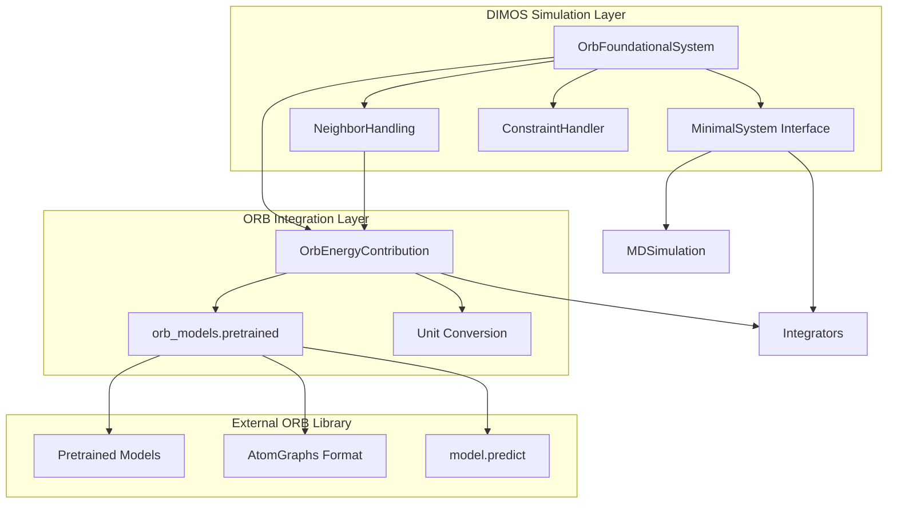
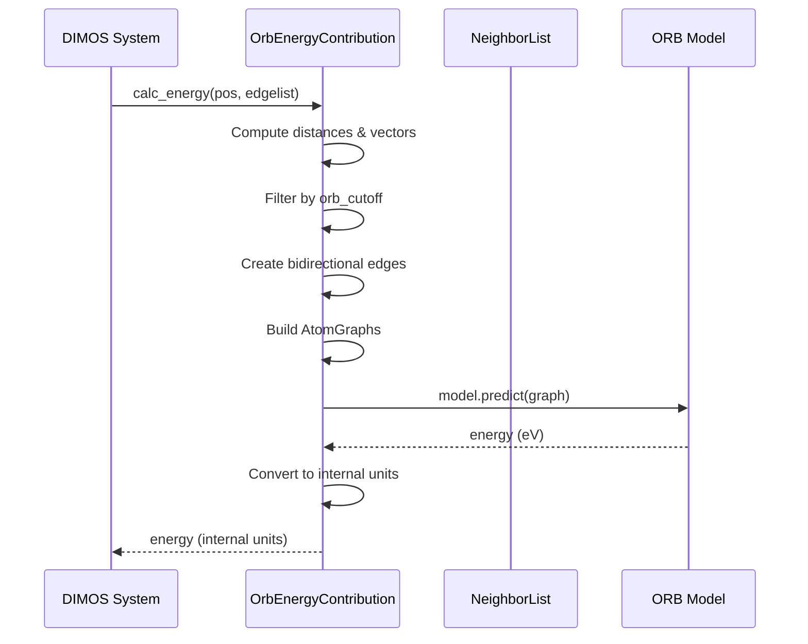

This page provides a comprehensive technical guide to ORB (Orbital Materials) machine learning potential integration within DIMOS. ORB potentials enable high-accuracy molecular simulations using neural network interatomic potentials trained on quantum mechanical calculations, offering DFT-level accuracy at computational costs comparable to classical force fields. The integration maintains DIMOS's modular architecture while providing seamless access to pre-trained ORB foundational models for both periodic and non-periodic systems.

## Architecture Overview

ORB ML potentials integrate into DIMOS through a two-layer architecture: a system orchestration layer that manages the simulation state and an energy calculation layer that interfaces with the ORB model library. This design mirrors the MACE integration pattern, maintaining consistency across different ML potential frameworks while accommodating ORB-specific requirements.



The architecture demonstrates how ORB models sit as energy providers within DIMOS's flexible force field system. The `OrbFoundationalSystem` class inherits from `MinimalSystem` [dimos/mlip/orb.py#L398], providing a consistent interface that DIMOS's simulation orchestrator expects. The `OrbEnergyContribution` class handles the actual energy computation by converting DIMOS's internal data structures to ORB's `AtomGraphs` format and managing unit conversions between the two systems [dimos/mlip/orb.py#L478-L531].

## Core Classes and Their Responsibilities

### OrbFoundationalSystem

The `OrbFoundationalSystem` serves as the primary interface for simulations using ORB potentials. This class manages system-level properties including masses, periodic boundary conditions, and integration with DIMOS's constraint handling and neighbor list infrastructure.

```python
system = OrbFoundationalSystem(
    masses=masses,
    atomic_numbers=atomic_numbers,
    orb_name="orb_v2",
    periodic=True,
    box=box,
    use_neighborlist=True,
    unit_system="amber",
    dtype=torch.float64
)
```

The constructor accepts atomic masses and numbers alongside configuration parameters [dimos/mlip/orb.py#L448-L458]. The `orb_name` parameter specifies which pre-trained ORB model to load—currently, only foundational models like "orb_v2" are supported, with custom ORB models raising a `NotImplementedError` [dimos/mlip/orb.py#L520-L524]. The system automatically creates an `OrbEnergyContribution` instance and adds it to the nonbonded force components list, establishing the energy calculation pipeline.

> [!TIP]
> The system enforces that ORB models use the neighbor list infrastructure when available, setting the `use_neighborlist` parameter to `True` by default. This is critical for performance—the ORB cutoff distance (default 6.0 Å) defines the neighbor search radius, and efficient neighbor management becomes essential for systems with thousands of atoms.

### OrbEnergyContribution

This class encapsulates the actual energy calculation logic and manages the interface between DIMOS's internal representation and ORB's expected input format. The initialization loads the specified ORB model using `orb_models.forcefield.pretrained` and prepares atomic information for the graph-based neural network [dimos/mlip/orb.py#L520-L547].

| Parameter | Type | Default | Description |
|-----------|------|---------|-------------|
| `atomic_numbers` | torch.Tensor | required | Nuclear charges (Z values) for all atoms |
| `box` | torch.Tensor | None | Periodic box vectors (diagonal or triclinic) |
| `periodic` | bool | False | Enable periodic boundary conditions |
| `orb_name` | str | 'orb_v2' | Name of pretrained ORB model |
| `orb_cutoff` | float | 6.0 | Distance cutoff for interactions (Å) |
| `dtype` | torch.dtype | torch default | Floating point precision |

The `calc_energy` method performs the core computation: it receives atomic positions and an edgelist from DIMOS's neighbor system, computes interatomic distances and vectors, filters by the ORB cutoff, constructs bidirectional edges, and assembles an `AtomGraphs` object compatible with ORB's prediction API [dimos/mlip/orb.py#L567-L624]. The returned energy undergoes unit conversion from eV to DIMOS's internal energy units using the `constants.eV_to_internal` conversion factor.

## Unit System Conversions

ORB models operate in a specific unit system (positions in Angstroms, energies in eV), while DIMOS supports multiple unit systems configurable via `unit_system` parameter. The ORB integration handles this conversion transparently through the `constants.eV_to_internal` factor [dimos/mlip/orb.py#L623]. This conversion ensures that energies returned from the ORB model are consistent with DIMOS's internal representation, whether using Amber, Gromacs, or reduced units.

For developers extending the system, note that position units are assumed to be in Angstroms when passed to the ORB model. If using a different length unit in DIMOS, additional conversion would be required before constructing the `AtomGraphs` object. The current implementation assumes the input positions are already compatible with ORB's expectations.

## Graph Construction Process

The energy calculation transforms DIMOS's sparse representation (positions + edgelist) into ORB's dense graph format through a multi-step process:



The bidirectional edge construction is noteworthy: for each filtered atom pair (i,j), both (i→j) and (j→i) edges are created with opposite direction vectors but identical distances [dimos/mlip/orb.py#L595-L600]. This ensures the graph neural network can compute messages in both directions, which is essential for proper energy and force calculations. The resulting edge features contain distance (`r`) and displacement vector (`vectors`) information, while node features include atomic numbers and one-hot embeddings.

## Integration with Classical Force Fields

A key feature of DIMOS's ORB integration is the ability to convert classical force field systems to ORB-based systems using the `as_orb_system()` method on `ClassicalParmedForceField` instances [dimos/ff.py#L1322-L1366]. This enables hybrid workflows where you can setup a system using Amber or Gromacs force files, then selectively replace the nonbonded interactions with ORB potentials while preserving the bonded terms and constraints.

```python
# Setup from classical force field
mm_system = AmberForceField('system.prmtop', cutoff=5.0, periodic=True)

# Convert to ORB system (replaces nonbonded with ORB)
orb_system = mm_system.as_orb_system(orb_name="orb-v2")

# Run simulation
integrator = VelocityVerlet(0.5, mm_system)
simulation = MDSimulation(orb_system, integrator, positions, temperature=300)
```

The conversion process extracts atomic numbers and masses from the ParmEd structure and constructs a new `OrbFoundationalSystem` [dimos/ff.py#L1334-L1353]. Importantly, it preserves the constraint handler from the original system, allowing bonds to remain constrained while ORB handles nonbonded interactions. The `atom_range` parameter provides selective conversion, enabling QM/MM-style approaches where only a subset of atoms use ORB potentials.

> [!TIP]
> When converting from classical force fields, verify that the ORB model supports all element types present in your system. ORB foundational models are trained on specific element sets, and unsupported elements will cause prediction failures. The atomic_numbers tensor passed to the constructor determines which elements the model will encounter.

## Periodic Boundary Condition Handling

ORB energy calculations support periodic systems through careful management of box vectors. When `periodic=True` and a `box` tensor is provided, the system stores both linear and diagonal forms of the box [dimos/mlip/orb.py#L540-L543]. During energy calculation, the `get_distances_and_vectors` function (imported from DIMOS's energy module) applies minimum image conventions, ensuring that atoms interact across periodic boundaries correctly.

The `update_box` method enables dynamic box resizing during NPT simulations or when applying barostats [dimos/mlip/orb.py#L555-L564]. This method updates both box representations, ensuring that subsequent energy calculations use the correct periodic dimensions. For constant-pressure simulations, this allows ORB-based systems to work seamlessly with DIMOS's barostat implementations [Monte Carlo Barostats for Pressure Control](22-monte-carlo-barostats-for-pressure-control).

## Performance Considerations

The computational efficiency of ORB-based simulations depends heavily on several factors:

1. **Neighbor List Management**: The integration leverages DIMOS's cell list algorithm for O(n) neighbor construction rather than O(n²) all-pairs calculations [dimos/neighbor_handling.py#L396-L421]. With a skin distance, neighbor lists can be reused over multiple timesteps, dramatically reducing overhead.

2. **Batch Processing**: The ORB model's `predict` method accepts batched graphs, allowing multiple systems or large systems to be processed efficiently. However, DIMOS's current implementation processes the entire system as a single graph.

3. **Cutoff Radius**: The 6.0 Å default cutoff balances accuracy and computational cost. For systems with long-range interactions, consider adjusting this parameter, though larger cutoffs increase both neighbor list construction time and graph neural network computation.

4. **GPU Acceleration**: ORB models run on GPUs when available, with the device determined by `torch.get_default_device()` [dimos/mlip/orb.py#L526]. For large systems (>1000 atoms), GPU acceleration provides significant speedups over CPU inference.

## Comparison with Other ML Potentials

| Feature | ORB | MACE | Classical FF |
|---------|-----|------|--------------|
| Accuracy | DFT-level | DFT-level | Empirical |
| Training Data | Quantum datasets | Materials Project | Experimental/QM |
| Computational Cost | High (NN inference) | High (NN inference) | Low |
| Transferability | Element-specific | Broad chemical space | Limited by parameterization |
| Periodic BC Support | Yes | Yes | Yes |
| GPU Required | Recommended | Recommended | No |
| Forces Available | Yes (via model.predict) | Yes | Analytic |

ORB and MACE both provide similar accuracy levels but differ in their underlying architectures and training data. The choice between them often depends on the chemical systems of interest and which model was trained on more relevant data. For organic molecules and biomolecules, ORB's foundational models often perform well, while MACE excels in materials science applications.

## Working Example

The following example demonstrates a complete workflow from loading an Amber system to running an MD simulation with ORB potentials:

```python
import torch
import parmed.amber
import dimos.ff as ff
import dimos.integrators as integrators
import dimos.simulation as simulation

# Load system from Amber files
mm_system = ff.AmberForceField(
    './examples/amber/amber25.prmtop',
    cutoff=5.0,
    switch_distance=3.5,
    nonbonded_type="Cutoff",
    periodic=True
)

# Convert to ORB system
orb_system = mm_system.as_orb_system("orb-v2")

# Load initial coordinates
rst7_file = parmed.amber.Rst7('./examples/amber/amber25.inpcrd')
positions = torch.tensor(
    rst7_file.positions.value_in_unit(parmed.unit.angstrom)
)

# Setup integrator and simulation
integrator = integrators.VelocityVerlet(dt=0.5, mass_system=mm_system)
md_sim = simulation.MDSimulation(
    orb_system, 
    integrator, 
    positions, 
    temperature=300
)

# Measure initial energy
energy = md_sim.measure_potential_energy()
print(f"Initial potential energy: {energy}")

# Run simulation steps
for _ in range(1000):
    md_sim.step()
    if _ % 100 == 0:
        current_energy = md_sim.measure_potential_energy()
        print(f"Step {_}, energy: {current_energy}")
```

This example, adapted from the test suite [tests/test_orb.py#L380-L424], shows the complete workflow: system initialization, conversion to ORB, energy measurement, and time integration. The simulation loop can be extended with trajectory output, pressure control, or enhanced sampling methods as needed.

## Testing and Validation

The ORB integration includes comprehensive tests that validate energy calculations and basic MD functionality [tests/test_orb.py](tests/test_orb.py). Tests cover:

- Energy calculation consistency between direct ORB predictions and DIMOS integration
- MD simulation stability over multiple timesteps
- Periodic boundary condition handling
- Conversion from classical force fields to ORB systems

When developing new features or extending the ORB integration, ensure that all existing tests pass and add new tests for the added functionality. This maintains reliability as the codebase evolves.

## Next Steps

For developers looking to extend ORB functionality or explore related topics:

- **Hybrid ML/MM Systems**: Learn how to combine ORB with classical force fields in [Hybrid ML/MM Systems: Design and Implementation](18-hybrid-ml-mm-systems-design-and-implementation)
- **GPU Optimization**: Explore PyTorch compilation and GPU acceleration strategies in [GPU Acceleration and PyTorch Compilation](23-gpu-acceleration-and-pytorch-compilation)
- **Neighbor Lists**: Dive deeper into efficient neighbor management in [Neighbor List Management and Cutoff Schemes](24-neighbor-list-management-and-cutoff-schemes)
- **Energy Training**: Understand differentiable energy landscapes for ML training in [Differentiable Energy Landscapes for ML Training](19-differentiable-energy-landscapes-for-ml-training)

The ORB integration represents DIMOS's commitment to providing access to state-of-the-art machine learning potentials while maintaining the framework's flexibility and performance characteristics. As ML potential methodologies continue to evolve, this modular architecture allows for seamless integration of new models and techniques.