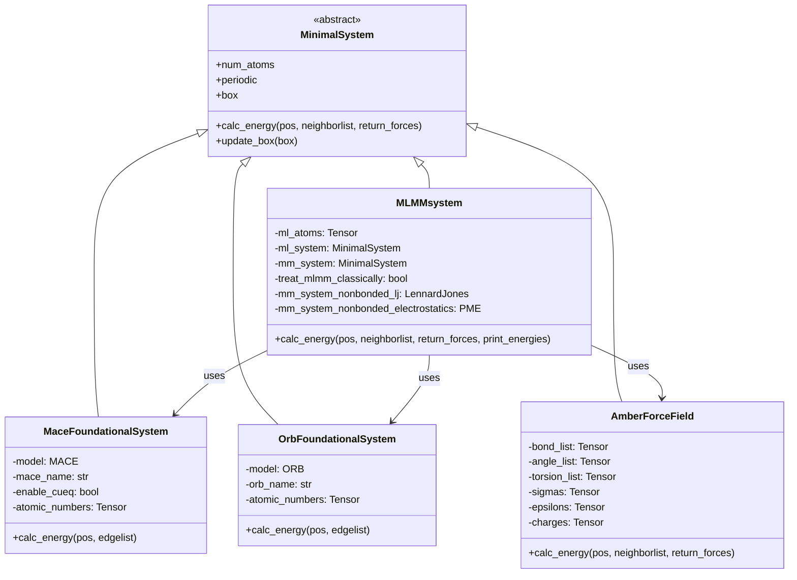
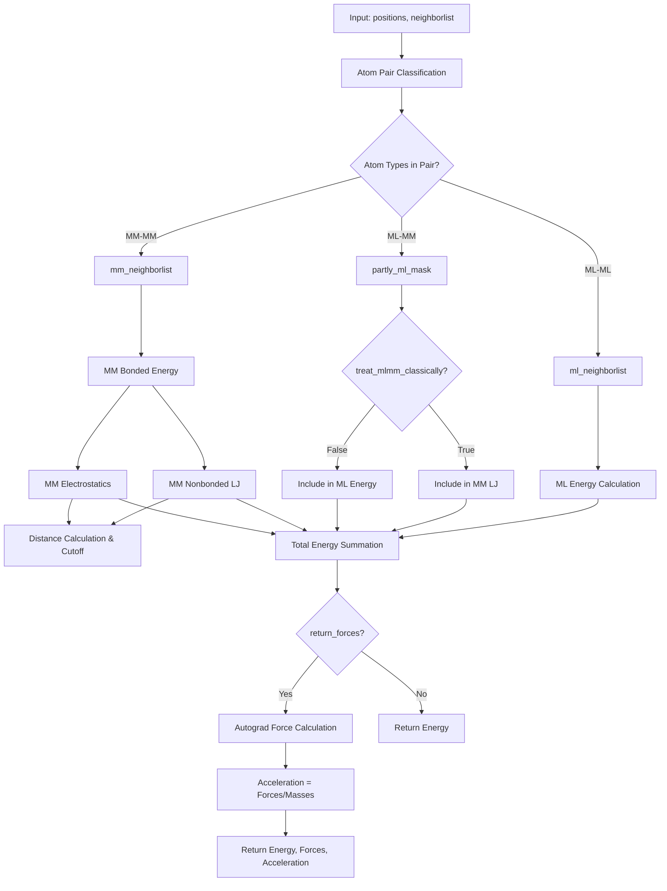

Hybrid ML/MM (Machine Learning/Molecular Mechanics) systems in DIMOS enable sophisticated molecular dynamics simulations that strategically combine the quantum-accuracy of machine learning potentials with the computational efficiency of classical force fields. This design allows you to apply high-accuracy ML potentials to critical regions (such as reactive centers or conformationally active sites) while treating the bulk system with efficient classical force fields.

## Architectural Foundation

The hybrid ML/MM architecture centers on the **MLMMsystem** class ([dimos/mlmm.py#L402-L451](dimos/mlmm.py#L402-L451)), which orchestrates the interaction between ML and MM computational domains. The system follows a clean separation of concerns pattern where ML potentials handle selected atom subsets while classical force fields manage the remainder and optionally the cross-interactions.



The MLMMsystem inherits from [MinimalSystem](dimos/mlmm.py#L402), ensuring compatibility with DIMOS's simulation orchestration framework while providing specialized hybrid energy calculation methods. The constructor accepts five critical parameters that define the hybrid configuration ([dimos/mlmm.py#L453-L471](dimos/mlmm.py#L453-L471)):

| Parameter | Type | Purpose |
|-----------|------|---------|
| `ml_atoms` | list or Tensor | Indices of atoms treated with ML potentials |
| `ml_system` | MinimalSystem | ML potential system (MaceFoundationalSystem or OrbFoundationalSystem) |
| `mm_system` | MinimalSystem | Classical MM system (typically AmberForceField) |
| `treat_mlmm_classically` | bool | Whether ML-MM interactions use classical potentials (default: True) |
| `electrostatic_type` | str or None | Electrostatic method ("PME" or None) |

> [!TIP]
> The `treat_mlmm_classically` parameter is critical: when True, ML-MM interactions use efficient classical force fields; when False, these interactions require ML potential evaluation, significantly increasing computational cost but potentially improving accuracy at the ML/MM interface.

## Energy Calculation Architecture

The core innovation in DIMOS's hybrid approach lies in the sophisticated energy decomposition strategy implemented in `calc_energy()` ([dimos/mlmm.py#L502-L615](dimos/mlmm.py#L502-L615)). The algorithm partitions atom pairs into three interaction categories and computes energies independently for each domain.



The classification process begins by identifying which atoms in each neighbor list pair belong to the ML region using boolean masking ([dimos/mlmm.py#L529-L541](dimos/mlmm.py#L529-L541)):

```python
mask_ml_0 = torch.isin(neighborlist[0], self.ml_atoms)
mask_ml_1 = torch.isin(neighborlist[1], self.ml_atoms)

purely_ml_mask = mask_ml_0 & mask_ml_1
partly_ml_mask = (mask_ml_0 | mask_ml_1) & ~purely_ml_mask
purely_mm_mask = ~mask_ml_0 & ~mask_ml_1
```

This creates three neighbor lists that are processed independently:

- **ML-ML pairs**: Processed by the ML potential system
- **MM-MM pairs**: Processed by classical bonded and nonbonded terms  
- **ML-MM pairs**: Handled based on `treat_mlmm_classically` flag

The total energy calculation ([dimos/mlmm.py#L594](dimos/mlmm.py#L594)) combines four components:

```
E_total = E_MM_bonded + E_LJ + E_electrostatics + E_ML
```

## ML Potential Integration

DIMOS integrates two state-of-the-art ML potential frameworks: **MACE** (Multi-Atomic Cluster Expansion) and **ORB** (Orbital representation-based potentials). Both provide foundational system classes that implement the MinimalSystem interface for seamless integration with the hybrid framework.

### MACE Integration

The `MaceFoundationalSystem` class ([dimos/mlip/mace.py#L400-L468](dimos/mlip/mace.py#L400-L468)) provides a comprehensive interface to pre-trained MACE models. Key features include:

- **CuEq acceleration**: Optional equivariant attention mechanism for improved performance
- **Unit conversion**: Automatic conversion between MACE's native units (Ångström, eV) and DIMOS internal units
- **Flexible atom selection**: `atom_range` parameter allows computing energies for specific atom subsets
- **Periodic boundary support**: Full compatibility with periodic simulation boxes

The energy calculation method ([dimos/mlip/mace.py#L619-L662](dimos/mlip/mace.py#L619-L662)) constructs a bidirectional edge representation required by MACE:

```python
idx_i_bi = torch.cat([edgelist[0], edgelist[1]])
idx_j_bi = torch.cat([edgelist[1], edgelist[0]])
edge_index = torch.stack([idx_i_bi, idx_j_bi])
shifts = torch.cat([shifts, -shifts])
```

This creates symmetric edge pairs with corresponding periodic shift vectors, enabling MACE to properly account for periodic boundary conditions in its neural network architecture.

### ORB Integration

The `OrbFoundationalSystem` class ([dimos/mlip/orb.py#L398-L457](dimos/mlip/orb.py#L398-L457)) provides similar functionality for ORB potentials. The key difference lies in the graph construction ([dimos/mlip/orb.py#L609-L619](dimos/mlip/orb.py#L609-L619)) where ORB uses a more structured `AtomGraphs` representation:

```python
input_graph = base.AtomGraphs(
    senders=edge_index[0],
    receivers=edge_index[1],
    n_node=torch.tensor([pos.size(0)]),
    n_edge=torch.tensor([edge_index[0].size(0)]),
    edge_features=edge_features,
    node_features=node_features,
    system_features=system_features,
    radius=10.0,
    max_num_neighbors=20,
)
```

| Feature | MACE | ORB |
|---------|------|-----|
| Model variants | mace-mp-small/medium/large | orb_v2 |
| CuEq acceleration | Yes | No |
| Graph representation | Dict-based edge indices | Structured AtomGraphs |
| Default cutoff | Model-specific | 6.0 Å |
| Energy return type | Configurable (total/interaction) | Graph prediction |

## Nonbonded Interaction Handling

The hybrid system maintains sophisticated nonbonded interaction handling to ensure physical consistency across the ML/MM boundary. This is managed through two dedicated instances of classical nonbonded calculators:

1. **LennardJones** ([dimos/energy.py#L1183-L1290](dimos/energy.py#L1183-L1290)): Handles van der Waals interactions with cutoff and switching functions
2. **PME** ([dimos/energy.py#L812-L931](dimos/energy.py#L812-L931)): Particle Mesh Ewald for long-range electrostatics

The critical design decision lies in how the system handles the cutoff mask for Lennard-Jones interactions when electrostatics are present ([dimos/mlmm.py#L566-L575](dimos/mlmm.py#L566-L575)):

```python
if self.treat_mlmm_classically:
    within_cutoff_lj = within_cutoff & mm_and_partly_ml_mask
else:
    within_cutoff_lj = within_cutoff & purely_mm_mask
```

When `treat_mlmm_classically=True`, the LJ calculation includes both MM-MM and ML-MM pairs, ensuring consistent van der Waals treatment across the entire system. When False, only pure MM pairs are included, which requires careful consideration of the physical implications at the interface.

> [!TIP]
> The PME electrostatics calculation is always performed on the full system (including ML-MM interactions) regardless of the `treat_mlmm_classically` setting, ensuring proper long-range electrostatic behavior that is critical for stability in condensed phase simulations.

## Force Calculation and Autograd Integration

The hybrid system leverages PyTorch's automatic differentiation for force computation ([dimos/mlmm.py#L605-L614](dimos/mlmm.py#L605-L614)), enabling two important capabilities:

1. **Force calculation for MD**: Standard forces via backward pass through the energy
2. **Differentiable energy landscapes**: Support for ML training via gradient-based optimization

```python
if self.create_graph:
    forces = -torch.autograd.grad(
        energy.sum(), pos, retain_graph=True, create_graph=True
    )[0]
else:
    forces = -torch.autograd.grad(
        energy.sum(), pos, retain_graph=False, create_graph=False
    )[0]
```

The `create_graph` flag determines whether the computational graph is retained for higher-order derivatives. This enables [Differentiable Energy Landscapes for ML Training](19-differentiable-energy-landscapes-for-ml-training) workflows where you can optimize ML potential parameters against hybrid system energies.

## Configuration and Usage Patterns

### Basic Hybrid System Setup

The typical workflow for creating a hybrid ML/MM system follows this pattern, as demonstrated in the test suite ([tests/test_mlmm.py#L394-L418](tests/test_mlmm.py#L394-L418)):

```python
# Load AMBER parameters
prmtop_filename = "./examples/amber/ala2_solv.prmtop"
parameters = parmed.amber.AmberParm(prmtop_filename)

# Define ML region (e.g., solute atoms)
ml_atoms = torch.tensor([0, 1, 2, ..., 21, 22], dtype=torch.int32)

# Prepare atomic information
num_atoms = len(parameters.atoms)
atomic_numbers = torch.zeros(num_atoms, dtype=torch.int32)
masses = torch.zeros(num_atoms, dtype=torch.get_default_dtype())

for idx, atom in enumerate(parameters.atoms):
    atomic_numbers[idx] = atom.atomic_number
    masses[idx] = atom.mass

# Create MM system with bonded exclusions for ML atoms
mm_system = AmberForceField(
    prmtop_filename, 
    nonbonded_type=None, 
    dispersion_correction=True, 
    excluded_bonded_atoms=ml_atoms
)

# Create ML system
ml_system = MaceFoundationalSystem(
    masses, 
    atomic_numbers, 
    periodic=mm_system.periodic, 
    box=mm_system.box
)

# Combine into hybrid system
mlmm_system = MLMMsystem(ml_atoms, ml_system, mm_system)
```

### ML Region Selection Strategies

The choice of which atoms to treat with ML potentials significantly impacts both accuracy and computational efficiency:

| Strategy | Description | Use Case | Computational Cost |
|----------|-------------|----------|-------------------|
| **Active site only** | ML region limited to reactive center | Enzyme catalysis, chemical reactions | Lowest |
| **Solute region** | All non-solvent atoms with ML | Solution-phase chemistry | Moderate |
| **Cluster QM/MM** | ML sphere around point of interest | Photochemistry, charge transfer | High |
| **Multi-site** | Disconnected ML regions | Protein with multiple metal centers | Variable |

The test example treats the entire alanine dipeptide solute (22 atoms) with MACE while water molecules use classical AMBER force fields ([tests/test_mlmm.py#L395](tests/test_mlmm.py#L395)).

### Compilation for Performance

For production simulations, PyTorch compilation provides significant speedup, as shown in the water benchmark ([benchmark/water/dimos_water_ml.py#L420-L423](benchmark/water/dimos_water_ml.py#L420-L423)):

```python
if compile:
    step = torch.compile(simulation.step, mode="max-autotune-no-cudagraphs")
else:
    step = simulation.step
```

The `max-autotune-no-cudagraphs` mode provides optimal performance without the overhead of CUDA graph capture, which is particularly beneficial for hybrid systems where the computational pattern varies between ML and MM regions.

## Performance Considerations

### Computational Overhead Analysis

The hybrid system's computational cost scales with the size and placement of the ML region. Based on the energy calculation architecture ([dimos/mlmm.py#L502-L594](dimos/mlmm.py#L502-L594)):

- **ML energy**: Scales with number of ML atoms and ML-MM interactions (if not classical)
- **MM bonded energy**: Scales with total bonds, angles, torsions (unchanged from pure MM)
- **MM nonbonded energy**: Scales with total atom pairs within cutoff (slightly reduced if ML-MM excluded)

The key performance optimization is the `treat_mlmm_classically=True` setting, which avoids the expensive ML potential evaluation for cross-interactions.

### Memory Management

The system integrates with DIMOS's [Memory Management and Computation Graph Detachment](26-memory-management-and-computation-graph-detachment) framework through the `create_graph` parameter. For production MD simulations:

```python
mlmm_system = MLMMsystem(
    ml_atoms, ml_system, mm_system, 
    create_graph=False  # Detach graph after force calculation
)
```

For ML training workflows:

```python
mlmm_system = MLMMsystem(
    ml_atoms, ml_system, mm_system, 
    create_graph=True  # Retain graph for gradient computation
)
```

## Integration with Enhanced Sampling

The hybrid ML/MM system fully supports DIMOS's enhanced sampling methods, enabling you to study rare events in chemically accurate regions:

- **[Metadynamics and Collective Variables](20-metadynamics-and-collective-variables)**: Apply bias to CVs defined in ML region
- **[Replica Exchange Molecular Dynamics](21-replica-exchange-molecular-dynamics)**: Use different ML/MM partitioning or ML models across replicas
- **[Hamiltonian Monte Carlo and MALA](14-hamiltonian-monte-carlo-and-mala)**: Leverage differentiable energy for ML training

The system maintains compatibility with collective variable forces ([dimos/mlmm.py#L596-L600](dimos/mlmm.py#L596-L600)):

```python
if self.cv_force is not None:
    energy_component = self.cv_force.calc_energy(pos)
    energy = energy + energy_component
```

## Validation and Testing

The hybrid ML/MM implementation includes comprehensive testing to ensure energy conservation and physical consistency. Key validation aspects include:

1. **Energy conservation**: NVE simulations demonstrate proper force consistency
2. **Interface stability**: Long-term stability of ML/MM boundary interactions  
3. **Electrostatic accuracy**: PME integration ensures proper long-range behavior
4. **Force continuity**: Smooth force transitions at ML/MM interface

The test suite ([tests/test_mlmm.py#L426-L431](tests/test_mlmm.py#L426-L431)) demonstrates 100-step MD simulations of alanine dipeptide in water with continuous trajectory output.

## Advanced Configuration Options

### Electrostatic Method Selection

The `electrostatic_type` parameter ([dimos/mlmm.py#L453](dimos/mlmm.py#L453)) controls long-range electrostatic treatment:

| Value | Implementation | Use Case |
|-------|----------------|----------|
| `None` | Coulomb cutoff | Small systems, gas phase |
| `"PME"` | Particle Mesh Ewald | Periodic systems, condensed phase |

For large-scale periodic simulations, PME is strongly recommended to avoid artifacts from cutoff truncation of electrostatic interactions.

### Bonded Interaction Exclusion

When creating the MM system, it's critical to exclude bonded interactions between ML atoms ([tests/test_mlmm.py#L408](tests/test_mlmm.py#L408)):

```python
mm_system = AmberForceField(
    prmtop_filename, 
    nonbonded_type=None, 
    dispersion_correction=True, 
    excluded_bonded_atoms=ml_atoms  # Critical: exclude ML-MM bonds
)
```

This prevents double-counting of bonded terms that are already handled by the ML potential.

## Relationship to Other DIMOS Components

The hybrid ML/MM system serves as a bridge between several key DIMOS subsystems:

- **[Force Field Systems Architecture](6-force-field-systems-architecture)**: Inherits from MinimalSystem interface
- **[MACE Machine Learning Potentials](16-mace-machine-learning-potentials)**: Provides ML potential implementation
- **[ORB Machine Learning Potentials](17-orb-machine-learning-potentials)**: Alternative ML framework
- **[Energy Calculation Framework](7-nonbonded-interactions-lennard-jones-potentials)**: Leverages classical nonbonded classes
- **[Simulation Orchestration and State Management](15-simulation-orchestration-and-state-management)**: Integrates with MDSimulation class

This modular design enables you to mix and match components while maintaining clean interfaces between different levels of the simulation stack.
