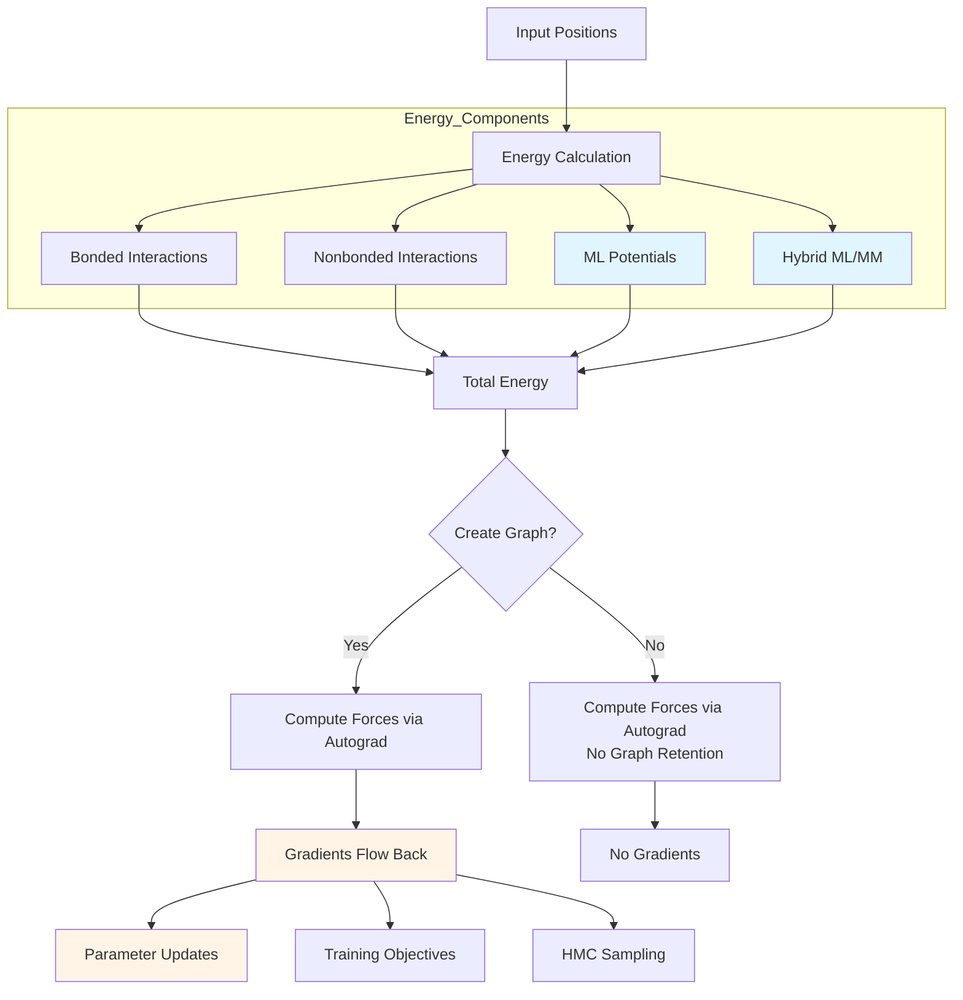
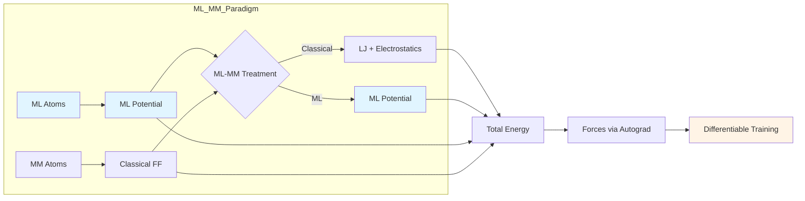
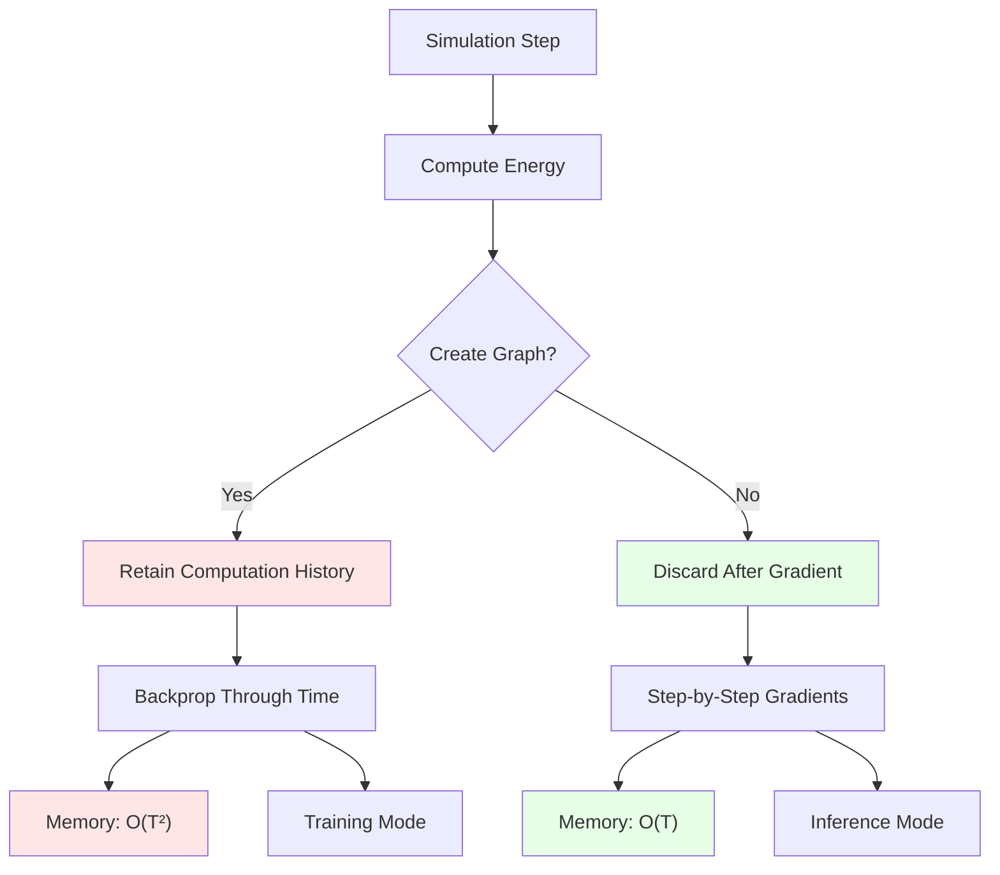

This guide explores DIMOS's differentiable energy landscape architecture, enabling end-to-end gradient-based optimization of molecular dynamics simulations for machine learning applications. The framework integrates classical molecular mechanics with neural network potentials, supporting advanced training paradigms including Hamiltonian Monte Carlo, reinforcement learning, and parameter optimization.

## Energy Landscape Architecture

DIMOS implements a **computationally differentiable energy landscape** through PyTorch's automatic differentiation system. All energy calculations—whether from classical force fields, neural network potentials, or hybrid ML/MM systems—maintain gradient connectivity, enabling backpropagation through entire simulation trajectories. This architecture transforms molecular dynamics from a black-box simulation into a **differentiable function** that can be optimized with gradient-based methods.

The energy landscape comprises multiple modular components: bonded interactions (bonds, angles, torsions), nonbonded interactions (Lennard-Jones, electrostatics), machine learning potentials, and hybrid ML/MM interfaces. Each component implements a standardized `calc_energy()` method returning differentiable PyTorch tensors, with optional force computation via automatic differentiation.



The differentiable pipeline begins with atomic positions as differentiable tensors, flows through energy computations that maintain gradient tracking, and enables downstream gradient-based optimization of simulation parameters, neural network potentials, or training objectives.

Sources: [mlmm.py](dimos/mlmm.py#L402-L453), [energy.py](dimos/energy.py#L374-L384)

## Differentiable Energy Components

### Classical Force Fields

All classical energy contributions in DIMOS are implemented as differentiable PyTorch operations. The energy module provides a comprehensive set of potentials, each maintaining gradient connectivity for backpropagation:

**Lennard-Jones Interactions**: The van der Waals potential computes energy through differentiable tensor operations, with both cutoff and no-cutoff variants. The calculation involves pairwise distance computations, inverse distance transformations, and the characteristic LJ 6-12 potential form—all operations preserving gradient information. The implementation supports switching functions for smooth cutoffs and 1-4 scaling factors for bonded exclusions.

**Electrostatics**: Charge-charge interactions implement Coulomb's law with differentiable distance computations. Multiple schemes are supported including cutoff-based approaches with reaction field approximation and Ewald summation for periodic systems. The PME (Particle Mesh Ewald) implementation uses Fourier transform operations that maintain differentiability through the entire reciprocal space calculation.

**Bonded Interactions**: Harmonic bond and angle potentials compute energy via differentiable distance and angle calculations. Torsion potentials use trigonometric functions with automatic differentiation support. The dihedral angle computation employs cross products and dot products that preserve gradient flow through the chain rule.

Sources: [energy.py](dimos/energy.py#L416-L2698), [energy.py](dimos/energy.py#L505-L545)

### Machine Learning Potentials

DIMOS integrates state-of-the-art neural network potentials with full differentiable integration:

**MACE Potentials**: The MaceEnergyContribution class wraps pre-trained MACE (Multi-Axis Cluster Expansion) models, handling unit conversions between MACE's native units (eV, Ångstroms) and DIMOS internal units. The energy calculation constructs input dictionaries with positions, edge indices for atomic pairs, and periodic boundary shift vectors. The MACE model returns differentiable energy predictions with automatic gradient tracking enabled.

**ORB Potentials**: The OrbEnergyContribution class integrates ORB (Orbital-Relevant Basis) force fields. The implementation constructs AtomGraph objects with node features (positions, atomic numbers, embeddings), edge features (distances, vectors), and system features (periodic cell). The ORB model prediction returns differentiable graph-level energy values, enabling end-to-end training of the potential itself if desired.

Both ML potential implementations support periodic boundary conditions, neighbor list optimization for efficiency, and GPU acceleration through PyTorch. The energy conversion from eV to internal units is a differentiable scaling operation, ensuring gradients are correctly propagated through the unit transformation.

Sources: [mace.py](dimos/mlip/mace.py#L499-L663), [orb.py](dimos/mlip/orb.py#L478-L624)

## Hybrid ML/MM Systems

### ML/MM Architecture

The MLMMsystem class enables **seamless integration** of ML and classical molecular mechanics, treating different regions of the system with different levels of theory while maintaining overall differentiability. This hybrid approach combines the accuracy of ML potentials for regions of interest (e.g., active sites, reactive centers) with the computational efficiency of classical force fields for the bulk system.

The system partitions atoms into three categories for interaction handling:
- **Purely ML atoms**: Interactions computed exclusively by ML potentials
- **Purely MM atoms**: Interactions computed by classical force fields  
- **ML-MM interface atoms**: Cross interactions configurable as classical or ML treatment

The `treat_mlmm_classically` parameter controls this boundary behavior. When True, ML-MM interactions use classical potentials (Lennard-Jones and electrostatics), providing smoother gradients and better computational efficiency. When False, ML potentials handle cross interactions, potentially capturing more accurate physics at the cost of increased computational expense.



The energy calculation in MLMMsystem orchestrates the different components, computing bonded energies from the MM system (bonds, angles, torsions), nonbonded energies from MM classical potentials, and ML energies from the neural network potential. The neighbor list is intelligently filtered to provide only the relevant atom pairs to each energy component, improving computational efficiency.

Sources: [mlmm.py](dimos/mlmm.py#L502-L616), [mlmm.py](dimos/mlmm.py#L453-L453)

### Gradient Computation

The ML/MM system maintains differentiability through careful management of the computation graph. Forces are computed via automatic differentiation:

```python
forces = -torch.autograd.grad(
    energy.sum(), pos, retain_graph=True, create_graph=True
)[0]
```

When `create_graph=True` is enabled, the force computation itself is differentiable, enabling **higher-order gradients** for training objectives that depend on forces or Hessians. This is essential for advanced applications like training neural network potentials using force matching, optimizing collective variable functions, or implementing gradient-based enhanced sampling methods.

The system supports two gradient computation modes: with graph retention for training scenarios requiring backpropagation through the simulation, and without graph retention for production MD runs where memory efficiency is prioritized. The `detach_()` method allows selective detachment of specific tensors from the computation graph to prevent unnecessary gradient flow while maintaining differentiability for targeted parameters.

Sources: [mlmm.py](dimos/mlmm.py#L603-L616), [integrators.py](dimos/integrators.py#L453-L460)

## ML Training Workflows

### Parameter Optimization

DIMOS supports **gradient-based optimization** of physical parameters using the differentiable energy landscape. Parameters can be made trainable by marking PyTorch tensors with `requires_grad=True`, enabling optimization via standard optimizers (Adam, SGD, L-BFGS, etc.).

The HMC training experiment demonstrates this capability by making several parameters differentiable during training:

```python
timestep = torch.tensor([0.1], requires_grad=True)
base_loc = torch.tensor([10.0], requires_grad=True)
protein_masses = torch.tensor(dimos_system.masses[protein_indices]).requires_grad_()
mass_hydrogen.requires_grad_()
mass_oxygen.requires_grad_()
```

These parameters are optimized against various objectives including energy minimization, dihedral angle targeting, and protein movement metrics. The training loop computes gradients of the loss function with respect to these parameters and updates them through gradient descent. This enables physics-informed learning where parameters are optimized to satisfy constraints or match experimental data.

> [!TIP]
> When optimizing masses or other physical parameters, ensure units are consistent throughout the computation. DIMOS uses internal units (kcal/mol for energy, amu for mass, Ångstroms for distance), so convert any experimental data to these units before computing loss functions. Large mass changes can dramatically affect integration stability—use gradient clipping and learning rate scheduling to maintain numerical stability.

Sources: [dimos_hmc.py](experiments/dimos_hmc.py#L30-L45)

### Hamiltonian Monte Carlo

The HMC implementation in DIMOS leverages differentiable energy landscapes for **probabilistic sampling** and Bayesian inference. Hamiltonian Monte Carlo proposes moves by simulating Hamiltonian dynamics on the energy landscape, using gradients to guide proposals toward high-probability regions of the distribution space.

The HMC experiment trains a neural network collective variable (CV) using a folded normal distribution, enabling efficient sampling of protein conformational space. The loss function incorporates acceptance probabilities, energy conservation, and CV values:

```python
loss_fn(hmc_move_object, step, pos, vel):
    initial_potential_energy = hmc_move_object.initial_potential_energy
    potential_energy = hmc_move_object.integrator.e
    kinetic_energy = dimos.utils.kinetic_energy(vel, hmc_move_object.sys)
    total_energy = potential_energy + kinetic_energy
    delta_energy = total_energy - initial_total_energy
    acceptance_prob = torch.exp(-delta_energy / hmc_move_object.kBT)
```

The differentiable energy landscape enables gradient-based optimization of the HMC proposal distribution, learning to make efficient proposals that maximize acceptance probabilities while maintaining detailed balance. This approach combines the statistical efficiency of HMC with the adaptivity of machine learning.

> [!TIP]
> For effective HMC training, monitor the acceptance probability during training. Target acceptance rates of 0.6-0.7 typically provide optimal exploration-exploitation trade-offs. If acceptance is too low, reduce step sizes or improve the CV parameterization. If acceptance is too high, increase step sizes to enable longer proposals.

Sources: [dimos_hmc.py](experiments/dimos_hmc.py#L48-L72), [dimos_hmc.py](experiments/dimos_hmc.py#L100-L150)

### Neural Network Potential Training

DIMOS supports **end-to-end training** of neural network potentials using the differentiable energy landscape. This includes both MACE and ORB potentials, which can be trained on ab initio reference data (DFT energies, forces, stresses) while being integrated into full MD simulations.

Training typically involves a multi-stage loss function combining energy, force, and potentially stress matching:

| Loss Component | Mathematical Form | Purpose |
|---|---|---|
| Energy loss | L_E = Σₙ (E_pred(n) - E_ref(n))² | Match reference energies |
| Force loss | L_F = Σₙ Σᵢ (F_pred(n,i) - F_ref(n,i))² | Match reference forces |
| Regularization | L_reg = λ‖θ‖² | Prevent overfitting |

The differentiable energy landscape enables computation of forces via automatic differentiation, eliminating the need for separate force prediction modules in the neural network architecture. The same potential function is used for both energy and force computation, ensuring thermodynamic consistency.

For hybrid ML/MM systems, training can focus on the ML region while keeping the MM parameters fixed, or perform joint optimization of both components. The flexible architecture supports transfer learning where pre-trained ML potentials are fine-tuned on specific systems or properties.

Sources: [mace.py](dimos/mlip/mace.py#L619-L663), [orb.py](dimos/mlip/orb.py#L567-L624)

## Performance and Optimization

### Graph Retention Strategies

Managing the **PyTorch computation graph** is critical for balancing differentiability with memory efficiency in large-scale simulations:

**Training Mode**: When `create_graph=True` is enabled, the entire computation history is retained, enabling backpropagation through arbitrary numbers of simulation steps. This is necessary for training neural network potentials, optimizing parameters with long-term objectives, or implementing gradient-based enhanced sampling methods. However, memory usage grows quadratically with trajectory length, limiting practical simulations to dozens or hundreds of steps.

**Inference Mode**: When `create_graph=False` is used, gradients are computed without retaining intermediate computation graphs. This enables force computation for dynamics while minimizing memory overhead, allowing production MD runs to reach millions of timesteps. The system can still provide gradient information for energy minimization or property calculations, but cannot support backpropagation through multiple timesteps.

**Selective Detachment**: The `get_variables_to_detach()` method in integrators allows selective removal of tensors from the computation graph. For example, accelerations can be detached after each timestep to prevent memory accumulation while maintaining differentiability for optimized parameters. This enables training with much longer effective trajectory lengths than full graph retention would permit.



> [!TIP]
> For training with long trajectories, implement gradient checkpointing strategies where only key timesteps retain computation graphs. Use PyTorch's `torch.utils.checkpoint` to recompute intermediate values during backpropagation, trading computation for memory savings. Alternatively, use adversarial or reinforcement learning approaches that optimize per-step objectives rather than requiring long-term gradients.

Sources: [mlmm.py](dimos/mlmm.py#L603-L616), [integrators.py](dimos/integrators.py#L542-L551)

### GPU Acceleration and Compilation

DIMOS leverages **PyTorch GPU acceleration** for all differentiable operations, enabling high-performance training of ML potentials and differentiable simulations. Key optimization strategies include:

**Vectorized Operations**: Energy calculations use batched tensor operations rather than loops, maximizing GPU utilization. Pairwise distance computations, energy summations, and gradient operations are all implemented as vectorized operations that can execute efficiently on GPU hardware.

**PyTorch Compilation**: The framework supports `torch.compile()` for just-in-time compilation of simulation steps. This can provide 2-5x speedups by fusing operations, optimizing memory access patterns, and generating efficient CUDA kernels. Compilation is particularly beneficial for complex ML potentials with many small operations.

**Mixed Precision Training**: PyTorch's automatic mixed precision (AMP) can be used to reduce memory usage and increase computational throughput during training. The framework supports float32, float64, and float16 computations, with careful handling of numerical stability in energy calculations.

**Neighbor List Optimization**: Efficient neighbor list management is crucial for performance with differentiable calculations. The framework supports skin-based neighbor list updates that balance the cost of list rebuilding against computational efficiency. For training scenarios where positions change minimally, neighbor lists can be reused across multiple timesteps.

Sources: [dimos_water_ml.py](benchmark/water/dimos_water_ml.py#L90-L96), [neighbor_handling.py](dimos/neighbor_handling.py)

## Practical Examples

### Training a Hybrid ML/MM System

This example demonstrates training a MACE potential in a hybrid ML/MM system with gradient-based parameter optimization:

```python
import dimos
import torch

# Setup hybrid system with ML region
prmtop = "examples/amber/ala2_solv.prmtop"
mm_system = dimos.ff.AmberForceField(prmtop, nonbonded_type="PME")

ml_atoms = torch.tensor(range(21))  # Alanine dipeptide
ml_system = dimos.mlip.MaceFoundationalSystem(
    masses=mm_system.masses,
    atomic_numbers=mm_system.atomic_numbers,
    mace_name="mace-mp-small",
    periodic=mm_system.periodic,
    box=mm_system.box,
    create_graph=True
)

hybrid_system = dimos.mlmm.MLMMsystem(
    ml_atoms, ml_system, mm_system,
    treat_mlmm_classically=True,
    electrostatic_type="PME",
    create_graph=True
)

# Make parameters trainable
temperature = torch.tensor([300.0], requires_grad=True)
force_coeff = torch.tensor([1.0], requires_grad=True)

# Training loop
optimizer = torch.optim.Adam([temperature, force_coeff], lr=0.01)
positions = dimos.read_positions("examples/amber/ala2_solv.rst7")

for epoch in range(100):
    optimizer.zero_grad()
    
    # Run short trajectory with differentiable dynamics
    for step in range(10):
        energy, forces, acceleration = hybrid_system.calc_energy(
            positions, neighborlist, return_forces=True
        )
        
        # Compute loss (example: dihedral angle targeting)
        phi = get_dihedral(positions, [4, 6, 8, 14])
        target_phi = torch.tensor([-1.2])
        loss = force_coeff * (phi - target_phi)**2
        
        # Backpropagate and optimize
        loss.backward()
        optimizer.step()
        
        # Update positions (simplified integration)
        positions = positions + 0.5 * forces
    
    print(f"Epoch {epoch}, Loss: {loss.item():.4f}")
```

This example shows how the differentiable energy landscape enables optimization of simulation parameters (temperature, force coefficients) while performing MD. The gradients flow through multiple integration steps, allowing the optimizer to learn parameters that achieve desired conformational sampling.

Sources: [test_mlmm.py](tests/test_mlmm.py#L408-L425), [dimos_hmc.py](experiments/dimos_hmc.py#L100-L150)

### Force Matching Neural Network Potential

This example demonstrates training a neural network potential using force matching against DFT reference data:

```python
import torch
import dimos

# Load reference DFT data (energies and forces)
reference_energies = torch.load('dft_energies.pt')
reference_forces = torch.load('dft_forces.pt')
reference_positions = torch.load('dft_positions.pt')

# Initialize MACE potential
potential = dimos.mlip.MaceEnergyContribution(
    atomic_numbers=atomic_numbers,
    box=None,
    periodic=False,
    mace_name="mace-mp-small",
    dtype=torch.float64
)

# Training loop
optimizer = torch.optim.Adam(potential.model.parameters(), lr=1e-4)
scheduler = torch.optim.lr_scheduler.ReduceLROnPlateau(optimizer)

for epoch in range(1000):
    total_loss = 0.0
    
    for i, (pos, ref_E, ref_F) in enumerate(zip(
        reference_positions, reference_energies, reference_forces)):
        
        optimizer.zero_grad()
        
        # Compute energy from neural network
        pred_E = potential.calc_energy(pos, edgelist)
        
        # Compute forces via autograd
        pred_F = -torch.autograd.grad(
            pred_E.sum(), pos, create_graph=True, retain_graph=True
        )[0]
        
        # Combined energy and force loss
        energy_loss = (pred_E - ref_E)**2
        force_loss = ((pred_F - ref_F)**2).sum()
        loss = energy_loss + 0.1 * force_loss
        
        loss.backward()
        optimizer.step()
        
        total_loss += loss.item()
    
    avg_loss = total_loss / len(reference_positions)
    scheduler.step(avg_loss)
    
    if epoch % 100 == 0:
        print(f"Epoch {epoch}, Loss: {avg_loss:.6f}")
```

This implementation leverages the differentiable energy landscape to compute forces automatically via autograd, eliminating the need for a separate force prediction head in the neural network. The training ensures thermodynamic consistency between energies and forces, leading to more accurate potentials.

Sources: [mace.py](dimos/mlip/mace.py#L619-L663), [test_mace.py](tests/test_mace.py)

## Next Steps

To deepen your understanding of DIMOS's differentiable capabilities:

- **[MACE Machine Learning Potentials](16-mace-machine-learning-potentials)**: Explore the architecture and usage of MACE neural network potentials in DIMOS
- **[ORB Machine Learning Potentials](17-orb-machine-learning-potentials)**: Learn about ORB force fields and their integration with differentiable simulations
- **[Hybrid ML/MM Systems](18-hybrid-ml-mm-systems-design-and-implementation)**: Understand the complete architecture and best practices for hybrid simulations
- **[Hamiltonian Monte Carlo and MALA](14-hamiltonian-monte-carlo-and-mala)**: Dive deeper into advanced sampling methods enabled by differentiable landscapes
- **[GPU Acceleration and PyTorch Compilation](23-gpu-acceleration-and-pytorch-compilation)**: Learn optimization techniques for high-performance differentiable simulations
