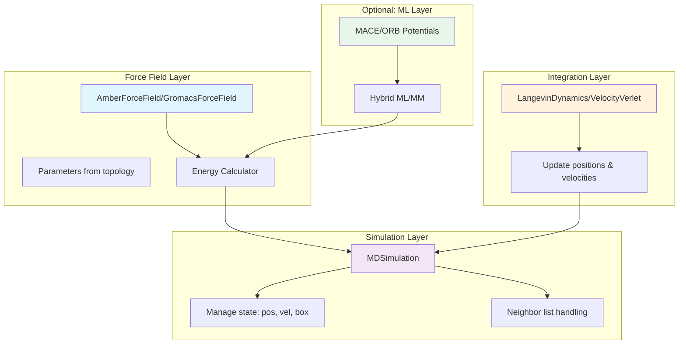

This guide provides beginner-level developers with a fast path to running their first molecular dynamics simulation using DIMOS. You'll learn the essential workflow for setting up and executing simulations, understand the core architecture, and discover where to go next for deeper knowledge.

DIMOS (Differentiable Molecular Simulator) is a PyTorch-based framework that bridges traditional molecular dynamics simulations with modern machine learning workflows. Its modular design enables seamless integration with ML potentials like MACE and ORB while maintaining compatibility with classical force fields from Amber and Gromacs.


## Installation

DIMOS can be installed using pip for the core functionality or via git clone for development work with optional dependencies. Choose the installation method that matches your needs.

### Basic Installation

For quick prototyping with Amber/Gromacs force fields:

```bash
pip install dimos-torch
```

This installs the core dependencies: PyTorch (≥2.4.1), ParmEd (≥4.2.2), and NumPy (<2.0.0) [pyproject.toml](/pyproject.toml#L39-L44).

### Development Installation

For full functionality including ML potentials and testing tools:

```bash
git clone https://github.com/nec-research/dimos.git; cd dimos

# Install with optional dependencies
python -m pip install -e '.[dev,mmtools,mace,orb]'
```

The optional dependency groups provide:
- **dev**: OpenMM with CUDA, Sphinx documentation tools, matplotlib [pyproject.toml](/pyproject.toml#L48-L53)
- **mmtools**: OpenMM tools, MDTraj, PyMBAR for enhanced sampling and analysis [pyproject.toml](/pyproject.toml#L55-L61)
- **mace**: MACE machine learning potentials [pyproject.toml](/pyproject.toml#L63-L66)
- **orb**: ORB machine learning potentials [pyproject.toml](/pyproject.toml#L68-L72)

Sources: [README.md](/README.md#L16-L34), [pyproject.toml](/pyproject.toml#L1-L72)

## Your First Simulation

The minimal workflow for running a DIMOS simulation consists of four steps: loading a force field, selecting an integrator, initializing the simulation, and running dynamics. This pattern applies across both classical force fields and machine learning potentials.

### Basic Workflow Example

Here's a complete example running an alanine dipeptide simulation with an Amber force field:

```python
import dimos
import parmed
import torch

# Step 1: Load the force field from Amber topology file
system = dimos.AmberForceField("config.prmtop", 
                               cutoff=10, 
                               nonbonded_type="PME",
                               periodic=True)

# Step 2: Initialize positions from coordinate file
rst7_file = parmed.amber.Rst7("config.rst7")
positions = torch.tensor(rst7_file.positions.value_in_unit(parmed.unit.angstrom))

# Step 3: Create an integrator (Langevin thermostat)
dt = 0.5  # timestep in femtoseconds
T = 300   # temperature in Kelvin
gamma = 1.0  # friction coefficient
integrator = dimos.LangevinDynamics(dt, T, gamma, system)

# Step 4: Set up the simulation
simulation = dimos.MDSimulation(system, integrator, positions, temperature=T)

# Step 5: Run dynamics
num_steps = 1000
simulation.step(num_steps)
```

### Architecture Overview

DIMOS follows a modular architecture where each component handles a specific aspect of molecular simulation:



The architecture separates concerns: force fields compute energies and forces, integrators propagate equations of motion, and simulation objects orchestrate the workflow while managing system state and periodic boundary conditions.

Sources: [README.md](/README.md#L36-L44), [dimos/ff.py](/dimos/ff.py#L375-L386), [dimos/integrators.py](/dimos/integrators.py#L375-L381), [dimos/simulation.py](/dimos/simulation.py#L375-L394)

## Component Selection Guide

DIMOS provides multiple options for each simulation component. Understanding when to use each helps you build efficient simulations appropriate for your scientific questions.

### Force Field Options

| Force Field | Input Format | Best For | Nonbonded Methods |
|-------------|--------------|----------|-------------------|
| AmberForceField | `.prmtop`, `.inpcrd` | Biomolecules, standard MD | Cutoff, PME, Ewald |
| GromacsForceField | `.top`, `.gro` | Large systems, custom FFs | Cutoff, PME |

The force field classes inherit from `ClassicalParmedForceField`, which handles parameter parsing and energy calculations [dimos/ff.py](/dimos/ff.py#L571-L572). Both support key nonbonded treatment methods:

- **Cutoff**: Simple truncation with optional switching function
- **PME**: Particle Mesh Ewald for long-range electrostatics
- **Ewald**: Traditional Ewald summation

Sources: [dimos/ff.py](/dimos/ff.py#L1367-L1387), [benchmark/water/dimos_water.py](/benchmark/water/dimos_water.py#L45-L47)

### Integrator Selection

| Integrator | Use Case | Parameters | Key Features |
|------------|----------|------------|--------------|
| LangevinDynamics | NVT ensemble, sampling | timestep, temperature, friction | Stochastic thermostat, robust |
| VelocityVerlet | Energy conservation studies | timestep | Deterministic, NVE ensemble |
| NoseHooverChainDynamics | Precise temperature control | timestep, temperature, chain_length | Extended system, minimal perturbation |

The `CommonIntegrator` base class provides a unified interface for all integrators [dimos/integrators.py](/dimos/integrators.py#L392-L393). Integrators update particle positions and velocities based on forces computed by the force field.

Sources: [dimos/integrators.py](/dimos/integrators.py#L392-L393), [tests/test_nve.py](/tests/test_nve.py#L405-L406)

### Running Simulation Steps

Once initialized, use the `step()` method to advance the simulation:

```python
# Run a single step
simulation.step(1)

# Run multiple steps with periodic output
for i in range(100):
    simulation.step(10)
    energy = simulation.measure_potential_energy()
    print(f"Step {i*10}: PE = {energy:.2f}")
```

The simulation automatically handles neighbor list updates, boundary conditions, and energy calculations. For memory efficiency in long simulations, use `detach_()` to break the computational graph while keeping positions differentiable [dimos/simulation.py](/dimos/simulation.py#L668-L676).

> [!TIP]
> The `detach_()` method is crucial for ML training workflows: it clears accumulated gradients from integrator state while preserving differentiability of positions for energy-based loss calculations. Call it periodically during optimization loops to prevent GPU memory overflow.

Sources: [dimos/simulation.py](/dimos/simulation.py#L620-L636), [dimos/simulation.py](/dimos/simulation.py#L668-L676)

## Working with Examples

The repository includes ready-to-run examples demonstrating common use cases. These scripts serve as templates for your own simulations and cover both classical and ML-enhanced workflows.

### Example Scripts Location

```
examples/
├── amber/              # Amber topology and coordinate files
│   ├── ala2_solv.prmtop/rst7    # Alanine dipeptide in water
│   ├── dhfr.prmtop/top           # Dihydrofolate reductase
│   └── amber25.prmtop/inpcrd    # Larger protein system
└── gromacs/            # Gromacs input files
    ├── dhfr_pme.gro/top          # DHFR with PME
    └── francesco.gro/top         # Custom system
```

### Running the Water Benchmark

A simple test simulation is available in [benchmark/water/dimos_water.py](/benchmark/water/dimos_water.py#L1-L80). This script simulates a water box with configurable parameters:

```bash
cd benchmark/water
python dimos_water.py dimosCPU PME 20 64 64
```

Parameters:
- Tool: `dimosCPU`, `dimosCUDA`, or `OpenMMCPU`
- Nonbonded: `Cutoff`, `PME`, or `Ewald`
- Box size: 20-140 (number of water molecules)
- Force field precision: 32 or 64
- Integration precision: 32 or 64

Sources: [benchmark/water/dimos_water.py](/benchmark/water/dimos_water.py#L25-L47), [examples/README.md](/examples/README.md#L1)

## Key Configuration Parameters

When setting up simulations, careful parameter selection determines accuracy and performance. These are the most commonly adjusted settings.

### Time Integration Parameters

| Parameter | Default | Range | Guidelines |
|-----------|---------|-------|------------|
| timestep | 0.5 fs | 0.1-2.0 fs | Smaller for stability, larger for speed |
| friction (Langevin) | 1.0 ps⁻¹ | 0.1-10.0 ps⁻¹ | Higher = stronger thermostat coupling |
| cutoff | 9-10 Å | 8-12 Å | Match force field recommendations |
| switch_distance | 7.5 Å | 0.75×cutoff | Smoothing function start point |

> [!TIP]
> For biomolecular simulations with Amber force fields, use `timestep=0.5 fs` with constraints on bonds involving hydrogen. This maintains energy conservation while enabling efficient sampling. Larger timesteps require constraint algorithms (handled automatically by Amber force fields).

Sources: [benchmark/water/dimos_water.py](/benchmark/water/dimos_water.py#L19-L21), [dimos/ff.py](/dimos/ff.py#L625-L638)

## Machine Learning Integration (Preview)

DIMOS uniquely supports hybrid classical/ML simulations, where part of the system uses machine learning potentials (MACE, ORB) while the remainder uses classical force fields. This enables accurate simulations of reactive regions within larger biomolecular contexts.

### Converting to ML Potentials

```python
# Start with classical system
system = dimos.AmberForceField("protein.prmtop", "protein.rst7")

# Convert a subset to MACE
mace_system = system.as_mace_system("small", atom_range=slice(100, 150))

# The system now uses ML for specified atoms, classical for rest
simulation = dimos.MDSimulation(mace_system, integrator, positions)
```

The `as_mace_system()` and `as_orb_system()` methods seamlessly integrate ML potentials while preserving the same simulation interface [dimos/ff.py](/dimos/ff.py#L1268-L1276), [dimos/ff.py](/dimos/ff.py#L1322-L1328).

Sources: [dimos/ff.py](/dimos/ff.py#L1268-L1328), [experiments/dimos_hmc.py](/experiments/dimos_hmc.py#L58-L73)

## Next Steps

Now that you've run your first simulation, consider these paths for deeper learning:

- **Installation and Setup**: Configure your environment for optimal performance, including GPU acceleration and compilation options [Installation and Setup](3-installation-and-setup)
- **Basic MD Workflow**: Understand the complete simulation lifecycle from initialization to analysis [Basic MD Simulation Workflow](4-basic-md-simulation-workflow)
- **Force Field Architecture**: Dive into how DIMOS handles bonded and nonbonded interactions [Force Field Systems Architecture](6-force-field-systems-architecture)
- **Running Your First Simulation**: Step-by-step guide with detailed explanations of each simulation phase [Running Your First Simulation](5-running-your-first-simulation)

For production simulations, explore the advanced sampling methods (metadynamics, replica exchange) and performance optimization techniques covered in the Deep Dive section of the documentation.