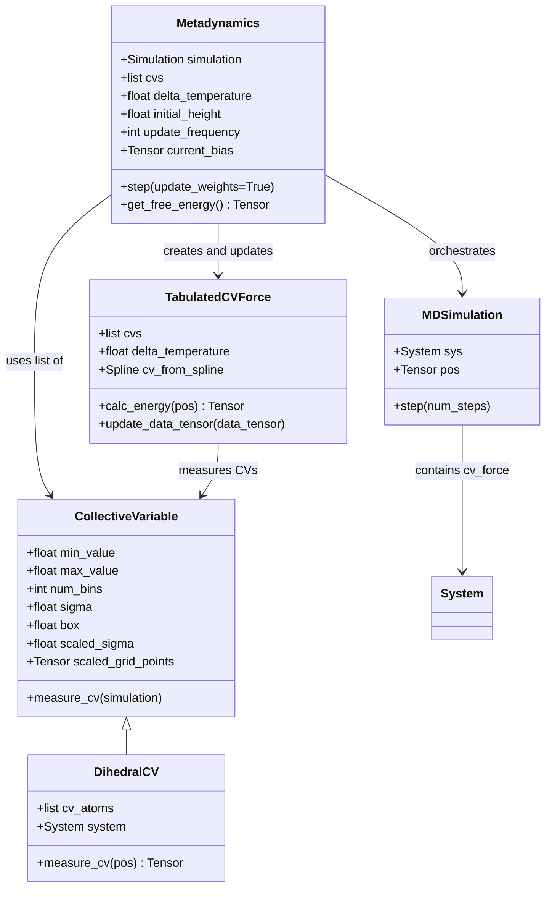
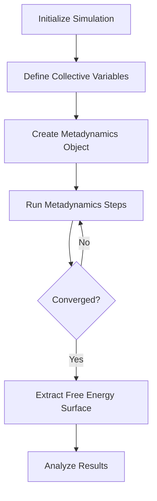

Metadynamics is an enhanced sampling technique that enables molecular dynamics simulations to escape local free energy minima by adding history-dependent bias potentials along carefully chosen collective variables (CVs). DIMOS implements **well-tempered metadynamics** with a flexible CV framework that supports one or two collective variables, both periodic and non-periodic, integrated seamlessly into the simulation orchestration system. This module provides the foundation for exploring complex free energy landscapes and calculating free energy surfaces for slow degrees of freedom.

Sources: [metadynamics.py](/dimos/advanced_methods/metadynamics.py#L374-L394)

## Architectural Overview

The metadynamics implementation follows a modular design that separates collective variable definitions, bias force application, and simulation orchestration. The architecture consists of four core components: a base class for collective variables, concrete CV implementations, a tabulated force handler using spline interpolation, and the main metadynamics orchestrator.



This design enables **pluggable collective variables** through inheritance from the `CollectiveVariable` base class, while the `TabulatedCVForce` manages the actual bias potential application using efficient spline interpolation. The `Metadynamics` class orchestrates the entire process, handling Gaussian hill deposition, bias accumulation, and free energy estimation.

Sources: [metadynamics.py](/dimos/advanced_methods/metadynamics.py#L404-L688), [simulation.py](/dimos/simulation.py#L512-L696)

## Well-Tempered Metadynamics Theory

Well-tempered metadynamics enhances standard metadynamics by controlling the growth of the bias potential through an exponentially decreasing hill height. The bias potential V(s,t) at collective variable space coordinate s and time t accumulates Gaussian hills:

**V(s,t) = Σᵢ wᵢ exp(-|s - sᵢ|² / (2σ²))**

where sᵢ represents the collective variable value at deposition time i, σ controls the Gaussian width, and wᵢ is the hill height. In well-tempered metadynamics, the hill height decreases exponentially with the current bias:

**wᵢ = w₀ exp(-V(sᵢ,t) / (ΔT · k_B))**

where w₀ is the initial hill height, ΔT is the bias temperature parameter, and k_B is the Boltzmann constant. This ensures the bias potential converges rather than growing indefinitely, allowing for free energy reconstruction.

The **free energy surface** F(s) is related to the converged bias potential:

**F(s) = -((T + ΔT) / ΔT) · V(s,∞)**

where T is the simulation temperature. This relationship enables accurate free energy estimation once the metadynamics simulation has converged. DIMOS implements these relationships through the height calculation in the `step()` method and the `get_free_energy()` method.

Sources: [metadynamics.py](/dimos/advanced_methods/metadynamics.py#L796-L833), [constants.py](/dimos/constants.py#L400-L466)

## Collective Variable System

The collective variable framework provides a flexible abstraction for defining degrees of freedom along which to apply the bias. The base `CollectiveVariable` class defines the interface and common infrastructure for all CV implementations.

### Base Collective Variable Class

The `CollectiveVariable` class serves as the foundation for custom CV definitions. It handles discretization of the CV space into bins and provides scaled coordinate systems for efficient Gaussian deposition.

**Key Parameters:**
- `min_value` / `max_value`: Define the CV range for discretization
- `num_bins`: Number of grid points for discretizing the CV space
- `sigma`: Width parameter for Gaussian hills (in original CV units)

The class automatically calculates derived parameters including `bin_width`, `box` (total range), `scaled_sigma` (normalized squared width), and `scaled_grid_points` (evenly spaced points in [0,1] space). The `measure_cv()` method must be implemented by subclasses to calculate the CV value from atomic positions.

Sources: [metadynamics.py](/dimos/advanced_methods/metadynamics.py#L404-L479)

### Dihedral Angle CV

DIMOS provides `DihedralCV` as a concrete implementation for dihedral angles defined by four atoms. This CV measures the torsional angle using vector cross products:

```
φ = -atan2(sin(φ), cos(φ))
```

where:
- cos(φ) = (v₁ × v₂) · (v₂ × v₃) / (|v₁ × v₂| · |v₂ × v₃|)
- sin(φ) = (v₁ × v₂) · [(v₂ × v₃) × v₂] / (|v₁ × v₂| · |(v₂ × v₃) × v₂|)

The calculation properly handles **periodic boundary conditions** through the `get_distance_vectors()` utility, ensuring correct vector measurements across box boundaries. This makes dihedral CVs particularly useful for studying conformational transitions in proteins and other flexible molecules.

Sources: [metadynamics.py](/dimos/advanced_methods/metadynamics.py#L481-L567), [utils.py](/dimos/utils.py)

### CV Implementation Pattern

To implement custom collective variables, inherit from `CollectiveVariable` and implement the `measure_cv()` method:

```python
class DistanceCV(CollectiveVariable):
    def __init__(self, atom_i, atom_j, min_value, max_value, num_bins, sigma, system):
        super().__init__(min_value, max_value, num_bins, sigma)
        self.atom_i = atom_i
        self.atom_j = atom_j
        self.system = system
    
    def measure_cv(self, pos):
        v = get_distance_vectors(pos, [self.atom_i, self.atom_j], 
                                  self.system.periodic, self.system.box)
        return torch.linalg.vector_norm(v)
```

This pattern allows for virtually any geometric or functional collective variable to be integrated into the metadynamics framework.

Sources: [metadynamics.py](/dimos/advanced_methods/metadynamics.py#L464-L479)

## Bias Force Application

The `TabulatedCVForce` class manages the application of bias forces using efficient **spline interpolation**. Rather than storing individual Gaussian hills, DIMOS accumulates the total bias potential on a discretized grid and applies smooth forces via cubic spline interpolation.

### Spline Interpolation Strategy

The class automatically selects one-dimensional or two-dimensional splines based on the number of CVs:

- **1D CVs**: Uses `OneDimensionalSpline` for interpolation along a single collective variable
- **2D CVs**: Uses `TwoDimensionalSpline` for interpolation on a 2D free energy surface

For periodic CVs (common for dihedral angles), the spline interpolation maintains periodicity by wrapping grid edges. The `calc_energy()` method measures current CV values and interpolates the bias energy from the stored grid.

The spline approach provides several advantages:
- **Efficient force calculation**: B(x) and gradients are computed analytically from spline derivatives
- **Smooth bias**: Eliminates discretization artifacts from raw grid lookup
- **Memory efficient**: Stores a single grid rather than thousands of individual Gaussians

Sources: [metadynamics.py](/dimos/advanced_methods/metadynamics.py#L569-L686), [splines.py](/dimos/splines.py)

### Force Integration with System

The bias force integrates with DIMOS energy calculations through the system's `cv_force` attribute:

```python
force = TabulatedCVForce(cvs, current_bias, delta_temperature, periodic_cvs=True)
simulation.sys.cv_force = force
```

During energy calculation in `MinimalSystem.calc_energy()`, if `cv_force` is present, its energy contribution is added to the total system energy. The force on each atom is computed via automatic differentiation of the bias energy with respect to positions, ensuring consistent forces that drive enhanced sampling.

Sources: [metadynamics.py](/dimos/advanced_methods/metadynamics.py#L766-L768), [ff.py](/dimos/ff.py#L486-L550)

## Metadynamics Orchestrator

The `Metadynamics` class provides the high-level interface for running enhanced sampling simulations. It manages the simulation loop, Gaussian hill deposition, and free energy reconstruction.

### Initialization Parameters

| Parameter | Type | Default | Description |
|-----------|------|---------|-------------|
| `simulation` | Simulation object | required | The MD or MC simulation to enhance |
| `cvs` | list of CV objects | required | Collective variables to bias (1-2 CVs) |
| `delta_temperature` | float | required | Bias temperature parameter controlling hill decay |
| `initial_height` | float | 1.0 | Initial Gaussian hill height (in energy units) |
| `update_frequency` | int | 1 | Number of MD steps between bias updates |
| `periodic_cvs` | bool | True | Whether CVs are periodic |

The `delta_temperature` parameter is particularly important—it controls how quickly hills decay. Larger values maintain stronger bias, while smaller values cause faster convergence. Values in the range of 1.5-3.0 times the simulation temperature are typical for well-tempered metadynamics.

Sources: [metadynamics.py](/dimos/advanced_methods/metadynamics.py#L688-L768)

### Simulation Loop

The `step()` method orchestrates the metadynamics simulation:

1. **Run simulation steps**: Execute `update_frequency` normal MD/MC steps
2. **Measure current CV values**: Compute CV values for the current configuration
3. **Calculate current bias energy**: Evaluate the bias potential at the CV point
4. **Compute Gaussian height**: Apply well-tempered decay formula
5. **Depose Gaussian hill**: Add weighted Gaussian to the bias grid
6. **Update bias force**: Refresh the spline interpolator with new bias
7. **Detach tensors**: Prevent memory accumulation in computation graph

The method supports optional weight updates, allowing equilibration periods without bias deposition.

Sources: [metadynamics.py](/dimos/advanced_methods/metadynamics.py#L780-L833)

### Free Energy Reconstruction

The `get_free_energy()` method implements the relationship between converged bias and free energy:

```python
return -((T + ΔT) / ΔT) * current_bias
```

This provides a direct estimate of the free energy surface as the simulation progresses. For periodic CVs, the free energy is automatically wrapped to the CV range, while for non-periodic CVs, absolute values are returned.

**Convergence assessment**: Monitor the free energy surface over time—convergence is achieved when subsequent estimates show minimal change in both shape and relative free energy differences.

Sources: [metadynamics.py](/dimos/advanced_methods/metadynamics.py#L769-L778)

## Usage Example

A complete metadynamics simulation follows this workflow:



### Complete Implementation

```python
import torch
from dimos import AmberForceField
from dimos.integrators import LangevinIntegrator
from dimos.simulation import MDSimulation
from dimos.advanced_methods import Metadynamics, DihedralCV

# 1. Set up system and simulation
system = AmberForceField('protein.prmtop', 'protein.inpcrd')
integrator = LangevinIntegrator(friciton=1.0, timestep=2.0)
simulation = MDSimulation(system, integrator, 
                         initial_pos=system.positions,
                         temperature=300.0)

# 2. Define collective variable (phi dihedral of residue 5)
phi_cv = DihedralCV(four_pair_atoms=[18, 19, 22, 23],  # Atom indices
                    min_value=-180.0,
                    max_value=180.0,
                    num_bins=100,
                    sigma=15.0,  # 15 degree Gaussian width
                    system=system)

# 3. Create metadynamics object
metadynamics = Metadynamics(
    simulation=simulation,
    cvs=[phi_cv],
    delta_temperature=600.0,  # 2x simulation temperature
    initial_height=0.5,  # kcal/mol
    update_frequency=100,  # Update every 100 steps
    periodic_cvs=True
)

# 4. Run enhanced sampling
num_steps = 1000000
for i in range(1000):
    metadynamics.step(update_weights=True)
    if i % 100 == 0:
        free_energy = metadynamics.get_free_energy()
        print(f"Step {i*100}: Free energy range {free_energy.min():.2f} to {free_energy.max():.2f}")

# 5. Extract final free energy surface
fes = metadynamics.get_free_energy()
cv_bins = torch.linspace(phi_cv.min_value, phi_cv.max_value, phi_cv.num_bins)
```

This example demonstrates a single CV metadynamics simulation of a protein dihedral angle. The bias temperature of 600 K provides moderate hill decay while maintaining sufficient bias for enhanced sampling.

Sources: [metadynamics.py](/dimos/advanced_methods/metadynamics.py#L688-L833), [ff.py](/dimos/ff.py#L1367-L1434), [integrators.py](/dimos/integrators.py)

## Two-Dimensional Collective Variables

DIMOS supports biasing along two collective variables simultaneously, enabling study of coupled degrees of freedom. The initialization automatically detects the number of CVs and creates the appropriate spline interpolator:

```python
# Define two dihedral angles (phi and psi of same residue)
phi_cv = DihedralCV([18, 19, 22, 23], -180.0, 180.0, 100, 15.0, system)
psi_cv = DihedralCV([19, 22, 23, 26], -180.0, 180.0, 100, 15.0, system)

# Create 2D metadynamics
metadynamics = Metadynamics(
    simulation=simulation,
    cvs=[phi_cv, psi_cv],  # Two CVs
    delta_temperature=600.0,
    initial_height=0.5,
    update_frequency=100
)
```

For 2D CVs, the Gaussian deposition uses the outer product of 1D Gaussian profiles, creating a separable 2D Gaussian that correctly captures correlations between the collective variables.

Sources: [metadynamics.py](/dimos/advanced_methods/metadynamics.py#L757-L828)

## Performance Considerations

The metadynamics implementation is optimized for efficiency through several design choices:

1. **Grid-based storage**: Bias potential accumulated on discrete grid rather than storing individual Gaussians
2. **Spline interpolation**: Smooth energy evaluation with analytical derivatives for force computation
3. **Efficient distance calculations**: Uses vectorized operations with periodic boundary condition handling
4. **Memory management**: Regular tensor detachment prevents computation graph bloat

**Recommended settings** for performance:
- `num_bins`: 50-200 per CV (balance resolution vs memory)
- `update_frequency`: 10-1000 steps (trade-off bias smoothness vs computation)
- Use GPU acceleration for large systems with many atoms

> [!TIP]
> The Gaussian width `sigma` parameter critically affects metadynamics efficiency. Values too small produce rough bias surfaces with poor sampling; values too large oversmooth important features. A good starting point is 10-20% of the CV range for periodic variables.

Sources: [metadynamics.py](/dimos/advanced_methods/metadynamics.py#L460-L462), [metadynamics.py](/dimos/advanced_methods/metadynamics.py#L797-L828)

## Integration with DIMOS Simulation Framework

Metadynamics integrates seamlessly with both MD and MC simulations through the unified `Simulation` interface. The bias force applies as an additional potential term in the energy calculation, affecting MD trajectories and MC acceptance probabilities.

For **molecular dynamics**, the bias force contributes to the total force through automatic differentiation, driving the system away from visited CV regions.

For **Monte Carlo**, the bias energy difference between trial and current configurations modifies the acceptance probability, enabling enhanced sampling in conformational space.

This unified approach allows metadynamics to work with any DIMOS simulation type, including those with machine learning potentials ([MACE](/dimos/mlip/mace.py), [ORB](/dimos/mlip/orb.py)) and hybrid ML/MM systems.

Sources: [simulation.py](/dimos/simulation.py#L403-L853), [mlmm.py](/dimos/mlmm.py)

## Parameter Selection Guidelines

Successful metadynamics requires careful parameter selection:

| Parameter | Effect | Guidelines |
|-----------|--------|------------|
| `delta_temperature` | Bias decay rate | Start with 1.5-3.0 × simulation temperature; lower values = faster convergence, higher values = more aggressive sampling |
| `initial_height` | Initial hill strength | 0.1-1.0 × thermal energy (k_BT); too high causes instability, too low slows exploration |
| `sigma` | Gaussian width | 10-20% of CV range; smaller for rough landscapes, larger for smooth transitions |
| `num_bins` | Grid resolution | 50-200 bins per CV; higher resolution = more accurate FES but slower computation |
| `update_frequency` | Hill deposition rate | 10-1000 steps; more frequent = smoother bias, less frequent = faster computation |

Monitor the free energy surface over time to assess convergence. Stable minima positions and consistent barrier heights indicate the simulation has converged.

> [!TIP]
> Always validate metadynamics results by comparing free energy differences from independent methods (e.g., umbrella sampling) or by repeating with different random seeds. The experimental status of DIMOS metadynamics requires careful verification against established implementations.

Sources: [metadynamics.py](/dimos/advanced_methods/metadynamics.py#L729-L756)

## Limitations and Future Development

The current metadynamics implementation has several known limitations:

1. **CV dimensionality**: Limited to 1-2 collective variables; higher-dimensional CVs require alternative approaches
2. **Experimental status**: Not yet thoroughly validated against established metadynamics implementations
3. **No parallel bias force**: For multiple CVs, bias applies to their combination rather than individual variables
4. **Limited CV types**: Only dihedral angle CV implemented; distance, angle, and custom CVs require user implementation

Future development may include:
- Multi-walker metadynamics for parallel simulations
- Multiple-walker parallel tempering metadynamics
- Bias-exchange metadynamics for high-dimensional CV spaces
- Additional built-in CV types (RMSD, radius of gyration, etc.)
- Automatic CV selection algorithms

Sources: [metadynamics.py](/dimos/advanced_methods/metadynamics.py#L374-L394)

## Next Steps

After mastering metadynamics fundamentals, explore these related enhanced sampling techniques in DIMOS:

- **[Replica Exchange Molecular Dynamics](21-replica-exchange-molecular-dynamics)** - Parallel tempering for temperature- or Hamiltonian-based enhanced sampling
- **[Hamiltonian Monte Carlo and MALA](14-hamiltonian-monte-carlo-and-mala)** - Integrating metadynamics bias with HMC for efficient sampling
- **[GPU Acceleration and PyTorch Compilation](23-gpu-acceleration-and-pytorch-compilation)** - Optimizing metadynamics performance on GPU hardware

For understanding the underlying dynamics and integration methods:
- **[Velocity Verlet Integration](11-velocity-verlet-integration)** - The integrator used in metadynamics MD simulations
- **[Langevin Dynamics and Thermostats](12-langevin-dynamics-and-thermostats)** - Temperature control in metadynamics simulations
- **[Simulation Orchestration and State Management](15-simulation-orchestration-and-state-management)** - How metadynamics integrates with the DIMOS simulation loop
