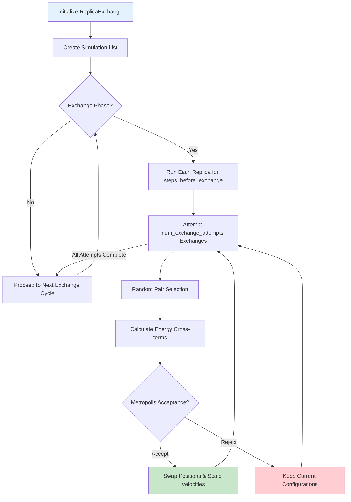
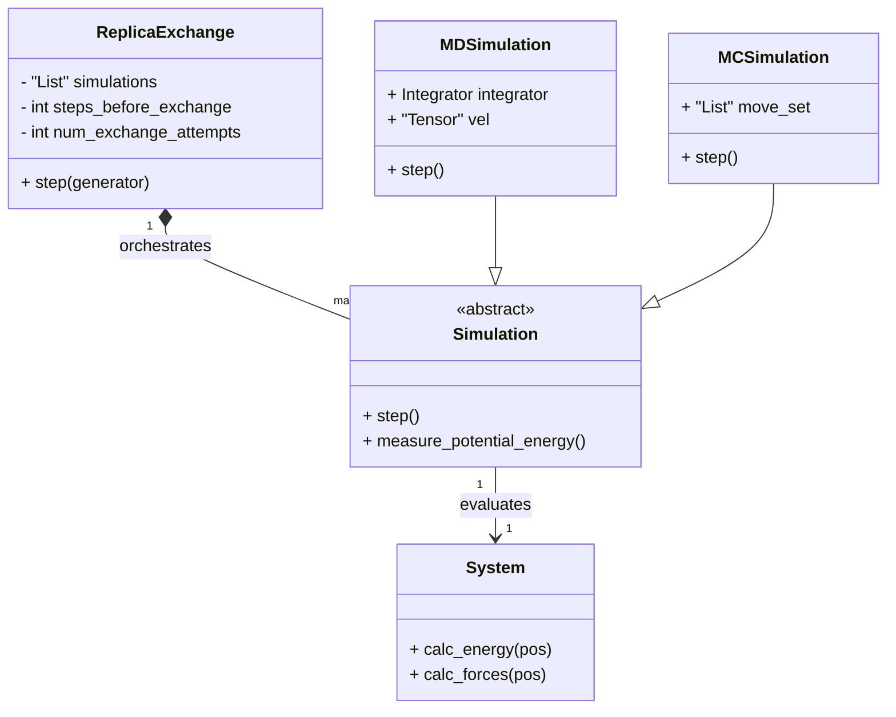

Replica Exchange Molecular Dynamics (REMD), also known as parallel tempering, is an enhanced sampling technique that addresses the fundamental challenge of exploring rugged energy landscapes in molecular simulations. By running multiple replicas of a system simultaneously at different temperatures or with different Hamiltonians, REMD enables configurations to diffuse across the temperature spectrum, allowing low-temperature replicas to access high-energy conformations that would otherwise be kinetically trapped. DIMOS provides a flexible REMD implementation that supports both Molecular Dynamics and Monte Carlo replicas, with careful handling of velocity scaling during exchanges to ensure detailed balance.

Sources: [replica_exchange.py](/dimos/advanced_methods/replica_exchange.py#L374-L393)

## Algorithm Architecture

The REMD implementation in DIMOS follows a modular design pattern that separates the exchange logic from the underlying simulation mechanics. The core `ReplicaExchange` class orchestrates multiple independent simulation objects, managing their coordination through periodic exchange attempts. This architecture allows REMD to work seamlessly with both MDSimulation and MCSimulation instances, enabling hybrid approaches where different replicas can use different integrators or move sets.

The algorithm operates in two phases: first, each replica advances independently for a configurable number of steps; second, the system attempts exchanges between randomly selected replica pairs using the Metropolis criterion. This random pair selection strategy differs from some implementations that attempt exchanges between adjacent temperature ladder replicas, providing a more thorough mixing pattern at the cost of potentially lower acceptance rates for widely separated temperatures.

Sources: [replica_exchange.py](/dimos/advanced_methods/replica_exchange.py#L401-L448), [simulation.py](/dimos/simulation.py#L512-L720)

The exchange acceptance criterion implements the detailed balance condition required for proper thermodynamic sampling. For two replicas with temperatures T₀ and T₁, the acceptance probability for swapping their configurations is:

P_accept = min[1, exp(β₀(E₀(pos₁) - E₀(pos₀)) + β₁(E₁(pos₀) - E₁(pos₁)))]

where β = 1/k_BT and E_i(pos_j) represents the energy of replica j's configuration evaluated with replica i's Hamiltonian. This formulation ensures that the equilibrium distribution is maintained for all replicas simultaneously.

Sources: [replica_exchange.py](/dimos/advanced_methods/replica_exchange.py#L483-L491)

## Implementation Details

The implementation demonstrates several sophisticated design choices that distinguish it from basic REMD algorithms. The most notable is the comprehensive velocity handling during exchanges. When replicas have different temperatures, velocities must be scaled to maintain the correct kinetic energy distribution at each temperature. DIMOS applies a scaling factor of √(T_new/T_old) before swapping velocities, ensuring that the velocity rescaling preserves the Maxwell-Boltzmann distribution appropriate for each replica's temperature.

The implementation also handles the case where one or both replicas lack velocity attributes (such as pure Monte Carlo simulations). By checking for the existence of the 'vel' attribute using `hasattr()`, the code gracefully skips velocity scaling for MC-only replicas while still performing position exchanges. This polymorphic approach enables sophisticated mixed-method sampling strategies where, for example, low-temperature replicas use Monte Carlo for efficiency while high-temperature replicas use molecular dynamics for rapid exploration.

Sources: [replica_exchange.py](/dimos/advanced_methods/replica_exchange.py#L494-L499), [simulation.py](/dimos/simulation.py#L718-L853)

> [!TIP]
> The random pair selection strategy using `torch.empty(2).uniform_()` rather than fixed neighbor exchanges provides better mixing across the temperature spectrum but requires careful tuning of the temperature distribution to ensure reasonable acceptance probabilities for the widest temperature gaps.

## Configuration and Parameters

The `ReplicaExchange` class exposes two key parameters that control the trade-off between simulation throughput and sampling efficiency. Understanding their impact is crucial for optimal performance:

| Parameter | Type | Default | Purpose | Optimization Guidance |
|-----------|------|---------|---------|---------------------|
| `steps_before_exchange` | int | 1 | Number of simulation steps per replica between exchange attempts | Larger values reduce exchange overhead but slow configuration diffusion across temperatures. Start with 1-10 for small systems; increase to 50-100 for larger systems where force calculations dominate. |
| `num_exchange_attempts` | int | 50 | Number of random pair exchanges attempted per exchange phase | Higher values increase mixing but also computational cost. Should scale roughly with the square of the number of replicas for thorough coverage. |

The experimental warning in the constructor reminds users that while the implementation is theoretically sound, it has not undergone the extensive validation that production-ready enhanced sampling methods require. Users should validate results against established implementations for critical applications.

Sources: [replica_exchange.py](/dimos/advanced_methods/replica_exchange.py#L430-L447)

## Integration with DIMOS Architecture

REMD leverages DIMOS's modular simulation architecture to provide a clean separation of concerns. The simulation objects maintain full autonomy during their independent propagation phases, using whatever integrators, thermostats, or barostats they were configured with. This flexibility enables advanced sampling strategies that would be difficult in monolithic REMD implementations:

The energy calculations required for the Metropolis criterion leverage the system's `calc_energy()` method, which is optimized through PyTorch's automatic differentiation framework. This means that REMD exchanges are fully compatible with differentiable force fields and machine learning potentials, enabling gradient-based enhanced sampling strategies that maintain differentiability throughout the exchange process.

Sources: [replica_exchange.py](/dimos/advanced_methods/replica_exchange.py#L483-L487), [simulation.py](/dimos/simulation.py#L403-L511)

## Temperature Distribution Strategies

While the REMD implementation itself is temperature-agnostic, proper performance requires careful selection of the temperature distribution across replicas. The choice of temperature spacing dramatically affects exchange acceptance rates and overall sampling efficiency. Common strategies include:

**Geometric Temperature Spacing**: T_{i+1} = T_i × α, where α is chosen to maintain roughly constant acceptance probabilities between adjacent replicas. This strategy naturally accommodates the exponential relationship between temperature and acceptance probability in canonical REMD.

**Replica Exchange with Hamiltonian Scaling**: Instead of varying temperature, replicas can scale the potential energy function: H_i(λ) = λ × H_0. This approach, sometimes called Hamiltonian REMD or λ-REMD, can be more efficient for systems where energy barriers are enthalpic rather than entropic in nature.

**Hybrid Approaches**: The DIMOS implementation's support for both MD and MC replicas enables hybrid strategies where temperature replicas are combined with Hamiltonian replicas, providing a more flexible approach to challenging sampling problems.

Sources: [replica_exchange.py](/dimos/advanced_methods/replica_exchange.py#L430-L444), [simulation.py](/dimos/simulation.py#L572-L720)

## Advanced Usage Patterns

The flexibility of the REMD implementation enables several advanced sampling strategies that go beyond basic parallel tempering. One powerful pattern involves combining REMD with other enhanced sampling methods: for example, applying metadynamics bias to the high-temperature replicas to accelerate exploration, while allowing that bias to propagate to low-temperature replicas through exchanges. This approach can dramatically improve the efficiency of free energy surface exploration.

Another advanced application is replica exchange for parameter space exploration, where replicas differ in force field parameters or machine learning potential hyperparameters rather than temperature. This enables Bayesian inference for force field parameters or active learning cycles where replicas explore different regions of parameter space. The implementation's agnostic treatment of replica differences makes this straightforward—any difference between replica simulations that affects energy calculation will lead to appropriate acceptance behavior through the Metropolis criterion.

Sources: [metadynamics.py](/dimos/advanced_methods/metadynamics.py#L688-L833), [replica_exchange.py](/dimos/advanced_methods/replica_exchange.py#L449-L500)

> [!TIP]
> When using REMD with GPU-accelerated simulations, be mindful of memory requirements. Each replica maintains its own copy of positions, velocities, and potentially integrator state. For systems with many replicas or large particle counts, memory management strategies like periodic checkpointing become essential.

## Performance Considerations

The computational efficiency of REMD in DIMOS depends on several factors that require careful balancing. The dominant cost is typically the energy calculations for the Metropolis criterion, which requires evaluating the energy of each configuration under both Hamiltonians involved in an exchange attempt. With N replicas and E exchange attempts, this requires 4N × E energy evaluations per exchange phase, which can become significant for large systems.

Fortunately, PyTorch's parallelization capabilities allow these energy calculations to be vectorized efficiently. The random pair selection strategy avoids the sequential dependency of neighbor-exchange implementations, enabling more parallel execution. Users should benchmark different configurations of `steps_before_exchange` and `num_exchange_attempts` to find the optimal balance for their specific system and hardware.

For very large simulations, consider using a smaller number of replicas with a wider temperature distribution combined with longer `steps_before_exchange` intervals. This reduces the overhead of exchange attempts while still enabling configuration diffusion across the temperature spectrum.

Sources: [replica_exchange.py](/dimos/advanced_methods/replica_exchange.py#L475-L478), [GPU Acceleration](/gpu-acceleration-and-pytorch-compilation)

## Best Practices

Effective use of REMD requires attention to several practical considerations that can dramatically impact performance and reliability:

**Energy Conservation**: Ensure that individual replicas are well-equilibrated before beginning REMD exchanges. Poorly equilibrated replicas can create artificial barriers to exchange and degrade sampling efficiency.

**Temperature Selection**: Use geometric temperature spacing and validate acceptance rates (aiming for 20-30% between adjacent temperature pairs). Monitor these rates throughout the simulation and adjust temperatures if acceptance rates drift too low or high.

**Exchange Frequency**: Start with `steps_before_exchange = 1` for small systems and increase gradually for larger systems. The optimal value balances the computational cost of exchanges against the rate of configuration diffusion across temperatures.

**Random Number Generation**: Provide a `torch.Generator` object to the `step()` method for reproducible results, especially when comparing across different runs or debugging issues.

**Validation**: Because REMD is an experimental feature, validate results against established implementations for critical applications. Pay particular attention to the velocity scaling logic, which differs from some other REMD implementations.

Sources: [replica_exchange.py](/dimos/advanced_methods/replica_exchange.py#L449-L500), [Temperature Control](/temperature-control-and-nvt-validation)

## Next Steps

Having understood the REMD implementation, you may want to explore related sampling techniques and validation methods:

- **[Metadynamics and Collective Variables](20-metadynamics-and-collective-variables)**: Another enhanced sampling technique that can be combined with REMD for challenging free energy landscapes
- **[Hamiltonian Monte Carlo and MALA](14-hamiltonian-monte-carlo-and-mala)**: Advanced Monte Carlo methods that can serve as efficient propagators for REMD replicas
- **[Temperature Control and NVT Validation](28-temperature-control-and-nvt-validation)**: Understanding how thermostats work in individual REMD replicas
- **[GPU Acceleration and PyTorch Compilation](23-gpu-acceleration-and-pytorch-compilation)**: Optimizing REMD performance through hardware acceleration and compilation
