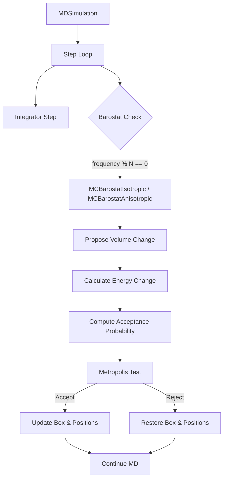

This documentation provides a comprehensive guide to pressure control in DIMOS using Monte Carlo barostats. Pressure control is essential for simulations that aim to represent experimental conditions, particularly liquid and condensed phase systems where density fluctuations are significant. DIMOS implements Monte Carlo-based barostats that randomly propose volume changes and accept or reject them according to the Metropolis criterion, ensuring proper sampling of the isothermal-isobaric (NPT) ensemble.

## Physical Foundations and Statistical Mechanics

Monte Carlo barostats maintain constant pressure by attempting random changes to the simulation box volume and accepting these changes based on thermodynamic principles. The acceptance probability for a volume change follows the Metropolis criterion, which accounts for the energy change of the system, the pressure-volume work performed, and the entropy change due to volume modification. For an isothermal-isobaric ensemble, the acceptance probability is given by:

P_accept = min[1, exp(-(ΔU + PΔV - Nk_BT ln(V'/V))/(k_BT))]

where ΔU is the change in potential energy, PΔV is the pressure-volume work, and the logarithmic term represents the Jacobian accounting for the change in configuration space volume due to the rescaling of coordinates. This formulation ensures that the simulation correctly samples the NPT ensemble [barostats.py](dimos/barostats.py#L549-L554).

The implementation distinguishes between two modes of coordinate rescaling. When `rescale_whole_system=True`, all atomic positions are uniformly scaled by the linear scaling factor λ = (V'/V)^(1/3), and the degrees of freedom count equals the number of atoms. When `rescale_whole_system=False`, only molecular centers are scaled, preserving internal molecular geometries, and the degrees of freedom count equals the number of molecules [barostats.py](dimos/barostats.py#L518-L545).

## Architecture Overview



The barostat architecture integrates seamlessly with the molecular dynamics simulation workflow. During each simulation step, after the integrator updates positions and velocities, the simulation checks whether a barostat move should be attempted based on the configured frequency. When triggered, the barostat proposes a volume change, calculates the corresponding thermodynamic terms, and applies the Metropolis criterion to determine acceptance or rejection [simulation.py](dimos/simulation.py#L636-L641).

## Isotropic Barostat Implementation

The `MCBarostatIsotropic` class implements uniform pressure control where all box dimensions scale proportionally. This is appropriate for isotropic systems like liquids and gases where pressure is equal in all directions.

### Configuration Parameters

| Parameter | Type | Default | Description |
|-----------|------|---------|-------------|
| `box` | torch.Tensor | required | Initial simulation box dimensions |
| `target_pressure` | float | 1.0 | Target pressure in bar |
| `frequency` | int | 25 | Steps between barostat moves |
| `scale` | float | 0.01 | Initial volume change scale as fraction of total volume |
| `adaptive` | bool | True | Enable adaptive move size adjustment |
| `min_acceptance_rate` | float | 0.25 | Minimum acceptable acceptance rate |
| `max_acceptance_rate` | float | 0.75 | Maximum acceptable acceptance rate |
| `rescale_whole_system` | bool | False | Scale all atoms or molecular centers only |
| `isotropic` | bool | True | Perform isotropic scaling |

The adaptive algorithm monitors acceptance rates and adjusts the volume scale parameter every 10 attempted moves to maintain an optimal acceptance rate between 25% and 75% [barostats.py](dimos/barostats.py#L501-L511). If the acceptance rate is too low, the volume scale is reduced; if too high, it is increased (capped at 30% of the initial volume). This adaptation improves sampling efficiency.

> [!TIP]
> The adaptive algorithm, while commonly used, has theoretical limitations regarding detailed balance. The implementation includes a reference to adaptive MCMC literature noting this concern. For production runs requiring rigorous sampling, consider disabling adaptation after an equilibration period or using a fixed volume scale determined from preliminary testing.

### Implementation Details

The isotropic barostat follows this algorithm for each move attempt:

1. Generate a random volume change: ΔV = volume_scale × 2 × (random - 0.5)
2. Compute new volume: V' = V + ΔV
3. Calculate linear scaling factor: λ = (V'/V)^(1/3)
4. Scale all box dimensions: box' = box × λ
5. Rescale positions according to `rescale_whole_system` setting
6. Update neighbor list if using cutoffs
7. Calculate energy change ΔU = U' - U
8. Compute acceptance probability including all thermodynamic terms
9. Accept or reject based on Metropolis criterion [barostats.py](dimos/barostats.py#L513-L578)

The pressure-volume work term uses the conversion factor `BAR_TO_INTERNAL_PRESSURE` to transform the external pressure from bar to internal energy units [constants.py](dimos/constants.py#L424-L430). For Amber units (kcal/mol), this conversion is approximately 1.439×10⁻⁵.

## Anisotropic Barostat Implementation

The `MCBarostatAnisotropic` class allows for differential control along different axes, enabling simulation of systems with anisotropic pressure requirements or those undergoing phase transitions with directional preferences. This feature is currently experimental and should be used with careful validation [barostats.py](dimos/barostats.py#L583-L587).

### Configuration Parameters

| Parameter | Type | Default | Description |
|-----------|------|---------|-------------|
| `box` | torch.Tensor | required | Initial simulation box dimensions |
| `scale_axis` | tuple[bool, bool, bool] | (True, True, True) | Which axes to scale |
| `target_pressure` | tuple[float] or float | (1.0, 1.0, 1.0) | Target pressure(s) in bar per axis |
| `frequency` | int | 25 | Steps between barostat moves |
| `scale` | float | 0.01 | Initial volume change scale |
| `adaptive` | bool | True | Enable per-axis adaptive adjustment |
| `min_acceptance_rate` | float | 0.25 | Minimum acceptable acceptance rate |
| `max_acceptance_rate` | float | 0.75 | Maximum acceptable acceptance rate |
| `rescale_whole_system` | bool | False | Scale all atoms or molecular centers only |
| `isotropic` | bool | False | Perform anisotropic scaling |

The anisotropic implementation differs from isotropic in that it randomly selects one axis per move attempt from the enabled axes [barostats.py](dimos/barostats.py#L635-L639). Each axis maintains independent counters for attempted and accepted moves, allowing per-axis adaptive adjustment of the volume scale parameter.

### Implementation Differences

Key differences in the anisotropic implementation include:

- Random axis selection: Only one axis changes per move attempt
- Per-axis pressure control: Each axis can have different target pressures
- Independent adaptation: Volume scale adjusts separately for each axis
- Axis-specific degrees of freedom: Used in Jacobian calculation [barostats.py](dimos/barostats.py#L686-L767)

The Jacobian term for anisotropic scaling uses the single-axis volume change rather than the full volume change, correctly accounting for the restricted configurational space modification.

## Integration with Simulation Workflow

Barostats integrate into the MD simulation through the `MDSimulation` class, which requires a thermostat when using a barostat [simulation.py](dimos/simulation.py#L594-L596). This requirement arises because the barostat implementation depends on temperature for the thermodynamic calculations, and maintaining proper temperature control is essential for correct NPT sampling.

The simulation loop applies barostat moves at the specified frequency:

```python
if self.barostat is not None:
    if self.total_step_counter % self.barostat.frequency == 0:
        self.pos = self.barostat.apply_barostat(self.pos, self, generator=self.rng_generator)
```

When a barostat move is accepted, the accelerations in the integrator are updated with the new forces [barostats.py](dimos/barostats.py#L559-L561). When rejected, the simulation restores the original box dimensions and neighbor list state to ensure detailed balance [barostats.py](dimos/barostats.py#L563-L567).

## Usage Examples

### Basic Isotropic Barostat

```python
import dimos

# Initialize system and thermostat
system = dimos.ff.AmberForceField("system.prmtop", nonbonded_type="Cutoff")
integrator = dimos.integrators.LangevinDynamics(
    timestep=0.5, 
    temperature=300.0, 
    friction_coefficient=0.1,
    system=system
)

# Create isotropic barostat
barostat = dimos.barostats.MCBarostatIsotropic(
    box=system.box,
    target_pressure=1.0,
    frequency=25,
    scale=0.01,
    adaptive=True
)

# Initialize simulation with barostat
simulation = dimos.simulation.MDSimulation(
    sys=system,
    integrator=integrator,
    initial_pos=positions,
    temperature=300.0,
    barostat=barostat
)
```

### Anisotropic Barostat (Experimental)

```python
# Create anisotropic barostat with different pressures per axis
barostat = dimos.barostats.MCBarostatAnisotropic(
    box=system.box,
    scale_axis=(True, True, True),  # Scale all three axes
    target_pressure=(1.0, 1.0, 0.5),  # Lower pressure in z-direction
    frequency=25,
    scale=0.01,
    adaptive=True
)

simulation = dimos.simulation.MDSimulation(
    sys=system,
    integrator=integrator,
    initial_pos=positions,
    temperature=300.0,
    barostat=barostat
)
```

## Validation and Testing

The barostat implementation has been validated against OpenMM's Monte Carlo barostat using alanine dipeptide in explicit solvent [test_barostats.py](tests/test_barostats.py#L386-L434). The validation compares:

- Total energy conservation
- Potential and kinetic energy components
- Volume dynamics over time
- Box dimension evolution

Tests confirm that DIMOS produces equivalent pressure-controlled dynamics to OpenMM, with differences within expected statistical fluctuations. The barostat correctly maintains the target pressure while preserving the thermostat's temperature control [test_barostats.py](tests/test_barostats.py#L540-L570).

## Performance Considerations

Several factors influence barostat performance:

- **Frequency**: More frequent barostat moves improve pressure control but increase computational cost. Values between 10-50 steps are typical for liquid systems.
- **Volume scale**: Larger moves increase acceptance probability variation. The adaptive algorithm typically finds optimal scales automatically.
- **Neighbor list updates**: Barostat moves require neighbor list recalculation when using cutoff schemes, adding overhead.
- **Rescaling mode**: `rescale_whole_system=False` is more efficient for systems with many small molecules (like water) as it avoids rescaling all atoms individually [barostats.py](dimos/barostats.py#L527-L532).

> [!TIP]
> For systems with predominantly three-atom molecules (like water), the implementation optimizes performance by batch-processing these molecules separately from other molecule types, allowing efficient parallelization of the center-of-mass calculations.

## Limitations and Best Practices

### Current Limitations

- The anisotropic barostat remains experimental and requires validation for production use
- Adaptive algorithm may compromise detailed balance theoretically
- Fixed-shape periodic boundary conditions are assumed (no triclinic box support)
- Barostat moves require thermostat coupling for proper thermodynamics

### Recommended Practices

1. **Equilibration**: Run initial equilibration with the barostat disabled, then enable after reaching target temperature
2. **Frequency tuning**: Adjust barostat frequency based on system properties; larger molecules may require lower frequency
3. **Adaptation monitoring**: Monitor acceptance rates during runs; consider disabling adaptation after equilibration
4. **Validation**: Always validate pressure and density against experimental data or reference simulations
5. **Anisotropic caution**: Use anisotropic barostat only when necessary and verify results carefully

## Next Steps

For comprehensive understanding of ensemble control, combine barostats with proper thermostat implementations documented in [Langevin Dynamics and Thermostats](12-langevin-dynamics-and-thermostats) and [Nose-Hoover Chains and Advanced Thermostats](13-nose-hoover-chains-and-advanced-thermostats). For advanced sampling techniques that combine pressure control with enhanced sampling, explore [Metadynamics and Collective Variables](20-metadynamics-and-collective-variables) and [Replica Exchange Molecular Dynamics](21-replica-exchange-molecular-dynamics).

To validate barostat implementation in your specific systems, refer to the validation framework in [Benchmarking Against OpenMM](29-benchmarking-against-openmm).