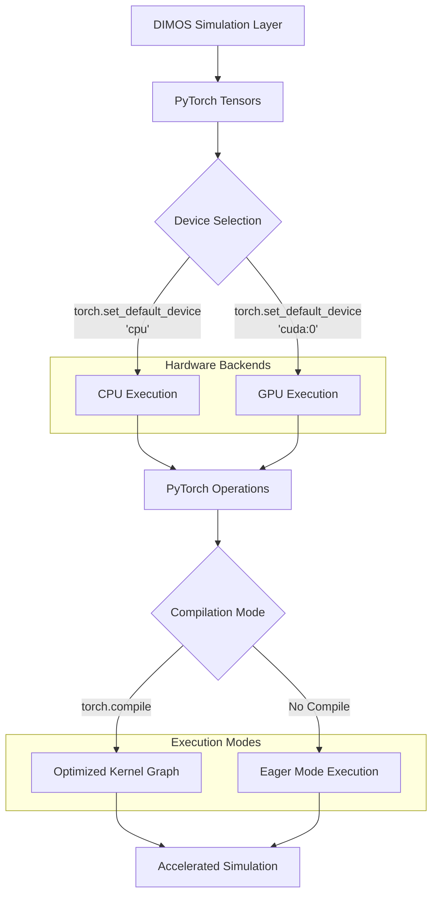

This page explains DIMOS's approach to GPU acceleration and PyTorch compilation for molecular dynamics simulations. DIMOS leverages PyTorch's tensor operations and compilation capabilities to achieve high-performance molecular dynamics simulations across different hardware platforms.

## Architecture Overview

DIMOS is built on PyTorch's tensor framework, enabling seamless execution on CPU and GPU devices with minimal code changes. The architecture follows a device-agnostic design pattern where tensor operations automatically utilize the available hardware acceleration.



## Device Configuration

DIMOS provides straightforward device configuration through PyTorch's device management API. Device selection determines where tensor operations and energy calculations execute.

### Basic Device Setup

The fundamental pattern for device configuration involves setting the default device before initializing simulation components:

```python
import torch
import dimos

# CPU execution
torch.set_default_device("cpu")

# GPU execution (CUDA)
torch.set_default_device("cuda:0")
```

Sources: [dimos_water.py](benchmark/water/dimos_water.py#L50-L56)

### Complete Simulation Setup

A typical simulation setup integrates device configuration with system initialization:

```python
# Configure device
torch.set_default_device("cuda:0")

# Load positions (automatically created on configured device)
rst7_file = parmed.amber.Rst7('system.inpcrd')  
positions = torch.tensor(rst7_file.positions.value_in_unit(parmed.unit.angstrom))

# Initialize system with specified dtype and device
dimos_system = dimos.ff.AmberForceField(
    'system.prmtop', 
    cutoff=10, 
    switch_distance=7.5, 
    nonbonded_type="PME", 
    periodic=True, 
    dtype=torch.float32
)

# Create integrator and simulation
integrator = dimos.integrators.LangevinDynamics(stepsize, 300, 1.0, dimos_system)
simulation = dimos.simulation.MDSimulation(dimos_system, integrator, positions, temperature=300)
```

Sources: [dimos_water.py](benchmark/water/dimos_water.py#L51-L65)

### Device and Precision Matrix

Different combinations of device and precision offer trade-offs between speed and accuracy:

| Device Configuration | FF Precision | Integration Precision | Use Case |
|---------------------|--------------|----------------------|----------|
| CPU (`cpu`) | float32 | float32 | Small systems, debugging, limited memory |
| CPU (`cpu`) | float64 | float64 | Small systems requiring high accuracy |
| GPU (`cuda:0`) | float32 | float32 | Large systems, production runs |
| GPU (`cuda:0`) | float64 | float64 | Benchmarking, high-precision studies |
| GPU (`cuda:0`) | float32 | float64 | Mixed precision for stability |

Sources: [dimos_water.py](benchmark/water/dimos_water.py#L33-L40)

## PyTorch Compilation

DIMOS supports PyTorch's `torch.compile()` feature, which optimizes the computational graph through kernel fusion and operator reordering. This can provide significant speedups, especially for production simulations.

### Compilation Modes

DIMOS benchmarking demonstrates different compilation modes through the `torch.compiler` API:

```python
# Reset compiler state
torch.compiler.reset()

# Compile simulation step with automatic tuning
step = torch.compile(
    simulation.step, 
    mode="max-autotune-no-cudagraphs"
)
```

Sources: [dimos_water.py](benchmark/water/dimos_water.py#L68-L71)

### Compilation Mode Comparison

| Mode | Description | Compilation Time | Runtime Performance |
|------|-------------|------------------|---------------------|
| `max-autotune-no-cudagraphs` | Extensive kernel tuning without CUDA graphs | Longest | Best for dynamic workloads |
| `max-autotune` | Maximum optimization with CUDA graphs | Long | Best for static workloads |
| `reduce-overhead` | Focus on reducing Python overhead | Medium | Good balance |
| Default mode | Basic compilation | Shortest | Moderate improvement |

> [!TIP]
> The first compilation run includes warmup time for kernel generation. Subsequent executions use the compiled graph, providing consistent performance. For benchmarking, include warmup steps to measure steady-state performance rather than compilation overhead.

### Eager vs Compiled Execution

The choice between eager mode and compilation depends on simulation requirements:

| Aspect | Eager Mode | Compiled Mode |
|--------|------------|---------------|
| Startup Time | Instant | Variable (seconds to minutes) |
| Debugging | Excellent (Python stack traces) | Challenging (compiled graph) |
| Flexibility | Maximum (dynamic shapes) | Limited (static shapes preferred) |
| Performance | Good (native PyTorch) | Excellent (optimized kernels) |
| Memory | Moderate | Variable (can be higher or lower) |

## Tensor Operations and GPU Acceleration

DIMOS leverages PyTorch's vectorized operations throughout the codebase, enabling efficient GPU utilization for molecular dynamics computations.

### Energy Calculation Pipeline

The energy calculation system demonstrates DIMOS's tensor-centric approach:

```python
class MinimalSystem:
    def calc_energy(self, pos: torch.Tensor, neighborlist, 
                    return_forces: bool = False, print_energies=False):
        """
        Calculate energy using PyTorch tensor operations.
        All computations execute on the configured device.
        """
        total_energy = 0
        
        # Sum nonbonded energies (vectorized)
        for nonbonded in self.nonbonded_force_components:
            energy = nonbonded.calc_energy(pos, neighborlist)
            total_energy += energy
            
        # Sum bonded energies (vectorized)
        for bonded in self.bonded_force_components:
            energy = bonded.calc_energy(pos)
            total_energy += energy
            
        return total_energy
```

Sources: [ff.py](dimos/ff.py#L486-L510)

### Nonbonded Interaction Computation

Lennard-Jones energy calculations exemplify GPU-accelerated distance operations:

```python
def calc_energy(self, pos: torch.Tensor, neighborlist: torch.Tensor) -> torch.Tensor:
    # Filter exclusions using tensor operations (GPU-accelerated)
    if self.need_filter:
        mask_exclusions = self.filter_applies_to[neighborlist[0], neighborlist[1]]
        neighborlist = neighborlist.T[~mask_exclusions].T

    # Calculate distances (vectorized, GPU-accelerated)
    distance_matrix = get_distances_edge_list(
        pos, neighborlist, self.periodic, self.box)
    
    # Apply cutoff using tensor masking
    within_cutoff = distance_matrix <= self.cutoff
    distance_matrix_cut = torch.masked_select(distance_matrix, within_cutoff)
    inverse_distance_cut = 1 / distance_matrix_cut

    # Calculate LJ energy (vectorized)
    lj_energy = self.lj_energy_contrib.calc_energy(
        pos, inverse_distance_cut, distance_matrix_cut, 
        neighborlist[:, within_cutoff])

    return lj_energy
```

Sources: [energy.py](dimos/energy.py#L505-L525)

### Distance Computation

Distance calculations with periodic boundary conditions demonstrate efficient tensor operations:

```python
def get_distances_edge_list(pos: torch.Tensor, edge_list: torch.Tensor, 
                           periodic: bool, box: torch.Tensor) -> torch.Tensor:
    """
    Calculate distances for edge pairs using vectorized operations.
    All operations execute on the configured device (CPU/GPU).
    """
    # Gather atom pairs
    pos_i = pos[edge_list[0]]
    pos_j = pos[edge_list[1]]
    
    # Calculate displacement vectors (vectorized)
    vectors = pos_j - pos_i
    
    # Apply periodic boundary conditions if needed
    if periodic:
        vectors = periodic_correction(vectors, box)
    
    # Calculate distances (vectorized)
    distances = torch.linalg.norm(vectors, dim=-1)
    
    return distances
```

Sources: [utils.py](dimos/utils.py#L417-L437)

## Optimization Strategies

### Memory Management

DIMOS provides mechanisms for managing computation graph memory during long simulations:

```python
class MDSimulation(Simulation):
    def detach_(self):
        """
        Detach tensors from the computation graph.
        
        This method detaches the integrator, velocities, and positions from the
        computation graph to save memory, while ensuring positions remain
        differentiable for energy calculations.
        """
        # Detach to prevent gradient accumulation
        self.integrator.detach_()
        self.vel.detach_()
        # Keep position differentiable for next step
        self.pos.detach_().requires_grad_()
```

Sources: [simulation.py](dimos/simulation.py#L668-L676)

### Gradient-Based Energy Minimization

The energy minimization system demonstrates PyTorch's automatic differentiation:

```python
def minimize_energy(self, num_optim, print_details=False, optimizer="LBFGS"):
    """
    Minimize energy using gradient-based optimization.
    Supports LBFGS, SGD, and Adam optimizers.
    """
    if self.sys.periodic:
        self.pos = self.sys.apply_boundary_conditions(self.pos)
    
    # Enable gradient computation
    self.pos.detach_().requires_grad_()
    
    if optimizer == "lbfgs":
        def closure():
            optimizer.zero_grad()
            energy = self.sys.calc_energy(self.pos, self.neighborlist)
            energy.backward()
            return energy
        
        optimizer = torch.optim.LBFGS([self.pos])
        for optim_step in range(num_optim):
            energy = optimizer.step(closure)
            if print_details:
                print(optim_step, energy.item())
```

Sources: [simulation.py](dimos/simulation.py#L449-L485)

> [!TIP]
> For production MD simulations, consider detaching the computation graph after each step using `simulation.detach_()` to prevent memory accumulation. This is particularly important for long-running simulations where the computation graph would otherwise grow unbounded.

## Performance Benchmarking

### Benchmark Configuration

The benchmarking framework demonstrates practical performance measurement across devices and compilation modes:

```python
# Configure device and precision
if "dimos" in tool:
    if "CPU" in tool:
        torch.set_default_device("cpu")
    elif "CUDA" in tool:
        torch.set_default_device("cuda:0")
    
    # Initialize system and simulation
    dimos_system = dimos.ff.AmberForceField(
        f'amber{box_size}.prmtop', 
        cutoff=10, 
        switch_distance=7.5, 
        nonbonded_type=nonbonded, 
        periodic=True, 
        dtype=dtype_ff
    )
    
    simulation = dimos.simulation.MDSimulation(
        dimos_system, integrator, positions, temperature=300
    )
    
    # Apply compilation if requested
    if "compile" in tool:
        torch.compiler.reset()
        step = torch.compile(simulation.step, mode="max-autotune-no-cudagraphs")
    else:
        step = simulation.step
```

Sources: [dimos_water.py](benchmark/water/dimos_water.py#L50-L75)

### TF32 Configuration

For modern NVIDIA GPUs (Ampere architecture and newer), TF32 can be controlled:

```python
# Disable TF32 for reproducibility with older hardware
torch.backends.cuda.matmul.allow_tf32 = False
```

Sources: [dimos_water.py](benchmark/water/dimos_water.py#L14)

## Implementation Guidelines

### Setting Up GPU Acceleration

1. **Verify CUDA availability**:
   ```python
   print(torch.cuda.is_available())  # Should return True
   print(torch.cuda.device_count())  # Number of available GPUs
   ```

2. **Configure device before initialization**:
   ```python
   torch.set_default_device("cuda:0")
   # All subsequent tensors use this device
   ```

3. **Choose appropriate precision**:
   - `torch.float32`: Good balance of speed and accuracy for most MD simulations
   - `torch.float64`: Higher precision, slower, more memory intensive

### Applying PyTorch Compilation

1. **Use compilation for production runs** after debugging is complete
2. **Include warmup steps** to account for compilation overhead
3. **Test different modes** to find optimal performance for your system size and workload:
   ```python
   # After warmup
   for mode in ["default", "reduce-overhead", "max-autotune-no-cudagraphs"]:
       torch.compiler.reset()
       compiled_step = torch.compile(simulation.step, mode=mode)
       # Benchmark and compare
   ```

4. **Monitor memory usage** - compilation can increase memory requirements

### Troubleshooting

| Issue | Possible Cause | Solution |
|-------|----------------|----------|
| Out of memory errors | Too large system for GPU memory | Reduce system size or use CPU execution |
| Slow compilation | Complex kernel graph | Use `reduce-overhead` mode instead of `max-autotune` |
| Poor GPU utilization | CPU-bound operations | Profile to identify bottlenecks, check tensor sizes |
| Precision issues | float32 vs float64 mismatch | Ensure consistent dtype across force field and integration |

## Integration with Machine Learning

The GPU acceleration infrastructure seamlessly integrates with DIMOS's machine learning capabilities, enabling hybrid classical/ML simulations:

```python
# Classical and ML forces both execute on GPU
# See [Hybrid ML/MM Systems: Design and Implementation](18-hybrid-ml-mm-systems-design-and-implementation)
```

Sources: [mlmm.py](dimos/mlmm.py)

## Next Steps

- **Neighbor List Management**: Learn about efficient neighbor list schemes that complement GPU acceleration in [Neighbor List Management and Cutoff Schemes](24-neighbor-list-management-and-cutoff-schemes)
- **Memory Optimization**: Understand advanced memory management techniques in [Memory Management and Computation Graph Detachment](26-memory-management-and-computation-graph-detachment)
- **Machine Learning Potentials**: Explore GPU-accelerated ML potentials in [MACE Machine Learning Potentials](16-mace-machine-learning-potentials) and [ORB Machine Learning Potentials](17-orb-machine-learning-potentials)
- **Benchmarking**: See comprehensive performance comparisons in [Benchmarking Against OpenMM](29-benchmarking-against-openmm)