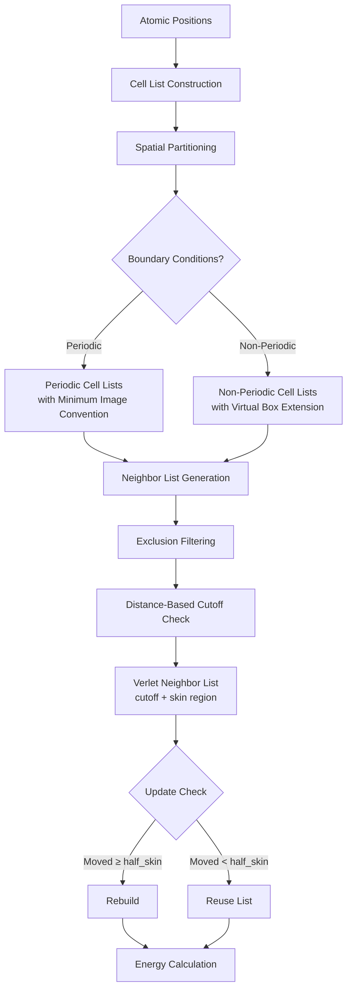

This comprehensive guide explains DIMOS's sophisticated neighbor list management system and cutoff schemes, which are fundamental to achieving efficient molecular dynamics simulations with linear scaling O(N) performance. The system combines cell lists, Verlet neighbor lists with skin regions, and optimized switching functions to minimize computational overhead while maintaining accuracy.

## Architecture Overview

The neighbor list system is built on a hierarchical architecture that combines spatial partitioning with efficient update strategies. At the core lies the `NeighborHandling` class which orchestrates cell list construction, neighbor list generation, and intelligent update checks.

Sources: [dimos/neighbor_handling.py](dimos/neighbor_handling.py#L374-L396)



The system integrates seamlessly with energy calculation pipelines through the `NonbondedInteractionsCutoff` and related classes, which consume neighbor lists to compute Lennard-Jones and electrostatic interactions efficiently.

Sources: [dimos/energy.py](dimos/energy.py#L695-L695)

## Cell List Algorithm

### Spatial Partitioning Fundamentals

Cell lists partition the simulation box into a regular grid of sub-boxes, where each cell has dimensions at least as large as the interaction cutoff distance (cutoff + skin). This ensures that only atoms in adjacent cells need to be considered for pairwise interactions, reducing the search space from O(N²) to approximately O(N).

The cell size calculation occurs during initialization:

```python
self.cutoff = cutoff + skin  # Include Verlet skin region
self.num_cells = torch.ceil(box / self.cutoff).to(torch.int64)
self.cell_size = box / self.num_cells
```

Sources: [dimos/neighbor_handling.py](dimos/neighbor_handling.py#L460-L478)

### Periodic vs Non-Periodic Implementations

For periodic boundary conditions, DIMOS uses the minimum image convention with modular arithmetic to handle atoms crossing box boundaries. The cell assignment formula:

```python
indices_of_atoms = ((pos / self.cell_size) % self.num_cells).to(torch.int32)
linear_cell_indices = (indices_of_atoms[:, 0] * self.num_cells[1] * self.num_cells[2] + 
                      indices_of_atoms[:, 1] * self.num_cells[2] + 
                      indices_of_atoms[:, 2])
```

Sources: [dimos/neighbor_handling.py](dimos/neighbor_handling.py#L630-L638)

For non-periodic systems, the algorithm dynamically creates a virtual box by adding epsilon (1e-1) to the maximum coordinates, ensuring atoms remain within the computational domain:

```python
min_pos = torch.min(pos, dim=0)
pos = pos - min_pos.values
max_pos = torch.max(pos, dim=0)
self.box = max_pos.values + self.epsilon_non_periodic
```

Sources: [dimos/neighbor_handling.py](dimos/neighbor_handling.py#L684-L691)

### Memory-Optimized Cell List Construction

The cell list uses a fixed-capacity buffer system with dynamic reallocation. This prevents memory fragmentation while accommodating variable atom counts per cell:

```python
cell_counts = torch.bincount(linear_cell_indices, minlength=self.total_num_cells)
max_atoms_in_cell = cell_counts.max()

# Reallocate buffer only if capacity changes
if (self.cell_capacity_for_atoms != max_atoms_in_cell) or 
   (self.total_num_cells != self._cell_atoms_buffer.shape[0]):
    self.cell_capacity_for_atoms = max_atoms_in_cell
    self._cell_atoms_buffer = torch.full(
        (self.total_num_cells, self.cell_capacity_for_atoms), 
        -1, dtype=torch.int64)
```

Sources: [dimos/neighbor_handling.py](dimos/neighbor_handling.py#L640-L649)

The sorted atom indices are then placed into their respective cells using cumulative sum partitions, ensuring O(N log N) complexity dominated by the sorting step:

```python
atom_offsets = torch.cat([torch.tensor([0], dtype=torch.int64), 
                         cell_counts.cumsum(0)])
start_positions = atom_offsets[:-1]
cell_indices_sorted, sort_indices = torch.sort(linear_cell_indices)
adjusted_sort_indices = flat_position_indices + start_positions[cell_indices_sorted]
sorted_atoms = sort_indices[adjusted_sort_indices]
self._cell_atoms_buffer[cell_indices_sorted, flat_position_indices] = sorted_atoms
```

Sources: [dimos/neighbor_handling.py](dimos/neighbor_handling.py#L651-L664)

## Verlet Neighbor Lists

### Skin Region Strategy

DIMOS implements Verlet neighbor lists with a configurable skin distance (default: 0.25 × cutoff, matching OpenMM's heuristic). The skin region allows the neighbor list to remain valid across multiple timesteps, dramatically reducing reconstruction frequency.

The core principle: rebuild the list only when any atom has moved more than half the skin distance since the last update:

```python
if skin is None:
    skin = 0.25 * cutoff  # OpenMM's default
self.skin = skin
self.cutoff = cutoff + skin
self.half_skin = self.skin / 2
self.half_skin_squared = self.half_skin**2
```

Sources: [dimos/neighbor_handling.py](dimos/neighbor_handling.py#L472-L478)

### Movement Tracking and Update Heuristic

The system tracks maximum displacement per atom efficiently using periodic boundary correction:

```python
def get_moved_distance_since_last_update(self, pos: torch.Tensor) -> torch.Tensor:
    pos_dist = pos - self.original_pos
    if self.periodic:
        pos_dist = periodic_correction(pos_dist, self.box)
    return torch.linalg.vector_norm(pos_dist, dim=1)

def check_recalc(self, pos: torch.Tensor) -> torch.Tensor:
    moved_distance = self.get_moved_distance_since_last_update(pos)
    if torch.any(moved_distance >= self.half_skin):
        self.neighborlist = self.get_neighborlist(pos)
    return self.neighborlist
```

Sources: [dimos/neighbor_handling.py](dimos/neighbor_handling.py#L712-L735)

This heuristic guarantees correctness because atoms moving less than half the skin distance cannot create or destroy interactions within the actual cutoff region (r ≤ cutoff).

### Neighbor List Construction

#### Periodic Systems

For periodic boundary conditions, DIMOS uses vectorized operations with `torch.vmap` for batched combination calculations:

```python
@torch.compiler.disable(recursive=True)
def build_neighborlist_from_cell_list(self, pos, cell_list, filter_for_distance=True):
    self.original_pos = pos.clone()
    
    # Pairwise combinations within each cell
    result1 = self.batched_combinations(cell_list, r=2)
    result1 = result1[~((result1[:, :, 0] == -1) | (result1[:, :, 1] == -1))]
    
    # Cartesian products between cells and their neighbors
    result2 = self.batched_cartesian_prod(cell_list, 
                                          cell_list[self.shifts].flatten(1, 2))
    result2 = result2[~((result2[:, :, 0] == -1) | (result2[:, :, 1] == -1))]
    
    self.neighborlist = torch.cat((result1, result2)).T
    # ... exclusion filtering and distance checks
```

Sources: [dimos/neighbor_handling.py](dimos/neighbor_handling.py#L828-L851)

The `shifts` tensor contains pre-computed neighbor cell offsets, calculated to avoid double counting by only considering "forward" neighbors (13 cells including self for half-space optimization).

Sources: [dimos/neighbor_handling.py](dimos/neighbor_handling.py#L551-L576)

#### Non-Periodic Systems

Non-periodic systems use a loop-based approach optimized for variable neighbor counts:

```python
def build_neighborlist_from_cell_list_loop(self, pos, cell_list, filter_for_distance=True):
    self.original_pos = pos
    results = []
    for idx, cell in enumerate(cell_list):
        mask2 = cell == -1
        cell = cell[~mask2]
        result0 = torch.combinations(cell, r=2)
        results.append(result0)
        
        index_tensor = torch.tensor(self.linear_shifts[idx])
        if index_tensor.size(0) == 0:
            continue
            
        neighbor_atoms = cell_list[index_tensor].flatten(0, 1)
        mask = neighbor_atoms == -1
        neighbor_atoms = neighbor_atoms[~mask]
        result = torch.cartesian_prod(cell, neighbor_atoms)
        results.append(result)
    
    self.neighborlist = torch.cat(results).T
    # ... exclusion filtering and distance checks
```

Sources: [dimos/neighbor_handling.py](dimos/neighbor_handling.py#L753-L786)

## Cutoff Schemes

### Switching Functions for Energy Continuity

DIMOS implements smooth switching functions to ensure continuous energy and forces at the cutoff boundary. The switching function operates between `switch_distance` and `cutoff`, smoothly transitioning the interaction to zero.

For Lennard-Jones potentials, the modified interaction is:

E_switch(r) = E_LJ(r) × S(r)

where S(r) is the polynomial switching function:

```
S(r) = 1                     for r < switch_distance
S(r) = 1 + t³(-10 + 15t - 6t⁴)  for switch_distance ≤ r ≤ cutoff
S(r) = 0                     for r > cutoff
```

with t = (r - switch_distance) / (cutoff - switch_distance)

Sources: [dimos/energy.py](dimos/energy.py#L1326-L1335)

The implementation ensures continuous forces (first derivative) by construction:

```python
if self.switch_dist is not None:
    t = (distance_matrix_cut - self.switch_dist) / (self.cutoff - self.switch_dist)
    switch_val = torch.where(
        t > 0,
        1 + t * t * t * (-10 + t * (15 - t * 6)),
        torch.ones_like(t)
    )
    interaction_strength = interaction_strength * switch_val
```

Sources: [dimos/energy.py](dimos/energy.py#L1326-L1335)

### Reaction Field Approximation for Electrostatics

For electrostatic interactions beyond the cutoff, DIMOS uses the Reaction Field Approximation (RFA), which models the solvent as a dielectric continuum:

E_RF = (q₁q₂/4πε₀) × (1/r + k_rf × r² - c_rf)

where:
- k_rf = (1/cutoff³) × (ε_solvent - 1) / (2ε_solvent + 1)
- c_rf = (1/cutoff) × (3ε_solvent) / (2ε_solvent + 1)

Sources: [dimos/energy.py](dimos/energy.py#L1490-L1510)

This approximation provides both continuity at the cutoff and reasonable long-range electrostatic behavior for systems where full Ewald summation is not required.

### Energy Calculation with Cutoffs

The `NonbondedInteractionsCutoff` class orchestrates cutoff-based energy calculations:

```python
def calc_energy(self, pos: torch.Tensor, neighborlist: torch.Tensor) -> torch.Tensor:
    # Calculate distances using pre-computed neighbor list
    distance_matrix = get_distances_edge_list(pos, neighborlist, 
                                               self.periodic, self.box)
    within_cutoff = distance_matrix <= self.cutoff
    neighborlist_within_cutoff = neighborlist[:, within_cutoff]
    distance_matrix_cut = torch.masked_select(distance_matrix, within_cutoff)
    
    inverse_distance_cut = 1 / distance_matrix_cut
    
    # Calculate Lennard-Jones and electrostatic contributions
    lj_energy = self.lj_energy_contrib.calc_energy(
        pos, inverse_distance_cut, distance_matrix_cut, neighborlist_within_cutoff)
    electrostatics_energy = self.electrostatics_energy_contrib.calc_energy(
        pos, inverse_distance_cut, distance_matrix_cut, neighborlist_within_cutoff)
    
    return lj_energy + electrostatics_energy
```

Sources: [dimos/energy.py](dimos/energy.py#L649-L668)

## Exclusion Handling

### Bonded Interaction Exclusions

To prevent counting bonded interactions (1-2, 1-3, and optionally 1-4) twice, DIMOS implements efficient exclusion filtering using two strategies depending on memory constraints.

For systems with sufficient memory, a boolean filter matrix is pre-computed:

```python
self.filter_exclusions = torch.zeros((self.num_atoms, self.num_atoms), dtype=torch.bool)
if exclusions is not None and exclusions.size(0) > 0:
    self.filter_exclusions[exclusions[0], exclusions[1]] = True
    self.filter_exclusions[exclusions[1], exclusions[0]] = True
```

Sources: [dimos/neighbor_handling.py](dimos/neighbor_handling.py#L494-L500)

This allows O(1) exclusion checks: `mask_exclusions = self.filter_exclusions[self.neighborlist[0], self.neighborlist[1]]`

### Memory-Optimized Exclusion Search

For memory-constrained systems (large N), exclusions are encoded as sorted integer keys using the encoding: key = i × num_atoms + j. Binary search then efficiently identifies excluded pairs:

```python
if self.save_memory:
    pairs = torch.cat([exclusions, exclusions[[1, 0]]], dim=1)
    sorted_pairs, _ = torch.sort(pairs, dim=0)
    unique_pairs = torch.unique(sorted_pairs, dim=1)
    self.exclusion_keys = unique_pairs[0] * num_atoms + unique_pairs[1]
    self.exclusion_keys = self.exclusion_keys.to(torch.int64)
    self.exclusion_keys, _ = torch.sort(self.exclusion_keys)

# During neighbor list construction:
sorted_neighbors, _ = torch.sort(self.neighborlist, dim=0)
neighbor_keys = sorted_neighbors[0] * self.num_atoms + sorted_neighbors[1]
neighbor_keys = neighbor_keys.to(torch.int64)

# Binary search to find exclusion matches
idx = torch.searchsorted(self.exclusion_keys, neighbor_keys)
mask_exclusions = (idx < len(self.exclusion_keys)) & \
                   (self.exclusion_keys[idx] == neighbor_keys)
```

Sources: [dimos/neighbor_handling.py](dimos/L485-L491, L795-L805, L834-L840)

### 1-4 Interaction Scaling

DIMOS properly handles 1-4 interactions (atoms separated by exactly three bonds) with scaled Lennard-Jones and electrostatic interactions:

- Lennard-Jones: divided by `scnb` (typically 2.0)
- Electrostatics: divided by `scee` (typically 1.2)

These interactions are calculated separately using explicit 1-4 pair lists:

```python
def lj_energy_contribution_cut_one_four(self, pos: torch.Tensor) -> torch.Tensor:
    distance_matrix = get_distances_edge_list(pos, self.exclusions_one_four, 
                                               self.periodic, self.box)
    mask_from_cutoff = [distance_matrix <= self.cutoff]
    # ... standard LJ calculation ...
    return torch.sum(interaction_strength) / self.scnb
```

Sources: [dimos/energy.py](dimos/energy.py#L1344-L1372)

## Memory Optimization Strategies

### Automatic Memory Detection

DIMOS automatically detects GPU memory constraints and activates appropriate optimization levels:

```python
if "cuda" in torch.get_default_device().__repr__() and save_memory is None:
    total_memory = torch.cuda.get_device_properties(torch.get_default_device()).total_memory / 1024
    save_memory = 0
    
    if num_atoms**2 / total_memory > 500:
        save_memory = 1  # Some optimization
    if num_atoms**2 / total_memory > 1250:
        save_memory = 2  # Aggressive optimization (CPU fallback)
        warn("Activated aggressive memory savings for neighborlist...")
```

Sources: [dimos/neighbor_handling.py](dimos/L438-L449)

> [!TIP]
> **Memory Optimization Heuristic**: The ratio num_atoms² / total_memory > 500-1250 determines optimization level. Level 1 uses integer key encoding for exclusions. Level 2 offloads heavy computations to CPU to prevent GPU memory overflow, though this significantly impacts performance.

### Aggressive Memory Optimization

Level 2 optimization moves intensive operations to CPU when GPU memory is critically constrained:

```python
if self.save_memory == 2:
    cell_list = cell_list.to("cpu")
    self.shifts = self.shifts.to("cpu")
    self.exclusion_keys = self.exclusion_keys.to("cpu")
    pos = pos.to("cpu")
    self.box = self.box.to("cpu")

# ... perform neighbor list construction ...

if self.save_memory == 2:
    self.neighborlist = self.neighborlist.to(torch.get_default_device())
    pos = pos.to(torch.get_default_device())
    self.box = self.box.to(torch.get_default_device())
```

Sources: [dimos/neighbor_handling.py](dimos/neighbor_handling.py#L852-L860)

## Integration with Simulation Loop

### Neighbor List Update Frequency

The neighbor list update frequency is controlled by `neighbor_check_interval` in the `MDSimulation` class:

```python
if self.sys.use_neighborlist and self.total_step_counter % self.neighbor_check_interval == 0:
    self.neighborlist = self.neighbor_handling.check_recalc(self.pos)
```

Sources: [dimos/simulation.py](dimos/simulation.py#L623-L624)

> [!TIP]
> **Update Interval Selection**: Use `neighbor_check_interval=1` (default) for maximum accuracy, especially with small timesteps. Increase to 2-4 for performance gains when using small skin distances, but monitor energy conservation carefully.

### Memory Detachment

To prevent unbounded computation graph growth during long simulations, positions are detached at configurable intervals:

```python
if detach:
    self.detach_()
    self.neighbor_handling.original_pos.detach_()
    self.neighbor_handling.box.detach_()
```

Sources: [dimos/simulation.py](dimos/simulation.py#L644-L647)

## Configuration Guidelines

### Recommended Cutoff and Skin Values

| System Type | Cutoff (nm) | Skin | Switch Distance | Notes |
|-------------|-------------|------|-----------------|-------|
| Proteins in solvent | 1.0-1.2 | 0.25-0.30 | 0.8-0.9 | Balance accuracy and speed |
| Pure water | 0.9-1.0 | 0.20-0.25 | 0.75-0.85 | Can use smaller cutoff |
| Small molecules | 1.0-1.4 | 0.30-0.35 | 0.85-1.0 | Larger for heterogeneous interactions |
| GPU memory constrained | 0.8-1.0 | 0.15-0.20 | 0.65-0.75 | Reduce skin for smaller neighbor lists |

Sources: [dimos/neighbor_handling.py](dimos/neighbor_handling.py#L472-L478)

### Memory Level Selection

| System Size | Available GPU Memory | Recommended Level | Rationale |
|-------------|---------------------|------------------|-----------|
| N < 10,000 | Any | 0 | No memory pressure |
| 10,000 ≤ N < 50,000 | ≥8 GB | 0 | Optimal performance |
| 50,000 ≤ N < 100,000 | 8-16 GB | 1 | Integer key encoding |
| 100,000 ≤ N < 200,000 | 16-24 GB | 1 | Moderate memory savings |
| N ≥ 200,000 | < 24 GB | 2 | CPU fallback required |

Sources: [dimos/neighbor_handling.py](dimos/neighbor_handling.py#L438-L449)

## Performance Considerations

### Computational Complexity Analysis

The neighbor list system achieves near-linear scaling through several optimizations:

| Operation | Complexity | Bottleneck |
|-----------|-----------|------------|
| Cell assignment | O(N) | Modulo arithmetic |
| Cell list sorting | O(N log N) | PyTorch sort operation |
| Intra-cell combinations | O(N) | Vectorized `torch.combinations` |
| Inter-cell products | O(N) | Vectorized `torch.cartesian_prod` |
| Exclusion filtering | O(N log M) | Binary search on exclusions |
| Distance checks | O(N) | Vectorized edge list distances |

Where N = number of atoms, M = number of excluded pairs.

Sources: [dimos/neighbor_handling.py](dimos/neighbor_handling.py#L656-L664, L833-L842)

### Typical Update Intervals

With proper skin distance settings (0.25 × cutoff), neighbor lists typically remain valid for 5-20 timesteps at 1-2 fs integration:

```mermaid
gantt
    title Neighbor List Update Timeline (Example)
    dateFormat X
    axisFormat %s
    
    section MD Steps
    Step 1      :a1, 0, 1
    Step 2      :a2, 1, 2
    Step 3      :a3, 2, 3
    Step 4      :a4, 3, 4
    Step 5      :a5, 4, 5
    Step 6      :a6, 5, 6
    Step 7      :a7, 6, 7
    Step 8      :a8, 7, 8
    Step 9      :a9, 8, 9
    Step 10     :a10, 9, 10
    
    section Neighbor List Updates
    Rebuild     :crit, b1, 0, 1
    Valid       :c1, 1, 6
    Rebuild     :crit, b2, 6, 7
    Valid       :c2, 7, 11
```



The exact interval depends on diffusion rate, temperature, and skin distance. Higher temperatures require more frequent updates.

## Advanced Usage Examples

### Customizing Neighbor List Parameters

For specialized systems, you can override default parameters:

```python
from dimos.neighbor_handling import NeighborHandling

# High-precision simulation with larger skin
neighbor_handler = NeighborHandling(
    periodic=True,
    num_atoms=50000,
    cutoff=1.2,  # nm
    box=system.box,
    exclusions=system.all_exclusions,
    skin=0.35,  # Larger than default 0.3 for safety
    save_memory=0  # No memory constraints
)

# Memory-optimized large system
neighbor_handler = NeighborHandling(
    periodic=True,
    num_atoms=200000,
    cutoff=1.0,
    box=system.box,
    exclusions=system.all_exclusions,
    skin=0.20,  # Smaller skin for reduced neighbor list size
    save_memory=2  # Aggressive CPU fallback
)
```

Sources: [dimos/neighbor_handling.py](dimos/neighbor_handling.py#L420-L491)

### Integrating with Custom Energy Functions

The neighbor list interface is straightforward to integrate with custom energy calculations:

```python
def custom_energy_calculation(pos, neighborlist, parameters):
    """Calculate custom energy using neighbor list."""
    distances = get_distances_edge_list(pos, neighborlist, periodic, box)
    # Apply custom potential function
    energy = custom_potential(distances, parameters)
    return torch.sum(energy)
```

The `get_distances_edge_list` utility handles all periodic boundary corrections automatically.

## Troubleshooting Common Issues

### Memory Overflow Errors

**Symptom**: CUDA out of memory during neighbor list construction

**Solution**: Activate memory optimization:

```python
# Auto-detect and set appropriate level
if torch.cuda.is_available():
    total_mem = torch.cuda.get_device_properties(0).total_memory / (1024**3)
    save_memory = 1 if num_atoms > 50000 else 2 if num_atoms > 150000 else 0
```

Sources: [dimos/neighbor_handling.py](dimos/neighbor_handling.py#L438-L449)

### Energy Drift with Neighbor Lists

**Symptom**: Increasing total energy in NVE simulation

**Root Causes and Solutions**:

1. **Skin too small**: Increase skin distance to 0.3-0.35 × cutoff
2. **Update interval too large**: Reduce `neighbor_check_interval` to 1
3. **High diffusion rates**: Increase skin or decrease update interval
4. **Box size near cutoff**: Ensure box/2 > cutoff + skin

Sources: [dimos/neighbor_handling.py](dimos/neighbor_handling.py#L506-L515)

### Performance Degradation

**Symptom**: Slow neighbor list rebuilds despite cell list optimization

**Optimization Strategies**:

1. **Check sorting overhead**: For large systems (>100k atoms), sorting dominates. Consider reducing cell size or updating box dimensions.
2. **Monitor neighbor list size**: If average neighbors > 100, consider reducing cutoff or increasing skin to reduce rebuild frequency.
3. **CPU fallback overhead**: Level 2 memory optimization transfers data to CPU. Upgrade GPU memory if possible.

Sources: [dimos/neighbor_handling.py](dimos/neighbor_handling.py#L656-L664, L852-L860)

## Next Steps

To deepen your understanding of DIMOS's performance optimization features, explore these related topics:

- [GPU Acceleration and PyTorch Compilation](23-gpu-acceleration-and-pytorch-compilation): Learn how PyTorch compilation and GPU strategies further accelerate neighbor list computations
- [Ewald Summation and PME Implementation](10-ewald-summation-and-pme-implementation): Understand long-range electrostatic treatment when cutoff schemes are insufficient
- [Constraint Handling Algorithms](25-constraint-handling-algorithms): See how constraints interact with neighbor lists for hydrogen-bonded systems
- [Memory Management and Computation Graph Detachment](26-memory-management-and-computation-graph-detachment): Advanced techniques for managing memory during long simulations