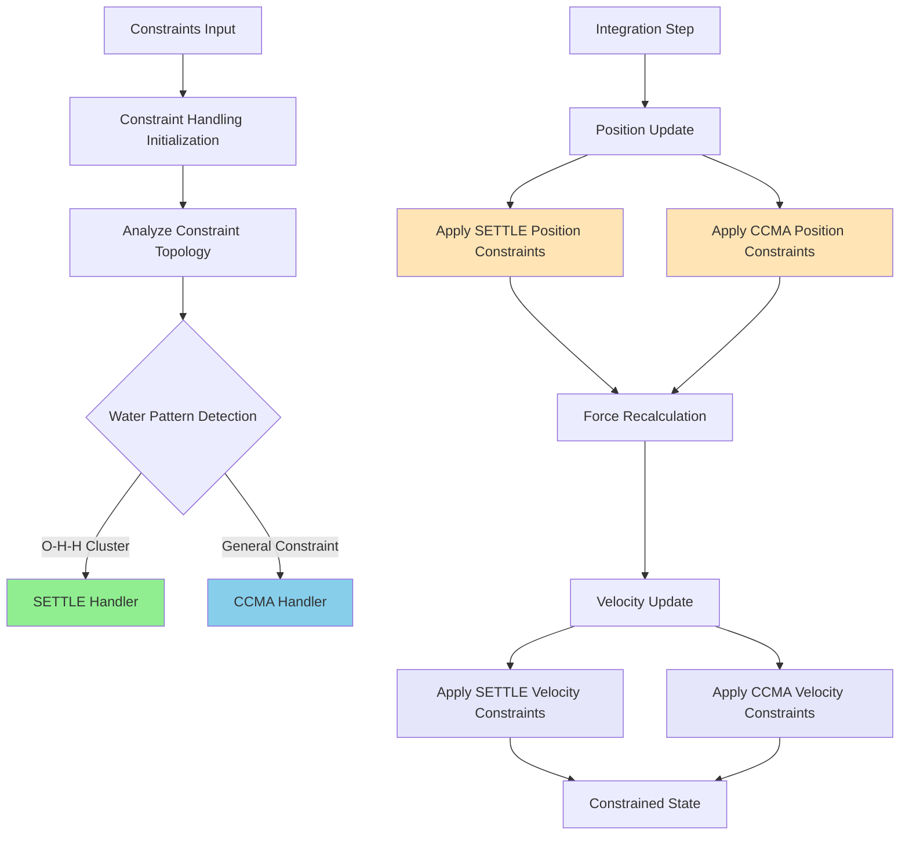
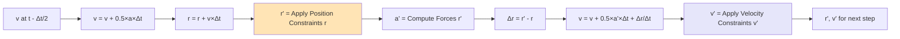

Constraint handling algorithms enable molecular dynamics simulations to use larger integration timesteps by enforcing fixed distances between bonded atoms. DIMOS implements a sophisticated two-tier constraint system that automatically optimizes constraint solving based on molecular geometry, providing the analytical SETTLE algorithm for water molecules and the iterative CCMA (Constant Constraint Matrix Approximation) algorithm for general distance constraints. This architectural choice enables simulations with timesteps up to 2-3 femtoseconds while maintaining numerical stability and energy conservation.

Sources: [constraints.py](dimos/constraints.py#L374-L394)

## Constraint Architecture Overview

DIMOS employs a hierarchical constraint architecture that automatically classifies and routes constraints to the most appropriate solving algorithm. The system distinguishes between rigid water molecules (typically 90%+ of constraints in solvated systems) and general molecular constraints, applying specialized algorithms optimized for each case. This dual-algorithm approach provides both computational efficiency for the common case and generality for arbitrary molecular topologies.

The `ConstraintsHandling` class serves as the central orchestrator, automatically detecting water molecule clusters during initialization and partitioning constraints between SETTLE and CCMA handlers. This detection logic examines constraint connectivity patterns, identifying three-atom clusters where a central atom participates in exactly two equal-length bonds—a signature of water-like geometry [constraints.py](dimos/constraints.py#L480-L560). The remaining constraints are handled by CCMA, which uses an iterative mass-weighted correction scheme with a constant constraint matrix approximation for efficiency.



Sources: [constraints.py](dimos/constraints.py#L423-L480)

## Constraint Algorithm Comparison

DIMOS provides two complementary constraint algorithms, each optimized for specific molecular patterns. The choice between algorithms is automatic, based on topological analysis during system initialization, but understanding their characteristics helps in system design and troubleshooting.

| Feature | SETTLE Algorithm | CCMA Algorithm |
|---------|----------------|----------------|
| **Target** | Rigid water molecules (O-H-H) | General distance constraints |
| **Solution Type** | Analytical, exact | Iterative approximation |
| **Constraints Per Call** | 3 atoms, 2 bond lengths | Arbitrary atom pairs |
| **Computational Cost** | O(1) per water molecule | O(n_iterations × n_constraints) |
| **Convergence** | Instantaneous | Requires iteration monitoring |
| **Periodic BC Support** | Yes | Yes |
| **Velocity Constraints** | Analytical projection | Linearized correction |
| **Typical Use Case** >90% of constraints in solvated proteins | Backbone constraints, ligand bonds |

> [!TIP]
> SETTLE provides 10-100x faster constraint solving for water molecules compared to iterative methods. In typical solvated protein simulations, water molecules constitute 80-95% of all constraints, making this optimization critical for performance.

Sources: [constraints.py](dimos/constraints.py#L658-L730), [constraints.py](dimos/constraints.py#L916-L995)

## SETTLE: Analytical Water Constraint Solving

The SETTLE algorithm, originally developed by Miyamoto and Kollman (1992), provides an exact analytical solution for maintaining rigid water geometry during molecular dynamics integration. DIMOS' implementation handles both position and velocity constraints with full support for periodic boundary conditions.

### Position Constraints

The SETTLE position constraint algorithm operates through a coordinate transformation sequence that maps the current water molecule configuration onto the target rigid geometry. The implementation computes the center of mass of the displaced water molecule, then applies a series of cross-product operations to construct a local coordinate system based on the original molecular orientation [constraints.py](dimos/constraints.py#L996-L1060). This transformation preserves the overall molecular orientation while enforcing exact bond lengths and angles.

The algorithm follows this mathematical sequence:
1. Compute the center of mass displacement from the unconstrained integration step
2. Transform atom positions to a molecule-local coordinate frame defined by cross products of bond vectors
3. Solve for the rigid body rotation that minimizes displacement from the target geometry
4. Apply the inverse transformation to obtain constrained positions in the global coordinate system

This approach eliminates the need for iterative convergence testing, as the analytical solution is exact within floating-point precision. For systems with thousands of water molecules, this provides substantial performance advantages over iterative constraint methods.

Sources: [constraints.py](dimos/constraints.py#L996-L1060)

### Velocity Constraints

Velocity constraint handling in SETTLE operates through linearized projection of the velocity components onto the subspace orthogonal to the constraint surface. The algorithm computes unit vectors along each bond direction (eAB, eBC, eCA) and projects the relative velocities onto these directions to obtain the constraint violation velocities [constraints.py](dimos/constraints.py#L1122-L1184). These violation velocities are then redistributed across the three atoms using mass-weighted coefficients derived from the molecular geometry.

The velocity constraint formulation solves a 3×3 linear system that ensures the net momentum of the constraint correction is zero (conserving linear momentum) while satisfying the three constraint equations (bond length derivatives). The solution involves trigonometric terms derived from the bond angles, resulting in corrections that are applied as:
```
v0' = v0 + (eAB × tab - eCA × tca) / mO
v1' = v1 + (eBC × tbc - eAB × tab) / mH1  
v2' = v2 + (eCA × tca - eBC × tbc) / mH2
```

where tab, tbc, tca are the Lagrange multipliers for each constraint computed from the mass-weighted geometry matrix.

Sources: [constraints.py](dimos/constraints.py#L1122-L1184)

## CCMA: Iterative General Constraint Solver

The Constant Constraint Matrix Approximation (CCMA) algorithm extends constraint handling to arbitrary molecular topologies. Based on the work of Eastman and Pande (2010), CCMA approximates the constraint Jacobian matrix as constant throughout the iterative solving process, dramatically reducing computational cost while maintaining convergence for typical timestep values.

### Matrix Construction and Inversion

CCMA initializes by constructing a constraint interaction matrix that couples constraints sharing atoms [constraints.py](dimos/constraints.py#L730-L825). For each pair of constraints that share an atom, the matrix entry is computed from the local geometry: either the law of cosines applied to the three participating bond lengths (when three constraints form a triangle) or the cosine of the equilibrium angle between the bonds (when angle parameters are available). This construction accounts for mass effects through the reduced mass formula:

```
μ_ij = 0.5 / (1/m_i + 1/m_j)
```

where μ_ij is the reduced mass for the constraint between atoms i and j. The matrix is inverted once during initialization (using PyTorch's matrix inversion) and stored in a sparse format for efficient repeated application. The sparse representation stores only non-zero entries along with their row and column indices, enabling fast matrix-vector products during iteration.

Sources: [constraints.py](dimos/constraints.py#L730-L825)

### Iterative Position Correction

The CCMA position constraint algorithm iteratively applies corrections to atomic positions until all constraints satisfy the specified tolerance. Each iteration computes the current constraint violations as the difference between squared bond lengths and their equilibrium values [constraints.py](dimos/constraints.py#L826-L875):

```
δ_j = μ_ij × (d²_j - |r'_ij|²) / (r_ij · r'_ij)
```

where δ_j is the correction magnitude for constraint j, μ_ij is the reduced mass, d_j is the equilibrium bond length, r_ij is the reference bond vector (before integration), and r'_ij is the current bond vector (after integration). The key innovation in CCMA is the approximation that the denominator term (r_ij · r'_ij) remains constant across iterations, allowing the constraint matrix to be pre-inverted.

The raw constraint corrections are then coupled through the precomputed inverse matrix to account for constraint interactions:
```
δ_coupled = M⁻¹ × δ_raw
```

Finally, the coupled corrections are applied to atomic positions as mass-weighted displacements along the constraint directions. The algorithm terminates when all constraint squared lengths fall within the tolerance window:
```
(1 - 2×tol + tol²) × d² ≤ |r'_ij|² ≤ (1 + 2×tol + tol²) × d²
```

or when the maximum iteration count is reached (default 150).

Sources: [constraints.py](dimos/constraints.py#L826-L875)

### Velocity Constraint Linearization

Velocity constraints in CCMA apply a single linearized correction derived from the same constraint matrix used for position corrections. The algorithm assumes small velocity displacements and linearizes the constraint derivative equations, resulting in a direct projection operation without iteration [constraints.py](dimos/constraints.py#L873-L890). This approximation is valid for typical MD timesteps where velocity changes per step are small relative to the constraint geometry.

The velocity constraint correction is computed as:
```
v' = v + M⁻¹ × (∂g/∂r) × v
```

where g represents the constraint functions and the derivative term approximates the projection of velocities onto the constraint surface. This approach ensures that velocities remain consistent with the constrained positions while maintaining computational efficiency.

Sources: [constraints.py](dimos/constraints.py#L873-L890)

## Integration with Velocity Verlet Dynamics

Constraint handling is tightly integrated with the Velocity Verlet integration scheme, with constraints applied at two critical points in each timestep. DIMOS implements this integration in the `VelocityVerlet.step()` method [integrators.py](dimos/integrators.py#L906-L955), following the standard SHAKE/RATTLE-style constraint protocol:



Position constraints are applied immediately after the position update, ensuring that all atoms satisfy bond length constraints before force evaluation. The force calculation then operates on the constrained geometry, preventing forces from driving the system into high-energy regions of constraint-violating configuration space.

Velocity constraints are applied after the velocity update, ensuring that atomic velocities satisfy the constraint derivatives (bonds neither expand nor contract due to velocity components along bond directions). The correction includes an additional term Δr/Δt that accounts for the displacement introduced by the position constraint step. This term ensures that the final velocities are consistent with the actual position trajectory, which differs from the unconstrained trajectory by the constraint correction.

> [!TIP]
> The velocity constraint correction includes the Δr/Δt term (position difference divided by timestep) to maintain consistency between the constrained position path and the velocity. Without this term, energy drift would occur even with perfect position constraints, because velocities would not reflect the actual motion undergone by atoms during constraint enforcement.

Sources: [integrators.py](dimos/integrators.py#L906-L955)

## Periodic Boundary Condition Support

Both SETTLE and CCMA fully support periodic boundary conditions through minimum image convention corrections. The `ConstraintsHandling` class propagates the periodic box dimensions to both constraint handlers via the `update_box()` method [constraints.py](dimos/constraints.py#L614-L623), ensuring that constraint calculations respect the simulation box geometry.

For SETTLE, periodic corrections are applied to all interatomic vectors before geometric operations: the bond vectors between oxygen and hydrogen atoms, the center of mass displacement, and the coordinate transformation axes [constraints.py](dimos/constraints.py#L1008-L1015). This ensures that water molecules crossing periodic boundaries are handled correctly, with the constraint geometry computed using minimum image distances.

For CCMA, periodic corrections are applied to both the reference bond vectors (before integration) and the current bond vectors (after integration) during each iteration [constraints.py](dimos/constraints.py#L831-L839). This double correction is necessary because the reference positions might also differ across periodic boundaries relative to the current positions. The constraint correction displacements are then applied directly to positions, with the integrator handling any additional periodic wrapping if needed.

Sources: [constraints.py](dimos/constraints.py#L614-L623), [constraints.py](dimos/constraints.py#L1008-L1015), [constraints.py](dimos/constraints.py#L831-L839)

## Performance Characteristics and Validation

The constraint system has been validated against OpenMM for energy conservation in NVE simulations using hydrogen-bond constraints. Test results from the `test_nve_constraints.py` benchmark show excellent energy conservation over 100 timesteps with a 3.0 fs timestep on an alanine dipeptide in explicit solvent [test_nve_constraints.py](test_nve_constraints.py#L382-L502). The comparison demonstrates that DIMOS constraints achieve energy stability comparable to OpenMM's reference implementation.

Performance characteristics depend heavily on system composition:
- **SETTLE cost**: Approximately 10-15 floating-point operations per water molecule per constraint application, with excellent vectorization potential due to the analytical formulation
- **CCMA cost**: O(n_iterations × n_nonzero_matrix_elements) per timestep, where n_iterations is typically 3-8 for 1e-4 tolerance and 2-3 fs timesteps
- **Memory overhead**: Sparse constraint matrix storage proportional to constraint connectivity (typically 5-10 non-zero entries per constraint for protein systems)

The automatic water detection typically reduces CCMA workload by 80-95% in solvated biomolecular systems, as most constraints are water bonds handled by SETTLE. This architectural optimization makes DIMOS competitive with other MD packages for typical biomolecular simulations.

Sources: [test_nve_constraints.py](test_nve_constraints.py#L382-L502)

## Configuration and Usage

Constraint handling is configured through the force field initialization when creating a system. The `constraint_option` parameter controls which bonds are constrained:

```python
# Example: Enable hydrogen bond constraints for Ala2 in explicit solvent
system = dimos.ff.AmberForceField(
    prmtop_filename, 
    nonbonded_type="Ewald",
    constraint_option="h_bonds"  # Constrain bonds to hydrogen atoms
)

# Create integrator with constraint handling
integrator = dimos.integrators.VelocityVerlet(timestep=3.0, system=system)

# Constraints are automatically detected and partitioned
# between SETTLE and CCMA during system initialization
```

The `ConstraintsHandling` class automatically detects water molecules and partitions constraints during initialization [constraints.py](dimos/constraints.py#L480-L620). No manual configuration of SETTLE versus CCMA allocation is required—the system analyzes the constraint graph and selects the optimal algorithm for each constraint based on topology.

Available constraint options (as defined in the force field module) include:
- `None`: No constraints
- `"h_bonds"`: Constrain all bonds to hydrogen atoms (most common)
- `"all_bonds"`: Constrain all bonds
- `"h_angles"`: Constrain bonds to hydrogen and angles involving hydrogen

The tolerance parameter (typically 1e-4 to 1e-6) controls the convergence criterion for CCMA iterations. Tighter tolerances improve constraint accuracy but may increase iteration count. For most biomolecular applications, the default tolerance of 1e-4 provides an excellent balance between accuracy and performance.

Sources: [test_nve_constraints.py](test_nve_constraints.py#L392-L407)

## Next Steps

With constraint handling algorithms understood, explore how they enable larger timesteps and improved sampling:

- **[Velocity Verlet Integration](11-velocity-verlet-integration)**: Detailed examination of the integration scheme that constraints enable, including mathematical foundations and stability analysis
- **[Langevin Dynamics and Thermostats](12-langevin-dynamics-and-thermostats)**: Combining constraints with stochastic dynamics for temperature control
- **[Energy Conservation and NVE Tests](27-energy-conservation-and-nve-tests)**: Validation methodology for constraint implementations and long-term stability testing
- **[Performance and Optimization](23-gpu-acceleration-and-pytorch-compilation)**: GPU acceleration strategies for constraint algorithms and PyTorch compilation techniques