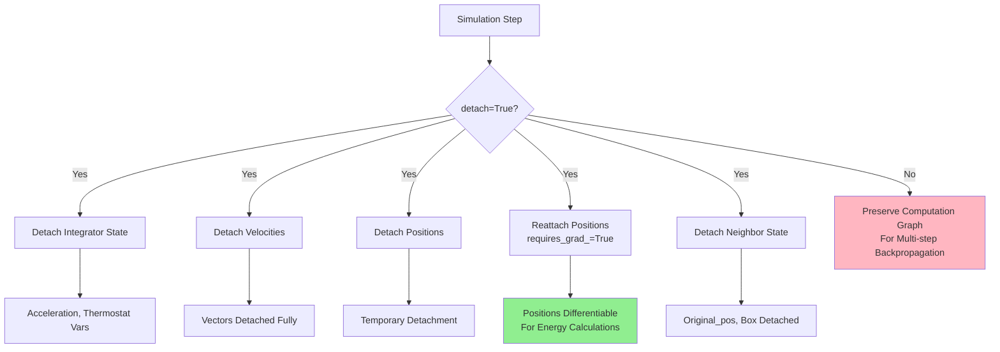

This page documents DIMOS's sophisticated memory management architecture and computation graph detachment strategies. These mechanisms enable efficient long-running simulations while preserving differentiability for machine learning integration and advanced sampling methods. Understanding these patterns is essential for implementing gradient-based optimization, training ML potentials, and performing metadynamics with collective variables.

## The Detachment Architecture

DIMOS implements a hierarchical detachment system that operates at multiple levels of the simulation stack. The core principle is **selective graph preservation**: only tensors required for future gradient computations remain attached to the computation graph, while others are detached to prevent unbounded memory growth during long simulations.

The architecture spans three primary layers:

- **Simulation Layer**: Controls detachment at the simulation step level in `MDSimulation` and `MCSimulation` classes
- **Integrator Layer**: Manages detachment of integrator-specific state tensors like accelerations and thermostat variables
- **Force Field Layer**: Handles detachment through the `create_graph` parameter in system initialization

This design enables **memory-efficient long simulations** (millions of steps) while supporting **gradient-based workflows** (ML training, enhanced sampling) through a single `detach` parameter in the `step()` method.



Sources: [simulation.py](dimos/simulation.py#L620-L680), [simulation.py](dimos/simulation.py#L668-L676)

## MDSimulation Detachment Strategy

The `MDSimulation.step()` method implements the primary memory management interface through its `detach` parameter (default: `True`). When enabled, it orchestrates a sequence of detachment operations after each integration step:

```python
for step in range(num_steps):
    # ... integration steps ...
    
    if detach:
        self.detach_()
        self.neighbor_handling.original_pos.detach_()
        self.neighbor_handling.box.detach_()
```

The `detach_()` method executes the core detachment logic:

```python
def detach_(self):
    self.integrator.detach_()  # Detaches acceleration, thermostat state
    self.vel.detach_()         # Fully detaches velocities
    self.pos.detach_().requires_grad_()  # Detach then reattach positions
```

This pattern reveals a critical design decision: **velocities are fully detached** because MD dynamics do not require velocity gradients for typical workflows. However, **positions are immediately re-attached with `requires_grad_()`** because energy calculations must remain differentiable. This enables gradient computation with respect to atomic coordinates while still preventing the graph from growing through the velocity update operations.

Sources: [simulation.py](dimos/simulation.py#L620-L680), [simulation.py](dimos/simulation.py#L668-L676)

## MCSimulation Detachment Strategy

Monte Carlo simulations follow a similar but adapted pattern due to their different computational model:

```python
def detach_(self):
    for move in self.move_set:
        if hasattr(move, "integrator"):
            move.integrator.detach_()
    self.pos.detach_()
    self.pos.requires_grad_()
```

Since MC simulations use a **move-based approach** rather than continuous integration, the detachment occurs at the move level. Each move in the move set may have its own integrator (for gradient-based moves), which is detached. The position detachment strategy remains identical to MD: temporary detachment followed by re-attachment to preserve differentiability for energy-based acceptance criteria.

This design supports **hybrid MC/MD moves** where some moves use integrators (Hamiltonian Monte Carlo) and others use purely stochastic proposals, all within a unified memory management framework.

Sources: [simulation.py](dimos/simulation.py#L803-L860), [simulation.py](dimos/simulation.py#L845-L853)

## Integrator-Level Detachment

Each integrator implements a `get_variables_to_detach()` method that specifies which internal state tensors should be detached. The base `CommonIntegrator` class provides the orchestration:

```python
def detach_(self):
    for var in self.get_variables_to_detach():
        var.detach_()
```

Different integrators expose different internal states:

| Integrator Type | Detached Variables | Rationale |
|----------------|-------------------|-----------|
| Verlet/VelocityVerlet | `[acceleration]` | Forces/accelerations don't need history for MD dynamics |
| Langevin Dynamics | `[acceleration]` | Random force terms break temporal correlations |
| Nose-Hoover | `[acceleration, thermostat_vel]` | Thermostat state doesn't require backpropagation in standard MD |
| Nose-Hoover Chain | `[acceleration, all_thermostat_vars]` | Extended thermostat states are detached |
| Brownian Dynamics | `[]` (empty) | No persistent internal state |
| Andersen/Berendsen/Lowe-Andersen | `[acceleration]` | Base integrator acceleration is detached |

The `@torch.compiler.disable(recursive=True)` decorator on Nose-Hoover Chain's thermostat propagation method ensures that PyTorch compilation doesn't interfere with the manual detachment logic.

Sources: [integrators.py](dimos/integrators.py#L453-L465), [integrators.py](dimos/integrators.py#L670-L685), [integrators.py](dimators.py#L1036-L1045), [integrators.py](dimos/integrators.py#L1745-L1754), [integrators.py](dimos/integrators.py#L1960-L1969), [integrators.py](dimos/integrators.py#L1971-L1973)

## Force Field Graph Creation

The `MinimalSystem` base class (used by all force field implementations) accepts a `create_graph` parameter that controls whether force computations build a computation graph:

```python
class MinimalSystem:
    def __init__(self, unit_system="amber", create_graph=False, dtype=None):
        self.create_graph = create_graph
        self.nonbonded_force_components = []
        self.bonded_force_components = []
```

When `create_graph=False` (default), energy calculations use `.detach()` on intermediate tensors to prevent graph construction. When `create_graph=True`, all force components preserve gradients, enabling end-to-end differentiability.

This parameter is critical for ML/MM systems where:

- **MM region** typically uses `create_graph=False` for efficiency
- **ML region** (MACE, ORB) always requires gradients for backpropagation
- **ML-MM interface** may preserve gradients depending on training objectives

The `MLMMsystem` class inherits this behavior and provides the `treat_mlmm_classically` parameter to further control whether ML-MM interactions are computed through ML potentials or classical force fields.

Sources: [ff.py](dimos/ff.py#L437-L490), [mlmm.py](dimos/mlmm.py#L453-L520)

## Memory vs. Differentiability Trade-offs

The `detach` parameter in simulation steps represents a fundamental trade-off:

| Configuration | Memory Usage | Backpropagation Capability | Use Cases |
|--------------|-------------|---------------------------|-----------|
| `detach=True` | **Constant** O(1) | **Single step** only | Production MD, long simulations, standard MC |
| `detach=False` | **Linear** O(T) | **Multi-step** through time | ML training, metadynamics, HMC tuning |

> [!TIP]
> When using `detach=False` for multi-step backpropagation, monitor GPU memory closely. A 10,000-step simulation with a medium-sized system can require 100+ GB of GPU memory. For training ML potentials, consider using shorter trajectories with gradient accumulation instead of long un-detached runs.

The default `detach=True` is appropriate for most scenarios. Only disable it when you specifically need gradients through multiple integration steps, such as:

- Training ML potentials with force matching using trajectory data
- Computing gradients of collective variables through time for metadynamics
- Implementing differentiable simulation layers in neural networks

Sources: [simulation.py](dimos/simulation.py#L620-L645)

## ML Integration Considerations

Machine learning potentials (MACE, ORB) operate within the detachment framework through the `calc_energy()` interface:

```python
def calc_energy(self, pos: torch.Tensor, edgelist: torch.Tensor) -> torch.Tensor:
    # Position slicing and preprocessing...
    energy = self.model(self.input_dict, compute_force=False)[self.energy_type]
    return energy * constants.eV_to_internal
```

The key insight is that **ML models receive positions that have been detached but re-attached with `requires_grad_()`**. This means:

- The ML potential's forward pass creates a **new subgraph** attached to the current positions
- This subgraph is **detached from previous steps** (memory efficient)
- But it **remains differentiable** for backpropagation through the current step (training compatible)

This enables workflows where you can:

1. Run a long simulation with `detach=True` to explore configuration space
2. Sample configurations and compute ML forces for training
3. Use those forces to train the ML potential end-to-end
4. Iterate without ever needing `detach=False`

The ML integration page provides detailed examples of training workflows with this approach.

Sources: [mlip/mace.py](dimos/mlip/mace.py#L619-L665), [mlmm.py](dimos/mlmm.py#L502-L520)

## Performance Implications

Detachment provides several performance benefits beyond memory savings:

- **Reduced overhead**: PyTorch's autograd machinery is not invoked for detached operations
- **Better cache locality**: Detached tensors don't carry gradient accumulation metadata
- **Compilation efficiency**: PyTorch compilation (`@torch.compile`) works better on smaller computation graphs
- **Faster checkpointing**: Detached state can be checkpointed more efficiently

However, detachment does have a small computational cost for the `detach_()` and `requires_grad_()` operations themselves. Benchmarks show this overhead is typically <1% of total simulation time, making it negligible for most practical purposes.

The GPU acceleration and PyTorch compilation page discusses how detachment interacts with compilation strategies for optimal performance.

Sources: [integrators.py](dimos/integrators.py#L1971-L1973), [simulation.py](dimos/simulation.py#L668-L676)

## Common Use Cases and Patterns

### Standard Production MD

```python
sim = MDSimulation(sys, integrator, initial_pos, initial_vel, temperature)
sim.step(num_steps=1000000, detach=True)  # Default, memory efficient
```

### ML Potential Training with Force Matching

```python
# Run simulation to generate configurations
for _ in range(num_batches):
    sim.step(num_steps=100, detach=True)
    pos = sim.pos.detach().clone()
    
    # Compute ML forces (positions already have requires_grad from energy call)
    forces = -torch.autograd.grad(ml_energy.sum(), pos, create_graph=True)[0]
    
    # Update ML model using ML-MM forces
    optimizer.step()
```

### Metadynamics with CV Gradients

```python
# Single step detachment preserves CV differentiability
sim.step(num_steps=1, detach=True)
cv = collective_variable(sim.pos)
cv_forces = torch.autograd.grad(cv.sum(), sim.pos)[0]
# Use cv_forces in bias potential
```

### Multi-Step Backpropagation (Advanced)

```python
# Only for specific use cases requiring temporal gradients
sim.step(num_steps=10, detach=False)
loss = objective(sim.pos)
loss.backward()  # Backpropagates through all 10 steps
```

Sources: [simulation.py](dimos/simulation.py#L620-L680), [simulation.py](dimos/simulation.py#L668-L676)

## Next Steps

For a complete understanding of performance optimization in DIMOS, continue with:

- [GPU Acceleration and PyTorch Compilation](23-gpu-acceleration-and-pytorch-compilation) - Learn how detachment interacts with compilation strategies
- [Differentiable Energy Landscapes for ML Training](19-differentiable-energy-landscapes-for-ml-training) - Deep dive into training workflows
- [Metadynamics and Collective Variables](20-metadynamics-and-collective-variables) - Advanced sampling with CV gradients

For validation and testing strategies, proceed to:

- [Energy Conservation and NVE Tests](27-energy-conservation-and-nve-tests) - Verify detachment doesn't affect physical accuracy