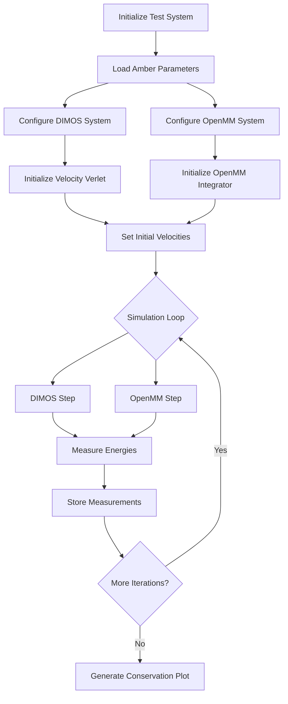

Energy conservation validation is a fundamental requirement for any molecular dynamics engine, as it verifies the numerical accuracy of integrators and force field implementations. In an NVE ensemble (constant Number of particles, Volume, and Energy), the total energy should remain constant throughout the simulation, with only small fluctuations due to numerical precision and floating-point errors. DIMOS provides a comprehensive testing framework that validates energy conservation against the OpenMM reference implementation across various simulation scenarios.

## Testing Framework Architecture

The NVE testing infrastructure in DIMOS implements a dual-validation approach that runs parallel simulations in both DIMOS and OpenMM, comparing energy components at each step. This framework supports validation across different nonbonded methods, constraint configurations, and integration schemes.



The testing framework is built around three primary test files: `test_nve.py` for basic NVE validation, `test_nve_constraints.py` for systems with geometric constraints, and `test_energy_correctness.py` for comprehensive energy component validation across different nonbonded methods.

Sources: [test_nve.py](tests/test_nve.py), [test_nve_constraints.py](tests/test_nve_constraints.py), [test_energy_correctness.py](tests/test_energy_correctness.py)

## Basic NVE Validation

The basic NVE test demonstrates energy conservation for a solvated alanine dipeptide system using the Velocity Verlet integrator with a 0.5 fs timestep. This test validates the fundamental accuracy of the integration algorithm and force field implementation in the absence of constraints.

The test configuration uses periodic boundary conditions with Cutoff nonbonded interactions and dispersion corrections enabled. Both DIMOS and OpenMM systems are initialized with identical positions and velocities, ensuring a direct comparison. The simulation runs for 100 iterations with measurements recorded every 10 steps.

Sources: [test_nve.py](tests/test_nve.py#L382-L414)

### Energy Measurement Protocol

Energy measurements capture both potential and kinetic energy components from both simulation engines. In DIMOS, potential energy is calculated via `sys.calc_energy()` which computes all bonded and nonbonded interactions using the current positions and neighbor list. Kinetic energy is computed using the utility function `kinetic_energy()` which implements the standard formula \(E_k = \frac{1}{2}\sum_i m_i v_i^2\).

```python
measurements[t, 0] = simulation.sys.calc_energy(simulation.pos, simulation.neighborlist).item()
measurements[t, 1] = dimos.kinetic_energy(simulation.vel, simulation.sys).item()
measurements[t, 2] = state.getPotentialEnergy().value_in_unit(mm.unit.kilocalories_per_mole)
measurements[t, 3] = state.getKineticEnergy().value_in_unit(mm.unit.kilocalories_per_mole)
```

Total energy conservation is then assessed by summing potential and kinetic components: \(E_{tot} = E_{pot} + E_{kin}\). The test generates visualization comparing DIMOS and OpenMM total energy trajectories, plus a normalized ratio plot to quantify deviations.

Sources: [test_nve.py](tests/test_nve.py#L426-L464), [utils.py](dimos/utils.py#L621-L627)

## NVE Testing with Constraints

When systems include geometric constraints (bond length constraints typically applied to hydrogen bonds), NVE validation becomes more complex due to the constraint algorithms that modify positions and velocities during integration. The `test_nve_constraints.py` file validates energy conservation with hydrogen bond constraints using a 3.0 fs timestep and Ewald electrostatics.

This test uses openmmtools' VelocityVerletIntegrator for the OpenMM reference to ensure comparable constraint handling. The DIMOS system is configured with `constraint_option="h_bonds"` which activates the CCMA (Constant Constraint Matrix Approximation) algorithm for general distance constraints and SETTLE for rigid water molecules.

Sources: [test_nve_constraints.py](tests/test_nve_constraints.py#L383-L436)

### Constraint Handling in Integration

The Velocity Verlet integrator in DIMOS incorporates constraint handling directly into the integration step. After the standard position update, constraints are applied to correct bond lengths, and the constraint correction vector is used to adjust velocities:

```python
vel = vel + 0.5 * self.a * self.timestep
original_pos = pos.clone()
pos = pos + vel * self.timestep
pos_prime = pos.clone()
self.constraint_handler.apply_constraints(original_pos, pos_prime)

self.update_acceleration(pos_prime, neighborlist, sys)

pos_difference = pos_prime - pos
if sys.periodic:
    pos_difference = periodic_correction(pos_difference, sys.box)

vel = vel + 0.5 * self.a * self.timestep + pos_difference / self.timestep

vel_prime = vel.clone()
self.constraint_handler.apply_velocity_constraints(pos_prime, vel_prime)
```

This algorithm ensures that constraints are satisfied while maintaining symplectic properties essential for energy conservation. The `pos_difference` term captures the constraint correction applied to positions, which is then used to update velocities consistently.

Sources: [integrators.py](dimos/integrators.py#L906-L950), [constraints.py](dimos/constraints.py)

## Energy Correctness Validation

Beyond time-based conservation, `test_energy_correctness.py` validates that DIMOS computes exactly the same potential energy as OpenMM for static configurations across various nonbonded methods. This test iterates through multiple system configurations (gas phase alanine penta-peptide, solvated alanine dipeptide, JAC system) and nonbonded methods (NoCutoff, Cutoff, Ewald, PME).

For each configuration, the test creates matching DIMOS and OpenMM systems with identical parameters, then computes potential energy at the initial positions using both engines:

```python
def get_energy_from_openmm(positions, openmm_system, version):
    total_energy = get_energy_new_context(positions, openmm_system)
    return total_energy.value_in_unit(mm.unit.kilocalorie / mm.unit.mole)

def get_energy_from_dimos(rst7_file, dimos_system):
    positions = torch.tensor(rst7_file.positions.value_in_unit(parmed.unit.angstrom))
    integrator = dimos.integrators.VelocityVerlet(2, dimos_system, dtype=dtype_integration)
    simulation = dimos.simulation.MDSimulation(dimos_system, integrator, positions, temperature=300)
    energy = simulation.sys.calc_energy(simulation.pos, simulation.neighborlist)
    return energy.item()
```

This static energy validation ensures that force field parameters and energy calculation implementations are correct before testing time-dependent energy conservation.

Sources: [test_energy_correctness.py](tests/test_energy_correctness.py#L409-L500)

## Simulation Energy Calculation Methods

The MDSimulation class provides convenient methods for measuring both potential and kinetic energy during simulations. The `measure_potential_energy()` method recalculates the neighbor list (if needed based on the check interval) and computes the full potential energy via the system's energy calculation method.

The `measure_kinetic_energy()` method includes special handling for integrators with non-zero shift parameters (used in certain splitting methods), applying velocity corrections before kinetic energy computation to ensure accuracy:

```python
def measure_kinetic_energy(self):
    shift = self.integrator.shift
    if shift != 0.0:
        self.integrator.update_acceleration(self.pos, self.neighborlist, self.sys)
        shifted_vel = self.vel + shift * self.integrator.a
        return kinetic_energy(shifted_vel, self.sys)
    else:
        return kinetic_energy(self.vel, self.sys)
```

This design ensures accurate kinetic energy measurement regardless of the integration scheme details.

Sources: [simulation.py](dimos/simulation.py#L437-L449), [simulation.py](dimos/simulation.py#L696-L718)

> [!TIP]
> For production simulations, consider increasing the `neighbor_check_interval` in the simulation constructor to improve performance, as energy conservation tests typically run with conservative settings. The constraint tolerance parameters (default 1e-4) also affect energy conservation quality—tighter tolerances improve conservation but increase computational cost.

## Validation Results Interpretation

When running NVE tests, successful validation shows two key characteristics in the generated plots. First, total energy should remain nearly constant throughout the simulation, with small fluctuations typically less than 0.01 kcal/mol for properly configured systems. Second, the DIMOS and OpenMM total energy trajectories should overlap closely in the top plot, while the normalized ratio in the bottom plot should hover near 1.0 with minimal drift.

Table: Expected Energy Conservation Behavior

| System Type | Timestep | Expected Energy Drift | Constraint Handling |
|-------------|----------|---------------------|---------------------|
| Gas phase (no cutoff) | 0.5-1.0 fs | < 0.001 kcal/mol/ps | Not applicable |
| Solvated with cutoffs | 0.5 fs | < 0.01 kcal/mol/ps | Not applicable |
| Solvated with H-bond constraints | 2.0-3.0 fs | < 0.01 kcal/mol/ps | CCMA/SETTLE |
| All-atom constraints | 2.0 fs | < 0.01 kcal/mol/ps | CCMA |

Larger energy drifts typically indicate issues with integration schemes, constraint algorithms, or force field parameter consistency between DIMOS and OpenMM.

## Running NVE Tests

To execute the NVE validation tests, navigate to the tests directory and run the appropriate test script. The tests require OpenMM and openmmtools packages installed, along with the Amber force field files in the examples directory.

The basic test generates `energy_conservation.pdf` containing the energy comparison plots, while the constraint test produces similar output with constrained dynamics. For comprehensive validation across all systems and nonbonded methods, run `test_energy_correctness.py` which prints energy differences between DIMOS and OpenMM for each configuration.

Sources: [tests/README.md](tests/README.md), [test_nve.py](tests/test_nve.py#L452-L464)

## Integration with Temperature Validation

Energy conservation tests are complemented by temperature control validation in the NVT ensemble. While NVE tests validate the integration algorithm accuracy at a fixed total energy, NVT tests validate thermostats' ability to maintain target temperatures while preserving proper energy exchange characteristics. Together, these validation approaches ensure that DIMOS produces physically meaningful dynamics across ensemble types.

The energy conservation infrastructure also serves as a foundation for more advanced validation, including force field parameter validation and benchmarking against other MD packages beyond OpenMM.
