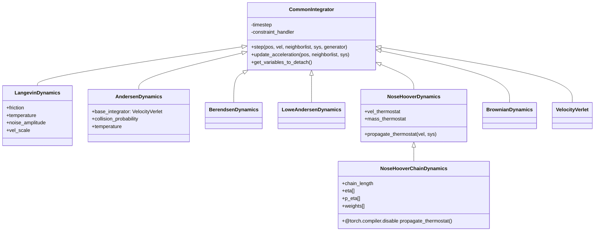
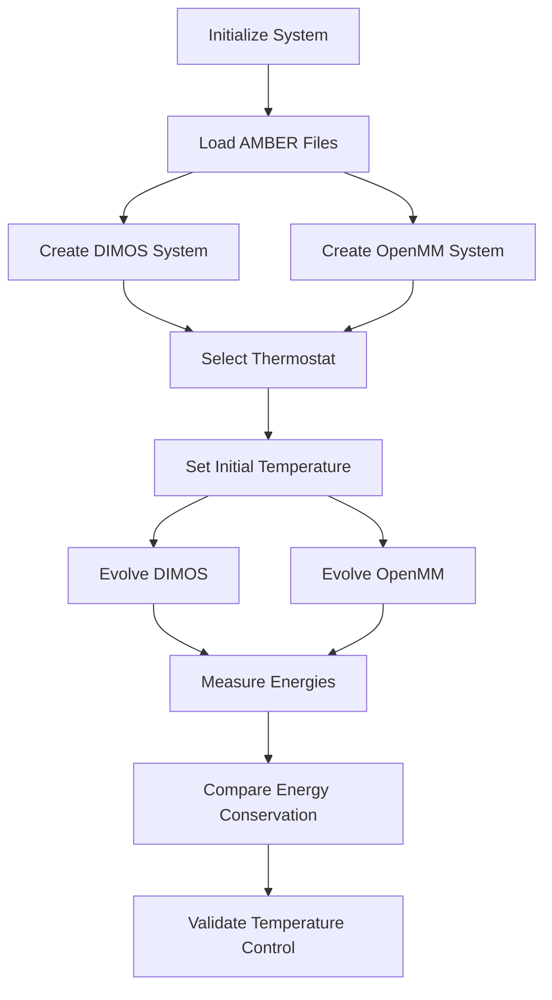

This page provides a comprehensive examination of temperature control mechanisms and canonical ensemble (NVT) validation in DIMOS. Understanding how thermostats maintain target temperatures and validate against established molecular dynamics engines is essential for reliable simulations in the canonical ensemble.

## Thermostat Architecture Overview

DIMOS implements a hierarchy of thermostat classes within the `CommonIntegrator` framework, each employing distinct algorithms for temperature control. The architecture supports both stochastic and deterministic approaches to coupling the system to a heat bath, with implementations varying in computational efficiency, ergodicity properties, and ensemble generation accuracy. The core thermostat classes extend `CommonIntegrator` and integrate seamlessly with the MD simulation orchestration system through a unified interface.



## Stochastic Thermostats

### Langevin Dynamics

Langevin dynamics implements a stochastic integrator that couples the system to a viscous heat bath through both friction and thermal noise terms. The equations of motion incorporate a velocity-dependent damping force and a Gaussian random force, effectively modeling the interaction with an implicit solvent. The implementation computes the velocity scaling factor `vel_scale = exp(-friction * timestep)` and determines the thermal noise amplitude based on the equipartition theorem, where `noise_amplitude = sqrt(kBT * (1 - vel_scale²) / masses)` for each particle dimension.

Sources: [dimos/integrators.py](dimos/integrators.py#L1084-L1134)

The LangevinDynamics class requires explicit friction coefficient specification in units of fs⁻¹, which is internally converted to simulation time units. A notable implementation constraint is the lack of constraint support—integrating with `PassthroughConstraintHandling` only due to the complexity of applying constraints to stochastic velocity updates.

Sources: [dimos/integrators.py](dimos/integrators.py#L1133-L1137)

### Andersen Thermostat

The Andersen thermostat maintains temperature through stochastic velocity reassignment rather than continuous friction. At each timestep, each atom has a probability `1 - exp(-collision_frequency * timestep)` of undergoing a collision with the heat bath, during which its velocity is completely replaced by a random draw from the Maxwell-Boltzmann distribution at the target temperature. This approach physically represents collisions with a background gas and generates the correct canonical ensemble.

Sources: [dimos/integrators.py](dimos/integrators.py#L1277-L1284)

The implementation composes AndersenDynamics over a VelocityVerlet base integrator, combining deterministic integration with stochastic velocity resampling. The collision mechanism uses random number comparison against the precomputed collision probability, selectively applying Maxwell-Boltzmann redistribution only to atoms flagged for collision.

Sources: [dimos/integrators.py](dimos/integrators.py#L1329-L1338)

### Brownian Dynamics

Brownian dynamics represents the overdamped limit of Langevin dynamics, neglecting inertial terms entirely. The position update depends directly on forces and thermal noise without velocity state, making it suitable for systems where friction dominates inertia. The implementation follows the standard Euler-Maruyama discretization of the Brownian motion equation.

Sources: [dimos/integrators.py](dimos/integrators.py#L957-L1048)

## Deterministic Thermostats

### Nose-Hoover Thermostat

The Nose-Hoover thermostat introduces a fictitious degree of freedom coupled to the system's kinetic energy, creating an extended system whose trajectory samples the canonical ensemble. The thermostat momentum `p_η` evolves according to the difference between instantaneous and target temperatures, while the thermostat position `η` tracks the cumulative scaling factor applied to velocities. This deterministic approach preserves time-reversibility while maintaining ergodicity for most systems.

Sources: [dimos/integrators.py](dimos/integrators.py#L1653-L1728)

The DIMOS implementation follows the Zhang+2019 formulation for efficient handling of constraints, computing degrees of freedom as `3 * num_atoms - num_total_constraints`. The thermostat mass is determined by the desired collision frequency: `mass_thermostat = dof * kBT / collision_frequency²`. The `propagate_thermostat` method computes the velocity scaling factor through a half-step propagation of the thermostat variable.

Sources: [dimos/integrators.py](dimos/integrators.py#L1728-L1731)

### Nose-Hoover Chain Thermostat

Nose-Hoover Chain (NHC) addresses the ergodicity issues of the single Nose-Hoover thermostat by coupling the system to a chain of thermostats, each controlling the previous thermostat's temperature. This multi-stage approach improves phase space exploration and eliminates the "flying ice cube" effect where energy can become trapped in the thermostat. DIMOS implements NHC using the Yoshida-Suzuki integration scheme for high-order accuracy in the thermostat propagation.

Sources: [dimos/integrators.py](dimos/integrators.py#L1844-L1899)

> [!TIP]
> The NHC implementation disables PyTorch compilation for the `propagate_thermostat` method using `@torch.compiler.disable(recursive=True)`, likely due to complex branching patterns or numerical precision requirements that compile-optimized execution may compromise.

The Yoshida-Suzuki weights are precomputed for orders 1, 3, 5, and 7, with the 5th-order scheme being the default. Multiple time stepping (`num_mts`) allows finer resolution in thermostat propagation without requiring smaller integration timesteps for the physical system. Thermostat masses form a cascade where the first thermostat couples to the system's kinetic energy and subsequent thermostats couple to their predecessors.

Sources: [dimos/integrators.py](dimos/integrators.py#L1899-L1960)

### Berendsen Thermostat

The Berendsen thermostat provides weak coupling to a heat bath through velocity scaling based on instantaneous temperature deviations. While computationally efficient and providing rapid equilibration, this method does not generate the correct canonical ensemble and may mask underlying dynamics issues. The implementation carries an explicit warning about its experimental status due to lack of OpenMM reference for exact algorithm matching.

Sources: [dimos/integrators.py](dimos/integrators.py#L1365-L1405)

The velocity scaling factor is computed as `λ = sqrt(1 + Δt/τ * (T_target/T_current - 1))`, where τ represents the coupling strength. Small values of τ provide stronger coupling and tighter temperature control at the cost of reduced dynamical accuracy.

Sources: [dimos/integrators.py](dimos/integrators.py#L1455-L1459)

### Lowe-Andersen Thermostat

The Lowe-Andersen thermostat combines aspects of Andersen and Langevin dynamics, applying stochastic collisions to velocity differences between atom pairs within a cutoff radius. This maintains hydrodynamic properties while ensuring canonical sampling, making it particularly useful for studying transport phenomena. The implementation follows the standard Lowe-Andersen formulation where collision probability and target temperature control the rate and magnitude of velocity reassignment.

Sources: [dimos/integrators.py](dimos/integrators.py#L1490-L1588)

## Temperature Measurement and Validation

### Temperature Calculation

DIMOS provides utility functions for temperature measurement based on the equipartition theorem. The `kinetic_energy` function computes total kinetic energy as `0.5 * Σ(masses * ||velocities||²)`, while `measure_temperature` converts this to temperature using `T = 2 * E_kin / (dof * kB)`. Degrees of freedom account for center-of-mass motion subtraction and system constraints.

Sources: [dimos/utils.py](dimos/utils.py#L621-L641)

The temperature measurement properly handles periodic boundary conditions and constraint effects by subtracting `3` degrees of freedom for center-of-mass translation and any additional constraint degrees of freedom. This ensures accurate temperature estimation for systems with various constraint schemes.

### NVT Ensemble Validation Framework

The `tests/test_nvt.py` file implements comprehensive validation by comparing DIMOS thermostat implementations directly against OpenMM reference implementations. The validation framework sets up identical initial conditions—positions from AMBER coordinate files, velocities at a specified initial temperature (typically 600K)—and evolves both systems under equivalent thermostat parameters.

Sources: [tests/test_nvt.py](tests/test_nvt.py#L360-L468)



The validation protocol measures potential and kinetic energies at regular intervals, comparing both the absolute values and energy components between DIMOS and OpenMM. Total energy conservation provides a fundamental check on integration accuracy, while kinetic energy fluctuations validate thermostat ensemble generation properties.

Sources: [tests/test_nvt.py](tests/test_nvt.py#L471-L495)

### Thermostat Configuration Reference

| Thermostat | DIMOS Class | Key Parameters | OpenMM Equivalent | Ensemble Accuracy |
|------------|-------------|----------------|-------------------|-------------------|
| Langevin | `LangevinDynamics` | friction (fs⁻¹) | `LangevinMiddleIntegrator` | NVT (exact) |
| Andersen | `AndersenDynamics` | collision_frequency (fs⁻¹) | `VerletIntegrator` + `AndersenThermostat` | NVT (exact) |
| Nose-Hoover | `NoseHooverDynamics` | collision_frequency (fs⁻¹) | `NoseHooverChainVelocityVerletIntegrator` (chain=1) | NVT (exact) |
| Nose-Hoover Chain | `NoseHooverChainDynamics` | collision_frequency, chain_length, num_mts, num_yoshidasuzuki | `NoseHooverChainVelocityVerletIntegrator` | NVT (exact) |
| Berendsen | `BerendsenDynamics` | coupling_strength | None (not exact NVT) | Approximate |
| Lowe-Andersen | `LoweAndersenDynamics` | collision_frequency | `LoweAndersenIntegrator` (openmmtools) | NVT (exact) |

Sources: [tests/test_nvt.py](tests/test_nvt.py#L382-L439)

## Integration with MD Simulation Orchestration

Temperature control integrates with MD simulation through the `MDSimulation` class in `dimos/simulation.py`. When initializing without explicit velocities, the system draws from a Maxwell-Boltzmann distribution at the specified temperature using `maxwell_boltzmann_distr`. The simulation maintains a random number generator for stochastic thermostats, ensuring reproducibility through seed control.

Sources: [dimos/simulation.py](dimos/simulation.py#L572-L593)

The simulation step method calls the integrator's `step` function, passing positions, velocities, neighbor lists, system information, and the random generator. Thermostats with temperature attributes enable barostat coupling, as pressure control requires a well-defined temperature target. The simulation orchestration handles constraint application and periodic boundary conditions both before and after thermostat operations.

Sources: [dimos/simulation.py](dimos/simulation.py#L620-L642)

> [!TIP]
> Memory management is critical in long simulations—each step optionally detaches tensors from the computation graph via `detach_()` to prevent unbounded graph growth while maintaining position differentiability for energy calculations.

## Practical Implementation Example

The following demonstrates typical thermostat configuration for an alanine dipeptide simulation:

```python
import dimos
import torch

# System setup
system = dimos.ff.AmberForceField("ala2_solv.prmtop", 
                                  nonbonded_type="Cutoff", 
                                  dispersion_correction=True)

# Langevin thermostat configuration
timestep = 0.5  # fs
temperature = 300.0  # K
friction_coefficient = 0.1  # fs^-1

integrator = dimos.integrators.LangevinDynamics(
    timestep, temperature, friction_coefficient, system
)

# Initialize simulation with Maxwell-Boltzmann velocities
simulation = dimos.simulation.MDSimulation(
    system, integrator, positions, temperature=temperature
)

# Equilibration and production
for i in range(1000):
    simulation.step(num_steps=10)
    
    # Monitor temperature
    current_temp = dimos.utils.measure_temperature(
        simulation.vel, simulation.sys
    ).item()
    print(f"Step {i*10}: Temperature = {current_temp:.1f} K")
```

Sources: [dimos/simulation.py](dimos/simulation.py#L512-L711)

## Performance and Accuracy Considerations

Stochastic thermostats (Langevin, Andersen) typically require smaller timesteps for accurate dynamics due to the introduction of high-frequency noise terms, while deterministic thermostats (Nose-Hoover variants) can often use larger timesteps but may exhibit ergodicity problems for small systems or stiff degrees of freedom. The Nose-Hoover Chain provides robust ensemble sampling at the cost of additional state variables and computational overhead for thermostat propagation.

GPU acceleration in DIMOS enables efficient thermostat operations through vectorized operations on batches of atoms. However, stochastic processes like Langevin dynamics require careful handling of random number generation across parallel computation. The implementation uses PyTorch's generator facilities for reproducible randomness across both CPU and GPU devices.

Sources: [dimos/integrators.py](dimos/integrators.py#L463-L487)

## Troubleshooting Temperature Control

Common temperature control issues include: (1) Incorrect degrees of freedom calculation when constraints are applied—verify that `num_total_constraints` matches the expected number; (2) Insufficient equilibration time when using weak-coupling thermostats like Berendsen; (3) Ergodicity problems with single Nose-Hoover thermostats for small systems, which NHC resolves; (4) Friction coefficient too high in Langevin dynamics leading to overdamped dynamics.

Debug temperature drift by monitoring both kinetic energy and the thermostat variables (e.g., `vel_thermostat` for Nose-Hoover) to distinguish between integration errors and thermostat malfunction. The validation framework in `test_nvt.py` provides reference implementations for direct comparison when diagnosing unexpected behavior.
