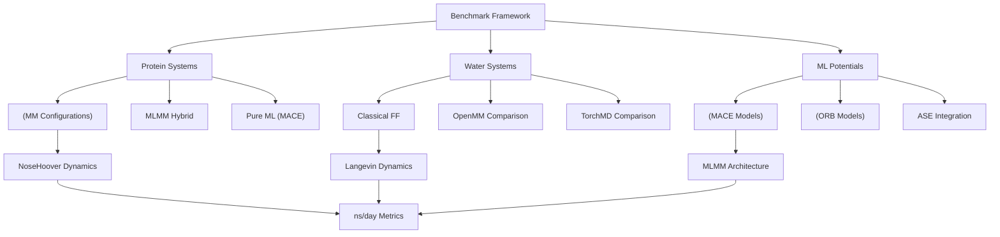

This documentation page provides a comprehensive overview of DIMOS's benchmarking framework, which systematically compares performance and accuracy against OpenMM across molecular systems of varying complexity. The benchmarking suite enables developers to evaluate DIMOS's computational efficiency, precision capabilities, and integration options for both classical force fields and machine learning potentials.

## Benchmark Framework Architecture

DIMOS implements a multi-tiered benchmarking infrastructure designed to provide rigorous performance comparisons with established molecular dynamics engines, particularly OpenMM. The framework supports classical molecular mechanics (MM) simulations, hybrid ML/MM systems, and pure machine learning potentials across different hardware platforms and precision configurations.

The benchmarking architecture separates into three primary domains: protein systems testing complex biomolecular environments, water systems testing solvent behavior at various scales, and machine learning potential benchmarking evaluating ML model performance. Each domain implements systematic performance measurement protocols with controlled warmup phases, repeated iterations for statistical significance, and comprehensive output tracking including timing metrics, energy conservation, and throughput calculations measured in nanoseconds per day (ns/day).

**Benchmark Configuration Parameters**:

| Parameter | Purpose | Typical Values |
|-----------|---------|----------------|
| Warmup iterations | Allow system thermalization and JIT compilation | 5-50 iterations |
| Measurement iterations | Statistical significance for performance data | 40-50 iterations |
| Steps per measurement | Balance timing precision vs. measurement duration | 25-35 steps |
| Force field precision | Numerical accuracy of energy calculations | float32, float64 |
| Integration precision | Numerical accuracy of time integration | float32, float64 |
| Nonbonded method | Electrostatics treatment | Cutoff, PME, Ewald |

Sources: [benchmark_proteins.py](benchmark/proteins/benchmark_proteins.py#L11-L15), [dimos_water.py](benchmark/water/dimos_water.py#L18-L21)



## Protein System Benchmarks

The protein benchmark suite evaluates DIMOS performance on biologically relevant molecular systems ranging from small peptides (alanine dipeptide) to medium-sized proteins (dihydrofolate reductase) and fast-folding miniproteins (trp-cage). These benchmarks test the full complexity of molecular simulations including bonded and nonbonded interactions, periodic boundary conditions, and long-range electrostatics via Particle Mesh Ewald (PME).

The benchmark script `benchmark_proteins.py` systematically compares six different configurations across three test systems. The configurations vary by force field type (classical MM vs. machine learning), constraint handling (h-angle constraints vs. no constraints), and hybrid ML/MM partitioning. Performance is measured through nanoseconds per day calculations, which quantify how much simulation time can be accumulated per 24 hours of wall-clock time.

**Protein Benchmark Systems**:

| System | Atoms | Description | Key Features |
|--------|-------|-------------|--------------|
| ala2_tip3p | ~200 | Alanine dipeptide in water | Small system for rapid testing |
| dhfr | ~20,000 | Dihydrofolate reductase | Medium enzyme with explicit solvent |
| trp-cage_sol | ~300 | Fast-folding miniprotein | Compact protein testing folding dynamics |

**Configuration Matrix**:

| Configuration Name | Force Field | Constraints | Description |
|-------------------|-------------|-------------|-------------|
| no_constraints_mm | Classical MM | None | Full timestep 0.5 fs |
| constraints_mm | Classical MM | h-angles | Full timestep 2.0 fs |
| no_constraints_mlmm | Hybrid ML/MM | None | ML for solvent, MM for protein |
| constraints_mlmm | Hybrid ML/MM | h-angles | ML solvent, MM protein with constraints |
| no_constraints_ml | Pure ML (MACE) | None | Full system with MACE-mp-large |
| constraints_ml | Pure ML (MACE) | h-angles | Full system with constraints |

The benchmark execution flow begins with thermalization through multiple warmup iterations, followed by measurement phases where timing data is collected. Each measurement iteration records the execution time, per-step performance, and calculates the ns/day throughput. The script applies PyTorch compilation optimizations using `max-autotune-no-cudagraphs` mode to optimize the computational graph for sustained production performance.

Sources: [benchmark_proteins.py](benchmark/proteins/benchmark_proteins.py#L16-L46), [benchmark_proteins.py](benchmark/proteins/benchmark_proteins.py#L49-L72)

> [!TIP]
> The protein benchmarking framework uses the NoseHooverDynamics integrator with different timesteps depending on constraint configuration: 0.5 fs for unconstrained systems and 2.0 fs for h-angle constrained systems. This four-fold timestep difference significantly impacts the achievable ns/day throughput, making constraint efficiency a critical performance factor in biomolecular simulations.

## Water System Benchmarks

Water system benchmarks provide controlled testbeds for evaluating computational performance across system sizes and nonbonded methods. The `dimos_water.py` script implements comprehensive comparisons between DIMOS, OpenMM, and TorchMD across multiple hardware platforms (CPU, CUDA), precision configurations (32-bit, 64-bit), and electrostatics treatments (Cutoff, Ewald, PME).

Water boxes are generated using the `generate_water_box_amber.py` script, creating periodic cubic boxes ranging from 20 to 140 Å in length, corresponding to systems from approximately 300 to 80,000 water molecules. This systematic scaling enables evaluation of performance scaling behavior and identification of algorithmic bottlenecks as system size increases.

**Benchmark Execution Command Structure**:

```bash
# DIMOS water benchmark syntax
python benchmark/water/dimos_water.py <tool> <nonbonded> <box_size> <ff_precision> <int_precision>

# Example: DIMOS with PME, 60Å box, float64 precision
python benchmark/water/dimos_water.py "dimosCUDAcompile" "PME" 60 64 64

# Example: OpenMM comparison
python benchmark/water/dimos_water.py "OpenMMCUDA" "PME" 60 64 64
```

**Platform Configuration Options**:

| Tool Variant | Platform | Compilation | Precision Control |
|--------------|----------|-------------|-------------------|
| dimosCPU | CPU | None | Configurable |
| dimosCPUcompile | CPU | PyTorch compile | Configurable |
| dimosCUDA | CUDA | None | Configurable |
| dimosCUDAcompile | CUDA | PyTorch compile | Configurable |
| OpenMMReference | Reference (Python) | N/A | Single/Double |
| OpenMMCPU | CPU | N/A | Configurable |
| OpenMMCUDA | CUDA | N/A | Configurable |
| TorchMD-CPU | CPU | Optional | Configurable |
| TorchMD-CUDA | CUDA | Optional | Configurable |

The benchmark measures three primary performance metrics: total execution time for the measurement phase, average time per MD step, and the derived ns/day throughput. The ns/day calculation converts the per-step simulation time (timestep × steps) to nanoseconds, then scales this to 24 hours based on measured execution time. This provides the standard metric for comparing MD engine performance across hardware and configurations.

OpenMM configuration matches DIMOS parameters precisely: 10 Å cutoff distance with 7.5 Å switch function for Lennard-Jones interactions, Langevin thermostat at 300 K with 1.0 ps⁻¹ friction coefficient, and identical nonbonded methods for electrostatics treatment. Platform-specific properties enable precision control, with OpenMM supporting single, double, or mixed precision modes on CUDA devices.

Sources: [dimos_water.py](benchmark/water/dimos_water.py#L24-L45), [dimos_water.py](benchmark/water/dimos_water.py#L76-L108), [dimos_water.py](benchmark/water/dimos_water.py#L200-L218)

## Machine Learning Potential Benchmarks

The ML potential benchmark suite (`dimos_water_ml.py`) evaluates performance of machine learning interatomic potentials implemented in DIMOS against the ASE (Atomic Simulation Environment) interface for widely-used models including MACE (Multi-Atomic Cluster Expansion) and ORB (On-the-fly Representation Learning). These benchmarks assess the efficiency gains achievable through DIMOS's optimized PyTorch implementation versus general-purpose ML frameworks.

DIMOS provides two integration paths for ML potentials: direct native implementations using `as_mace_system()` and `as_orb_system()` methods, and hybrid ML/MM systems where ML potentials model specific regions (typically solvent) while classical force fields handle the remainder. The benchmark tests multiple model sizes (small, medium, large for MACE) and configuration options including CUDA-enabled (cuEq) execution paths for GPU acceleration.

**ML Model Benchmark Configurations**:

| Model | Variants | Parameter Count | Use Case |
|-------|----------|-----------------|----------|
| MACE-mp-small | standard, cuEq | ~0.5M | Rapid prototyping |
| MACE-mp-medium | standard, cuEq | ~5M | Production simulations |
| MACE-mp-large | standard, cuEq | ~15M | High-accuracy studies |
| ORB-v2 | standard | Variable | Alternative architecture |

> [!TIP]
> The ML benchmarking framework distinguishes between cuEq-enabled and standard models. cuEq (CUDA equivalent) reconfigures the MACE model's computational graph for optimized GPU execution, potentially providing 2-3× speedup over standard implementations on CUDA devices. The trade-off is increased memory usage during compilation.

Performance measurement follows the same protocol as classical force field benchmarks: warmup phases to allow compilation and thermalization, followed by measurement iterations where per-step timing is recorded. The benchmark directly compares DIMOS's integrated ML/MM architecture against ASE's general-purpose interface, highlighting optimizations possible when the ML potential is tightly integrated with the MD infrastructure including neighbor lists, periodic boundary conditions, and force/energy gradients computation.

The ASE configuration for comparison uses the same molecular systems (water boxes), thermostat parameters (Langevin at 300 K, 0.1 fs⁻¹ friction), and timesteps (0.5 fs) to ensure fair comparison. However, ASE cannot benefit from DIMOS's specialized MLMM architecture, which enables hybrid force field partitioning and optimized gradient computation for backpropagation through ML potentials.

Sources: [dimos_water_ml.py](benchmark/water/dimos_water_ml.py#L32-L88), [dimos_water_ml.py](benchmark/water/dimos_water_ml.py#L98-L172)

## Validation and Accuracy Assessment

Beyond performance metrics, DIMOS implements comprehensive validation tests in the `tests/test_energy_correctness.py` module to ensure numerical accuracy matches established reference implementations. These validation benchmarks compare energy components calculated by DIMOS against OpenMM across multiple test systems with varying force field parameters, cutoff distances, and nonbonded methods.

The validation framework implements direct energy comparison at identical atomic configurations, enabling detection of numerical discrepancies at the level of individual energy components (bonded terms, Lennard-Jones, electrostatics). For systems with cutoff schemes, the validation tests verify proper implementation of switch functions, long-range corrections, and exclusion handling for bonded atom pairs.

**Energy Validation Test Cases**:

| Test System | Force Field | Configurations | Validation Focus |
|-------------|-------------|----------------|------------------|
| Amber25 | AMBER ff14SB | NoCutoff, Cutoff 10 Å | General protein force field |
| Ala2_gas | AMBER | NoCutoff, Cutoff 10 Å | Gas-phase peptide |
| Ala2_solv | AMBER + TIP3P | Cutoff 10 Å + PME | Solvated peptide, long-range electrostatics |

The validation methodology creates OpenMM systems with parameters identical to DIMOS configurations, including cutoff distances, switch distances, nonbonded methods (Cutoff, Ewald, PME), and exclusion patterns (1-2, 1-3, 1-4 scaling). Energy calculations are performed at the same atomic coordinates for both engines, with component-wise decomposition available for debugging purposes. The validation suite accepts numerical differences below configurable tolerance thresholds, accounting for minor implementation variations in precision handling.

This energy validation framework serves dual purposes: it provides verification that DIMOS implements force field calculations correctly against an established reference (OpenMM), and it generates baseline performance data that can be used to assess the accuracy of future optimizations or new algorithm implementations.

Sources: [test_energy_correctness.py](tests/test_energy_correctness.py#L418-L470), [test_energy_correctness.py](tests/test_energy_correctness.py#L449-L459)

## Running Benchmarks

Executing the benchmarking suite requires appropriate environment setup with DIMOS, OpenMM, and optional dependencies installed. Benchmarks should be run on quiescent systems with minimal background processes to ensure reproducible timing measurements. GPU benchmarks require CUDA-enabled PyTorch and appropriate OpenMM platform support.

**Typical Benchmark Execution Workflow**:

1. Navigate to the appropriate benchmark directory
2. Ensure required test data (prmtop, rst7, gro, top files) are present
3. Configure environment variables (OMP_NUM_THREADS for CPU parallelism)
4. Execute benchmark scripts with desired parameters
5. Collect output data files containing timing and performance metrics
6. Analyze results using provided ns/day calculations and standard deviations

The protein benchmarks accept two arguments: the system name (e.g., "dhfr", "ala2_tip3p", "trp-cage_sol") and the configuration name (e.g., "constraints_mm", "no_constraints_mlmm"). Output files are named systematically using these parameters for easy identification and comparison across runs.

Water benchmarks require five arguments specifying the computational tool, nonbonded method, box size, force field precision, and integration precision. The script appends results to output files rather than overwriting, enabling accumulation of data across multiple benchmark sessions with different configurations or hardware.

Sources: [benchmark_proteins.py](benchmark/proteins/benchmark_proteins.py#L16-L22), [dimos_water.py](benchmark/water/dimos_water.py#L24-L46)

## Interpreting Benchmark Results

Benchmark output files contain tabular data with performance metrics calculated from repeated measurement iterations. The primary metric is ns/day (nanoseconds per day), which quantifies simulation throughput. This metric accounts for both the MD timestep (which varies with constraint handling) and the per-step execution time to provide a normalized measure of productivity.

**Output File Format Example**:
```
# Protein benchmark: <system>_<configuration>_benchmark.dat
<ns_per_day_mean>\t<ns_per_day_standard_error>

# Water benchmark: <tool>_nonbonded<method>_dtypeff<precision>_...dat
<box_size>\t<num_atoms>\t<total_time>\t<mean_step_time>\t<ns_per_day>\t<mean>\t<sem>
```

When comparing results between DIMOS and OpenMM, consider that OpenMM benefits from decades of optimization and is highly optimized for production workloads. DIMOS emphasizes flexibility (differentiable energy, easy integration with ML models, modular architecture) over raw performance. Performance gaps are expected, particularly for classical force fields, but the benchmarking framework enables quantification of these gaps and identification of optimization opportunities.

Key factors affecting benchmark results include:
- **Precision**: Float32 provides 2-4× speedup over float64 at the cost of numerical precision
- **Compilation**: PyTorch compilation provides speedup but adds initial overhead
- **Constraints**: Enabling h-angle constraints allows 4× larger timesteps, dramatically increasing ns/day
- **System size**: Performance scaling behavior varies by algorithm and hardware
- **Hardware**: GPU acceleration provides order-of-magnitude speedups for large systems
- **Nonbonded method**: PME is more expensive than simple cutoff but required for charged systems

Sources: [benchmark_proteins.py](benchmark/proteins/benchmark_proteins.py#L57-L73), [dimos_water.py](benchmark/water/dimos_water.py#L215-L218)

## Next Steps

For comprehensive understanding of DIMOS's computational architecture and validation methodology, explore the following related documentation:

- **[Energy Conservation and NVE Tests](27-energy-conservation-and-nve-tests)** - Detailed methodology for validating numerical integration stability and energy conservation properties
- **[Temperature Control and NVT Validation](28-temperature-control-and-nvt-validation)** - Validation of thermostat implementations and temperature control accuracy
- **[GPU Acceleration and PyTorch Compilation](23-gpu-acceleration-and-pytorch-compilation)** - Technical details on GPU optimization strategies and compilation techniques
- **[Force Field Parameter Validation](30-force-field-parameter-validation)** - Comprehensive validation methodology for force field implementations across different formats

The benchmarking framework continues to evolve with DIMOS development, incorporating new systems, force fields, and machine learning potentials. Contributing benchmark results or extending the framework to test additional scenarios provides valuable data for understanding DIMOS's performance characteristics and guiding optimization efforts.