This guide provides comprehensive instructions for installing and configuring DIMOS (Differentiable Molecular Simulator), a PyTorch-based framework for molecular dynamics and Monte Carlo simulations. Installation is designed to be straightforward while offering flexibility for different use cases, from basic simulations to advanced machine learning workflows.

## System Requirements and Prerequisites

Before installing DIMOS, ensure your system meets the minimum requirements. The framework is built on modern Python and PyTorch technology, requiring Python 3.10 or higher. The core dependencies are intentionally minimal: PyTorch (≥2.4.1) provides the computational backend and automatic differentiation, ParmEd (≥4.2.2) handles molecular topology files, and NumPy (<2.0.0) supports numerical operations. The modular design allows you to install additional components only when needed for your specific simulation requirements, such as machine learning potentials or advanced sampling methods.


Sources: [pyproject.toml](pyproject.toml#L25-L31), [README.md](README.md#L1-L10)

## Installation Methods

### Basic Installation via pip

The quickest way to get started with DIMOS is through pip, which installs the core package with all essential dependencies. This method is ideal for users who want to immediately begin running standard molecular dynamics simulations without needing machine learning potentials or development tools. Simply execute `pip install dimos-torch` from your command line to install the latest stable version. This approach provides a clean installation that includes the core force field systems, integrators, and simulation orchestration components required for most standard workflows.

Sources: [README.md](README.md#L26-L31)

### Development Installation from Source

For users who need access to the latest features, want to modify the code, or require optional dependencies, installing from source is the recommended approach. Clone the repository and install in editable mode with specific dependency groups tailored to your needs. The editable installation (`-e` flag) allows you to modify the source code and have changes immediately reflected without reinstallation. You can selectively install dependency groups: `dev` for development tools including OpenMM and documentation building, `mmtools` for enhanced molecular mechanics capabilities, `mace` for MACE machine learning potentials, and `orb` for ORB model support.

Sources: [README.md](README.md#L33-L39), [pyproject.toml](pyproject.toml#L33-L58)

```bash
git clone https://github.com/nec-research/dimos.git
cd dimos
python -m pip install -e '.[dev,mmtools,mace,orb]'
```

The following flowchart illustrates the installation decision process and available options:

```mermaid
flowchart TD
    A[Start Installation] --> B{Installation Type}
    B -->|Quick Start| C["pip install dimos-torch"]
    B -->|Development/Custom| D[Clone Repository]
    D --> E["cd dimos"]
    E --> F{Select Dependencies}
    F --> G[Core Only]
    F --> H["dev: OpenMM, Sphinx"]
    F --> I["mmtools: Enhanced MM"]
    F --> J["mace: ML Potentials"]
    F --> K["orb: ML Potentials"]
    F --> L[All Optional]
    G --> M["pip install -e ."]
    H --> N["pip install -e '.[dev]'"]
    I --> N
    J --> N
    K --> N
    L --> N
    M --> O[Installation Complete]
    N --> O
    C --> O
```



Sources: [README.md](README.md#L26-L39), [pyproject.toml](pyproject.toml#L1-L61)

## Dependency Groups and Optional Components

DIMOS uses a modular dependency system that allows you to install only the components you need. This approach keeps your environment clean and reduces potential conflicts while providing flexibility for advanced use cases. Understanding these groups helps you make informed decisions about which components to install based on your simulation requirements.

The following table provides a detailed breakdown of each dependency group, its purpose, and when to use it:

| Dependency Group | Purpose | Key Packages | Use Case |
|----------------|---------|-------------|----------|
| Core (default) | Basic MD/MC simulations | torch, ParmEd, numpy | Standard simulations, energy calculations |
| dev | Development and testing | openmm[cuda12], sphinx, matplotlib | Contributing to DIMOS, running test suite, building documentation |
| mmtools | Enhanced molecular mechanics | openmmtools, mdtraj, pymbar, numba | Advanced sampling, free energy calculations, enhanced validation |
| mace | MACE machine learning potentials | mace-torch≤0.3.11, cuequivariance-ops | ML-accelerated simulations, hybrid ML/MM systems |
| orb | ORB machine learning potentials | orb-models, pynanoflann | Alternative ML potentials, differentiable training workflows |

Sources: [pyproject.toml](pyproject.toml#L33-L58)

### Optional: TorchMD Dependencies

For users who want to run test cases based on torchMD for benchmarking or comparative studies, additional packages are required. To avoid installing the proprietary moleculekit dependency, install torchMD components with the `--no-deps` flag: `pip install torchmd scipy networkx pandas tqdm pyyaml --no-deps`. This allows you to perform performance comparisons between DIMOS and torchMD frameworks as demonstrated in the benchmark scripts.

Sources: [README.md](README.md#L41-L44)

## Verification and Installation Testing

After installation, verify your setup by running the test suite to ensure all components are correctly installed and functioning. The repository includes comprehensive tests that validate energy correctness, simulation stability, and integration with different force field formats. Start with basic tests like `test_energy_correctness.py` which validates all energy components including various electrostatic interaction treatments. For GPU setups, tests like `test_nve.py` verify energy conservation in microcanonical ensembles, comparing DIMOS results against OpenMM reference implementations for numerical accuracy validation.

The `examples/` directory contains production-ready input files for reproducing results from published research, including both Amber and Gromacs format files. These examples serve as excellent starting points for understanding how to prepare your own simulation systems and validate your installation against known reference data.

Sources: [tests/README.md](tests/README.md#L1-L3), [examples/README.md](examples/README.md#L1-L1), [tests/test_nve.py](tests/test_nve.py#L374-L419)

## Project Structure and Organization

Understanding the DIMOS project structure helps you navigate the codebase and find relevant components for your simulations. The repository is organized into logical directories separating core functionality, examples, benchmarks, tests, and experiments. This modular architecture supports both easy exploration and maintainability as the framework evolves.


The main `dimos/` directory contains all core simulation components organized by functionality: force field systems (`ff.py`), integrators (`integrators.py`), energy calculations (`energy.py`), simulation orchestration (`simulation.py`), and specialized modules for advanced methods, machine learning integration (`mlip/`), and hybrid ML/MM systems (`mlmm.py`). The `benchmark/` directory provides performance testing scripts for both water and protein systems, demonstrating how to set up and run comparative benchmarks. The `examples/` directory contains Amber and Gromacs input files for various molecular systems, serving as templates for your own simulations.

Sources: [dimos/__init__.py](dimos/__init__.py#L374-L389), [benchmark/water/dimos_water.py](benchmark/water/dimos_water.py#L1-L22), [benchmark/proteins/benchmark_proteins.py](benchmark/proteins/benchmark_proteins.py#L1-L18)

## Quick Start Verification

After completing installation, verify your setup with a simple simulation to ensure everything works correctly. The following minimal example demonstrates the complete workflow from system initialization to simulation execution:

```python
import dimos
import parmed

# Load Amber force field and initialize positions
system = dimos.AmberForceField("config.prmtop", cutoff=10, nonbonded_type="PME")
rst7 = parmed.amber.Rst7("config.rst7")
positions = rst7.positions

# Set up integrator and simulation
integrator = dimos.LangevinDynamics(dt=0.5, T=300, gamma=1.0, system=system)
simulation = dimos.MDSimulation(system, integrator, positions, temperature=300)

# Run simulation
simulation.step(1000)  # 1000 steps
```

This example demonstrates the three core components of any DIMOS simulation: force field setup (system), dynamics choice (integrator), and simulation orchestration (MDSimulation). You can explore different force field formats (`GromacsForceField`), integrators (`VelocityVerlet`, `NoseHooverDynamics`), and simulation parameters to match your specific requirements.

> [!TIP]
> When installing with GPU support, ensure your CUDA driver version matches the PyTorch CUDA version. Use `torch.cuda.is_available()` to verify GPU recognition after installation.

Sources: [README.md](README.md#L46-L54), [dimos/__init__.py](dimos/__init__.py#L374-L389)

## Next Steps

With DIMOS successfully installed and verified, you're ready to explore its capabilities. The recommended learning path progresses from understanding the basic workflow to mastering advanced features. Start with [Basic MD Simulation Workflow](4-basic-md-simulation-workflow) to understand the core simulation architecture, then proceed to [Running Your First Simulation](5-running-your-first-simulation) for hands-on experience with example systems. As you become comfortable with basic simulations, explore the [Force Field Systems Architecture](6-force-field-systems-architecture) to understand the underlying design principles that enable DIMOS's flexibility and performance.

For users interested in machine learning integration, the [Hybrid ML/MM Systems](18-hybrid-ml-mm-systems-design-and-implementation) documentation provides comprehensive guidance on combining traditional force fields with neural network potentials. Researchers focusing on enhanced sampling methods should consult [Metadynamics and Collective Variables](20-metadynamics-and-collective-variables) and [Replica Exchange Molecular Dynamics](21-replica-exchange-molecular-dynamics) for advanced sampling techniques.
