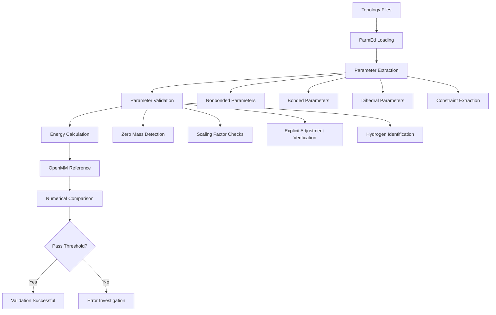

Force field parameter validation in DIMOS provides a comprehensive framework for ensuring the correctness and accuracy of classical force field implementations through systematic testing against reference implementations like OpenMM. This validation infrastructure covers parameter extraction, energy calculation verification, and cross-platform compatibility for both Amber and Gromacs force fields.

## Validation Architecture

The validation system operates through a multi-layered architecture that validates force field parameters at multiple stages: parameter extraction from topology files, energy calculation verification, and cross-reference comparison with established simulation packages.



The validation infrastructure is distributed across multiple test files, with primary validation logic in `tests/test_energy_correctness.py` for Amber systems and `tests/test_energy_correctness_gromacs.py` for Gromacs systems. These tests systematically verify energy calculations across different boundary conditions and nonbonded treatment methods.

Sources: [tests/test_energy_correctness.py](tests/test_energy_correctness.py#L390-L449), [tests/test_energy_correctness_gromacs.py](tests/test_energy_correctness_gromacs.py#L388-L444)

## Parameter Extraction and Validation

The `ClassicalParmedForceField` class serves as the foundation for parameter extraction and validation, with specialized implementations for `AmberForceField` and `GromacsForceField`. Each parameter type undergoes specific validation checks during extraction.

### Nonbonded Parameter Validation

Nonbonded parameters (Lennard-Jones sigma, epsilon, and atomic charges) are extracted through the `get_nonbonded_parameters()` method, which includes critical validation for zero-mass particles that indicate unsupported virtual sites like TIP4P water models.

Sources: [dimos/ff.py](dimos/ff.py#L1063-L1104)

The extraction process validates:

- Mass detection to identify unsupported virtual sites
- Consistent tensor shapes and data types
- Unit compatibility with the chosen unit system (amber vs gromacs)

When zero mass particles are detected, the system raises an exception because TIP4P and other virtual site models are currently unsupported.

> [!TIP]
> The zero mass particle check is critical because virtual sites require special handling that differs fundamentally from standard atoms. Attempting to process TIP4P water without this check would lead to undefined behavior in energy calculations.

### Bonded Parameter Validation

Bonded parameters undergo multi-stage validation during extraction:

- **Bonds**: Extracted via `get_bond_parameters()` with optional exclusion of constrained atoms
- **Angles**: Validated in `get_angle_parameters()` with warnings for missing hydrogen-including angles in water
- **Dihedrals**: Platform-specific extraction with scaling factor consistency checks
- **Improper Dihedrals**: Different handling for CHARMM-style vs standard impropers

Sources: [dimos/ff.py](dimos/ff.py#L1104-L1208)

The angle parameter extraction includes a specific validation warning: if fewer than 5% of atoms have hydrogen-including angles but the system has periodic boundary conditions, a warning suggests that water angle interactions may be missing. This typically indicates that constraints are being used, which is acceptable but worth verification.

### Dihedral Scaling Factor Validation

The `check_generic_adjusts()` method validates the consistency of 1-4 electrostatic and Lennard-Jones scaling factors across all dihedrals in the system.

Sources: [dimos/ff.py](dimos/ff.py#L967-L995)

This validation checks that:

- All dihedrals use consistent 1-4 electrostatic scaling (scee)
- All dihedrals use consistent 1-4 Lennard-Jones scaling (scnb)
- Inconsistent scaling triggers warnings about potential storage requirements

The system also checks for explicit adjustments via `check_explicit_adjusts()`, which verifies that individual charge rescaling factors match the global scee values. When explicit adjustments are present, the system confirms that the generic scnb is set to 1.0 since explicit parameters handle the scaling.

Sources: [dimos/ff.py](dimos/ff.py#L995-L1036)

## Cross-Reference Validation with OpenMM

The primary validation method compares DIMOS energy calculations against OpenMM reference calculations across a comprehensive test matrix.

### Test Configuration Matrix

The validation suite tests multiple system configurations:

| System | Periodic | Nonbonded Methods | Dispersion |
|--------|----------|-------------------|------------|
| ala5_gas | False | NoCutoff, Cutoff | False |
| ala2_solv | False | NoCutoff | False |
| ala2_solv | True | NoCutoff, Cutoff, Ewald, PME | True, False |
| JAC | True | Cutoff, PME | False |

Sources: [tests/test_energy_correctness.py](tests/test_energy_correctness.py#L393-L408)

For Gromacs systems, the test matrix includes:

| System | Periodic | Nonbonded Methods |
|--------|----------|-------------------|
| francesco | True | PME |
| ala2_no_constraint | True | PME |

Sources: [tests/test_energy_correctness_gromacs.py](tests/test_energy_correctness_gromacs.py#L388-L395)

### Energy Comparison Protocol

For each test configuration, the validation protocol follows these steps:

1. Load topology and coordinate files using ParmEd
2. Create OpenMM system with matching nonbonded method and parameters
3. Create DIMOS force field with equivalent configuration
4. Calculate energies from both systems at identical positions
5. Compare numerical values for agreement

Sources: [tests/test_energy_correctness.py](tests/test_energy_correctness.py#L449-L585)

The OpenMM reference calculation uses the Reference platform to ensure platform-agnostic baseline comparisons. Energy component decomposition can be enabled for detailed analysis, separating Lennard-Jones and electrostatic contributions to isolate discrepancies.

> [!TIP]
> The NoCutoff case is excluded for periodic systems because different packages handle long-range interactions inconsistently without explicit cutoff methods. Users receive warnings when attempting this combination.

### Platform-Specific Validation

For Gromacs force fields, the validation includes:

- Proper directory setup for Gromacs topology files
- Different coordinate file parsing (.gro vs .rst7)
- PME parameter verification including grid dimensions
- Switch function consistency at specified distances

Sources: [tests/test_energy_correctness_gromacs.py](tests/test_energy_correctness_gromacs.py#L381-L444)

## Constraint Validation

Constraint extraction and validation occur through the `extract_constraints()` method, which identifies bonds and angles to constrain based on hydrogen mass detection.

### Constraint Types Supported

| Constraint Type | Description | Application |
|----------------|-------------|-------------|
| `h_bonds` | Constrain bonds involving hydrogen | Fast, approximate |
| `all_bonds` | Constrain all bonds | Higher accuracy |
| `h_angles` | Constrain bonds and angles involving hydrogen | Water-specific optimization |

Sources: [dimos/ff.py](dimos/ff.py#L869-L944)

The method identifies hydrogen atoms by mass (1.008 amu with relative tolerance of 1e-4) rather than atom name to handle naming ambiguities across different force fields. For the `h_angles` constraint type, the system calculates virtual constraint lengths for H-H distances in water molecules using the law of cosines.

### Constraint Validation Checks

- Visited tracking to prevent duplicate constraints
- Mass-based hydrogen identification with tolerance
- Oxygen identification for water-specific constraints (16.0 amu)
- Virtual bond length calculation for water H-H constraints

## Platform-Specific Dihedral Handling

Dihedral parameter extraction differs significantly between Amber and Gromacs formats, requiring separate validation strategies.

### Amber Dihedral Validation

The `AmberForceField.get_dihedral_parameters()` method extracts standard and improper dihedrals with validation for:

- `ignore_end` flags for exclusion handling
- Phase conversion from degrees to radians
- Separation of proper and improper torsions
- CHARMM flag set to false for Amber systems

Sources: [dimos/ff.py](dimos/ff.py#L1379-L1434)

### Gromacs Dihedral Validation

The `GromacsForceField.get_dihedral_parameters()` method handles:

- `DihedralTypeList` objects containing multiple torsions per dihedral
- Periodicity zero filtering (skips unused torsion terms)
- CHARMM-style improper detection from separate improper list
- Separate improper counter for CHARMM identification

Sources: [dimos/ff.py](dimos/ff.py#L1446-L1522)

The Gromacs implementation specifically handles the case where impropers are defined in a separate list (CHARMM style) versus being marked as improper in the main dihedral list (Gromacs style).

## Energy Component Validation

The `calc_energy()` method in the base `MinimalSystem` class provides the framework for validating individual energy components, enabling detailed debugging of parameter implementations.

Sources: [dimos/ff.py](dimos/ff.py#L486-L552)

When `print_energies=True`, the system outputs individual component contributions:

- Bonded forces: HarmonicBond, HarmonicAngle, Torsion, CHARMMTorsion
- Nonbonded forces: Lennard-Jones, electrostatics (various methods)
- CMAP corrections: Grid-based correction maps
- Collective variable forces: User-defined CV terms

This granular output enables validation that each force component matches expected values, isolating parameter extraction errors to specific interaction types.

## Running Validation Tests

Execute the Amber validation suite:

```bash
python tests/test_energy_correctness.py
```

Execute the Gromacs validation suite:

```bash
python tests/test_energy_correctness_gromacs.py
```

For detailed energy component analysis, modify the `print_energy_components` flag at the top of each test file to `True`.

Sources: [tests/test_energy_correctness.py](tests/test_energy_correctness.py#L389), [tests/test_energy_correctness_gromacs.py](tests/test_energy_correctness_gromacs.py#L385)

## Extending Validation

To add new validation cases:

1. Add topology and coordinate files to `examples/amber/` or `examples/gromacs/`
2. Create an entry in the `examples` list with appropriate configuration
3. Specify periodic boundary conditions and cutoff choices
4. Set dispersion correction preferences

The test framework automatically handles system creation, energy calculation, and numerical comparison for each configuration.

Sources: [tests/test_energy_correctness.py](tests/test_energy_correctness.py#L393-L408)

## Next Steps

For understanding how validated force fields are used in simulation workflows, see [Simulation Orchestration and State Management](15-simulation-orchestration-and-state-management). For details on the energy calculation methods being validated, refer to the energy calculation framework documentation starting with [Nonbonded Interactions: Lennard-Jones Potentials](7-nonbonded-interactions-lennard-jones-potentials).