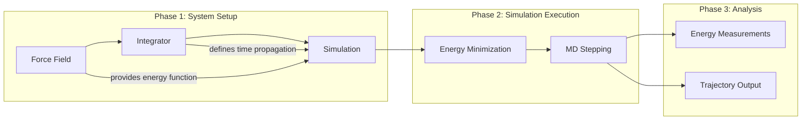

This guide introduces the fundamental workflow for running molecular dynamics simulations with DIMOS, designed specifically for developers getting started with the framework. You'll learn the essential components needed to set up and execute a basic MD simulation, from system initialization to running dynamics and analyzing results.

## Understanding the Simulation Architecture

Before diving into code, it's important to understand how DIMOS organizes molecular dynamics simulations through three core components that work together:



The **Force Field** defines your molecular system's physics by reading topology files and computing energies. The **Integrator** determines how atoms move through time using algorithms like Velocity Verlet or Langevin dynamics. The **Simulation** orchestrates everything, managing state, applying constraints, and running the simulation loop. This separation enables flexible mixing and matching of different components while keeping the workflow simple.

## Step-by-Step Workflow

### Step 1: Set Up Your Force Field System

The first step is to create a force field system by loading your molecular topology. DIMOS supports both AMBER and GROMACS format files through specialized classes:

```python
import dimos
import torch

# For AMBER format files
system = dimos.AmberForceField(
    "config.prmtop",           # Topology file
    cutoff=10.0,               # Nonbonded cutoff in Angstroms
    switch_distance=7.5,       # Switching function distance
    nonbonded_type="Cutoff",   # Can be "Cutoff", "PME", or "Ewald"
    periodic=True              # Enable periodic boundary conditions
)

# For GROMACS format files
system = dimos.GromacsForceField(
    "system.top",              # Topology file
    "system.gro",              # Coordinate file
    cutoff=10.0,
    switch_distance=7.5,
    nonbonded_type="PME",
    periodic=True
)
```

The force field initialization loads all bonded and nonbonded parameters from your topology file, constructs energy calculation components, and sets up the simulation box dimensions based on your coordinate file.

Sources: [dimos/ff.py](dimos/ff.py#L625-L698), [dimos/ff.py](dimos/ff.py#L1367-L1378)

### Step 2: Choose and Configure Your Integrator

The integrator determines how positions and velocities are updated at each timestep. For basic simulations, you'll typically choose between:

```python
# Velocity Verlet - constant energy (NVE) ensemble
integrator = dimos.VelocityVerlet(
    timestep=0.5,              # Timestep in femtoseconds
    sys=system                 # Your force field system
)

# Langevin Dynamics - constant temperature (NVT) ensemble
integrator = dimos.LangevinDynamics(
    timestep=0.5,              # Timestep in femtoseconds
    temperature=300.0,         # Target temperature in Kelvin
    friction=1.0,              # Friction coefficient in 1/ps
    sys=system
)

# Nose-Hoover - advanced thermostat for NVT
integrator = dimos.NoseHooverDynamics(
    timestep=2.0,              # Can use larger timestep with constraints
    temperature=300.0,
    collision_frequency=0.05,
    sys=system
)
```

Sources: [dimos/integrators.py](dimos/integrators.py#L836-L904), [dimos/integrators.py](dimos/integrators.py#L1084-L1194), [dimos/integrators.py](dimos/integrators.py#L1653-L1754)

### Step 3: Load Initial Coordinates

Load your initial atomic positions from coordinate files:

```python
import parmed

# From AMBER restart files
rst7_file = parmed.amber.Rst7("system.rst7")
positions = torch.tensor(
    rst7_file.positions.value_in_unit(parmed.unit.angstrom)
)

# Or use DIMOS helper for GROMACS files
positions = dimos.read_positions("system.gro")
```

Positions should be provided as PyTorch tensors with shape `(num_atoms, 3)` in Angstroms. DIMOS automatically converts these to internal units for computation.

Sources: [benchmark/water/dimos_water.py](benchmark/water/dimos_water.py#L34-L37), [tests/test_nve.py](tests/test_nve.py#L391-L395)

### Step 4: Create the Simulation Object

Now combine your system, integrator, and positions into a simulation object:

```python
simulation = dimos.MDSimulation(
    sys=system,                # Force field system
    integrator=integrator,     # Integrator instance
    initial_pos=positions,     # Initial positions tensor
    initial_vel=None,          # Optional: provide velocities
    temperature=300.0,         # Required if initial_vel is None
    seed=42,                   # Random seed for reproducibility
    neighbor_check_interval=1  # Neighbor list update frequency
)
```

If you don't provide initial velocities, DIMOS automatically samples them from a Maxwell-Boltzmann distribution at the specified temperature. The simulation object also initializes neighbor lists for efficient nonbonded calculations and applies any bond constraints defined in your force field.

Sources: [dimos/simulation.py](dimos/simulation.py#L572-L620)

### Step 5: Energy Minimization (Recommended)

Before starting dynamics, it's good practice to minimize energy to remove any steric clashes or high-energy configurations:

```python
# Minimize using LBFGS (recommended for accuracy)
simulation.minimize_energy(
    num_optim=500,             # Number of optimization steps
    print_details=True,        # Print progress
    optimizer="LBFGS"
)

# Or use Adam for faster (but less thorough) minimization
simulation.minimize_energy(
    num_optim=100,
    optimizer="Adam"
)
```

Energy minimization uses PyTorch's optimizers to find a local energy minimum by gradient descent. LBFGS is generally preferred for its accuracy, while Adam can be faster for very large systems.

Sources: [dimos/simulation.py](dimos/simulation.py#L448-L510)

### Step 6: Run the Simulation

Execute dynamics using the `step()` method:

```python
# Run 10,000 steps
simulation.step(num_steps=10000)

# Or run in blocks for periodic measurements/output
for block in range(100):
    simulation.step(num_steps=100)
    
    # Measure potential energy
    pe = simulation.measure_potential_energy()
    print(f"Block {block}: PE = {pe.item()}")
```

The `step()` method advances the simulation by integrating equations of motion, applying periodic boundary conditions, updating neighbor lists, and optionally detaching from the computation graph to save memory.

Sources: [dimos/simulation.py](dimos/simulation.py#L620-L680)

### Step 7: (Optional) Save Trajectory

Save atomic positions for visualization or analysis:

```python
# Write PDB file with current configuration
system.write_pdb(
    positions=simulation.pos,
    output="output.pdb",
    unwrap=True                # Unwrap molecules across periodic boundaries
)
```

This writes the current configuration in PDB format, which can be visualized with tools like VMD or PyMOL.

Sources: [dimos/ff.py](dimos/ff.py#L1224-L1268)

## Complete Example: Basic NVE Simulation

Here's a complete working example combining all steps:

```python
import dimos
import torch
import parmed

# 1. Set up the force field system
system = dimos.AmberForceField(
    "examples/amber/ala2_solv.prmtop",
    cutoff=9.0,
    switch_distance=7.5,
    nonbonded_type="Cutoff",
    periodic=True
)

# 2. Create integrator (NVE ensemble)
integrator = dimos.VelocityVerlet(timestep=0.5, sys=system)

# 3. Load initial coordinates
rst7_file = parmed.amber.Rst7("examples/amber/ala2_solv.rst7")
positions = torch.tensor(rst7_file.positions.value_in_unit(parmed.unit.angstrom))

# 4. Create simulation object
simulation = dimos.MDSimulation(
    system, integrator, positions, 
    temperature=600.0           # Initial high temperature
)

# 5. Minimize energy
print("Minimizing energy...")
simulation.minimize_energy(500, print_details=False)

# 6. Run production simulation
print("Running MD simulation...")
for step in range(100):
    simulation.step(num_steps=10)
    
    # Measure energies
    pe = simulation.measure_potential_energy()
    ke = simulation.measure_kinetic_energy()
    print(f"Step {step*10}: PE = {pe.item():.2f}, KE = {ke.item():.2f}")

# 7. Save final configuration
system.write_pdb(simulation.pos, "final_config.pdb")
```

Sources: [tests/test_nve.py](tests/test_nve.py#L384-L430)

## Configuration Parameters Reference

| Component | Parameter | Description | Typical Values |
|-----------|-----------|-------------|----------------|
| **Force Field** | `cutoff` | Nonbonded cutoff distance | 9.0-12.0 Å |
| | `switch_distance` | Distance where switching function starts | 7.5-9.0 Å |
| | `nonbonded_type` | Long-range electrostatics method | "Cutoff", "PME", "Ewald" |
| **Integrator** | `timestep` | Integration step size | 0.5 fs (no constraints), 2.0 fs (with constraints) |
| | `temperature` | Target temperature | 300 K (room temp) |
| | `friction` | Langevin friction coefficient | 1.0-5.0 ps⁻¹ |
| **Simulation** | `neighbor_check_interval` | Frequency to rebuild neighbor lists | 1-10 steps |
| | `seed` | Random number generator seed | Any integer |

## Common Ensemble Choices

Different ensembles are suitable for different simulation goals:

| Ensemble | Integrator | When to Use | Key Features |
|----------|------------|-------------|--------------|
| **NVE** | VelocityVerlet | Testing energy conservation, pure dynamics | Constant energy, no thermostat |
| **NVT** | LangevinDynamics | Simulations at constant temperature | Stochastic thermostat, flexible |
| **NVT** | NoseHooverDynamics | High-precision temperature control | Deterministic thermostat, good for sampling |

> [!TIP]
> For production simulations with constraints (like SHAKE on bonds involving hydrogen), you can use larger timesteps (2.0 fs) with the LangevinDynamics or NoseHooverDynamics integrators. Remember to set `constraint_option="h_angles"` when creating your force field to enable hydrogen bond angle constraints.

## Memory Optimization and Performance

DIMOS provides several options to optimize memory usage during long simulations:

```python
# Detach from computation graph (default behavior saves memory)
simulation.step(num_steps=100, detach=True)

# Keep computation graph for backpropagation (uses more memory)
simulation.step(num_steps=100, detach=False)

# Optional: use torch.compile for significant speedup
from torch import compile
compiled_step = compile(simulation.step, mode="max-autotune")
compiled_step(num_steps=100)
```

The `detach` parameter controls whether the computation graph is preserved. For standard production simulations where you don't need gradients, `detach=True` (the default) dramatically reduces memory usage by preventing PyTorch from tracking intermediate tensors.

Sources: [dimos/simulation.py](dimos/simulation.py#L668-L676), [benchmark/water/dimos_water.py](benchmark/water/dimos_water.py#L54-L58)

## Troubleshooting Common Issues

| Issue | Likely Cause | Solution |
|-------|--------------|----------|
| **NaN in positions** | Forces too large, timestep too big | Reduce timestep, minimize energy first |
| **Energy drift** | Integrator not appropriate | Use proper thermostat for NVT, check cutoff |
| **Slow performance** | Small neighbor check interval | Increase `neighbor_check_interval` |
| **Constraint violations** | Timestep too large for constrained bonds | Reduce timestep or disable constraints |

## Next Steps

Now that you understand the basic MD simulation workflow, you can explore more advanced topics:

- Learn about **different integrator algorithms** in [Velocity Verlet Integration](11-velocity-verlet-integration)
- Understand **temperature control methods** in [Langevin Dynamics and Thermostats](12-langevin-dynamics-and-thermostats)
- Explore **force field architecture** in [Force Field Systems Architecture](6-force-field-systems-architecture)
- See **practical examples** in [Running Your First Simulation](5-running-your-first-simulation)