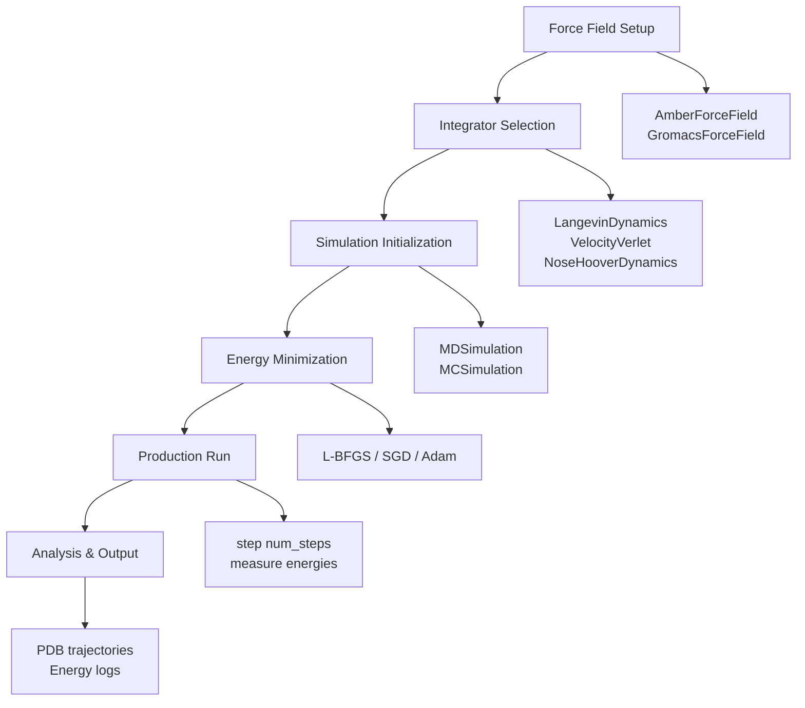
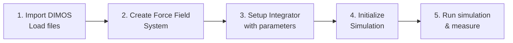

This guide walks you through running your first molecular dynamics simulation with DIMOS. You'll learn the core workflow, set up a simple system, and execute simulations with different integrators and options. By the end, you'll be equipped to simulate protein systems, water boxes, or custom molecular systems with confidence.


## Understanding DIMOS Simulation Architecture

Before diving into code, let's understand how DIMOS organizes simulations. The framework follows a modular design where each component has a specific responsibility, making it easy to customize and extend.



The simulation architecture consists of three core layers working together:

1. **System Layer** (`dimos.ff`) - Defines molecular topology, force field parameters, and energy calculations. The `AmberForceField` and `GromacsForceField` classes handle loading topology files and setting up nonbonded interaction schemes.

2. **Integrator Layer** (`dimos.integrators`) - Governs how the system evolves through time. Options range from simple velocity Verlet to sophisticated thermostats like Langevin dynamics and Nose-Hoover chains.

3. **Simulation Layer** (`dimos.simulation`) - Orchestrates the entire process, managing state (positions, velocities), performing steps, and handling boundary conditions and constraints.

This modular design means you can mix and match components: use any integrator with any force field, switch between molecular dynamics and Monte Carlo simulations, or add machine learning potentials to classical systems.

Sources: [simulation.py](dimos/simulation.py#L403-L512), [ff.py](dimos/ff.py#L571-L639), [integrators.py](dimos/integrators.py#L392-L566)

## Prerequisites and Setup

To run your first simulation, you'll need simulation files containing molecular topology and initial coordinates. DIMOS provides example files in the `examples/` directory, or you can use your own Amber/Gromacs files.

### Available Example Systems

| System | Location | Type | Description |
|--------|----------|------|-------------|
| Alanine dipeptide (solvated) | `examples/amber/ala2_solv.*` | Amber | Small peptide in water, good for testing |
| Alanine pentapeptide | `examples/amber/ala5_gas.*` | Amber | Larger peptide, gas phase |
| 6N4O protein | `examples/amber/6n4o.*` | Amber | Medium-sized protein system |
| Alanine dipeptide (no constraints) | `examples/gromacs/ala2_no_constraint.*` | Gromacs | Simple test system |
| DHFR protein | `examples/gromacs/dhfr_pme.*` | Gromacs | Larger protein with PME setup |


Ensure you have these files available or have prepared your own system using standard tools like `tleap` (for Amber) or `gmx pdb2gmx` (for Gromacs).

Sources: [examples/README.md](examples/README.md#L1)

## Quick Start: Your First Simulation in 5 Steps

Let's run a basic molecular dynamics simulation of alanine dipeptide in water. This example uses Langevin dynamics for temperature control, which is robust and widely applicable.



### Step 1: Import DIMOS and Load Input Files

```python
import dimos
import torch

# Set precision and device (optional but recommended)
torch.set_default_dtype(torch.float64)

# Define file paths
prmtop_filename = "./examples/amber/ala2_solv.prmtop"
rst7_filename = "./examples/amber/ala2_solv.rst7"

# Load initial positions using DIMOS utility
positions = dimos.read_positions(rst7_filename)
```

The `read_positions()` function handles file parsing and unit conversion automatically, returning positions as a PyTorch tensor in the correct units (Angstroms for Amber systems by default).

Sources: [utils.py](dimos/utils.py#L667-L700)

### Step 2: Create the Force Field System

```python
# Create force field system with PME for electrostatics
system = dimos.AmberForceField(
    prmtop_filename,
    nonbonded_type="PME",           # Particle Mesh Ewald for accurate electrostatics
    cutoff=10.0,                     # Nonbonded cutoff in Angstroms
    switch_distance=7.5,             # Switching function distance
    dispersion_correction=True,      # Apply long-range dispersion correction
    periodic=True                    # Enable periodic boundary conditions
)
```

The `AmberForceField` class reads the parameter file and sets up all bonded and nonbonded interactions. Key parameters:

- **nonbonded_type**: Controls electrostatic treatment ("Cutoff", "Ewald", "PME", or None)
- **cutoff**: Distance at which nonbonded interactions are truncated
- **switch_distance**: Where the switching function begins to smoothly zero interactions
- **dispersion_correction**: Compensates for truncated Lennard-Jones interactions
- **periodic**: Whether to apply periodic boundary conditions

Sources: [ff.py](dimos/ff.py#L625-L670)

### Step 3: Configure the Integrator

```python
# Set simulation parameters
timestep = 0.5        # femtoseconds
temperature = 300.0   # Kelvin
friction = 1.0        # friction coefficient (ps^-1) for Langevin dynamics

# Create Langevin dynamics integrator
integrator = dimos.LangevinDynamics(
    timestep,
    temperature,
    friction,
    system
)
```

Langevin dynamics combines deterministic forces with stochastic thermal noise and friction, providing automatic temperature control. The friction parameter (in ps⁻¹) controls how strongly the system couples to the thermal bath—typical values range from 0.1 to 10.0 ps⁻¹.

Sources: [integrators.py](dimos/integrators.py#L1084-L1140)

### Step 4: Initialize the Simulation

```python
# Create MD simulation object
simulation = dimos.simulation.MDSimulation(
    system,
    integrator,
    positions,
    temperature=temperature,    # For Maxwell-Boltzmann velocity initialization
    seed=42                     # Random seed for reproducibility
)
```

The `MDSimulation` constructor handles several critical tasks:

1. **Velocity Initialization**: If velocities aren't provided, it generates them from a Maxwell-Boltzmann distribution at the specified temperature
2. **Constraint Application**: Applies any bond/angle constraints defined in the force field
3. **Neighbor List Setup**: Initializes neighbor lists for efficient nonbonded calculations
4. **Acceleration Calculation**: Computes initial forces and accelerations

Sources: [simulation.py](dimos/simulation.py#L572-L620)

### Step 5: Run and Measure

```python
# Minimize energy (optional but recommended)
print("Minimizing energy...")
simulation.minimize_energy(num_optim=20, print_details=True)

# Run production simulation
num_steps = 1000
measure_every = 100

print(f"Running {num_steps} steps...")
for step in range(0, num_steps, measure_every):
    simulation.step(measure_every)
    
    # Measure properties
    pe = simulation.measure_potential_energy()
    ke = simulation.measure_kinetic_energy()
    temp = simulation.sys.measure_temperature(simulation.vel)
    
    print(f"Step {step}: PE={pe:.2f}, KE={ke:.2f}, Total={pe+ke:.2f}, T={temp:.1f}K")

print("Simulation complete!")
```

> [!TIP]
> Always minimize energy before production runs—this removes bad contacts and prevents numerical instability during the first few steps.

The `step()` method advances the simulation by the specified number of steps, updating positions and velocities according to the integrator's algorithm. It automatically handles periodic boundary conditions, neighbor list updates, and constraint enforcement.

Sources: [simulation.py](dimos/simulation.py#L620-L680)

## Alternative Simulation Workflows

### Gromacs Systems

For Gromacs users, the workflow is nearly identical:

```python
import dimos
import torch

# Load Gromacs files
system = dimos.GromacsForceField(
    "system.top", 
    "system.gro",
    nonbonded_type="PME",
    cutoff=10.0,
    switch_distance=7.5,
    periodic=True
)

positions = dimos.read_positions("system.gro")

# Rest of simulation setup identical to Amber example
integrator = dimos.LangevinDynamics(0.5, 300.0, 1.0, system)
simulation = dimos.MDSimulation(system, integrator, positions, temperature=300.0)
```

Sources: [ff.py](dimos/ff.py#L1434-L1450), [utils.py](dimos/utils.py#L667-L700)

### Velocity Verlet (NVE Ensemble)

For energy conservation studies, use Velocity Verlet without a thermostat:

```python
integrator = dimos.VelocityVerlet(timestep, system)
simulation = dimos.simulation.MDSimulation(
    system,
    integrator,
    positions,
    temperature=300.0  # Only used for initial velocity distribution
)

# In NVE, temperature will drift according to energy exchange
simulation.step(1000)
```

Sources: [integrators.py](dimos/integrators.py#L836-L907)

### Nose-Hoover Thermostat

For more sophisticated temperature control:

```python
integrator = dimos.NoseHooverDynamics(
    timestep=2.0,
    temperature=300.0,
    collision_frequency=0.05,
    sys=system
)
```

Sources: [integrators.py](dimos/integrators.py#L1653-L1813)

## Writing Trajectory Files

To save configurations during simulation:

```python
output_file = open("trajectory.pdb", "w")

for step in range(0, num_steps, 100):
    simulation.step(100)
    
    # Write current configuration to PDB
    system.write_pdb(simulation.pos, output_file)
    output_file.flush()

output_file.close()
```

The `write_pdb()` method handles unit conversion and formatting automatically. For periodic systems, it can optionally unwrap coordinates.

Sources: [ff.py](dimos/ff.py#L1224-L1268)

## Complete Working Example

Here's a complete script combining all elements:

```python
import dimos
import torch

# Setup
torch.set_default_dtype(torch.float64)
torch.set_default_device("cpu")  # or "cuda" for GPU acceleration

# Load system
system = dimos.AmberForceField(
    "./examples/amber/ala2_solv.prmtop",
    nonbonded_type="Cutoff",
    cutoff=10.0,
    dispersion_correction=True,
    periodic=True
)

positions = dimos.read_positions("./examples/amber/ala2_solv.rst7")

# Create integrator and simulation
integrator = dimos.LangevinDynamics(0.5, 300.0, 1.0, system)
simulation = dimos.simulation.MDSimulation(
    system, 
    integrator, 
    positions, 
    temperature=300.0,
    seed=42
)

# Minimize
print("Minimizing energy...")
simulation.minimize_energy(20, print_details=True)

# Production run with output
print("Running simulation...")
output_file = open("output.pdb", "w")

num_steps = 1000
measure_interval = 100

for step in range(0, num_steps, measure_interval):
    simulation.step(measure_interval)
    
    pe = simulation.measure_potential_energy()
    ke = simulation.measure_kinetic_energy()
    temp = system.measure_temperature(simulation.vel)
    
    print(f"Step {step:5d}: E_total={pe+ke:12.2f}, T={temp:6.1f}K")
    system.write_pdb(simulation.pos, output_file)

output_file.close()
print("Done!")
```

## Common Parameters Reference

| Parameter | Typical Values | Description | Notes |
|-----------|----------------|-------------|-------|
| `timestep` | 0.5-2.0 fs | Integration step size | Larger with constraints, smaller without |
| `temperature` | 300-350 K | Target temperature | Used for velocity initialization and thermostats |
| `friction` | 0.1-10.0 ps⁻¹ | Langevin coupling strength | 1.0 ps⁻¹ is common for biomolecular simulations |
| `cutoff` | 8-12 Å | Nonbonded cutoff distance | Must be less than half box size |
| `switch_distance` | 6-10 Å | Where switching begins | Should be < cutoff |
| `nonbonded_type` | "Cutoff", "PME", "Ewald" | Electrostatic treatment | PME recommended for periodic systems |
| `constraint_option` | None, "h_angles", "all-bonds" | Constraint handling | Allows larger timesteps when used |

Sources: [ff.py](dimos/ff.py#L625-L670), [integrators.py](dimos/integrators.py#L1084-L1140)

## Troubleshooting Guide

| Issue | Likely Cause | Solution |
|-------|--------------|----------|
| NaN in positions | Bad contacts or too large timestep | Run energy minimization first, reduce timestep |
| Energy drift (NVE) | Insufficient cutoff or poor starting config | Increase cutoff, ensure proper minimization |
| Temperature not converging | Friction too low or system too small | Increase friction coefficient, check system size |
| Neighbor list errors | Cutoff too large for box | Reduce cutoff or use larger simulation box |
| Memory issues | Too many atoms or not detaching | Use `detach=True` in step(), reduce system size |

> [!TIP]
> Always check for NaN values early—if you see them in the first few steps, minimize energy before continuing.

Sources: [simulation.py](dimos/simulation.py#L668-L680)

## Next Steps

Now that you've run your first simulation, explore these advanced topics:

- **[Force Field Systems Architecture](6-force-field-systems-architecture)** - Deep dive into how force fields are structured and parameterized
- **[Velocity Verlet Integration](11-velocity-verlet-integration)** - Understanding the mathematics of integration algorithms
- **[Langevin Dynamics and Thermostats](12-langevin-dynamics-and-thermostats)** - Detailed treatment of stochastic dynamics
- **[GPU Acceleration and PyTorch Compilation](23-gpu-acceleration-and-pytorch-compilation)** - Optimizing performance with CUDA and compilation
- **[Machine Learning Integration](18-hybrid-ml-mm-systems-design-and-implementation)** - Combining ML potentials with classical force fields

For production simulations with large systems, consider reading the [Performance and Optimization](23-gpu-acceleration-and-pytorch-compilation) section to learn about GPU acceleration and PyTorch compilation techniques that can provide 10-100x speedups.