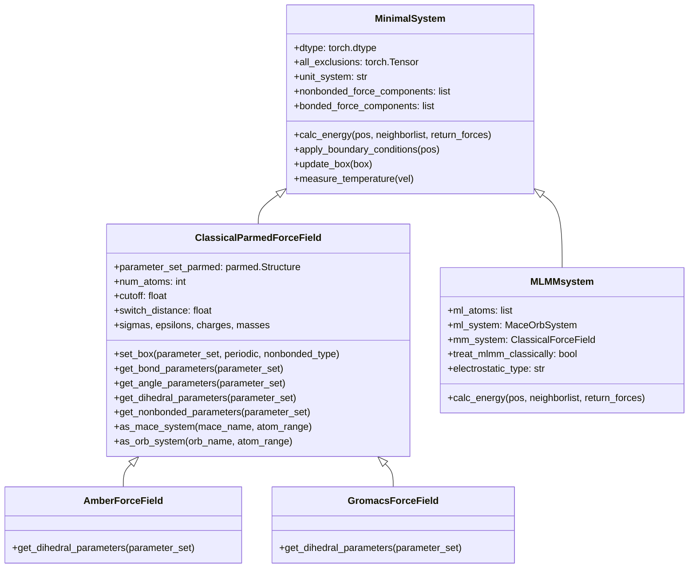
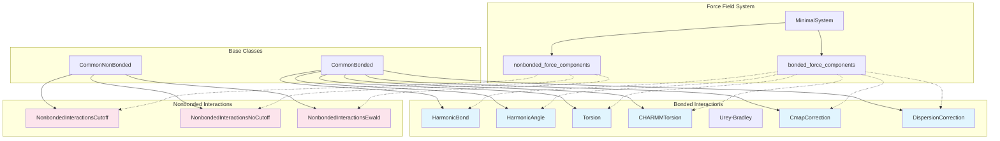
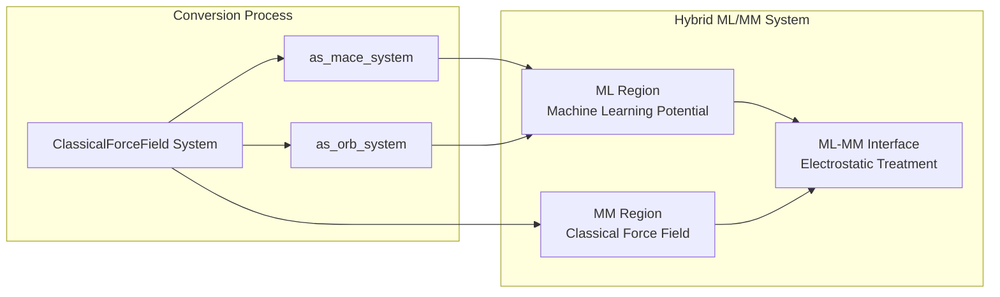

The force field system in DIMOS provides a comprehensive, modular framework for molecular dynamics simulations that seamlessly integrates classical force fields with modern machine learning potentials. This architecture enables flexible system composition, supporting multiple force field formats while maintaining computational efficiency through PyTorch-based implementation.

## Architectural Overview

DIMOS employs a hierarchical class structure that separates concerns between system management, parameter parsing, and energy calculation. The architecture is built around three primary inheritance levels, each adding specific functionality while maintaining a consistent interface for energy and force calculations.


The design philosophy emphasizes modularity—each energy component operates independently, allowing for easy extension and composition. This approach enables users to mix and match force field types, from classical AMBER and GROMACS implementations to hybrid ML/MM systems, all through a unified API.

Sources: [dimos/ff.py](/dimos/ff.py#L374-L386), [dimos/mlmm.py](/dimos/mlmm.py#L375-L391)

## Class Hierarchy

The force field system follows a three-tier inheritance hierarchy designed for extensibility and code reuse.



### MinimalSystem Base Class

The `MinimalSystem` class provides the foundation for all force field implementations, implementing core functionality that every simulation system requires. It manages the unit system (defaulting to AMBER units), maintains lists of force components, and provides the essential `calc_energy` method that orchestrates energy computation across all registered components [dimos/ff.py](/dimos/ff.py#L400-L570).

Key responsibilities include:
- **Energy aggregation**: Summing contributions from bonded and nonbonded force components through the `calc_energy` method
- **Boundary condition handling**: Applying periodic boundary conditions via `apply_boundary_conditions`
- **Box management**: Propagating box dimension updates to all force components through `update_box`
- **Force computation**: Computing forces via automatic differentiation when `create_graph=True`

The class maintains two primary lists: `bonded_force_components` and `nonbonded_force_components`, allowing modular addition of energy terms during system initialization.

Sources: [dimos/ff.py](/dimos/ff.py#L400-L570)

### ClassicalParmedForceField Implementation

The `ClassicalParmedForceField` extends the base class with specific functionality for handling classical molecular mechanics force fields using ParmEd as the parameter parsing backend [dimos/ff.py](/dimos/ff.py#L571-L816). This class serves as the primary implementation for traditional force field simulations.

During initialization, it performs a comprehensive system setup process:

1. **Parameter loading**: Uses ParmEd to load force field files (`.prmtop`, `.top`, `.gro`, etc.)
2. **Box configuration**: Sets up periodic boundary conditions based on file parameters and user specifications
3. **Parameter extraction**: Parses bonded parameters (bonds, angles, dihedrals, impropers, Urey-Bradley terms)
4. **Nonbonded parameter extraction**: Retrieves atomic charges, Lennard-Jones parameters (σ, ε), and masses
5. **Exclusion management**: Gathers bond, angle, and dihedral exclusions for proper nonbonded interaction handling
6. **Nonbonded method initialization**: Instantiates appropriate nonbonded interaction classes based on the specified method (Cutoff, Ewald, PME, NoCutoff)
7. **Constraint setup**: Configures constraint handling if specified (e.g., h_angles for hydrogen constraints)

The class supports format-specific nuances through specialized subclasses (`AmberForceField` and `GromacsForceField`), which override parameter extraction methods to handle differences in dihedral parameter representation between formats.

Sources: [dimos/ff.py](/dimos/ff.py#L625-L816)

### ML Integration Classes

DIMOS provides seamless integration with machine learning potentials through conversion methods in `ClassicalParmedForceField`. The `as_mace_system` and `as_orb_system` methods transform a classical force field system into a machine learning-based system by extracting atomic numbers and masses from the ParmEd structure [dimos/ff.py](/dimos/ff.py#L1268-L1364).

For hybrid simulations, the `MLMMsystem` class combines classical and ML regions, allowing selective application of ML potentials to specific atoms while treating the rest of the system with classical force fields [dimos/mlmm.py](/dimos/mlmm.py#L402-L540).

Sources: [dimos/ff.py](/dimos/ff.py#L1268-L1364), [dimos/mlmm.py](/dimos/mlmm.py#L402-L540)

## Energy Component Architecture

The energy calculation system follows a modular design where each interaction type is encapsulated in a dedicated class. This separation enables independent testing, optimization, and composition of energy terms.

### Component Organization



### Bonded Force Components

Bonded interactions inherit from `CommonBonded` and implement specific energy calculations for different interaction types [dimos/energy.py](/dimos/energy.py#L2125-L2540):

- **HarmonicBond**: Computes bond stretching energy using harmonic potential: E = k(r - r₀)²
- **HarmonicAngle**: Computes angle bending energy: E = k(θ - θ₀)²
- **Torsion**: Computes dihedral rotation energy using Fourier series
- **CHARMMTorsion**: Implements CHARMM-style improper dihedral potentials
- **CmapCorrection**: Applies correction maps for backbone torsions
- **DispersionCorrection**: Applies long-range Lennard-Jones dispersion corrections

Each component maintains its own parameter tensors and implements the `calc_energy` method that accepts atomic positions and returns the energy contribution.

Sources: [dimos/energy.py](/dimos/energy.py#L2228-L2680)

### Nonbonded Force Components

Nonbonded interactions inherit from `CommonNonBonded` and handle van der Waals and electrostatic interactions with various treatment methods [dimos/energy.py](/dimos/energy.py#L402-L2100):

The architecture supports four primary nonbonded methods, each with distinct computational characteristics:

| Method | Class | Neighbor List | Electrostatic Treatment | Use Case |
|--------|-------|---------------|------------------------|----------|
| Cutoff | `NonbondedInteractionsCutoff` | Required | Reaction Field Approximation | Solvent simulations, moderate accuracy |
| NoCutoff | `NonbondedInteractionsNoCutoff` | Not Required | Direct summation | Gas phase, small clusters |
| Ewald | `NonbondedInteractionsEwald` | Required | Ewald summation | Periodic systems, high accuracy |
| PME | `NonbondedInteractionsEwald` | Required | Particle Mesh Ewald | Large biomolecular systems |

Nonbonded components handle complex exclusion patterns including 1-2, 1-3, and 1-4 interactions with appropriate scaling factors (scee for electrostatics, scnb for Lennard-Jones) [dimos/ff.py](/dimos/ff.py#L709-L731).

Sources: [dimos/energy.py](/dimos/energy.py#L695-L932), [dimos/ff.py](/dimos/ff.py#L733-L793)

> [!TIP]
> The nonbonded architecture uses a match-case pattern (Python 3.10+) to select appropriate interaction classes based on the `nonbonded_type` parameter, providing clean extensibility for adding new electrostatic methods.

## Force Field Format Support

DIMOS provides native support for AMBER and GROMACS force field formats through specialized subclasses that handle format-specific parameter representations.

### Format-Specific Subclasses

**AmberForceField**: Extends `ClassicalParmedForceField` with AMBER-specific dihedral parameter handling [dimos/ff.py](/dimos/ff.py#L1367-L1433). AMBER uses a multi-term Fourier series representation for dihedrals, requiring specialized parsing logic.

**GromacsForceField**: Extends `ClassicalParmedForceField` with GROMACS-specific adaptations [dimos/ff.py](/dimos/ff.py#L1434-L1522). GROMACS uses slightly different conventions for dihedral parameters and improper definitions.

Both subclasses inherit all core functionality from the parent class, only overriding methods where format differences exist. This design maximizes code reuse while accommodating format-specific requirements.

Sources: [dimos/ff.py](/dimos/ff.py#L1367-L1522)

### Supported File Formats

| Format | Parameter File | Coordinate File | Example |
|--------|----------------|-----------------|---------|
| AMBER | `.prmtop`, `.parm7` | `.inpcrd`, `.rst7` | `amber25.prmtop`, `JAC.rst7` |
| GROMACS | `.top` | `.gro` | `dhfr_pme.top`, `dhfr_pme.gro` |

The ParmEd library handles the underlying file parsing, with DIMOS providing the abstraction layer that converts ParmEd structures into PyTorch tensors suitable for GPU acceleration.

Sources: [examples/amber/](/examples/amber), [examples/gromacs/](/examples/gromacs)

## Parameter Extraction and Management

The force field system implements a comprehensive parameter extraction framework that converts ParmEd structures into optimized PyTorch tensors.

### Nonbonded Parameters

The `get_nonbonded_parameters` method extracts atomic properties including masses, Lennard-Jones parameters (σ, ε), and partial charges [dimos/ff.py](/dimos/ff.py#L1063-L1102). These are stored as 1D tensors indexed by atom position, enabling efficient broadcasting during energy calculations.

The system validates parameters during extraction, raising exceptions for invalid configurations such as zero-mass particles (which would indicate virtual sites or TIP4P water models requiring special handling).

Sources: [dimos/ff.py](/dimos/ff.py#L1063-L1102)

### Bonded Parameters

Bonded parameters are extracted through specialized methods that iterate through ParmEd topology:

- **Bonds**: `get_bond_parameters` extracts force constants (k) and equilibrium distances (r₀) [dimos/ff.py](/dimos/ff.py#L1145-L1174)
- **Angles**: `get_angle_parameters` extracts force constants and equilibrium angles (θ₀), converting degrees to radians [dimos/ff.py](/dimos/ff.py#L1104-L1143)
- **Dihedrals**: `get_dihedral_parameters` extracts multi-term Fourier series parameters and distinguishes proper from improper dihedrals
- **Urey-Bradley**: `get_urey_bradley` extracts cross-term angle-bond parameters for CHARMM-style force fields

Each method returns parameter tensors along with atom index lists specifying which atoms participate in each interaction. Exclusion patterns are simultaneously extracted for use in nonbonded calculations.

Sources: [dimos/ff.py](/dimos/ff.py#L1104-L1210)

### Exclusion Management

The system maintains comprehensive exclusion patterns to prevent double-counting of interactions [dimos/ff.py](/dimos/ff.py#L705-L705). Bonded interactions generate exclusions for:

- 1-2 interactions (directly bonded atoms)
- 1-3 interactions (atoms separated by two bonds)
- 1-4 interactions (atoms separated by three bonds, handled with scaled parameters rather than full exclusion)

These exclusions are concatenated into `all_exclusions` and passed to nonbonded components to mask inappropriate interactions.

Sources: [dimos/ff.py](/dimos/ff.py#L705-L705)

## Hybrid ML/MM Architecture

The `MLMMsystem` class enables hybrid simulations that combine machine learning potentials with classical force fields, treating different regions of a molecular system with different computational approaches.

### System Composition



### MLMMsystem Implementation

The `MLMMsystem` class maintains three core components [dimos/mlmm.py](/dimos/mlmm.py#L453-L540):

1. **ml_atoms**: List of atom indices to be treated with ML potentials
2. **ml_system**: Machine learning potential system (MACE or ORB)
3. **mm_system**: Classical force field system for remaining atoms

The `calc_energy` method orchestrates energy computation by:
- Calculating ML potential energy for the ML region
- Calculating classical MM energy for the MM region
- Optionally computing ML-MM interactions classically (controlled by `treat_mlmm_classically`)
- Handling electrostatic coupling between regions based on `electrostatic_type` parameter

This architecture enables applications such as QM/MM-like simulations where a region of interest (e.g., active site) is treated with high-accuracy ML potentials while the bulk solvent remains efficient classical mechanics.

Sources: [dimos/mlmm.py](/dimos/mlmm.py#L453-L540)

### Conversion Methods

The `as_mace_system` and `as_orb_system` methods provide seamless conversion from classical to ML systems [dimos/ff.py](/dimos/ff.py#L1268-L1364). These methods:

1. Extract atomic numbers and masses from the ParmEd structure
2. Optionally restrict to a specific atom range (for hybrid systems)
3. Initialize the ML potential system with appropriate parameters
4. Preserve constraint handling from the original system

The conversion preserves periodic boundary conditions and box dimensions, enabling direct replacement of classical potentials with ML equivalents without changing the simulation environment.

Sources: [dimos/ff.py](/dimos/ff.py#L1268-L1364)

## Configuration Options

The force field system provides extensive configuration through constructor parameters, allowing fine-grained control over simulation behavior.

### ClassicalParmedForceField Configuration

| Parameter | Type | Default | Description |
|-----------|------|---------|-------------|
| `parameter_file` | str | Required | Path to force field parameter file |
| `xyz_file` | str | None | Path to coordinate file (optional for parameter-only loading) |
| `cutoff` | float | 9.0 | Nonbonded interaction cutoff distance (Å) |
| `switch_distance` | float | 7.5 | Distance at which switching function begins (Å) |
| `nonbonded_type` | str | "Cutoff" | Electrostatic treatment method |
| `dispersion_correction` | bool | False | Apply long-range L-J correction |
| `constraint_option` | str | None | Constraint handling method (e.g., "h_angles") |
| `periodic` | bool | Auto | Force periodic boundary conditions |
| `create_graph` | bool | False | Enable autograd computation graphs |
| `dtype` | torch.dtype | Default | Tensor data type |

> [!TIP]
> The `create_graph` parameter enables differentiable energy landscapes but introduces significant memory overhead. Set to True only when needed for machine learning training or force field parameter optimization.

Sources: [dimos/ff.py](/dimos/ff.py#L625-L638)

### MLMMsystem Configuration

| Parameter | Type | Default | Description |
|-----------|------|---------|-------------|
| `ml_atoms` | list | Required | Atom indices for ML treatment |
| `ml_system` | MaceOrbSystem | Required | ML potential system |
| `mm_system` | ClassicalForceField | Required | Classical force field system |
| `treat_mlmm_classically` | bool | True | Compute ML-MM interactions classically |
| `electrostatic_type` | str | None | ML-MM electrostatic coupling method |

Sources: [dimos/mlmm.py](/dimos/mlmm.py#L453-L468)

## Practical Usage Examples

### Classical Force Field Simulation

```python
import dimos

# Load GROMACS system with PME electrostatics
system = dimos.GromacsForceField(
    parameter_file="dhfr_pme.top",
    xyz_file="dhfr_pme.gro",
    cutoff=10.0,
    switch_distance=7.5,
    nonbonded_type="PME",
    constraint_option="h_angles"
)

# Calculate energy and forces
energy, forces, acceleration = system.calc_energy(
    pos, 
    neighborlist, 
    return_forces=True
)
```

Sources: [benchmark/proteins/benchmark_proteins.py](/benchmark/proteins/benchmark_proteins.py#L23-L44)

### Pure ML Potential Simulation

```python
# Convert classical system to MACE ML potential
ml_system = system.as_mace_system(
    mace_name="mace-mp-large",
    enable_cueq=True
)

# Use with standard integrator
integrator = dimos.NoseHooverDynamics(
    timestep=2.0, 
    temperature=300.0,
    system=ml_system
)
```

Sources: [benchmark/proteins/benchmark_proteins.py](/benchmark/proteins/benchmark_proteins.py#L43-L44)

### Hybrid ML/MM Simulation

```python
# Identify ML region (e.g., protein)
ml_atoms = base_sys.other_molecules[0]

# Create MM system excluding ML atoms
mm_system = dimos.GromacsForceField(
    "dhfr_pme.top", 
    "dhfr_pme.gro",
    cutoff=10.0,
    nonbonded_type=None,
    excluded_bonded_atoms=ml_atoms
)

# Convert ML region to MACE
ml_system = mm_system.as_mace_system(
    "mace-mp-large",
    atom_range=(0, len(ml_atoms))
)

# Combine into hybrid system
hybrid = dimos.mlmm.MLMMsystem(
    ml_atoms=ml_atoms,
    ml_system=ml_system,
    mm_system=mm_system,
    electrostatic_type=None,
    create_graph=False
)
```

Sources: [benchmark/proteins/benchmark_proteins.py](/benchmark/proteins/benchmark_proteins.py#L36-L41)

## Design Patterns and Extensibility

The force field architecture employs several design patterns that facilitate extension and customization.

### Strategy Pattern for Nonbonded Methods

The nonbonded method selection uses the strategy pattern, with different interaction classes implementing a common interface through `calc_energy` methods [dimos/ff.py](/dimos/ff.py#L733-L793). This enables runtime selection of electrostatic treatment methods without modifying system initialization code.

### Builder Pattern for System Composition

The conversion methods (`as_mace_system`, `as_orb_system`) implement a builder pattern that transforms existing systems into different implementations while preserving core state [dimos/ff.py](/dimos/ff.py#L1268-L1364). This enables progressive system refinement without requiring complete re-initialization.

### Composite Pattern for Energy Components

Energy calculation follows the composite pattern, with `MinimalSystem` acting as the composite that aggregates individual component contributions [dimos/ff.py](/dimos/ff.py#L486-L549). Each component contributes independently to the total energy, enabling straightforward addition of new energy terms.

## Next Steps

Now that you understand the force field systems architecture, explore specific energy calculation components:

- **Nonbonded Interactions**: Learn about Lennard-Jones potentials and electrostatics methods in [Nonbonded Interactions: Lennard-Jones Potentials](7-nonbonded-interactions-lennard-jones-potentials) and [Nonbonded Interactions: Electrostatics Methods](8-nonbonded-interactions-electrostatics-methods)
- **Bonded Interactions**: Understand bond, angle, and torsion potentials in [Bonded Interactions: Bonds, Angles, and Torsions](9-bonded-interactions-bonds-angles-and-torsions)
- **Ewald Methods**: Dive into periodic electrostatics in [Ewald Summation and PME Implementation](10-ewald-summation-and-pme-implementation)
- **ML Integration**: Explore machine learning potentials in [MACE Machine Learning Potentials](16-mace-machine-learning-potentials) and [ORB Machine Learning Potentials](17-orb-machine-learning-potentials)
- **Hybrid Systems**: Learn about combining ML and MM in [Hybrid ML/MM Systems: Design and Implementation](18-hybrid-ml-mm-systems-design-and-implementation)

For practical implementation, continue to [Running Your First Simulation](5-running-your-first-simulation) or explore [Basic MD Simulation Workflow](4-basic-md-simulation-workflow).
