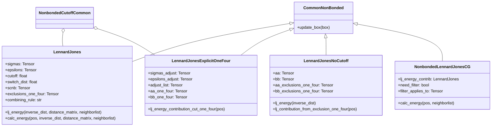

The Lennard-Jones potential represents the cornerstone of van der Waals interactions in molecular dynamics simulations, capturing both repulsive (Pauli exclusion) and attractive (dispersion) forces between atoms. DIMOS implements a comprehensive suite of LJ potentials designed for computational efficiency while maintaining physical accuracy across diverse simulation scenarios from all-atom biomolecular systems to coarse-grained models.

## Mathematical Foundation and Combining Rules

The Lennard-Jones potential in DIMOS follows the standard 12-6 formulation: E = 4ε[(σ/r)¹² - (σ/r)⁶], where ε represents the well depth and σ the distance at which the potential crosses zero. The implementation computes pairwise parameters using combining rules that determine mixed atom-type interactions from individual atom parameters. DIMOS supports two combining rules through the `combining_rule` parameter: "lorentz-berthelot" (default, aliased as "arithmetric") uses arithmetic mean for σ and geometric mean for ε, while "geometric" uses geometric mean for both parameters. These rules are applied in the `lj_energy` method where σ_pairs = (0.5 × (σᵢ + σⱼ))⁶ and ε_pairs = √(εᵢ × εⱼ) for the arithmetic case [dimos/energy.py#L1293-L1327](dimos/energy.py#L1293-L1327).

The computational implementation optimizes the LJ calculation by precomputing inverse distance powers. The code calculates r⁻² from the inverse distance matrix, then computes r⁻⁶ through successive multiplication: r⁻⁶ = r⁻² × r⁻² × r⁻², and r⁻¹² = r⁻⁶ × r⁻⁶. This approach reduces expensive division operations and leverages vectorized PyTorch operations for parallel computation across all atom pairs within the cutoff [dimos/energy.py#L1317-L1320](dimos/energy.py#L1317-L1320).

## Class Architecture and Implementation Variants

DIMOS provides a flexible architecture supporting multiple LJ implementations tailored to different simulation requirements. The class hierarchy enables specialization while maintaining consistent interfaces.

| Class | Purpose | Key Features | Use Cases |
|-------|---------|--------------|-----------|
| `LennardJones` | Standard LJ with cutoff | Switching function, 1-4 scaling | Most MD simulations |
| `LennardJonesExplicitOneFour` | Explicit 1-4 parameter adjustment | Separate σ/ε for 1-4 pairs | Force fields with specific 1-4 parameters |
| `LennardJonesNoCutoff` | Full pairwise computation | No distance cutoff, precomputed coefficients | Small systems, validation |
| `NonbondedLennardJonesCG` | Coarse-grained LJ | Selective interaction filtering | Mixed AA/CG simulations |

The base `LennardJones` class serves as the primary implementation for production simulations. It initializes with atom-wise sigma and epsilon parameters, a cutoff distance, optional switching function, scaling factor for 1-4 interactions (scnb), and exclusion lists for atoms separated by exactly three bonds [dimos/energy.py#L1236-L1282](dimos/energy.py#L1236-L1282). The class handles both periodic and non-periodic boundary conditions through the box parameter.



The architecture enables clean separation of concerns: distance calculations are delegated to neighbor list systems, parameter combination follows force field conventions, and energy computations remain fully differentiable for gradient-based optimization and machine learning applications.

## Switching Functions and Smooth Cutoffs

The discontinuity at the LJ cutoff radius can introduce artifacts in molecular dynamics simulations. DIMOS implements a smooth switching function that gradually reduces the potential to zero between the switch distance and the cutoff. The switching function S(t) uses a quintic polynomial: S(t) = 1 + t³(-10 + t(15 - 6t)), where t = (r - r_switch)/(r_cutoff - r_switch). This function ensures both the potential and its first derivative vanish at the cutoff, preserving energy conservation during simulations [dimos/energy.py#L1333-L1341](dimos/energy.py#L1333-L1341).

The switching function is applied conditionally: if `switch_dist` is None, no switching occurs. Otherwise, the code computes t for all pair distances and applies the switching polynomial only where t > 0 (i.e., pairs between switch distance and cutoff). This implementation uses PyTorch's `torch.where` for efficient conditional computation without explicit Python loops [dimos/energy.py#L1333-L1341](dimos/energy.py#L1333-L1341).

> [!TIP]
> The switch distance should typically be set to 0.8-0.9 of the cutoff distance. The default configuration uses switch_distance=7.5 Å with cutoff=9.0 Å, providing sufficient range for physical interactions while maintaining computational efficiency. Switching distances too close to the cutoff can introduce noise in forces; distances too far reduce computational savings.

## 1-4 Interactions and Exclusion Handling

Atoms separated by exactly three bonds (1-4 interactions) require special treatment in molecular mechanics force fields. These interactions are excluded from the nonbonded neighbor list but typically computed with scaled parameters to account for partial electronic screening. DIMOS implements 1-4 LJ interactions through the `scnb` scaling factor (typically 1/2 or 1/1.2 in standard force fields), which divides the interaction energy [dimos/energy.py#L1344-L1383](dimos/energy.py#L1344-L1383).

The `lj_energy_contribution_cut_one_four` method computes these interactions separately from the main neighbor list. It calculates distances specifically for 1-4 pairs using the `exclusions_one_four` tensor, applies the distance cutoff, and computes the LJ energy with the scnb scaling factor. The method uses the same combining rules as regular interactions but scales the final energy [dimos/energy.py#L1344-L1383](dimos/energy.py#L1344-L1383).

Some force fields specify explicit sigma and epsilon adjustments for 1-4 pairs rather than simple scaling. The `LennardJonesExplicitOneFour` class handles this scenario by accepting separate `sigmas_adjust` and `epsilons_adjust` tensors, along with an `adjust_list` specifying which atom pairs use adjusted parameters. Precomputed coefficients `aa_one_four` and `bb_one_four` store the adjusted parameters for efficient computation [dimos/energy.py#L1008-L1061](dimos/energy.py#L1008-L1061).

## Integration with Force Field Systems

The LJ potentials integrate seamlessly with DIMOS's force field loading infrastructure. The `ClassicalParmedForceField` class extracts LJ parameters from ParmEd structure objects through the `get_nonbonded_parameters` method. This method iterates through all atoms, extracting sigma, epsilon, charge, and mass values into PyTorch tensors [dimos/ff.py#L1063-L1102](dimos/ff.py#L1063-L1102).

The force field system supports multiple nonbonded treatment modes selected via the `nonbonded_type` parameter. For "Cutoff" or "RFA" modes, the system instantiates `NonbondedInteractionsCutoff`, which combines LJ and electrostatic calculations with distance-based cutoffs. This class inherits from `NonbondedCutoffCommon` and adds an electrostatic component for complete nonbonded energy computation [dimos/ff.py#L733-L752](dimos/ff.py#L733-L752).

The parameter loading process handles 1-4 adjustments through two mechanisms: generic scaling factors (scee for electrostatics, scnb for LJ) applied globally, and explicit per-pair adjustments stored in the ParmEd structure's `adjusts` attribute. The system automatically detects whether explicit adjustments are necessary or if a simple scaling factor suffices, optimizing the computational approach accordingly [dimos/ff.py#L712-L731](dimos/ff.py#L712-L731).

## Performance Optimization Strategies

DIMOS employs several computational optimizations to achieve high performance in LJ calculations. The primary optimization leverages PyTorch's vectorized operations, computing all pairwise interactions in parallel without explicit Python loops. The neighbor list system filters interactions based on distance before energy computation, ensuring only physically relevant pairs contribute to the energy [dimos/energy.py#L649-L681](dimos/energy.py#L649-L681).

The implementation uses efficient tensor indexing: `neighborlist[0]` and `neighborlist[1]` extract the two atoms of each interacting pair, enabling vectorized parameter lookup: `epsilon_pairs = sqrt(epsilons[neighborlist[0]] * epsilons[neighborlist[1]])`. This approach avoids constructing full N×N distance matrices, instead computing only the subset of pairs within the cutoff [dimos/energy.py#L1321-L1321](dimos/energy.py#L1321-L1321).

For systems without cutoffs, `LennardJonesNoCutoff` precomputes all pair coefficients (aa for r⁻¹² terms, bb for r⁻⁶ terms) during initialization. This trades memory for computation speed, storing the full coefficient matrix but allowing O(N) energy computation from a precomputed inverse distance matrix. The class uses an upper triangle indexing scheme to avoid double-counting pairs [dimos/energy.py#L1855-L1870](dimos/energy.py#L1855-L1870).

> [!TIP]
> The coarse-grained `NonbondedLennardJonesCG` class provides additional optimization for systems where only a subset of atom types interact. The `applies_to` parameter specifies which pairs should interact, creating a boolean mask that filters out irrelevant interactions before distance calculations. This is particularly useful in hybrid all-atom/coarse-grained simulations where coarse-grained beads interact selectively.

## API Reference and Usage Patterns

The primary entry point for LJ interactions in production simulations is the `LennardJones` class. A typical instantiation follows:

```python
lj_potential = LennardJones(
    sigmas=sigmas,  # [num_atoms] tensor of sigma parameters
    epsilons=epsilons,  # [num_atoms] tensor of epsilon parameters
    cutoff=9.0,  # cutoff distance in Angstroms
    switch_distance=7.5,  # switching function start distance
    scnb=2.0,  # 1-4 scaling factor (energy divided by this value)
    exclusions_one_four=dihedral_exclusions,  # [2, num_14_pairs] tensor
    periodic=True,  # use periodic boundary conditions
    box=box_vectors,  # [3, 3] box matrix
    combining_rule="lorentz-berthelot"  # or "geometric"
)
```

Energy computation requires precomputed inverse distances and the neighbor list:

```python
lj_energy = lj_potential.calc_energy(
    pos=positions,  # [num_atoms, 3] position tensor
    inverse_distance_cut=inv_dist_cut,  # [num_pairs] 1/r tensor
    distance_matrix_cut=dist_cut,  # [num_pairs] distance tensor
    neighborlist=neighbor_pairs  # [2, num_pairs] atom indices
)
```

The `calc_energy` method returns the total LJ energy as a scalar tensor, automatically differentiable through PyTorch's autograd system [dimos/energy.py#L1385-L1391](dimos/energy.py#L1385-L1391).

When working with force fields loaded from Amber or Gromacs files, users typically interact with LJ potentials indirectly through the `ClassicalParmedForceField` class. The nonbonded type selection determines the LJ implementation: "Cutoff" uses `LennardJones`, "NoCutoff" uses `LennardJonesNoCutoff`, and "PME" or "Ewald" uses cutoff-based LJ combined with long-range electrostatics [dimos/ff.py#L733-L793](dimos/ff.py#L733-L793).

## Next Steps

Having established the foundations of Lennard-Jones potentials in DIMOS, the logical progression leads to understanding the complete nonbonded interaction picture. Explore electrostatic methods in [Nonbonded Interactions: Electrostatics Methods](8-nonbonded-interactions-electrostatics-methods) to learn how Coulomb interactions complement LJ potentials. For systems requiring long-range accuracy, [Ewald Summation and PME Implementation](10-ewald-summation-and-pme-implementation) details advanced electrostatic treatments. To understand how neighbor lists enable efficient LJ computations, refer to [Neighbor List Management and Cutoff Schemes](24-neighbor-list-management-and-cutoff-schemes). For validation of LJ implementations against reference systems, see [Benchmarking Against OpenMM](29-benchmarking-against-openmm).
