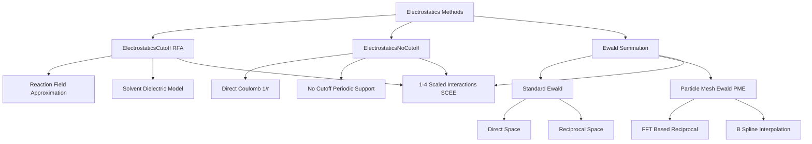

This documentation provides a comprehensive analysis of electrostatic interaction methods implemented in DIMOS, covering reaction field approximation, direct Coulomb calculations, and Ewald summation techniques. These methods form the foundation for handling long-range electrostatic forces in molecular dynamics simulations, with varying computational complexity and accuracy trade-offs suited for different system types and scales.

## Electrostatics Methods Architecture

DIMOS implements a multi-tiered electrostatics framework designed to support diverse simulation scenarios ranging from small isolated systems to large periodic biomolecular assemblies. The architecture centers on three primary approaches: Reaction Field Approximation (RFA) for efficient cutoff-based calculations, direct Coulomb for non-periodic or small systems, and Ewald-based methods (including PME) for accurate long-range electrostatics in periodic systems.



The electrostatics framework integrates through the `CommonNonBonded` base class, which provides box update functionality common to all nonbonded interactions. Each method implements the `calc_energy()` method with parameter signatures tailored to its computational requirements, whether utilizing neighbor lists for cutoff-based methods or full distance matrices for exact calculations.

## Reaction Field Approximation (RFA)

The Reaction Field Approximation models electrostatic interactions within a cutoff radius while accounting for solvent effects beyond that radius through a dielectric continuum model. This approach provides a balanced compromise between computational efficiency and physical accuracy for simulations in explicit solvent environments.

The potential energy function implements the reaction field formulation:

E = (q₁q₂/4πε₀) × (1/r + k_rf×r² - c_rf)

where the reaction field parameters k_rf and c_rf are derived from the cutoff distance and solvent dielectric constant. The implementation in `ElectrostaticsCutoff` precomputes these parameters during initialization based on the specified cutoff and solvent dielectric constant (default 78.5 for water).

Sources: [dimos/energy.py](dimos/energy.py#L1421-L1610), [dimos/ff.py](dimos/ff.py#L720-L850)

### RFA Parameter Configuration

The reaction field method requires careful selection of three primary parameters that govern its behavior:

| Parameter | Default | Physical Significance | Impact on Simulation |
|-----------|---------|----------------------|----------------------|
| `cutoff` | 9.0 Å | Maximum distance for direct pair interactions | Larger cutoffs improve accuracy but increase O(N²) scaling |
| `switch_distance` | 7.5 Å | Distance where switching function begins | Provides smooth energy truncation to avoid forces discontinuities |
| `solvent_dielectric` | 78.5 | Dielectric constant beyond cutoff | Models solvent screening effect; should match solvent type |

The implementation precomputes the reaction field coefficients using the analytical formulas:

k_rf = (1/cutoff³) × (solvent_dielectric - 1) / (2 × solvent_dielectric + 1)

c_rf = (1/cutoff) × (3 × solvent_dielectric) / (2 × solvent_dielectric + 1)

These coefficients are stored as class attributes and applied during energy evaluation without requiring runtime recalculations.

Sources: [dimos/energy.py](dimos/energy.py#L1468-L1491)

### RFA Energy Calculation

The `electrostatic_energy_contribution()` method evaluates the reaction field potential for all atom pairs within the cutoff. The calculation follows a vectorized approach using PyTorch operations:

```python
dist2 = distance_matrix * distance_matrix
pot = charges[neighborlist[0]] * charges[neighborlist[1]] * (inverse_dist + self.krf * dist2 - self.crf)
```

This formulation efficiently computes the reaction field correction term (k_rf × r² - c_rf) for all pairs simultaneously. The energy is then scaled by the Coulomb constant appropriate for the selected unit system (`constants.ONE_BY_4_PI_EPSILON_0`), which varies between Amber units (332.06) and kJ/mol units (138.94).

Sources: [dimos/energy.py](dimos/energy.py#L1533-L1555), [dimos/constants.py](dimos/constants.py#L400-L466)

> [!TIP]
> The reaction field method implicitly assumes that the solvent beyond the cutoff responds as a dielectric continuum. This approximation becomes increasingly accurate at higher solvent dielectric constants and larger cutoffs, but may introduce artifacts in systems with heterogeneous dielectric environments or when studying charged species near interfaces.

## Direct Coulomb Interactions (No Cutoff)

For small systems or simulations where periodic boundary conditions are not required, DIMOS provides `ElectrostaticsNoCutoff`, which implements the exact Coulomb potential without any cutoff truncation:

E = (q₁q₂)/(4πε₀r)

This method is particularly valuable for gas-phase calculations, cluster simulations, or benchmark studies where the absence of long-range approximations is desired. The implementation leverages complete distance matrices to evaluate all pairwise interactions, resulting in O(N²) computational complexity regardless of system size.

Sources: [dimos/energy.py](dimos/energy.py#L1955-L2106)

### NoCutoff Implementation Details

The `ElectrostaticsNoCutoff` class employs an optimized initialization strategy that precomputes charge products for all atom pairs:

```python
charges_2d = torch.matmul(self.charges.unsqueeze(-1), self.charges.unsqueeze(-1).T)
charges_2d[all_exclusions[1], all_exclusions[0]] = 0.0
charges_2d[all_exclusions[0], all_exclusions[1]] = 0.0
self.charges_2d = charges_2d[upper_triangle[0], upper_triangle[1]]
```

This approach eliminates redundant charge product calculations during energy evaluation, as the matrix multiplication computes all qᵢqⱼ products in a single operation. The exclusion mask zeros out bonded interactions (1-2, 1-3, and specified 1-4 exclusions) before extracting the upper triangle to avoid double-counting.

The `electrostatic_energy_contribution()` method then performs a simple element-wise multiplication with the inverse distance matrix:

```python
return torch.sum(self.charges_2d * inverse_dist) * constants.ONE_BY_4_PI_EPSILON_0
```

This vectorized approach maximizes GPU utilization by avoiding Python loops and minimizing memory transfers.

Sources: [dimos/energy.py](dimos/energy.py#L2008-L2056)

## 1-4 Electrostatic Scaling and Exclusions

All electrostatic methods in DIMOS implement proper handling of 1-4 interactions—electrostatic interactions between atoms separated by exactly three bonds—which require scaling to account for overpolarization in force fields. The scaling factor (SCEE) is typically set to 1.2 or 2.0, depending on the specific force field.

### Exclusion Hierarchy

DIMOS implements a hierarchical exclusion system for electrostatic interactions:

| Interaction Type | Treatment | Physical Justification |
|-----------------|-----------|------------------------|
| 1-2 (bonded) | Full exclusion | Covalent bond |
| 1-3 (angle) | Full exclusion | Angle constraint |
| 1-4 (dihedral) | Scaled by SCEE factor | Overpolarization correction |
| Other specified | Full exclusion | Special force field requirements |

The `dihedral_exclusions` tensor identifies all 1-4 atom pairs, while `all_exclusions` combines bonded and angle exclusions. For cutoff-based methods, these exclusions are applied during neighbor list construction. For NoCutoff methods, they are applied via direct masking of the charge product matrix.

Sources: [dimos/energy.py](dimos/energy.py#L1481-L1507), [dimos/energy.py](dimos/energy.py#L2002-L2010)

### 1-4 Energy Computation

The 1-4 electrostatic energy is computed separately from the regular pairwise interactions using the `electrostatic_energy_contribution_one_four()` method:

```python
self.one_four_charges = self.charges[dihedral_exclusion[0]] * self.charges[dihedral_exclusion[1]] / scee
```

The precomputed scaled charge products eliminate runtime division operations. The 1-4 distances are computed on-the-fly using edge list traversals, as the number of 1-4 pairs is typically orders of magnitude smaller than the total number of atom pairs.

Sources: [dimos/energy.py](dimos/energy.py#L1562-L1590), [dimos/energy.py](dimos/energy.py#L2075-L2099)

> [!TIP]
> The separation of 1-4 interactions from regular pairwise computations is not merely a force field convention—it serves a critical optimization purpose. By computing 1-4 energies independently, DIMOS avoids the complex neighbor list masking operations that would otherwise be required to exclude these pairs from the regular energy calculation, while maintaining clean separation of concerns for validation and testing.

## Integration with Force Field Systems

Electrostatics methods are instantiated and configured through the `ClassicalParmedForceField` class, which provides a unified interface for selecting appropriate electrostatic treatments based on system requirements and force field specifications.

### Method Selection Interface

The `nonbonded_type` parameter controls which electrostatics implementation is used:

```python
match nonbonded_type:
    case "Cutoff" | "RFA":
        # ElectrostaticsCutoff with neighbor lists
    case "NoCutoff":
        # ElectrostaticsNoCutoff without neighbor lists
    case "Ewald" | "PME":
        # Ewald summation with reciprocal space
```

The initialization process automatically configures the neighbor list usage flag (`use_neighborlist`) and selects appropriate cutoff parameters. The default configuration uses RFA with a 9.0 Å cutoff and 7.5 Å switch distance, providing a balance between accuracy and computational efficiency for most biomolecular simulations.

Sources: [dimos/ff.py](dimos/ff.py#L720-L850)

## Physical Constants and Unit Systems

DIMOS supports multiple unit systems through the `constants.py` module, which provides unit-appropriate values for Coulomb's constant (1/4πε₀):

| Unit System | Coulomb Constant | Energy Units | Length Units |
|-------------|------------------|--------------|--------------|
| Amber (kcal/mol) | 332.055757 | kcal/mol | Å |
| OpenMM/Gromacs (kJ/mol) | 138.935458 | kJ/mol | nm |
| Reduced LJ | 1/(4π) | ε | σ |

The constants are initialized at module import time and accessed throughout the energy calculation code via `constants.ONE_BY_4_PI_EPSILON_0`. This design ensures consistent unit handling across all electrostatic methods and enables straightforward conversion between different force field conventions.

Sources: [dimos/constants.py](dimos/constants.py#L400-L466), [dimos/energy.py](dimos/energy.py#L1555-L1561)

## Method Comparison and Selection Criteria

Selecting the appropriate electrostatics method involves balancing computational cost, physical accuracy, and system characteristics. The following table provides guidance for method selection based on system properties and simulation requirements:

| Method | Complexity | Scaling | Best For | Limitations |
|--------|------------|---------|----------|-------------|
| RFA | Low | O(N) with neighbor lists | Explicit solvent, standard proteins | Solvent continuum approximation |
| NoCutoff | High | O(N²) | Gas phase, clusters, benchmarks | Impractical for large systems |
| Ewald | Medium | O(N^(3/2)) | Periodic systems, high accuracy | More complex parameter setup |
| PME | Low-Medium | O(N log N) | Large periodic systems, production | Requires FFT library support |

For production simulations of biomolecules in explicit solvent, RFA with appropriate cutoff parameters (typically 9-12 Å) offers the best compromise between accuracy and efficiency. Research applications requiring the highest fidelity electrostatics should consider PME or standard Ewald summation, which are covered in detail in [Ewald Summation and PME Implementation](10-ewald-summation-and-pme-implementation).

## Next Steps

The electrostatics methods described here form one component of the comprehensive nonbonded interaction framework. For a complete understanding of van der Waals interactions and their interplay with electrostatics, see [Nonbonded Interactions: Lennard-Jones Potentials](7-nonbonded-interactions-lennard-jones-potentials). For advanced long-range electrostatics methods beyond reaction field approximation, the [Ewald Summation and PME Implementation](10-ewald-summation-and-pme-implementation) page provides detailed coverage of reciprocal space techniques.

To understand how electrostatics integrate with the overall energy calculation workflow and force field architecture, refer to [Force Field Systems Architecture](6-force-field-systems-architecture) for system-level design patterns and [Energy Calculation Framework](6-force-field-systems-architecture) for implementation details.