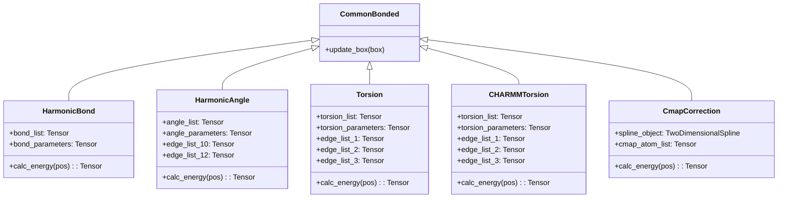

This page provides a comprehensive examination of bonded interactions in DIMOS—the covalent forces that define molecular structure through bond stretching, angle bending, and torsional rotation. These interactions form the backbone of classical molecular mechanics force fields and are computed independently of nonbonded interactions during each energy evaluation step.

## Architecture Overview

Bonded interactions in DIMOS follow a modular design pattern where each interaction type is encapsulated in a dedicated class inheriting from a common base. This architecture enables flexible combination of different bonded terms while maintaining a unified energy calculation interface. The system supports both standard periodic torsions and CHARMM-style harmonic torsions, along with specialized corrections like Urey-Bradley terms and CMAP (Correction Map) for improved protein backbone energetics.



The energy calculation workflow integrates these components through the `ClassicalParmedForceField` class, which aggregates all bonded force components into a unified `bonded_force_components` list [dimos/ff.py#L676-L701]. During energy evaluation, bonded terms are computed sequentially before nonbonded interactions, with optional force computation via automatic differentiation when gradients are required [dimos/ff.py#L513-L549].

Sources: [dimos/energy.py#L2125-L2141](dimos/energy.py#L2125-L2141), [dimos/ff.py#L676-L701](dimos/ff.py#L676-L701)

## Harmonic Bond Interactions

Harmonic bonds represent the stretching forces between covalently bonded atom pairs. DIMOS implements the standard harmonic potential form where the energy increases quadratically with displacement from the equilibrium bond length. This formulation is computationally efficient and provides accurate representation of bond vibrations near equilibrium geometries.

### Mathematical Formulation

The harmonic bond energy is calculated as:

**E_bond = Σ k_b (r - r₀)²**

Where:
- `k_b` is the bond force constant (energy/distance²)
- `r` is the instantaneous bond distance
- `r₀` is the equilibrium bond length

### Implementation Details

The `HarmonicBond` class requires two tensors as input: `bond_list` containing atom index pairs defining each bond, and `bond_parameters` containing the force constant and equilibrium distance for each bond [dimos/energy.py#L2248-L2252]. The energy calculation uses the `get_distances_edge_list` utility function to compute all bond distances in a single vectorized operation, applying periodic boundary conditions when specified.

```python
# Energy calculation implementation
distances = get_distances_edge_list(pos, self.bond_list, self.periodic, self.box)
return torch.sum(self.bond_parameters[:, 0] * (distances - self.bond_parameters[:, 1])**2)
```

This implementation leverages PyTorch's automatic differentiation capabilities, enabling efficient force computation through gradient calculation without requiring explicit force formulas. The bond exclusions generated during parameter extraction are later used for 1-4 nonbonded interaction scaling [dimos/ff.py#L676-L678].

Sources: [dimos/energy.py#L2228-L2281](dimos/energy.py#L2228-L2281), [dimos/ff.py#L1145-L1174](dimos/ff.py#L1145-L1174)

## Harmonic Angle Interactions

Angle interactions model the resistance to deformation of the angle formed by three consecutively bonded atoms. The harmonic angle potential restores the angle to its equilibrium value, playing a crucial role in maintaining local molecular geometry such as bond angles in water molecules or tetrahedral carbon centers.

### Mathematical Formulation

The harmonic angle energy follows a similar quadratic form:

**E_angle = Σ k_θ (θ - θ₀)²**

Where:
- `k_θ` is the angle force constant (energy/radian²)
- `θ` is the instantaneous bond angle in radians
- `θ₀` is the equilibrium angle in radians

### Geometric Calculation

The angle computation requires careful vector mathematics to handle periodic boundary conditions correctly. The `HarmonicAngle` class constructs two edge lists representing vectors from the central atom to each outer atom [dimos/energy.py#L2332-L2336]. The cosine of the angle is obtained through the dot product normalized by vector magnitudes, with clamping to ensure numerical stability:

```python
r_10 = get_distance_vectors(pos, self.edge_list_10, self.periodic, self.box)
r_12 = get_distance_vectors(pos, self.edge_list_12, self.periodic, self.box)

scalar_product = torch.linalg.vecdot(r_10, r_12, dim=1)
norm_10 = torch.linalg.vector_norm(r_10, dim=1)
norm_12 = torch.linalg.vector_norm(r_12, dim=1)

cos_argument = torch.clamp(scalar_product / (norm_10 * norm_12), -1, 1)
interaction_angle = torch.acos(cos_argument)
```

This approach ensures robust angle calculation even when atoms are near periodic box boundaries. The parameter extraction process converts equilibrium angles from degrees to radians during initialization [dimos/ff.py#L1136].

Sources: [dimos/energy.py#L2282-L2377](dimos/energy.py#L2282-L2377), [dimos/ff.py#L1104-L1143](dimos/ff.py#L1104-L1143)

## Periodic Torsion Interactions

Torsional interactions describe the rotational energy barriers around single bonds, determining conformational preferences and dihedral angle distributions. DIMOS supports the standard Fourier series formulation used in most classical force fields, enabling accurate representation of rotational barriers with multiple minima.

### Mathematical Formulation

The periodic torsion energy is expressed as:

**E_torsion = Σ k_φ [1 + cos(nφ - δ)]**

Where:
- `k_φ` is the torsional barrier height
- `n` is the multiplicity (number of energy minima per 360° rotation)
- `φ` is the dihedral angle in radians
- `δ` is the phase shift (determines the angle of energy minima)

Multiple torsion terms can be applied to the same dihedral, each with different parameters, to capture complex rotational profiles.

### Dihedral Angle Computation

The `Torsion` class calculates dihedral angles using three edge vectors representing bonds between consecutive atoms [dimos/energy.py#L2500-L2502]. The dihedral angle computation handles periodic boundary conditions by ensuring minimum-image conventions are applied to each bond vector.

```python
phi = get_dihedral_angle(pos, self.edge_list_1, self.edge_list_2, self.edge_list_3, self.periodic, self.box)

angle_diff = self.torsion_parameters[:, 1] * phi - self.torsion_parameters[:, 2]
energy_contrib = self.torsion_parameters[:, 0] * (1 + torch.cos(angle_diff))
return torch.sum(energy_contrib)
```

The parameter storage format for torsions includes the force constant, multiplicity, phase shift, and 1-4 electrostatic/Lennard-Jones scaling factors [dimos/ff.py#L1419-L1420]. These scaling factors are extracted and applied to nonbonded interactions for atom pairs separated by exactly three bonds.

Sources: [dimos/energy.py#L2457-L2534](dimos/energy.py#L2457-L2534), [dimos/ff.py#L1379-L1431](dimos/ff.py#L1379-L1431)

## CHARMM-Style Torsions and Improper Torsions

DIMOS supports both Amber and CHARMM force field conventions for torsional interactions. The key distinction lies in the treatment of improper torsions—dihedrals that maintain planarity or chirality rather than describing rotational preferences.

### CHARMM Harmonic Improper Torsions

CHARMM force fields use a harmonic form for improper torsions:

**E_improper = k_χ (χ - χ₀)²**

Where `χ` is the improper dihedral angle and `χ₀` is the target angle (typically 0° or 180°). The `CHARMMTorsion` class implements this form [dimos/energy.py#L2379-L2454], distinguishing it from the periodic `Torsion` class used for proper dihedrals.

### Force Field Detection and Parameter Extraction

The force field type determines which torsion parameter extraction method is used. Amber force fields store improper torsions alongside proper torsions in the `dihedrals` list with an `improper` flag [dimos/ff.py#L1411-L1414], while Gromacs force fields separate proper dihedrals and impropers into distinct lists [dimos/ff.py#L1477-L1510].

The `ClassicalParmedForceField` initialization detects CHARMM force fields by checking for zero improper dihedrals in the standard list combined with explicit `impropers` entries, then instantiates the appropriate torsion class:

```python
if improper_list.size(0) > 0:
    if CHARMM:
        self.bonded_force_components.append(CHARMMTorsion(improper_list, impropers_parameters, self.periodic, self.box))
    else:
        self.bonded_force_components.append(Torsion(improper_list, impropers_parameters, self.periodic, self.box))
```

This flexibility allows DIMOS to handle both force field conventions seamlessly during system setup.

Sources: [dimos/energy.py#L2379-L2454](dimos/energy.py#L2379-L2454), [dimos/ff.py#L1434-L1521](dimos/ff.py#L1434-L1521)

## Urey-Bradley Terms

Urey-Bradley terms are additional bond interactions between atoms 1 and 3 in an angle (atoms that are not directly bonded but share a common neighbor). These cross-terms provide more accurate representation of angle-dependent bond length correlations, particularly important in systems with hydrogen bonding or specific angular geometries.

### Implementation Approach

DIMOS treats Urey-Bradley terms as harmonic bond interactions using the same `HarmonicBond` class, but with atom pairs extracted from a separate parameter list [dimos/ff.py#L680-L682]. The `get_urey_bradley` method extracts these terms from the ParmEd structure [dimos/ff.py#L1176-L1206], with the resulting force component appended alongside standard bonds in the energy calculation.

This design choice simplifies the codebase by reusing the well-tested harmonic bond implementation while maintaining clear semantic separation in parameter extraction. The Urey-Bradley terms contribute to both the total energy and force calculations, with their exclusions included in the overall exclusion list for nonbonded interaction handling.

Sources: [dimos/ff.py#L1176-L1206](dimos/ff.py#L1176-L1206), [dimos/ff.py#L680-L682](dimos/ff.py#L680-L682)

## CMAP Corrections

CMAP (Correction Map) provides 2D grid-based energy corrections for coupled backbone dihedral angles (φ/ψ) in proteins. This advanced feature improves the accuracy of protein secondary structure predictions by capturing correlations between adjacent dihedral angles that standard torsional terms cannot represent.

### Architecture and Implementation

The `CmapCorrection` class uses two-dimensional spline interpolation to evaluate correction energies based on coupled φ and ψ angles [dimos/energy.py#L2144-L2225]. Each CMAP term involves five atoms defining two consecutive dihedrals, with the correction energy added to the total bonded energy:

```python
phi = get_dihedral_angle(pos, self.edge_list_1_0, self.edge_list_2_0, self.edge_list_3_0, self.periodic, self.box)
psi = get_dihedral_angle(pos, self.edge_list_1_1, self.edge_list_2_1, self.edge_list_3_1, self.periodic, self.box)

energy = 0.0
for si, hi in zip(psi, phi):
    energy = energy + self.spline_object.evaluate_spline(si, hi)
```

> [!TIP]
> CMAP corrections are currently an experimental feature in DIMOS. While functional, they have not undergone comprehensive validation and should be used with caution. Compare results against established implementations when employing CMAP for production simulations.

The implementation uses spline interpolation over a user-defined resolution grid, with periodic boundary conditions in both dihedral dimensions to maintain continuity at the wrap-around points.

Sources: [dimos/energy.py#L2144-L2225](dimos/energy.py#L2144-L2225), [dimos/ff.py#L699-L701](dimos/ff.py#L699-L701)

## Bonded Interaction Summary

| Interaction Type | Energy Formula | Parameters | Class Name | Typical Applications |
|---|---|---|---|---|
| Harmonic Bond | k(r - r₀)² | k, r₀ | `HarmonicBond` | Covalent bond stretching |
| Harmonic Angle | k(θ - θ₀)² | k, θ₀ | `HarmonicAngle` | Bond angle bending |
| Periodic Torsion | k[1 + cos(nφ - δ)] | k, n, δ | `Torsion` | Bond rotation (Amber/Gromacs) |
| Harmonic Torsion | k(φ - φ₀)² | k, φ₀ | `CHARMMTorsion` | Improper torsions (CHARMM) |
| Urey-Bradley | k(r - r₀)² | k, r₀ | `HarmonicBond` | 1-3 distance correlations |
| CMAP | E(φ,ψ) from grid | 2D spline | `CmapCorrection` | Protein backbone corrections |

All bonded interaction classes share the `CommonBonded` interface, ensuring consistent behavior for periodic boundary condition updates [dimos/energy.py#L2125-L2141]. The force field initialization process automatically selects and instantiates the appropriate combination of bonded terms based on the input force file format and detected force field characteristics.

Sources: [dimos/energy.py#L2228-L2534](dimos/energy.py#L2228-L2534)

## Integration with Force Field System

The bonded interaction system integrates seamlessly with DIMOS's broader force field architecture. During `ClassicalParmedForceField` initialization, bonded parameters are extracted from the ParmEd structure through specialized methods that handle force field format differences [dimos/ff.py#L676-L701].

### Parameter Extraction Pipeline

1. **Bond parameters**: Extracted via `get_bond_parameters`, returning atom pairs, force constants, and equilibrium distances [dimos/ff.py#L1145-L1174]
2. **Angle parameters**: Extracted via `get_angle_parameters`, including angle exclusion lists for nonbonded scaling [dimos/ff.py#L1104-L1143]
3. **Torsion parameters**: Format-specific extraction in `AmberForceField` or `GromacsForceField` subclasses [dimos/ff.py#L1379-L1521]
4. **Exclusion aggregation**: All bonded exclusions combined for 1-4 scaling decisions [dimos/ff.py#L705]

### Energy Calculation Order

The energy calculation sequence ensures bonded terms are evaluated before nonbonded interactions:

1. Loop through `bonded_force_components` and compute each energy contribution
2. Optionally print individual energy components for debugging
3. Compute nonbonded interactions with or without neighbor lists
4. Apply collective variable forces if present
5. Compute forces via automatic differentiation when required

This ordering is maintained in the `calc_energy` method of `MinimalSystem` [dimos/ff.py#L486-L549], with bonded energies contributing to the total energy sum that feeds into force calculations through PyTorch's autograd system.

Sources: [dimos/ff.py#L676-L701](dimos/ff.py#L676-L701), [dimos/ff.py#L486-L549](dimos/ff.py#L486-L549)

## Practical Considerations

When working with bonded interactions in DIMOS, several important factors affect simulation accuracy and performance:

### Periodic Boundary Conditions

All bonded interaction classes support periodic boundary conditions through box parameters passed during initialization. The utility functions `get_distances_edge_list`, `get_distance_vectors`, and `get_dihedral_angle` handle minimum-image conventions automatically, ensuring correct distance and angle calculations across periodic boundaries [dimos/utils.py#L417-L587].

### Constraint Integration

Bonded parameters interact with the constraint system through the `excluded_bonded_atoms` mechanism. When constraints are active (such as SETTLE for water molecules), constrained bonds and angles can be excluded from the bonded force calculations to avoid redundant computations and potential double-counting [dimos/ff.py#L1329-L1333].

### Numerical Stability

The angle calculation includes clamping of the cosine argument to [-1, 1] before taking the arccosine, preventing numerical errors from floating-point imprecision [dimos/energy.py#L2371]. Similarly, the torsion calculation ensures robust handling of edge cases where vectors become collinear or nearly collinear.

### Performance Considerations

Bonded interactions scale linearly with the number of bonds, angles, and torsions in the system, making them generally efficient compared to nonbonded O(N²) interactions. However, very large biomolecules may benefit from constraint algorithms like CCMA (Constant Constraint Matrix Approximation) to reduce the computational overhead of angle terms [dimos/constraints.py#L658-L914].

Sources: [dimos/utils.py#L417-L587](dimos/utils.py#L417-L587), [dimos/constraints.py#L658-L914](dimos/constraints.py#L658-L914)

## Next Steps

To deepen your understanding of DIMOS's energy calculation framework:

- Explore [Nonbonded Interactions: Lennard-Jones Potentials](7-nonbonded-interactions-lennard-jones-potentials) to understand how bonded exclusions affect van der Waals calculations
- Review [Nonbonded Interactions: Electrostatics Methods](8-nonbonded-interactions-electrostatics-methods) for details on 1-4 scaling factors extracted from torsion parameters
- Examine [Force Field Systems Architecture](6-force-field-systems-architecture) for the broader context of how bonded interactions fit within the complete force field system
- Consult [Constraint Handling Algorithms](25-constraint-handling-algorithms) to understand how constraints interact with bonded terms in practice

These interconnected documentation pages provide comprehensive coverage of DIMOS's energy calculation infrastructure, from the individual bonded interaction terms discussed here to their integration with nonbonded forces and advanced sampling methods.