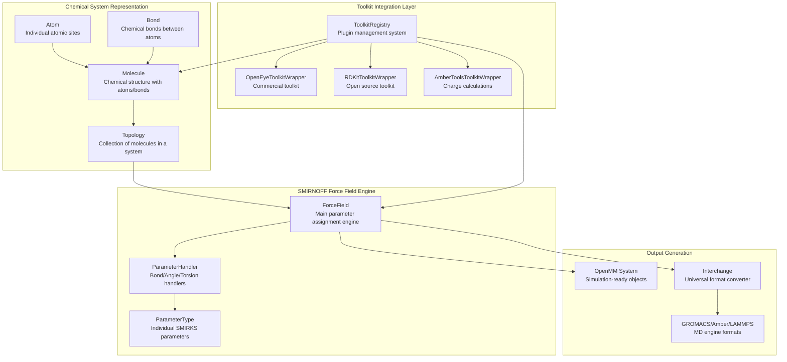
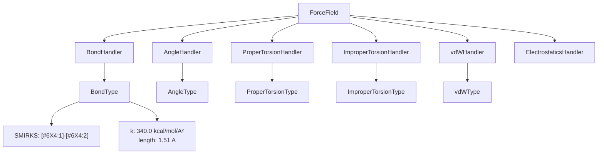
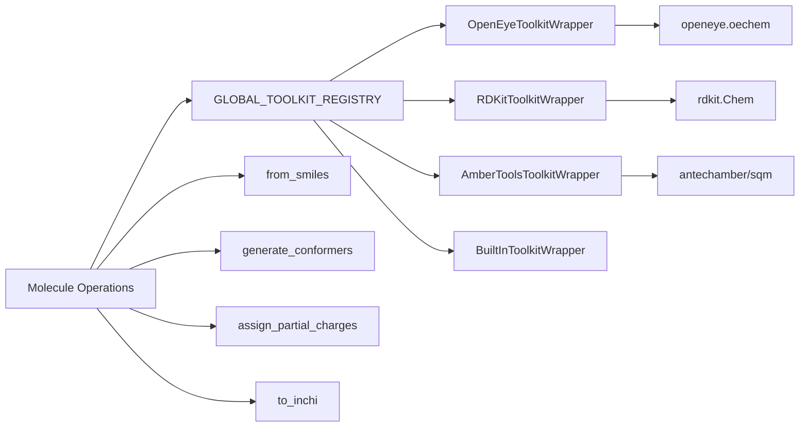
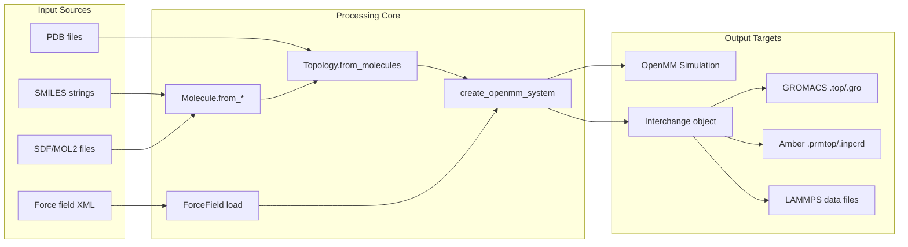
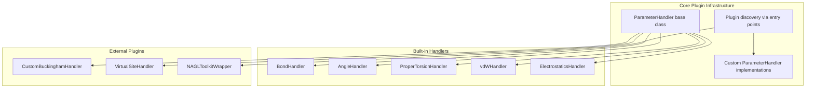

# Overview

Relevant source files

The following files were used as context for generating this wiki page:

- [.pre-commit-config.yaml](.pre-commit-config.yaml)
- [.readthedocs.yaml](.readthedocs.yaml)
- [MANIFEST.in](MANIFEST.in)
- [README.md](README.md)
- [docs/releasehistory.md](docs/releasehistory.md)
- [openff/toolkit/__init__.py](openff/toolkit/__init__.py)
- [openff/toolkit/_tests/test_toolkits.py](openff/toolkit/_tests/test_toolkits.py)
- [openff/toolkit/_tests/test_topology.py](openff/toolkit/_tests/test_topology.py)
- [openff/toolkit/topology/molecule.py](openff/toolkit/topology/molecule.py)
- [openff/toolkit/topology/topology.py](openff/toolkit/topology/topology.py)
- [openff/toolkit/typing/engines/smirnoff/forcefield.py](openff/toolkit/typing/engines/smirnoff/forcefield.py)
- [openff/toolkit/typing/engines/smirnoff/io.py](openff/toolkit/typing/engines/smirnoff/io.py)
- [openff/toolkit/typing/engines/smirnoff/parameters.py](openff/toolkit/typing/engines/smirnoff/parameters.py)
- [openff/toolkit/utils/callback.py](openff/toolkit/utils/callback.py)
- [openff/toolkit/utils/collections.py](openff/toolkit/utils/collections.py)
- [openff/toolkit/utils/exceptions.py](openff/toolkit/utils/exceptions.py)
- [openff/toolkit/utils/openeye_wrapper.py](openff/toolkit/utils/openeye_wrapper.py)
- [openff/toolkit/utils/rdkit_wrapper.py](openff/toolkit/utils/rdkit_wrapper.py)
- [openff/toolkit/utils/serialization.py](openff/toolkit/utils/serialization.py)
- [openff/toolkit/utils/toolkits.py](openff/toolkit/utils/toolkits.py)
- [openff/toolkit/utils/utils.py](openff/toolkit/utils/utils.py)
- [setup.cfg](setup.cfg)

This document provides a comprehensive overview of the OpenFF toolkit repository architecture, core components, and system design. The OpenFF toolkit is a Python library for developing and applying modern molecular mechanics force fields using the SMIRNOFF (SMIRKS Native Open Force Field) specification.

For information about specific usage patterns and examples, see [User Guide](#3). For development workflows and contribution guidelines, see [Development](#4).

## Purpose and Scope

The OpenFF toolkit serves as the foundational software infrastructure for the Open Force Field Initiative, providing tools for:

- **Chemical system representation** through `Molecule` and `Topology` classes
- **Force field parameter assignment** using SMIRNOFF format via `ForceField` engine
- **Cheminformatics toolkit integration** through a plugin-based `ToolkitRegistry` system
- **Multi-format output generation** supporting OpenMM, GROMACS, Amber, and LAMMPS

The toolkit focuses on direct chemical perception using SMIRKS patterns rather than traditional atom typing, enabling more flexible and extensible force field development.

Sources: [README.md:8-15](), [openff/toolkit/__init__.py:1-4]()

## Core System Architecture

Sources: [openff/toolkit/topology/molecule.py:865-870](), [openff/toolkit/topology/topology.py:394-431](), [openff/toolkit/typing/engines/smirnoff/forcefield.py:137-223](), [openff/toolkit/utils/toolkits.py:101-110]()

## Core Components

### Chemical System Representation

The toolkit's foundation consists of classes for representing molecular systems:

| Component | Class | Purpose | Key Methods |
|-----------|-------|---------|-------------|
| **Chemical Entity** | `Molecule` | Immutable molecular structure | `from_smiles()`, `from_file()`, `to_openmm()` |
| **System Container** | `Topology` | Collection of molecules | `from_molecules()`, `add_molecule()`, `from_pdb()` |
| **Atomic Sites** | `Atom` | Individual atoms with properties | `symbol`, `formal_charge`, `partial_charge` |
| **Connectivity** | `Bond` | Chemical bonds between atoms | `bond_order`, `is_aromatic`, `fractional_bond_order` |

Sources: [openff/toolkit/topology/molecule.py:865-1100](), [openff/toolkit/topology/topology.py:394-554]()

### SMIRNOFF Parameter System

The force field engine implements the SMIRNOFF specification through a hierarchical parameter system:

Each `ParameterHandler` manages a specific force field term type (bonds, angles, torsions, etc.) and contains `ParameterType` objects that define SMIRKS patterns and associated physical parameters.

Sources: [openff/toolkit/typing/engines/smirnoff/parameters.py:1-54](), [openff/toolkit/typing/engines/smirnoff/forcefield.py:137-292]()

### Toolkit Integration Architecture

The toolkit integrates external cheminformatics libraries through a plugin-based registry system:

The `GLOBAL_TOOLKIT_REGISTRY` maintains precedence order and automatically falls back to available toolkits when methods are called.

Sources: [openff/toolkit/utils/toolkits.py:101-159](), [openff/toolkit/utils/openeye_wrapper.py:88-162](), [openff/toolkit/utils/rdkit_wrapper.py:73-132]()

## Data Flow and Processing Pipeline

The typical workflow involves creating `Molecule` objects from chemical representations, assembling them into a `Topology`, loading force field parameters via `ForceField`, and generating simulation-ready outputs through either direct OpenMM `System` creation or via `Interchange` for other MD engines.

Sources: [openff/toolkit/topology/molecule.py:1200-1400](), [openff/toolkit/topology/topology.py:525-554](), [openff/toolkit/typing/engines/smirnoff/forcefield.py:700-900]()

## Plugin and Extension System

The toolkit's extensibility is enabled through entry point-based plugin discovery:

Plugin registration occurs through setuptools entry points in the `openff.toolkit.parameter_handler_plugins` group, allowing external packages to extend the toolkit with custom force field terms.

Sources: [openff/toolkit/typing/engines/smirnoff/forcefield.py:70-96](), [openff/toolkit/typing/engines/smirnoff/parameters.py:2400-2500]()

---