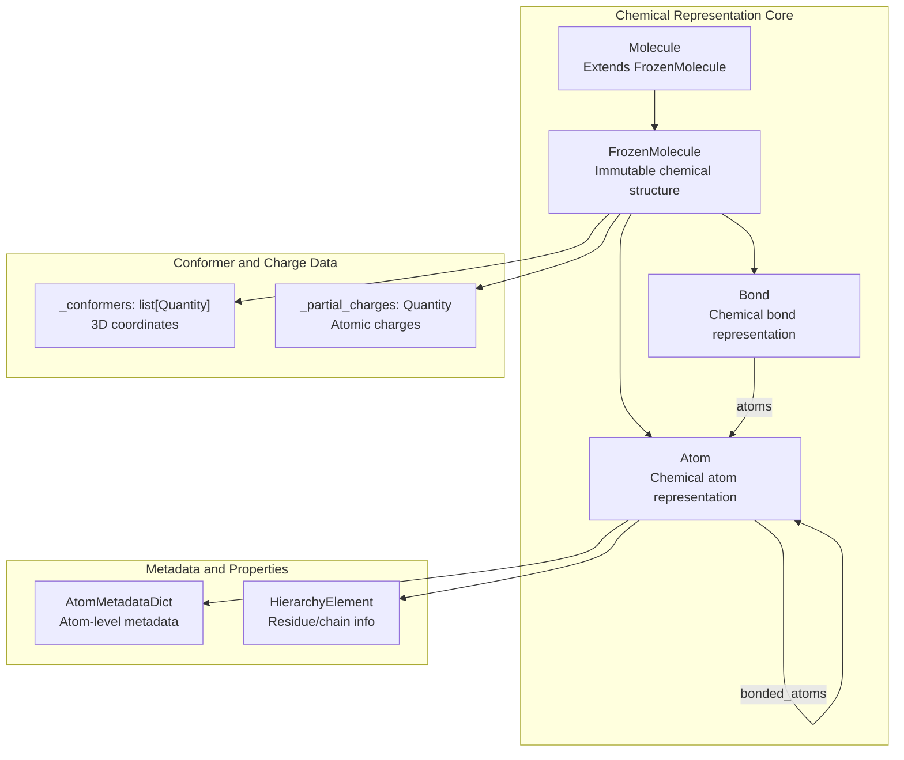
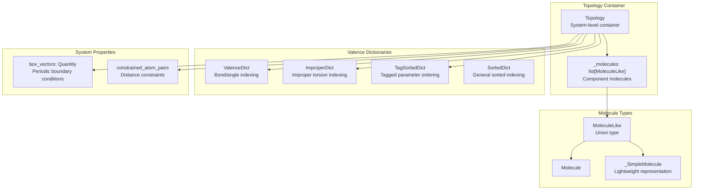
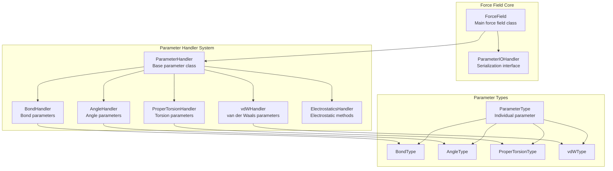
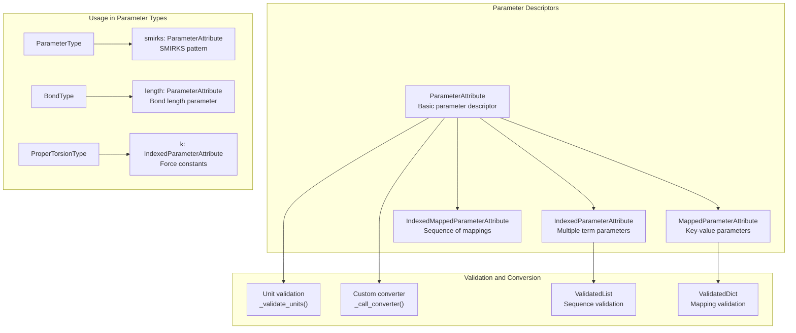
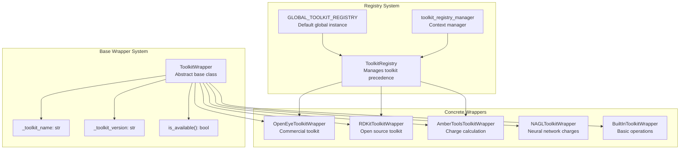
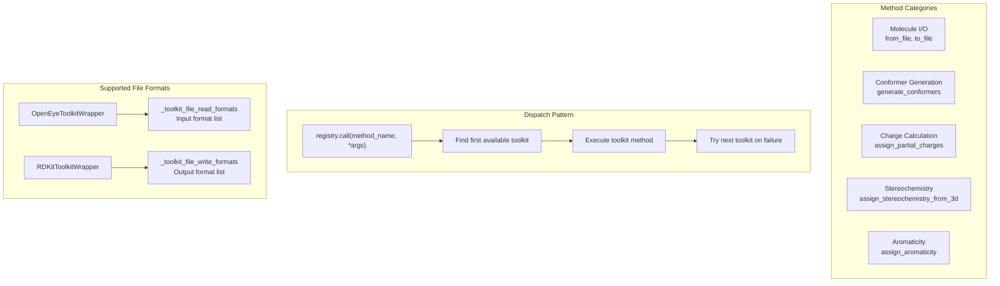
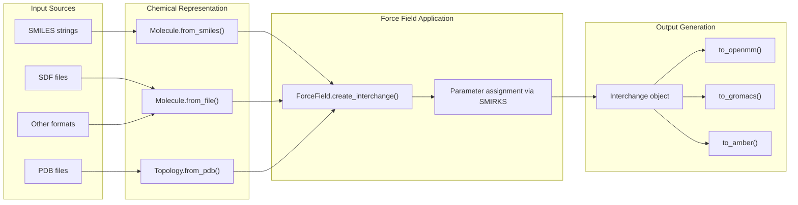
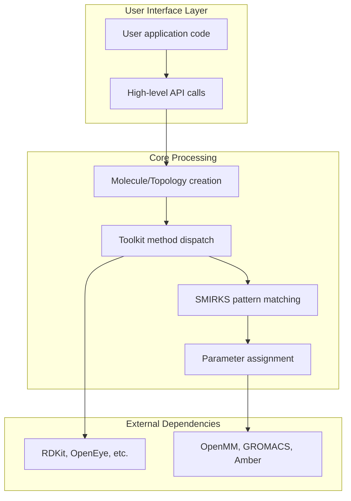

# Core Architecture

Relevant source files

The following files were used as context for generating this wiki page:

- [.pre-commit-config.yaml](.pre-commit-config.yaml)
- [The-SMIRNOFF-force-field-format.md](The-SMIRNOFF-force-field-format.md)
- [docs/releasehistory.md](docs/releasehistory.md)
- [openff/toolkit/_tests/test_toolkits.py](openff/toolkit/_tests/test_toolkits.py)
- [openff/toolkit/_tests/test_topology.py](openff/toolkit/_tests/test_topology.py)
- [openff/toolkit/topology/molecule.py](openff/toolkit/topology/molecule.py)
- [openff/toolkit/topology/topology.py](openff/toolkit/topology/topology.py)
- [openff/toolkit/typing/engines/smirnoff/forcefield.py](openff/toolkit/typing/engines/smirnoff/forcefield.py)
- [openff/toolkit/typing/engines/smirnoff/parameters.py](openff/toolkit/typing/engines/smirnoff/parameters.py)
- [openff/toolkit/utils/exceptions.py](openff/toolkit/utils/exceptions.py)
- [openff/toolkit/utils/openeye_wrapper.py](openff/toolkit/utils/openeye_wrapper.py)
- [openff/toolkit/utils/rdkit_wrapper.py](openff/toolkit/utils/rdkit_wrapper.py)
- [openff/toolkit/utils/serialization.py](openff/toolkit/utils/serialization.py)
- [openff/toolkit/utils/toolkits.py](openff/toolkit/utils/toolkits.py)
- [openff/toolkit/utils/utils.py](openff/toolkit/utils/utils.py)
- [setup.cfg](setup.cfg)

This document describes the fundamental architectural components of the OpenFF Toolkit and how they interact to provide force field parametrization capabilities. It covers the core data models for chemical representation, the SMIRNOFF force field engine, and the toolkit integration layer that enables interoperability with external cheminformatics libraries.

For information about specific parameter handlers and force field implementation details, see [SMIRNOFF Force Field System](#2.2). For toolkit wrapper implementations and usage patterns, see [Toolkit Integration System](#2.3).

## Core Chemical Representation System

The OpenFF Toolkit's chemical representation is built around three fundamental classes that form a hierarchical object model: `Molecule`, `Topology`, and their constituent `Atom` and `Bond` objects.

### Molecule and Atom/Bond Architecture

The `FrozenMolecule` class [openff/toolkit/topology/molecule.py:865-908]() serves as the immutable base class containing atoms, bonds, and molecular properties. The `Molecule` class extends this to provide mutable operations for building and modifying chemical structures.

### Topology System Architecture

The `Topology` class [openff/toolkit/topology/topology.py:394-431]() acts as a container for one or more molecules, managing system-level properties like periodic boundary conditions and constraints. It uses specialized dictionary classes to efficiently handle valence term indexing with proper symmetry considerations.

Sources: [openff/toolkit/topology/molecule.py:865-908](), [openff/toolkit/topology/topology.py:394-431](), [openff/toolkit/topology/topology.py:160-392]()

## SMIRNOFF Force Field Engine

The SMIRNOFF force field system implements a modular, plugin-based architecture for parameter assignment using SMIRKS pattern matching.

### ForceField and ParameterHandler Architecture

The `ForceField` class [openff/toolkit/typing/engines/smirnoff/forcefield.py:137-223]() serves as the main entry point for SMIRNOFF parameter assignment. It manages a collection of `ParameterHandler` objects that each handle specific types of interactions through SMIRKS pattern matching.

### Parameter Attribute System

The parameter system uses descriptor classes [openff/toolkit/typing/engines/smirnoff/parameters.py:225-436]() to provide automatic unit validation, type conversion, and constraints on parameter values.

Sources: [openff/toolkit/typing/engines/smirnoff/forcefield.py:137-223](), [openff/toolkit/typing/engines/smirnoff/parameters.py:225-436](), [openff/toolkit/typing/engines/smirnoff/parameters.py:438-585]()

## Toolkit Integration Layer

The toolkit integration system provides a unified interface to multiple cheminformatics libraries through a registry pattern and wrapper classes.

### ToolkitRegistry and Wrapper Architecture

The `ToolkitRegistry` class [openff/toolkit/utils/toolkit_registry.py]() manages the precedence order of available toolkits and dispatches method calls to the first capable toolkit. The `GLOBAL_TOOLKIT_REGISTRY` [openff/toolkit/utils/toolkits.py:102-110]() provides a default instance used throughout the codebase.

### Toolkit Method Dispatch

Each toolkit wrapper implements a standard interface for common operations, with the registry automatically selecting the appropriate toolkit based on availability and method support.

Sources: [openff/toolkit/utils/toolkits.py:102-110](), [openff/toolkit/utils/openeye_wrapper.py:89-227](), [openff/toolkit/utils/rdkit_wrapper.py:73-132]()

## Data Flow and System Integration

The OpenFF Toolkit follows a clear data flow from input molecular representations through force field parametrization to simulation-ready output.

### Parametrization Pipeline

### Component Interaction Flow

The system maintains clear separation between chemical representation, force field logic, and external toolkit integration, enabling modularity and extensibility while providing a unified user interface.

Sources: [openff/toolkit/topology/molecule.py:865-908](), [openff/toolkit/typing/engines/smirnoff/forcefield.py:137-223](), [openff/toolkit/utils/toolkits.py:102-110]()

---