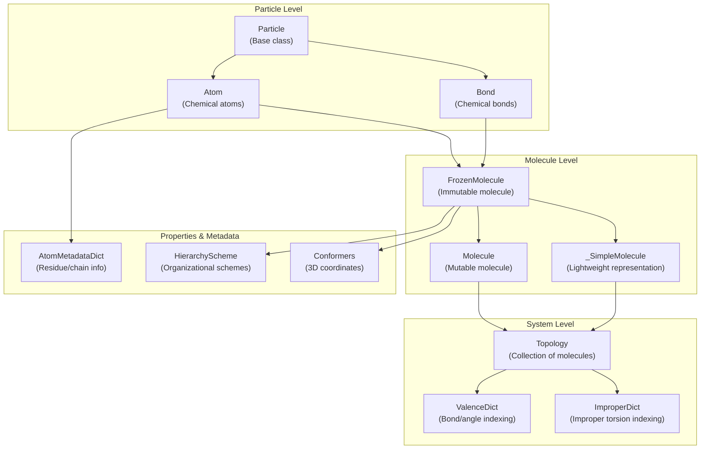
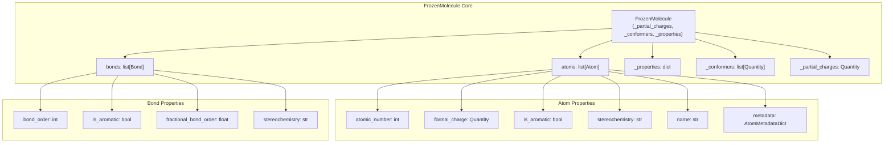
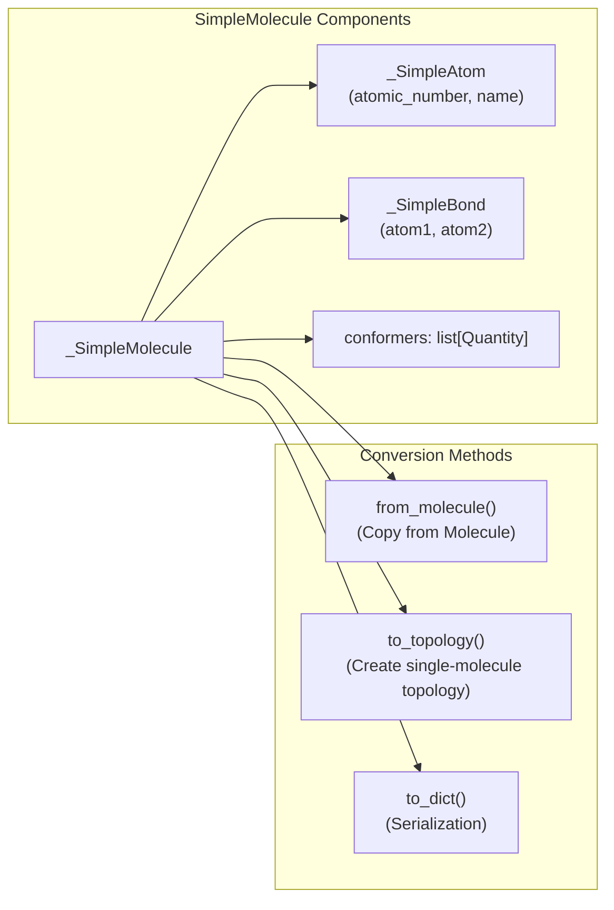
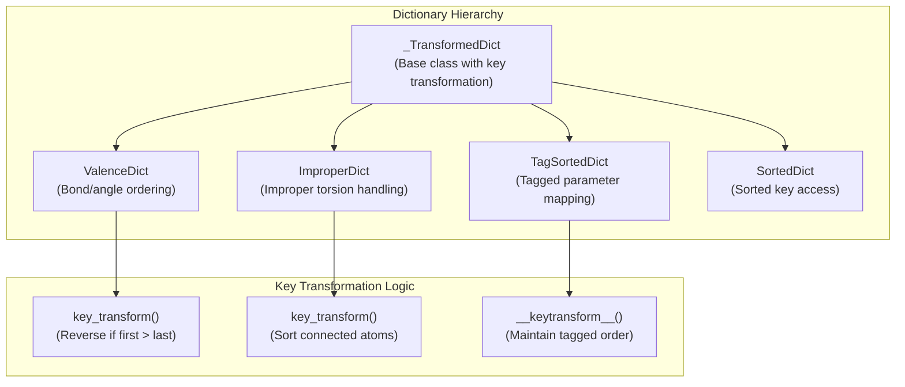
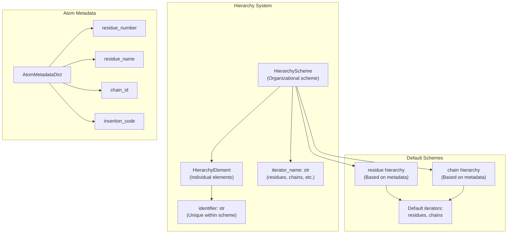
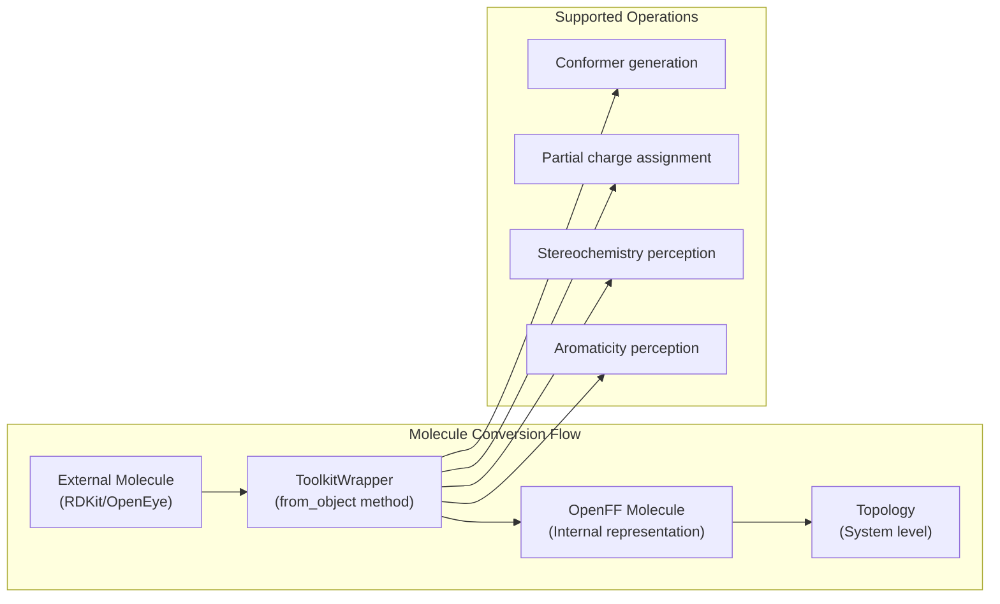

# Molecule and Topology System

Relevant source files

The following files were used as context for generating this wiki page:

- [.pre-commit-config.yaml](.pre-commit-config.yaml)
- [docs/releasehistory.md](docs/releasehistory.md)
- [openff/toolkit/_tests/_stale_tests.py](openff/toolkit/_tests/_stale_tests.py)
- [openff/toolkit/_tests/test_energies.py](openff/toolkit/_tests/test_energies.py)
- [openff/toolkit/_tests/test_examples.py](openff/toolkit/_tests/test_examples.py)
- [openff/toolkit/_tests/test_links.py](openff/toolkit/_tests/test_links.py)
- [openff/toolkit/_tests/test_mm_molecule.py](openff/toolkit/_tests/test_mm_molecule.py)
- [openff/toolkit/_tests/test_nagl.py](openff/toolkit/_tests/test_nagl.py)
- [openff/toolkit/_tests/test_toolkits.py](openff/toolkit/_tests/test_toolkits.py)
- [openff/toolkit/_tests/test_topology.py](openff/toolkit/_tests/test_topology.py)
- [openff/toolkit/_tests/test_utils_serialization.py](openff/toolkit/_tests/test_utils_serialization.py)
- [openff/toolkit/_tests/utils.py](openff/toolkit/_tests/utils.py)
- [openff/toolkit/topology/_mm_molecule.py](openff/toolkit/topology/_mm_molecule.py)
- [openff/toolkit/topology/molecule.py](openff/toolkit/topology/molecule.py)
- [openff/toolkit/topology/topology.py](openff/toolkit/topology/topology.py)
- [openff/toolkit/typing/engines/smirnoff/forcefield.py](openff/toolkit/typing/engines/smirnoff/forcefield.py)
- [openff/toolkit/typing/engines/smirnoff/parameters.py](openff/toolkit/typing/engines/smirnoff/parameters.py)
- [openff/toolkit/utils/exceptions.py](openff/toolkit/utils/exceptions.py)
- [openff/toolkit/utils/nagl_wrapper.py](openff/toolkit/utils/nagl_wrapper.py)
- [openff/toolkit/utils/openeye_wrapper.py](openff/toolkit/utils/openeye_wrapper.py)
- [openff/toolkit/utils/rdkit_wrapper.py](openff/toolkit/utils/rdkit_wrapper.py)
- [openff/toolkit/utils/serialization.py](openff/toolkit/utils/serialization.py)
- [openff/toolkit/utils/toolkits.py](openff/toolkit/utils/toolkits.py)
- [openff/toolkit/utils/utils.py](openff/toolkit/utils/utils.py)
- [setup.cfg](setup.cfg)

This document covers the core molecular representation and system modeling components of the OpenFF toolkit. The Molecule and Topology system provides the fundamental data structures for representing individual molecules and larger chemical systems containing multiple molecules. This includes atomic and bond connectivity, molecular properties, hierarchical organization (residues, chains), and integration with cheminformatics toolkits.

For information about force field parameter assignment to these molecular systems, see [SMIRNOFF Force Field System](#2.2). For toolkit integration details, see [Toolkit Integration System](#2.3).

## Core Architecture

The system is built around a hierarchical set of classes that represent chemical systems at different levels of granularity:

**Sources:** [openff/toolkit/topology/molecule.py:120-865](), [openff/toolkit/topology/topology.py:394-431](), [openff/toolkit/topology/_mm_molecule.py:38-44]()

## Molecule Representation System

### Core Molecule Classes

The molecule representation system uses a composition-based approach where molecules contain atoms and bonds as distinct objects:

**Sources:** [openff/toolkit/topology/molecule.py:915-964](), [openff/toolkit/topology/molecule.py:208-588](), [openff/toolkit/topology/molecule.py:649-858]()

### Molecule Creation and Manipulation

The `Molecule` class provides multiple factory methods for creating molecular objects from different sources:

| Creation Method | Purpose | Key Parameters |
|----------------|---------|----------------|
| `from_smiles()` | Create from SMILES string | `smiles`, `allow_undefined_stereo`, `toolkit_registry` |
| `from_file()` | Load from molecular file formats | `file_path`, `file_format`, `toolkit_registry` |
| `from_rdkit()` | Convert from RDKit molecule | `rdmol`, `allow_undefined_stereo`, `hydrogens_are_explicit` |
| `from_openeye()` | Convert from OpenEye molecule | `oemol`, `allow_undefined_stereo` |
| `from_polymer_pdb()` | Load protein from PDB | `file_path`, Includes residue perception |

**Sources:** [openff/toolkit/topology/molecule.py:1238-1399](), [openff/toolkit/topology/molecule.py:1541-1616](), [openff/toolkit/topology/molecule.py:2485-2619]()

### SimpleMolecule System

The `_SimpleMolecule` class provides a lightweight alternative representation for specific use cases:

**Sources:** [openff/toolkit/topology/_mm_molecule.py:38-159](), [openff/toolkit/topology/_mm_molecule.py:469-481]()

## Topology System

### Topology Structure

The `Topology` class represents complete chemical systems containing multiple molecules:

```mermaid
graph TB
    subgraph "Topology Core"
        TopologyClass["Topology"]
        MoleculeList["_molecules: list[MoleculeLike]"]
        BoxVectors["_box_vectors: Quantity"]
        Constraints["_constrained_atom_pairs: dict"]
        AromaticityModel["_aromaticity_model: str"]
    end
    
    subgraph "Molecule Management"
        AddMolecule["add_molecule()<br/>(Returns molecule index)"]
        AddMolecules["add_molecules()<br/>(Batch addition)"]
        UniqueMolecules["unique_molecules<br/>(Property)"]
        IdenticalGroups["identical_molecule_groups<br/>(Property)"]
    end
    
    subgraph "System Properties"
        Periodic["is_periodic: bool"]
        NAtoms["n_atoms: int"]
        NBonds["n_bonds: int"]
        NMolecules["n_molecules: int"]
    end
    
    TopologyClass --> MoleculeList
    TopologyClass --> BoxVectors
    TopologyClass --> Constraints
    TopologyClass --> AromaticityModel
    
    TopologyClass --> AddMolecule
    TopologyClass --> AddMolecules
    TopologyClass --> UniqueMolecules
    TopologyClass --> IdenticalGroups
    
    TopologyClass --> Periodic
    TopologyClass --> NAtoms
    TopologyClass --> NBonds
    TopologyClass --> NMolecules
```

**Sources:** [openff/toolkit/topology/topology.py:394-460](), [openff/toolkit/topology/topology.py:689-713](), [openff/toolkit/topology/topology.py:1250-1312]()

### Topology Creation Methods

| Factory Method | Purpose | Key Parameters |
|---------------|---------|----------------|
| `from_molecules()` | Create from molecule list | `molecules` |
| `from_openmm()` | Convert from OpenMM topology | `openmm_topology`, `unique_molecules` |
| `from_mdtraj()` | Convert from MDTraj topology | `mdtraj_topology`, `unique_molecules` |
| `from_pdb()` | Load directly from PDB file | `file_path`, `_custom_substructures` |

**Sources:** [openff/toolkit/topology/topology.py:525-553](), [openff/toolkit/topology/topology.py:1618-1730](), [openff/toolkit/topology/topology.py:1970-2025]()

## Connectivity and Valence Handling

### Specialized Dictionary Classes

The system uses several specialized dictionary classes to handle molecular connectivity efficiently:

**Sources:** [openff/toolkit/topology/topology.py:95-131](), [openff/toolkit/topology/topology.py:160-211](), [openff/toolkit/topology/topology.py:330-391](), [openff/toolkit/topology/topology.py:235-328]()

### Valence Term Indexing

Each dictionary class provides specialized indexing for different types of molecular connectivity:

| Dictionary Type | Use Case | Key Format | Ordering Rule |
|----------------|----------|------------|---------------|
| `ValenceDict` | Bonds, angles | `(atom1, atom2)` | Reverse if first > last |
| `ImproperDict` | Improper torsions | `(atom1, center, atom3, atom4)` | Sort connected atoms, preserve center |
| `TagSortedDict` | Tagged parameters | `(atom1, atom2, ...)` | Maintain original tag order |

**Sources:** [openff/toolkit/topology/topology.py:163-170](), [openff/toolkit/topology/topology.py:334-347](), [openff/toolkit/topology/topology.py:274-328]()

## Hierarchy and Metadata Systems

### Hierarchy Schemes

The system supports hierarchical organization of atoms within molecules:

**Sources:** [openff/toolkit/topology/molecule.py:4840-4933](), [openff/toolkit/topology/molecule.py:4950-5050](), [openff/toolkit/topology/molecule.py:190-206]()

## Integration with External Systems

### Cheminformatics Toolkit Integration

The molecule and topology systems integrate seamlessly with external cheminformatics toolkits:

**Sources:** [openff/toolkit/topology/molecule.py:1541-1616](), [openff/toolkit/topology/molecule.py:1238-1326](), [openff/toolkit/utils/openeye_wrapper.py:279-325](), [openff/toolkit/utils/rdkit_wrapper.py:134-179]()

### Serialization and Persistence

The system provides comprehensive serialization capabilities:

| Format | Method | Use Case |
|--------|--------|----------|
| Dictionary | `to_dict()` / `from_dict()` | Internal serialization |
| JSON | `to_json()` / `from_json()` | Human-readable storage |
| File formats | `to_file()` / `from_file()` | Standard chemical formats |
| OpenMM | `to_openmm()` / `from_openmm()` | Simulation integration |

**Sources:** [openff/toolkit/topology/molecule.py:5565-5625](), [openff/toolkit/topology/topology.py:2892-2957](), [openff/toolkit/utils/serialization.py:23-122]()

---