# SMIRNOFF Force Field System

Relevant source files

The following files were used as context for generating this wiki page:

- [The-SMIRNOFF-force-field-format.md](The-SMIRNOFF-force-field-format.md)
- [docs/typing.rst](docs/typing.rst)
- [openff/toolkit/_tests/test_forcefield.py](openff/toolkit/_tests/test_forcefield.py)
- [openff/toolkit/_tests/test_molecule.py](openff/toolkit/_tests/test_molecule.py)
- [openff/toolkit/_tests/test_parameters.py](openff/toolkit/_tests/test_parameters.py)

## Purpose and Scope

The SMIRNOFF Force Field System is the core parameterization engine of the OpenFF toolkit, responsible for applying molecular mechanics parameters to chemical systems using SMIRKS-based pattern matching. This system implements the SMIRNOFF (SMIRks Native Open Force Field) specification, which uses chemical perception via SMIRKS patterns rather than atom types for parameter assignment.

This document covers the force field architecture, parameter handlers, SMIRKS pattern matching, and the parameter application process. For information about the underlying molecule and topology representations, see [Molecule and Topology System](#2.1). For details about cheminformatics toolkit integration, see [Toolkit Integration System](#2.3).

## Core Architecture

The SMIRNOFF system is built around three main components: the `ForceField` class that orchestrates parameter assignment, `ParameterHandler` classes that manage specific types of parameters, and `ParameterType` classes that represent individual parameter definitions.

### ForceField Class Structure

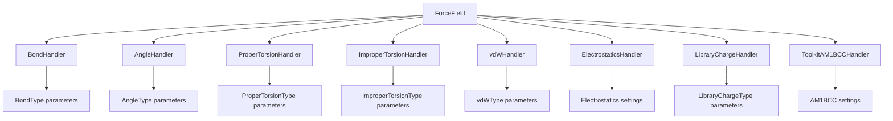

**Core ForceField Architecture**

The `ForceField` class serves as the central coordinator, maintaining a registry of `ParameterHandler` instances. Each handler manages parameters for a specific energy term (bonds, angles, etc.) and contains a list of `ParameterType` objects that define the actual parameter values and their associated SMIRKS patterns.

Sources: [openff/toolkit/_tests/test_forcefield.py:782-901](), [docs/typing.rst:16-31]()

### Parameter Handler Registration

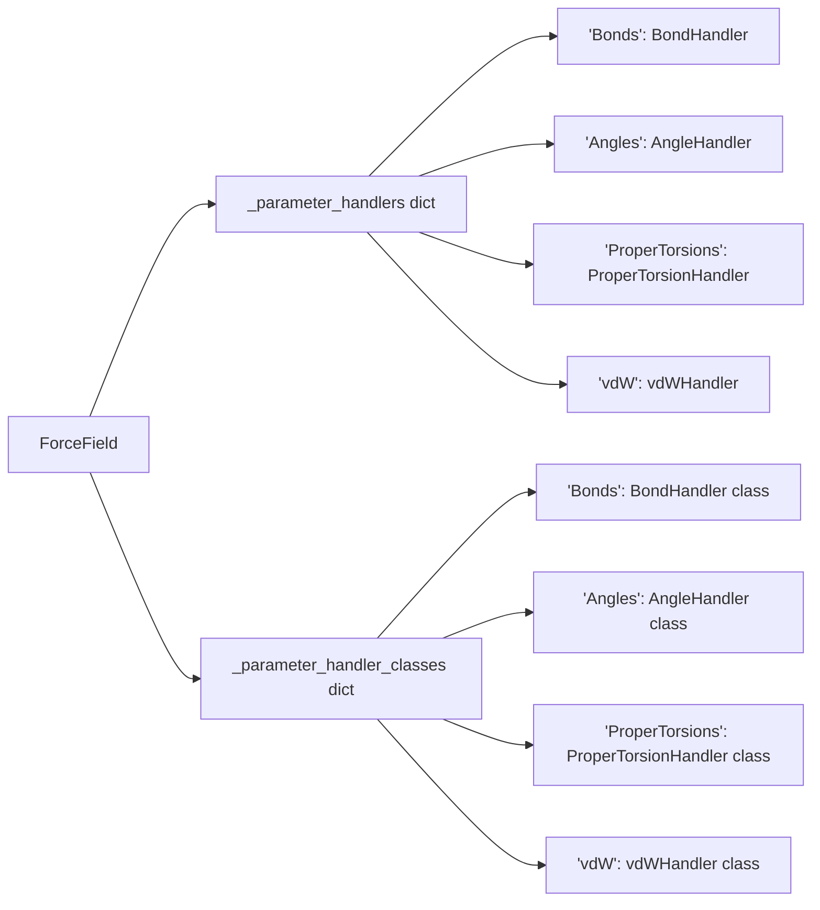

**Parameter Handler Registration System**

Parameter handlers are registered by their `TAGNAME` attribute and can be accessed using the `get_parameter_handler()` method or dictionary-style lookup. The force field maintains both handler instances and handler classes for dynamic instantiation.

Sources: [openff/toolkit/_tests/test_forcefield.py:653-683](), [openff/toolkit/_tests/test_forcefield.py:1672-1702]()

## SMIRKS Pattern Matching System

The SMIRNOFF system uses SMIRKS (SMILES arbitrary target specification) patterns to identify chemical environments for parameter assignment. Each parameter includes a SMIRKS pattern that defines which molecular substructures it applies to.

### Pattern Hierarchy and Precedence

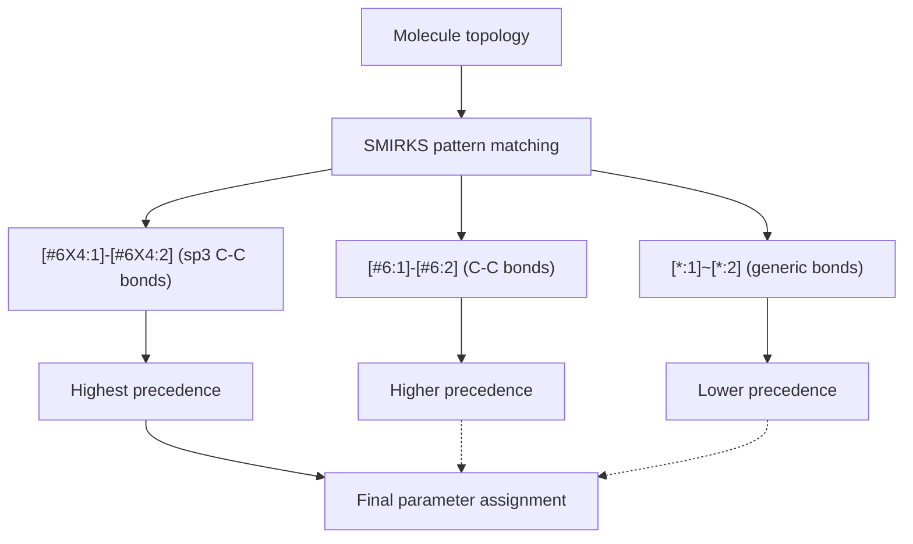

**SMIRKS Pattern Precedence System**

Parameters are applied in order of specificity, with more specific patterns overriding more general ones. The last matching parameter in the handler's parameter list is used for each chemical environment.

Sources: [openff/toolkit/_tests/test_forcefield.py:1725-1741](), [openff/toolkit/_tests/test_parameters.py:826-913]()

### Tagged Atom System

SMIRKS patterns use numbered tags (`:1`, `:2`, etc.) to identify specific atoms that receive parameters. Each parameter type defines how many tagged atoms it expects and what parameters apply to each.

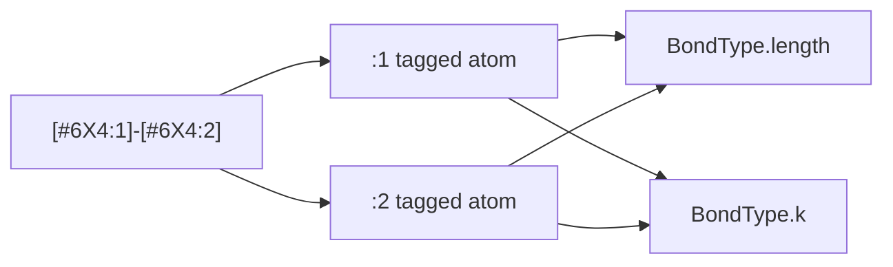

**Tagged Atom Parameter Assignment**

Sources: [openff/toolkit/_tests/test_parameters.py:1098-1140]()

## Parameter Types and Handlers

The SMIRNOFF system includes handlers for all major molecular mechanics energy terms, each with specialized parameter types and validation logic.

### Core Parameter Handlers

| Handler | Purpose | Parameter Attributes |
|---------|---------|---------------------|
| `BondHandler` | Harmonic bond potentials | `length`, `k`, bond order interpolation |
| `AngleHandler` | Harmonic angle potentials | `angle`, `k` |
| `ProperTorsionHandler` | Proper dihedral terms | `periodicity`, `phase`, `k`, `idivf` |
| `ImproperTorsionHandler` | Improper dihedral terms | `periodicity`, `phase`, `k`, `idivf` |
| `vdWHandler` | van der Waals parameters | `sigma`, `epsilon`, combining rules |
| `ElectrostaticsHandler` | Electrostatic settings | `method`, `cutoff`, scaling factors |

Sources: [docs/typing.rst:56-81](), [openff/toolkit/_tests/test_parameters.py:1183-1201]()

### Parameter Attributes and Validation

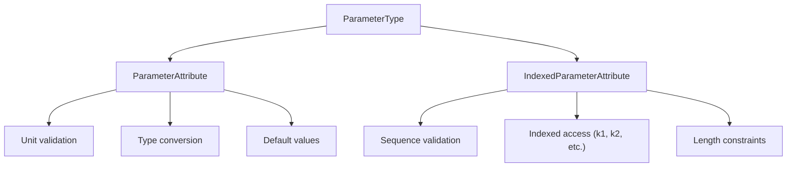

**Parameter Attribute System**

The `ParameterAttribute` and `IndexedParameterAttribute` descriptors provide automatic validation, unit checking, and type conversion for parameter values. Indexed attributes support multiple values (e.g., `k1`, `k2`, `k3` for torsions).

Sources: [openff/toolkit/_tests/test_parameters.py:52-181](), [openff/toolkit/_tests/test_parameters.py:184-267]()

### Advanced Parameter Features

#### Fractional Bond Order Interpolation

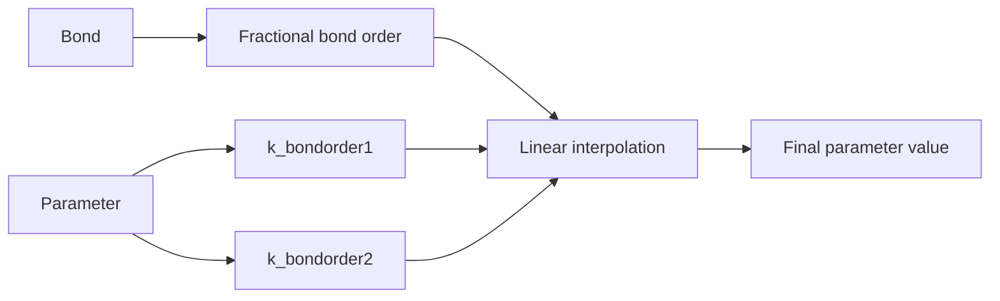

**Fractional Bond Order Parameter Interpolation**

Bond and torsion parameters can be interpolated based on fractional bond order values computed by quantum chemistry methods, allowing for more accurate representation of conjugated systems.

Sources: [openff/toolkit/_tests/test_parameters.py:269-322](), [openff/toolkit/_tests/test_forcefield.py:289-309]()

#### Charge Assignment Methods

The system supports multiple charge assignment methods:

- **Library charges**: Pre-computed charges for specific molecular fragments
- **Toolkit-based methods**: AM1-BCC, Gasteiger, etc. via external toolkits
- **Charge increment models**: Systematic charge adjustments based on chemical environment

Sources: [openff/toolkit/_tests/test_forcefield.py:1935-2023](), [openff/toolkit/_tests/test_forcefield.py:2084-2333]()

## Force Field Application Process

### Parameter Assignment Workflow

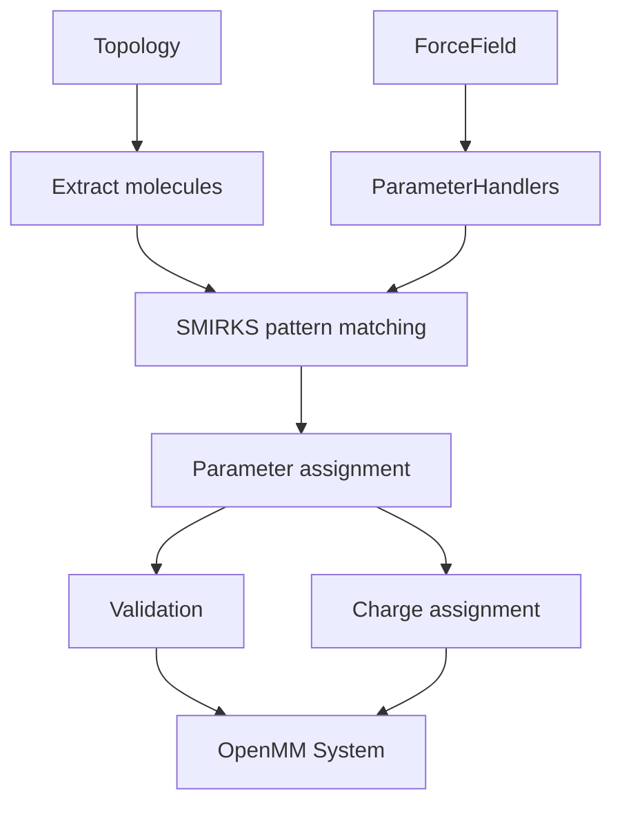

**Force Field Application Pipeline**

The `create_openmm_system()` method orchestrates the complete parameterization process, calling each registered parameter handler to assign parameters and generate the final OpenMM System object.

Sources: [openff/toolkit/_tests/test_forcefield.py:1284-1325]()

### Parameter Lookup and Precedence

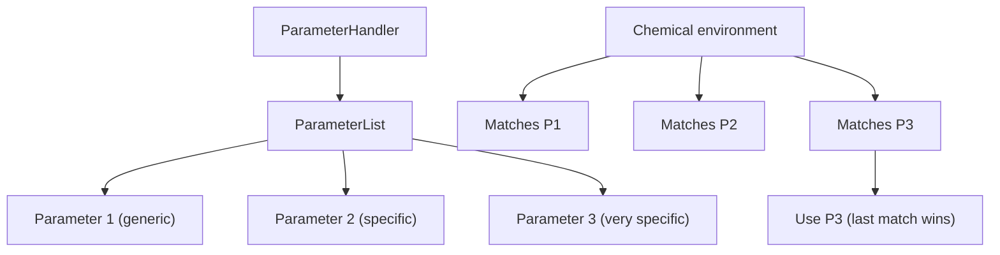

**Parameter Precedence Resolution**

When multiple parameters match the same chemical environment, the last (most specific) parameter in the list is used. This allows general parameters to be overridden by more specific ones.

Sources: [openff/toolkit/_tests/test_parameters.py:826-870]()

## File Format and I/O

### OFFXML Structure

The SMIRNOFF specification is implemented through OFFXML files with a hierarchical structure:

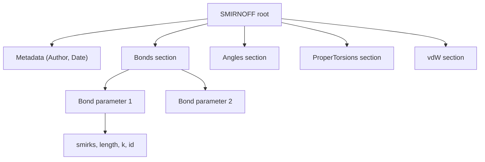

**OFFXML File Structure**

Each section corresponds to a parameter handler, and individual parameter elements contain SMIRKS patterns and parameter values with units.

Sources: [openff/toolkit/_tests/test_forcefield.py:64-194]()

### XML Serialization and Cosmetic Attributes

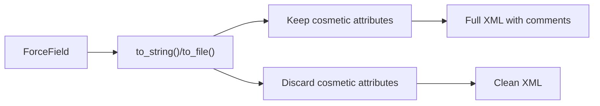

**XML Serialization Options**

The force field supports round-trip serialization with optional preservation of cosmetic attributes (comments, formatting, etc.) that don't affect parameterization but aid human readability.

Sources: [openff/toolkit/_tests/test_forcefield.py:1002-1056](), [openff/toolkit/_tests/test_forcefield.py:1159-1214]()

## Advanced Features

### Plugin System

The force field system supports dynamic loading of custom parameter handler plugins, allowing extension with new parameter types without modifying core code.

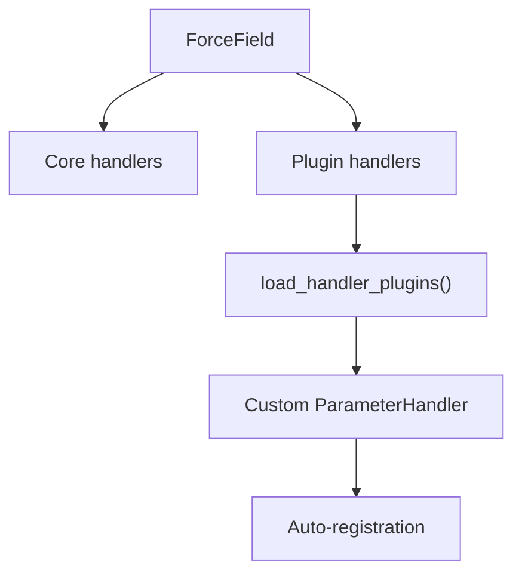

**Parameter Handler Plugin Architecture**

Sources: [openff/toolkit/_tests/test_forcefield.py:1911-1925]()

### Virtual Sites

The system supports virtual sites for representing lone pairs, bond charge sites, and other off-atom charge distributions.

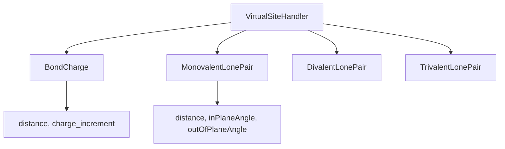

**Virtual Site Types**

Sources: [openff/toolkit/_tests/test_forcefield.py:437-661]()

### Version Management and Compatibility

The system includes comprehensive version checking for both the overall SMIRNOFF specification version and individual parameter handler section versions.

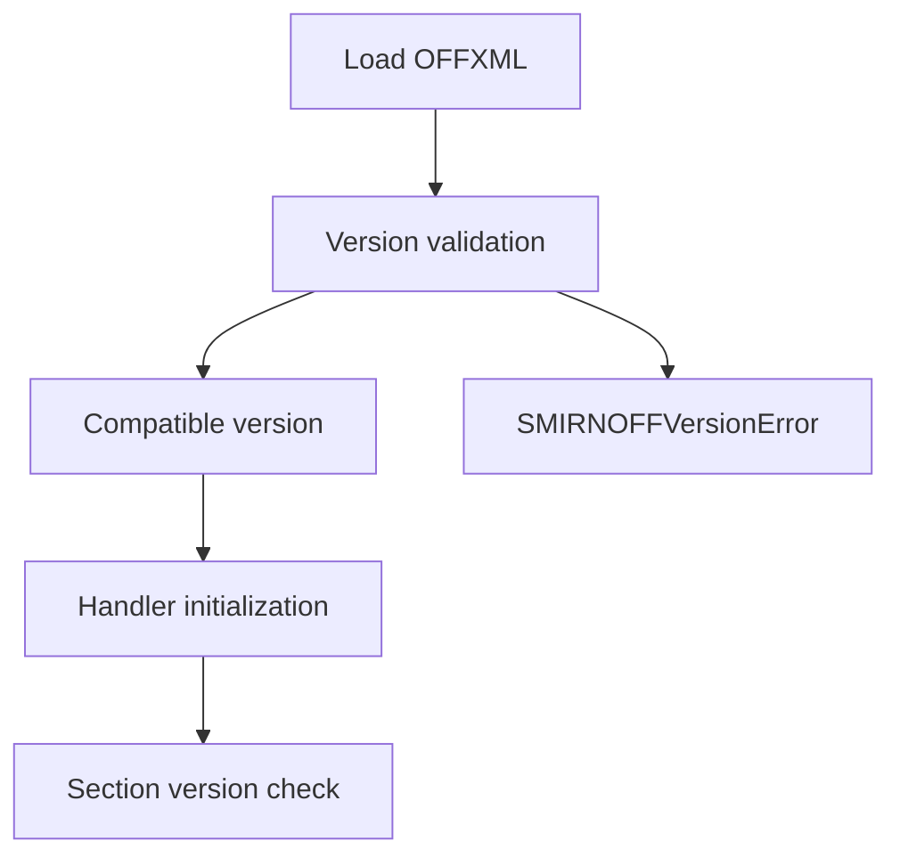

**Version Validation System**

Sources: [openff/toolkit/_tests/test_parameters.py:657-708](), [openff/toolkit/_tests/test_forcefield.py:842-854]()

---