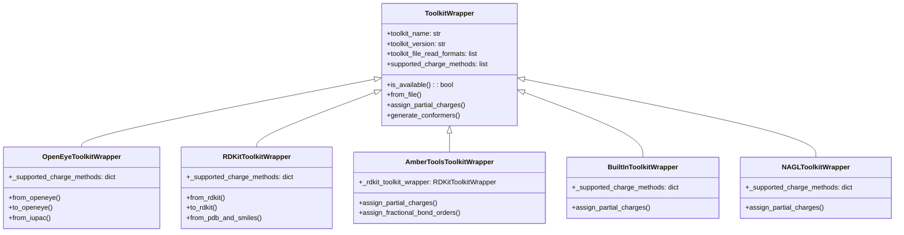
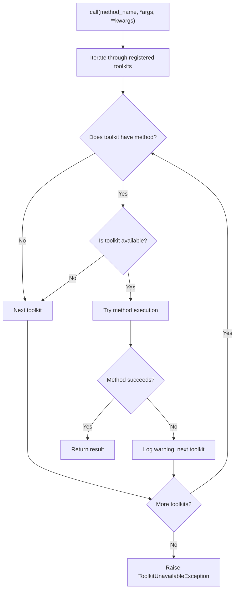
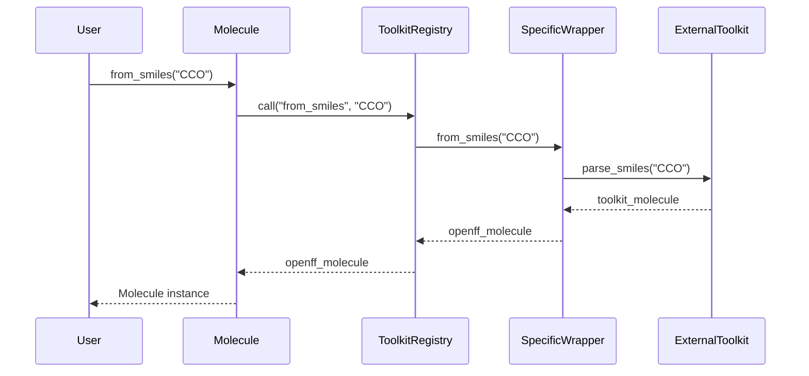
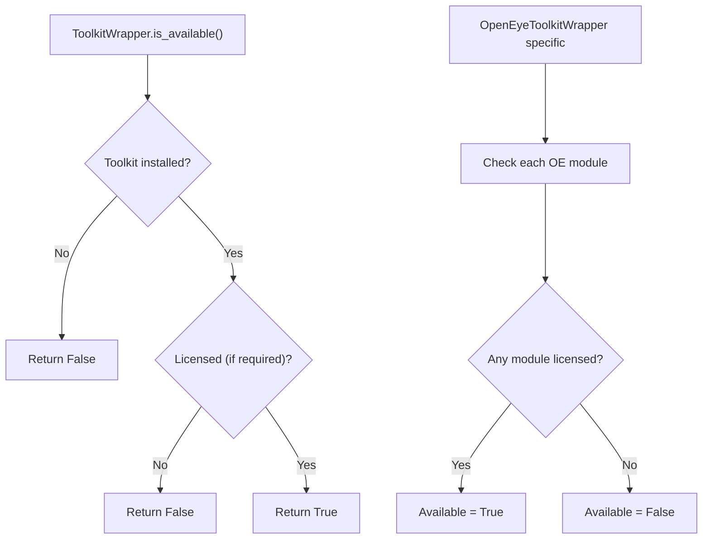
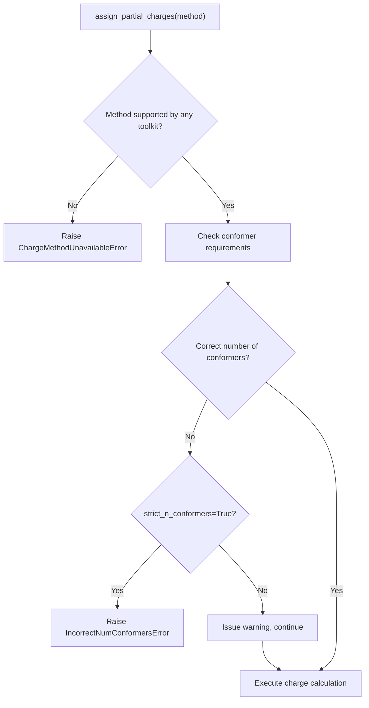

# Toolkit Integration System

<details>
<summary>Relevant source files</summary>

The following files were used as context for generating this wiki page:

- [.pre-commit-config.yaml](.pre-commit-config.yaml)
- [docs/releasehistory.md](docs/releasehistory.md)
- [openff/toolkit/_tests/test_toolkits.py](openff/toolkit/_tests/test_toolkits.py)
- [openff/toolkit/_tests/test_topology.py](openff/toolkit/_tests/test_topology.py)
- [openff/toolkit/topology/molecule.py](openff/toolkit/topology/molecule.py)
- [openff/toolkit/topology/topology.py](openff/toolkit/topology/topology.py)
- [openff/toolkit/typing/engines/smirnoff/forcefield.py](openff/toolkit/typing/engines/smirnoff/forcefield.py)
- [openff/toolkit/typing/engines/smirnoff/parameters.py](openff/toolkit/typing/engines/smirnoff/parameters.py)
- [openff/toolkit/utils/ambertools_wrapper.py](openff/toolkit/utils/ambertools_wrapper.py)
- [openff/toolkit/utils/base_wrapper.py](openff/toolkit/utils/base_wrapper.py)
- [openff/toolkit/utils/builtin_wrapper.py](openff/toolkit/utils/builtin_wrapper.py)
- [openff/toolkit/utils/exceptions.py](openff/toolkit/utils/exceptions.py)
- [openff/toolkit/utils/openeye_wrapper.py](openff/toolkit/utils/openeye_wrapper.py)
- [openff/toolkit/utils/rdkit_wrapper.py](openff/toolkit/utils/rdkit_wrapper.py)
- [openff/toolkit/utils/serialization.py](openff/toolkit/utils/serialization.py)
- [openff/toolkit/utils/toolkits.py](openff/toolkit/utils/toolkits.py)
- [openff/toolkit/utils/utils.py](openff/toolkit/utils/utils.py)
- [setup.cfg](setup.cfg)

</details>


## Purpose and Scope

The Toolkit Integration System provides a standardized interface for integrating external cheminformatics toolkits (OpenEye, RDKit, AmberTools) into the OpenFF Toolkit. This system enables the OpenFF Toolkit to leverage specialized functionality from different toolkits while maintaining a consistent API. For information about the SMIRNOFF force field parameter system, see [2.2](#2.2). For details about the core molecular data structures, see [2.1](#2.1).

The system consists of wrapper classes that normalize toolkit-specific APIs, a registry system for managing multiple toolkits with priority-based selection, and integration points throughout the codebase where external toolkit functionality is required.

## Core Architecture

### ToolkitWrapper Base Class

The foundation of the integration system is the `ToolkitWrapper` base class, which defines a common interface that all toolkit implementations must follow.

**ToolkitWrapper Class Hierarchy**


Sources: [openff/toolkit/utils/base_wrapper.py:36-158](), [openff/toolkit/utils/openeye_wrapper.py:89-277](), [openff/toolkit/utils/rdkit_wrapper.py:73-132](), [openff/toolkit/utils/ambertools_wrapper.py:29-101](), [openff/toolkit/utils/builtin_wrapper.py:19-140]()

### Toolkit Capabilities and Specialization

Each toolkit wrapper provides specific capabilities and maintains metadata about what it can do:

| Toolkit | Primary Capabilities | Charge Methods | File Formats |
|---------|---------------------|----------------|--------------|
| `OpenEyeToolkitWrapper` | Comprehensive cheminformatics, IUPAC names | am1bcc, gasteiger, mmff94 | SDF, MOL2, PDB, SMI, OEB |
| `RDKitToolkitWrapper` | Open-source cheminformatics, basic operations | gasteiger, mmff94 | SDF, MOL, SMI, PDB |
| `AmberToolsToolkitWrapper` | Quantum chemistry charge calculations | am1bcc, am1-mulliken, gasteiger | Uses RDKit for I/O |
| `BuiltInToolkitWrapper` | Basic fallback operations | zeros, formal_charge | None |
| `NAGLToolkitWrapper` | Neural network charge assignment | nagl | None |

Sources: [openff/toolkit/utils/openeye_wrapper.py:117-162](), [openff/toolkit/utils/rdkit_wrapper.py:86-88](), [openff/toolkit/utils/ambertools_wrapper.py:41-62](), [openff/toolkit/utils/builtin_wrapper.py:31-36]()

## Registry System

### ToolkitRegistry Architecture

The `ToolkitRegistry` class manages multiple toolkit wrappers and provides priority-based method resolution.

**ToolkitRegistry Method Resolution Flow**


Sources: [openff/toolkit/utils/toolkit_registry.py:1-400]()

### Global Toolkit Registry

The system provides a default global registry with predefined toolkit precedence:

```python
GLOBAL_TOOLKIT_REGISTRY = ToolkitRegistry(
    toolkit_precedence=[
        OpenEyeToolkitWrapper,
        RDKitToolkitWrapper, 
        AmberToolsToolkitWrapper,
        BuiltInToolkitWrapper,
    ]
)
```

This allows the system to automatically fall back to available toolkits when the preferred toolkit is unavailable.

Sources: [openff/toolkit/utils/toolkits.py:102-110]()

## Toolkit Integration Points

### Molecule Class Integration

The `Molecule` class integrates with toolkits through several key patterns:

**Molecule-Toolkit Integration Pattern**


Sources: [openff/toolkit/topology/molecule.py:1000-1100](), [openff/toolkit/utils/toolkit_registry.py:200-300]()

### Key Integration Methods

The toolkit system integrates with `Molecule` operations through these primary methods:

1. **Molecule Creation**: `from_smiles()`, `from_file()`, `from_iupac()`
2. **Format Conversion**: `to_rdkit()`, `to_openeye()`, `to_file()`
3. **Property Calculation**: `assign_partial_charges()`, `generate_conformers()`
4. **Chemical Operations**: `enumerate_stereoisomers()`, `enumerate_tautomers()`

Sources: [openff/toolkit/topology/molecule.py:1000-2000](), [openff/toolkit/utils/base_wrapper.py:146-200]()

## Toolkit Availability and Licensing

### Availability Checking System

Each toolkit wrapper implements availability checking to handle optional dependencies:

**Toolkit Availability Check Flow**


Sources: [openff/toolkit/utils/base_wrapper.py:118-129](), [openff/toolkit/utils/openeye_wrapper.py:247-277](), [openff/toolkit/utils/rdkit_wrapper.py:114-132]()

### Error Handling for Unavailable Toolkits

The system provides graceful degradation when toolkits are unavailable:

- `ToolkitUnavailableException` for missing required functionality
- `LicenseError` for licensing issues (primarily OpenEye)
- Automatic fallback through the registry system
- Informative error messages with installation instructions

Sources: [openff/toolkit/utils/exceptions.py:44-52](), [openff/toolkit/utils/openeye_wrapper.py:213-227]()

## Charge Method Management

### Charge Method Registry

Each toolkit maintains its own registry of supported charge calculation methods:

```python
# OpenEye example
_supported_charge_methods = {
    "am1bcc": {
        "oe_charge_method": "OEAM1BCCCharges",
        "min_confs": 1, "max_confs": 1, "rec_confs": 1
    },
    "gasteiger": {
        "oe_charge_method": "OEGasteigerCharges", 
        "min_confs": 0, "max_confs": 0, "rec_confs": 0
    }
}
```

Sources: [openff/toolkit/utils/openeye_wrapper.py:117-160](), [openff/toolkit/utils/rdkit_wrapper.py:86-88](), [openff/toolkit/utils/ambertools_wrapper.py:41-62]()

### Method Resolution and Validation

The system validates charge method availability and conformer requirements before execution:

**Charge Method Resolution**


Sources: [openff/toolkit/utils/base_wrapper.py:160-200](), [openff/toolkit/topology/molecule.py:4000-4200]()

## Plugin and Extension System

### Entry Point Registration

The toolkit system supports plugin registration through Python entry points, allowing external packages to register custom toolkit wrappers:

```python
# Example entry point registration
"openff.toolkit.plugins" = [
    "custom_toolkit = my_package.toolkit:CustomToolkitWrapper"
]
```

Sources: [openff/toolkit/typing/engines/smirnoff/plugins.py:1-50](), [openff/toolkit/typing/engines/smirnoff/forcefield.py:23-24]()

### Extending the System

New toolkit wrappers can be added by:

1. Inheriting from `ToolkitWrapper`
2. Implementing required abstract methods
3. Registering with the `ToolkitRegistry`
4. Optionally using entry points for automatic discovery

Sources: [openff/toolkit/utils/base_wrapper.py:36-200](), [openff/toolkit/utils/toolkit_registry.py:100-200]()

---