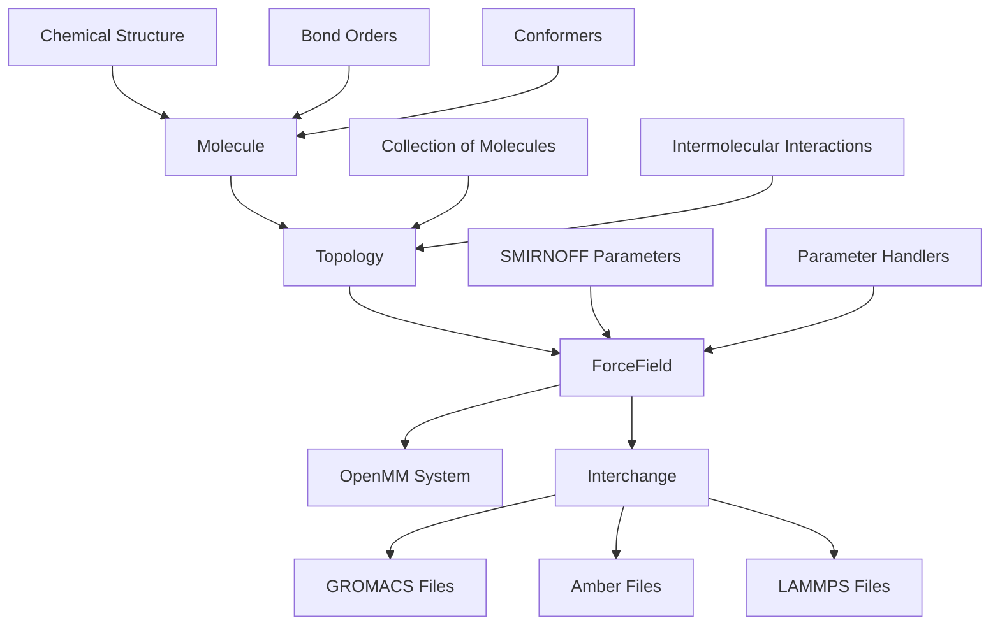
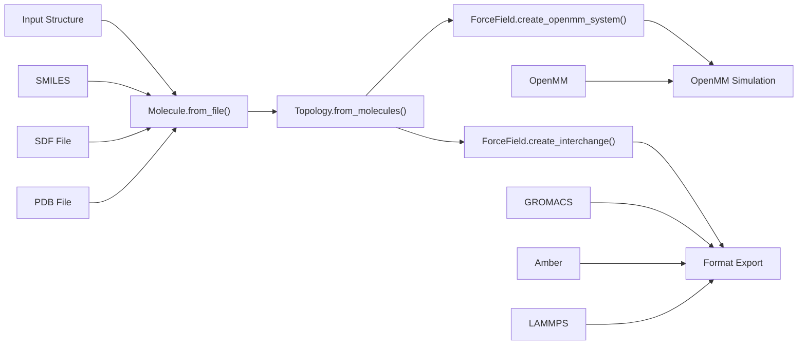
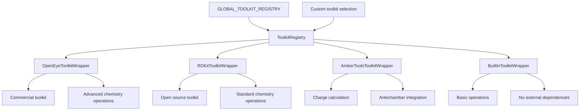
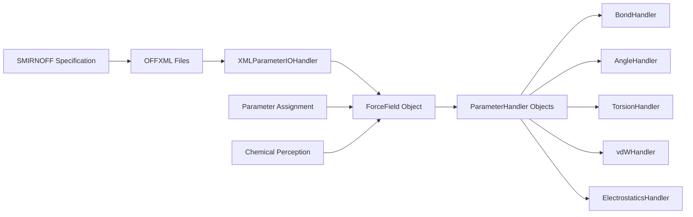

# User Guide

<details>
<summary>Relevant source files</summary>

The following files were used as context for generating this wiki page:

- [.github/workflows/release.yml](.github/workflows/release.yml)
- [.readthedocs.yaml](.readthedocs.yaml)
- [MANIFEST.in](MANIFEST.in)
- [README.md](README.md)
- [examples/README.md](examples/README.md)
- [examples/SMIRNOFF_simulation/README.md](examples/SMIRNOFF_simulation/README.md)
- [examples/conformer_energies/README.md](examples/conformer_energies/README.md)
- [examples/forcefield_modification/README.md](examples/forcefield_modification/README.md)
- [examples/inspect_assigned_parameters/README.md](examples/inspect_assigned_parameters/README.md)
- [examples/toolkit_showcase/README.md](examples/toolkit_showcase/README.md)
- [examples/using_smirnoff_in_amber_or_gromacs/README.md](examples/using_smirnoff_in_amber_or_gromacs/README.md)
- [examples/using_smirnoff_with_amber_protein_forcefield/README.md](examples/using_smirnoff_with_amber_protein_forcefield/README.md)
- [examples/visualization/README.md](examples/visualization/README.md)
- [openff/toolkit/__init__.py](openff/toolkit/__init__.py)
- [openff/toolkit/typing/engines/smirnoff/io.py](openff/toolkit/typing/engines/smirnoff/io.py)
- [openff/toolkit/utils/callback.py](openff/toolkit/utils/callback.py)
- [openff/toolkit/utils/collections.py](openff/toolkit/utils/collections.py)

</details>


This guide provides comprehensive documentation for users of the OpenFF toolkit, covering core concepts, workflows, and practical usage patterns. The toolkit is designed for molecular mechanics force field development and application using the SMIRNOFF format and direct chemical perception methods.

This guide covers practical usage of the toolkit's core functionality. For detailed architectural information, see [Core Architecture](#2). For development and contribution guidelines, see [Development](#4). For specific installation instructions and getting started steps, see [Getting Started](#3.1).

## Purpose and Scope

The OpenFF toolkit serves two main purposes:
- **SMIRNOFF Force Field Application**: Tools for using SMIRKS Native Open Force Field (SMIRNOFF) force fields to parameterize molecular systems
- **Chemical Perception and Manipulation**: Direct chemical environment perception and molecular graph manipulation capabilities

The toolkit provides a unified interface for molecular mechanics workflows while supporting multiple backend cheminformatics libraries through a plugin architecture.

**Sources**: [README.md:10-15](), [openff/toolkit/__init__.py:1-4]()

## Core Concepts

### Primary Data Structures

The toolkit centers around three main data structures that represent different aspects of molecular systems:



**Sources**: [README.md:58-77](), [openff/toolkit/__init__.py:15-19]()

### Core Classes and Their Roles

| Class | Module | Purpose |
|-------|--------|---------|
| `Molecule` | `openff.toolkit.topology` | Represents individual chemical structures with connectivity and properties |
| `Topology` | `openff.toolkit.topology` | Contains collections of molecules and their spatial relationships |
| `ForceField` | `openff.toolkit.typing.engines.smirnoff` | Manages SMIRNOFF parameter sets and applies them to systems |
| `ToolkitRegistry` | `openff.toolkit.utils.toolkits` | Manages integration with external cheminformatics libraries |
| `Interchange` | External package | Converts parameterized systems to various simulation formats |

**Sources**: [openff/toolkit/__init__.py:31-45](), [README.md:55-76]()

## Basic Workflow

### Standard Parameterization Workflow

The typical workflow for parameterizing a molecular system follows this pattern:



### Code Example: Basic Usage

The following example demonstrates the standard workflow for parameterizing a small molecule:

```python
# Load a molecule into the OpenFF Molecule object
from openff.toolkit import Molecule
from openff.toolkit.utils import get_data_file_path
sdf_file_path = get_data_file_path('molecules/ethanol.sdf')
molecule = Molecule.from_file(sdf_file_path)

# Create an OpenFF Topology object from the molecule
from openff.toolkit import Topology
topology = Topology.from_molecules(molecule)

# Load the latest OpenFF force field release: version 2.1.0, codename "Sage"
from openff.toolkit import ForceField
forcefield = ForceField('openff-2.1.0.offxml')

# Create an OpenMM system representing the molecule with SMIRNOFF-applied parameters
openmm_system = forcefield.create_openmm_system(topology)

# Create an Interchange object for representations in other formats
interchange = forcefield.create_interchange(topology)
```

**Sources**: [README.md:57-77]()

## Usage Patterns

### Available Example Categories

The toolkit provides comprehensive examples organized by use case:

```mermaid
graph TB
    A["Examples"] --> B["toolkit_showcase"]
    A --> C["forcefield_modification"]
    A --> D["conformer_energies"]
    A --> E["SMIRNOFF_simulation"]
    A --> F["using_smirnoff_in_amber_or_gromacs"]
    A --> G["using_smirnoff_with_amber_protein_forcefield"]
    A --> H["visualization"]
    A --> I["inspect_assigned_parameters"]
    
    B --> B1["Protein-ligand system parameterization"]
    B --> B2["Mixed force field workflows"]
    B --> B3["Simulation and visualization"]
    
    C --> C1["Parameter modification"]
    C --> C2["Energy evaluation"]
    C --> C3["Force field optimization"]
    
    D --> D1["Small molecule energies"]
    D --> D2["Conformer comparison"]
    
    E --> E1["Gas phase simulation"]
    E --> E2["SMIRNOFF format usage"]
    
    F --> F1["Format conversion"]
    F --> F2["Multi-engine compatibility"]
    
    G --> G1["Protein-ligand complexes"]
    G --> G2["Mixed parameter sets"]
    
    H --> H1["Jupyter notebook integration"]
    H --> H2["3D visualization"]
    
    I --> I1["Parameter assignment inspection"]
    I --> I2["Usage statistics"]
```



**Sources**: [examples/README.md:7-21]()

### Common Use Cases

#### 1. Protein-Ligand System Parameterization
Combines OpenFF parameters for ligands with traditional force fields for proteins, as demonstrated in the toolkit showcase example.

**Sources**: [examples/toolkit_showcase/README.md:1-4]()

#### 2. Force Field Parameter Modification
Allows users to modify force field parameters and evaluate energy changes, useful for force field development and optimization.

**Sources**: [examples/forcefield_modification/README.md:1-4]()

#### 3. Conformer Energy Calculations
Computes energies for different conformers of molecules using SMIRNOFF force fields, supporting both interactive and command-line usage.

**Sources**: [examples/conformer_energies/README.md:1-7]()

#### 4. Format Interoperability
Converts OpenMM systems to GROMACS, Amber, and LAMMPS formats through the Interchange interface, enabling use across different simulation engines.

**Sources**: [examples/using_smirnoff_in_amber_or_gromacs/README.md:1-8]()

## Integration Capabilities

### Toolkit Registry System

The toolkit integrates with multiple cheminformatics libraries through a registry system:



**Sources**: [openff/toolkit/__init__.py:20-27](), [openff/toolkit/__init__.py:53-58]()

### Force Field Ecosystem

The toolkit integrates with the broader OpenFF force field ecosystem:

| Component | Repository | Purpose |
|-----------|------------|---------|
| Sage Force Fields | openff-forcefields | Latest OpenFF parameter sets |
| smirnoff99Frosst | smirnoff99Frosst | AMBER-compatible SMIRNOFF conversion |
| Plugin Architecture | Various | Third-party force field distribution |

**Sources**: [README.md:34-41]()

## Input and Output Formats

### Supported Input Formats

The toolkit accepts multiple input formats for molecular structures:

- **SMILES strings**: Direct chemical notation
- **SDF files**: Structure data format with 3D coordinates
- **PDB files**: Protein Data Bank format (requires additional processing)
- **MOL files**: MDL Molfile format

### Output Capabilities

Through the Interchange system, parameterized systems can be exported to:

- **OpenMM System**: Native simulation format
- **GROMACS**: Topology and coordinate files
- **Amber**: Parameter and coordinate files
- **LAMMPS**: Input files for molecular dynamics

**Sources**: [README.md:55-76]()

## SMIRNOFF Format Support

### Force Field File Handling

The toolkit provides comprehensive support for SMIRNOFF format force fields:



**Sources**: [openff/toolkit/typing/engines/smirnoff/io.py:97-236](), [README.md:45-51]()

### Parameter Inspection and Modification

The toolkit allows detailed inspection and modification of force field parameters, supporting:

- Parameter assignment tracking
- Usage statistics generation
- Dynamic parameter modification
- Custom parameter handler development

**Sources**: [examples/inspect_assigned_parameters/README.md:1-4]()

## Visualization and Analysis

### Built-in Visualization Support

The toolkit provides rich visualization capabilities in Jupyter notebooks:

- **RDKit backend**: 2D molecular structure rendering
- **OpenEye backend**: Professional-grade molecular visualization
- **NGLView backend**: 3D molecular visualization (requires conformers)

**Sources**: [examples/visualization/README.md:1-30]()

### Analysis Tools

Integration with analysis tools enables:

- Conformer energy comparison
- Parameter usage statistics
- Force field performance evaluation
- Chemical environment analysis

**Sources**: [examples/conformer_energies/README.md:1-7](), [examples/inspect_assigned_parameters/README.md:1-4]()

---