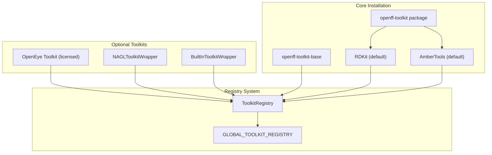
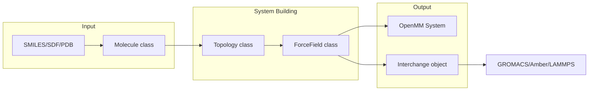
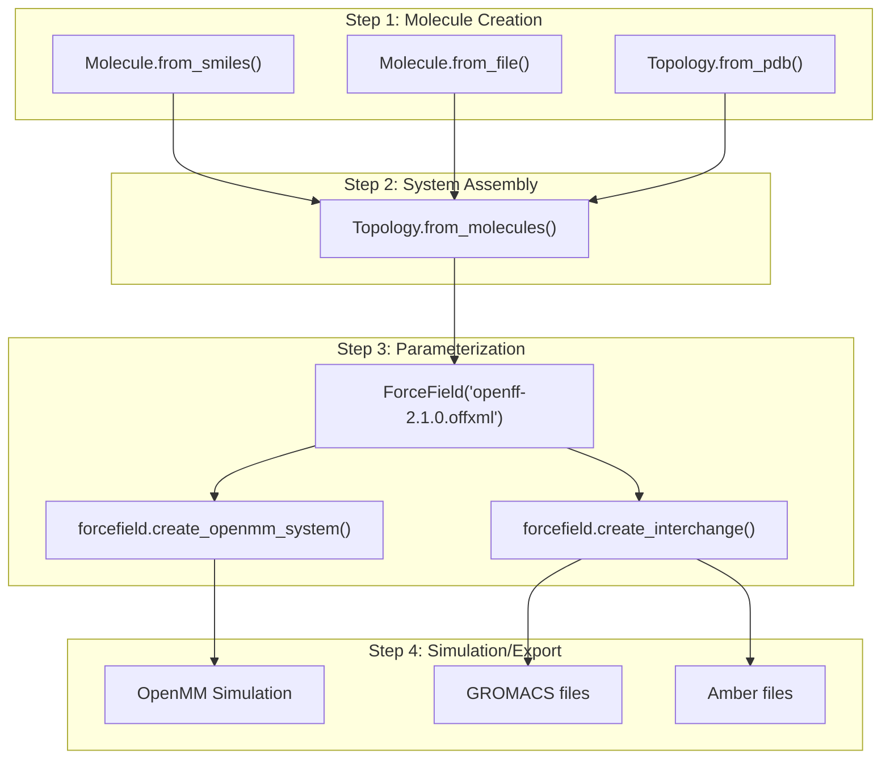
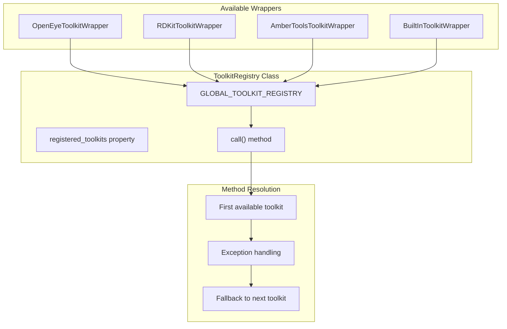

# Getting Started

<details>
<summary>Relevant source files</summary>

The following files were used as context for generating this wiki page:

- [.readthedocs.yaml](.readthedocs.yaml)
- [FAQ.md](FAQ.md)
- [MANIFEST.in](MANIFEST.in)
- [README.md](README.md)
- [docs/api/toolkits.md](docs/api/toolkits.md)
- [docs/conf.py](docs/conf.py)
- [docs/environment.yml](docs/environment.yml)
- [docs/examples.md](docs/examples.md)
- [docs/index.md](docs/index.md)
- [docs/installation.md](docs/installation.md)
- [docs/users/developing.md](docs/users/developing.md)
- [docs/users/molecule_cookbook.ipynb](docs/users/molecule_cookbook.ipynb)
- [docs/users/pdb_cookbook/index.ipynb](docs/users/pdb_cookbook/index.ipynb)
- [docs/utils.rst](docs/utils.rst)
- [openff/toolkit/__init__.py](openff/toolkit/__init__.py)
- [openff/toolkit/typing/engines/smirnoff/io.py](openff/toolkit/typing/engines/smirnoff/io.py)
- [openff/toolkit/utils/callback.py](openff/toolkit/utils/callback.py)
- [openff/toolkit/utils/collections.py](openff/toolkit/utils/collections.py)
- [openff/toolkit/utils/toolkit_registry.py](openff/toolkit/utils/toolkit_registry.py)

</details>


This page provides installation instructions, introduces the core concepts of the OpenFF Toolkit, and demonstrates basic usage patterns. It serves as an entry point for new users who want to start working with molecular force fields using the SMIRNOFF specification.

For advanced usage patterns and complex scenarios, see [Advanced Usage](#3.3). For detailed examples and tutorials, see [Examples and Tutorials](#3.2). For information about the core architectural components, see [Core Architecture](#2).

## Installation

The OpenFF Toolkit can be installed via the Mamba package manager, which is the recommended approach as it automatically handles all dependencies.

### Installing via Mamba

Create a new environment with the toolkit:

```shell
mamba create -n openff-toolkit -c conda-forge openff-toolkit
mamba activate openff-toolkit
```

### Platform Support

The toolkit is pure Python and supports:
- Linux (x86_64)
- macOS (x86_64) 
- Python 3.11, 3.12, 3.13

Sources: [docs/installation.md:33-36](), [README.md:28]()

### Optional Dependencies

The toolkit integrates with multiple cheminformatics libraries through a plugin system. The base installation includes RDKit and AmberTools by default. OpenEye Toolkit can be optionally installed for users with a license.

#### Installation Architecture Diagram



Sources: [docs/installation.md:49-61](), [openff/toolkit/utils/toolkit_registry.py:110-116]()

## Core Concepts

The OpenFF Toolkit is built around several key classes that work together to apply molecular force fields:

### Primary Classes Overview



Sources: [README.md:57-77](), [openff/toolkit/__init__.py:48-52]()

### Molecule Class

The `Molecule` class represents individual chemical species with complete chemical information including:
- Atomic composition and connectivity
- Bond orders and formal charges  
- Stereochemistry
- Conformations (3D coordinates)

### Topology Class

The `Topology` class represents a complete molecular system containing one or more `Molecule` instances. It maintains:
- Collection of molecules
- Box vectors for periodic systems
- Metadata about the system

### ForceField Class

The `ForceField` class implements the SMIRNOFF specification for parameter assignment. It contains:
- Parameter handlers for different force types
- SMIRKS patterns for chemical perception
- Parameter values and functional forms

Sources: [README.md:12-14](), [docs/users/molecule_cookbook.ipynb:16-22]()

## Basic Usage Examples

### Creating a Molecule from SMILES

The most common way to create a molecule is from a SMILES string:

```python
from openff.toolkit import Molecule

# Create a molecule from SMILES
molecule = Molecule.from_smiles("CCO")  # ethanol
```

### Building a Topology

Combine molecules into a topology for system parameterization:

```python
from openff.toolkit import Topology

# Create topology from a single molecule
topology = Topology.from_molecules([molecule])

# Or from multiple molecules
water = Molecule.from_smiles("O")
topology = Topology.from_molecules([molecule, water, water])
```

### Applying a Force Field

Load a force field and create an OpenMM system:

```python
from openff.toolkit import ForceField

# Load the latest Sage force field
forcefield = ForceField('openff-2.1.0.offxml')

# Create OpenMM system
openmm_system = forcefield.create_openmm_system(topology)

# Or create Interchange for other MD engines
interchange = forcefield.create_interchange(topology)
```

Sources: [README.md:57-77](), [docs/users/molecule_cookbook.ipynb:181-184]()

### Complete Workflow Example



Sources: [README.md:57-77](), [docs/users/molecule_cookbook.ipynb:16-22]()

## Toolkit Integration

The OpenFF Toolkit uses a registry system to integrate with multiple cheminformatics libraries:

### Toolkit Registry System



### Checking Available Toolkits

```python
from openff.toolkit import GLOBAL_TOOLKIT_REGISTRY

# Check which toolkits are available
print(GLOBAL_TOOLKIT_REGISTRY.registered_toolkit_versions)
# Output: {'The RDKit': '2022.03.5', 'AmberTools': '22.0', 'Built-in Toolkit': None}
```

Sources: [openff/toolkit/utils/toolkit_registry.py:25-76](), [docs/installation.md:91-98](), [docs/api/toolkits.md:53-60]()

## Error Handling

The toolkit enforces strict chemical specification to avoid ambiguous parameterization:

### Stereochemistry Requirements

```python
# This will raise UndefinedStereochemistryError
try:
    molecule = Molecule.from_smiles("CC([NH3+])C(=O)[O-]")  # Missing stereochemistry
except UndefinedStereochemistryError:
    print("Stereochemistry must be defined")

# This works - stereochemistry is explicit
molecule = Molecule.from_smiles("C[C@H]([NH3+])C(=O)[O-]")
```

Sources: [docs/users/molecule_cookbook.ipynb:380-387]()

## Loading Complex Systems

### PDB Files with Small Molecules

For PDB files containing ligands, you must provide the chemical information:

```python
# Define the ligand chemistry
ligand = Molecule.from_smiles("CCCC1=CC=CC=C1O")

# Load PDB with ligand information
topology = Topology.from_pdb("complex.pdb", unique_molecules=[ligand])
```

Sources: [docs/users/pdb_cookbook/index.ipynb:264-267](), [docs/users/pdb_cookbook/index.ipynb:296-298]()

## Next Steps

- **For detailed examples**: See [Examples and Tutorials](#3.2) for comprehensive notebooks and workflows
- **For advanced features**: See [Advanced Usage](#3.3) for custom parameter handlers and complex systems  
- **For core concepts**: See [Molecule and Topology System](#2.1) and [SMIRNOFF Force Field System](#2.2) for architectural details
- **For development**: See [Development](#4) for contributing guidelines and testing frameworks

Sources: [README.md:78-86](), [docs/index.md:18-31]()

---