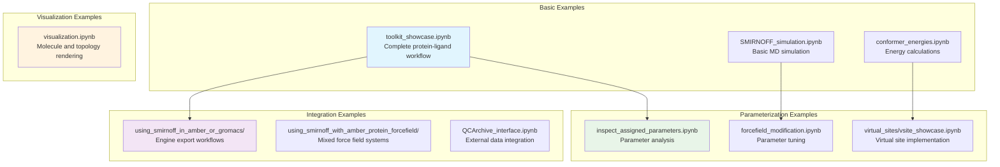
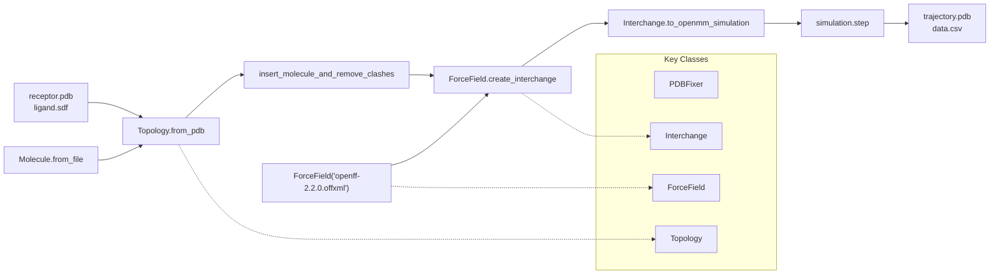
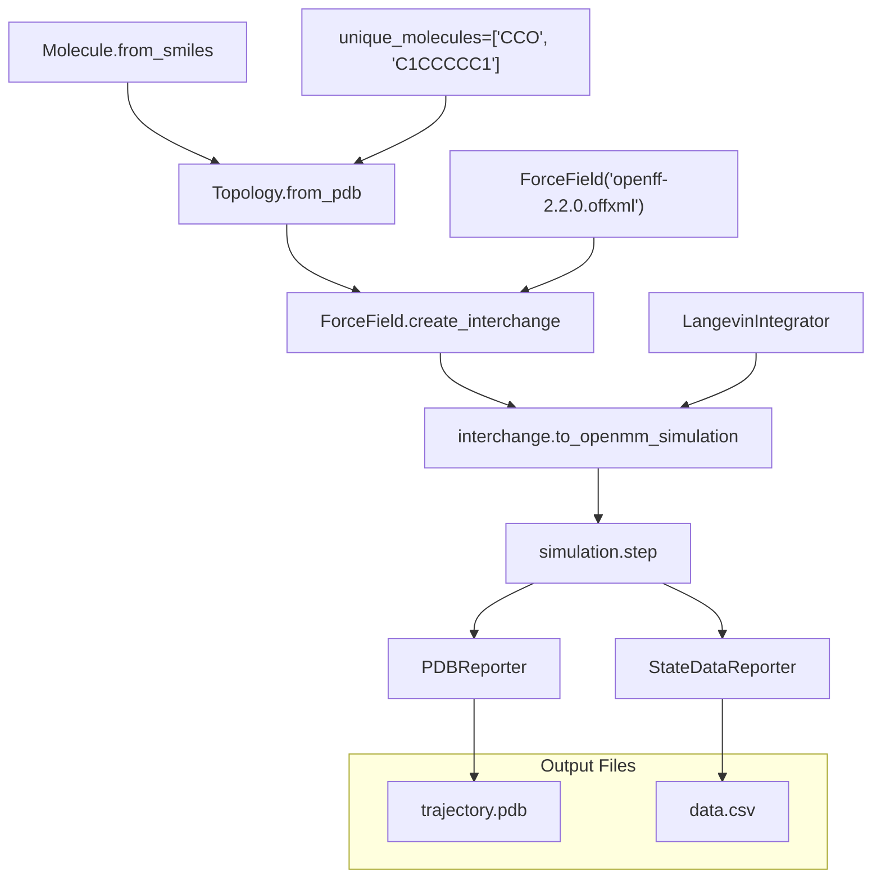
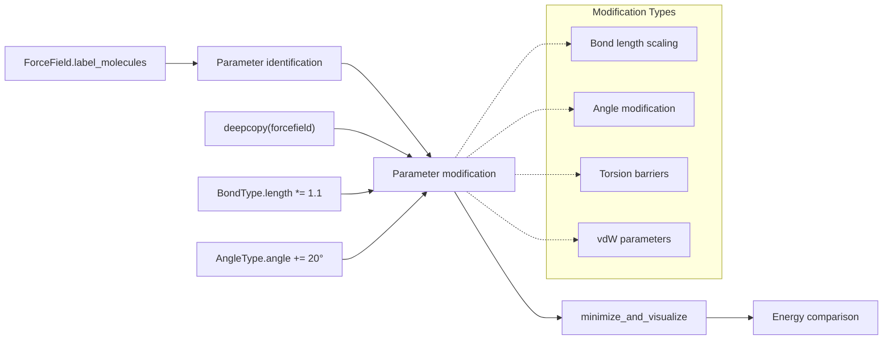
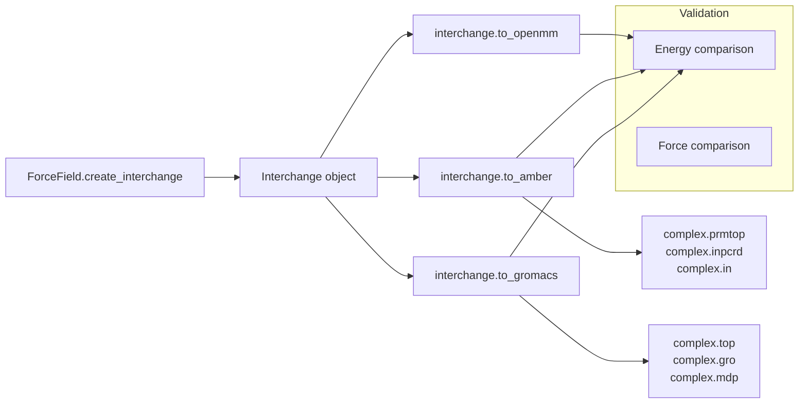
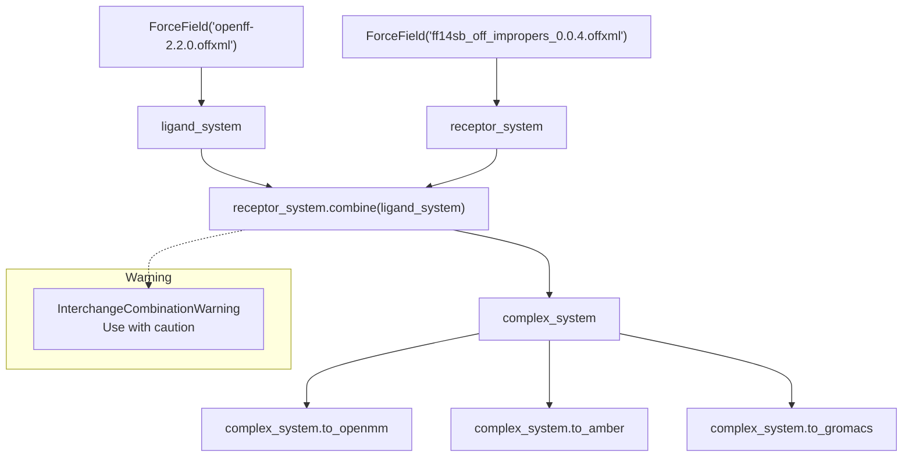
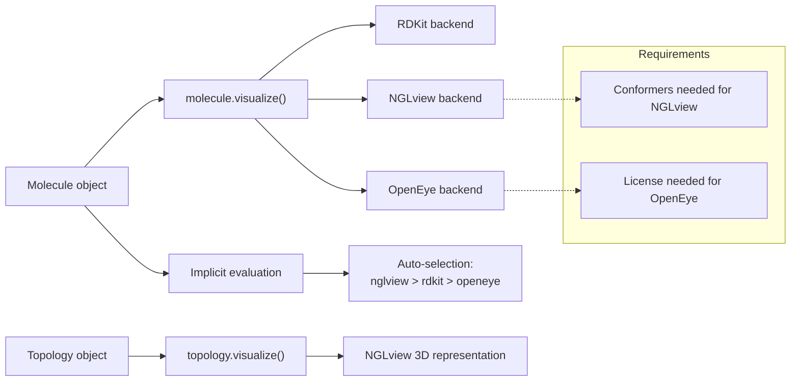

# Examples and Tutorials

Relevant source files

The following files were used as context for generating this wiki page:

- [.github/workflows/release.yml](.github/workflows/release.yml)
- [examples/QCArchive_interface/QCarchive_interface.ipynb](examples/QCArchive_interface/QCarchive_interface.ipynb)
- [examples/README.md](examples/README.md)
- [examples/SMIRNOFF_simulation/README.md](examples/SMIRNOFF_simulation/README.md)
- [examples/SMIRNOFF_simulation/run_simulation.ipynb](examples/SMIRNOFF_simulation/run_simulation.ipynb)
- [examples/conformer_energies/README.md](examples/conformer_energies/README.md)
- [examples/conformer_energies/conformer_energies.ipynb](examples/conformer_energies/conformer_energies.ipynb)
- [examples/forcefield_modification/README.md](examples/forcefield_modification/README.md)
- [examples/forcefield_modification/forcefield_modification.ipynb](examples/forcefield_modification/forcefield_modification.ipynb)
- [examples/inspect_assigned_parameters/README.md](examples/inspect_assigned_parameters/README.md)
- [examples/inspect_assigned_parameters/inspect_assigned_parameters.ipynb](examples/inspect_assigned_parameters/inspect_assigned_parameters.ipynb)
- [examples/toolkit_showcase/README.md](examples/toolkit_showcase/README.md)
- [examples/toolkit_showcase/toolkit_showcase.ipynb](examples/toolkit_showcase/toolkit_showcase.ipynb)
- [examples/using_smirnoff_in_amber_or_gromacs/README.md](examples/using_smirnoff_in_amber_or_gromacs/README.md)
- [examples/using_smirnoff_in_amber_or_gromacs/export_with_interchange.ipynb](examples/using_smirnoff_in_amber_or_gromacs/export_with_interchange.ipynb)
- [examples/using_smirnoff_with_amber_protein_forcefield/BRD4_inhibitor_benchmark.ipynb](examples/using_smirnoff_with_amber_protein_forcefield/BRD4_inhibitor_benchmark.ipynb)
- [examples/using_smirnoff_with_amber_protein_forcefield/README.md](examples/using_smirnoff_with_amber_protein_forcefield/README.md)
- [examples/virtual_sites/vsite_showcase.ipynb](examples/virtual_sites/vsite_showcase.ipynb)
- [examples/visualization/README.md](examples/visualization/README.md)
- [examples/visualization/visualization.ipynb](examples/visualization/visualization.ipynb)

This document provides a comprehensive guide to the example notebooks and tutorial materials in the OpenFF Toolkit repository. These examples demonstrate practical usage patterns, from basic molecular parameterization to advanced force field modification and multi-engine workflows. The examples serve as both learning materials for new users and reference implementations for common computational chemistry tasks.

For basic installation and simple usage, see [Getting Started](#3.1). For complex scenarios including custom parameter handlers and specialized workflows, see [Advanced Usage](#3.3).

## Example Organization and Categories

The OpenFF Toolkit examples are organized into distinct categories based on their primary focus and complexity level. Each example includes comprehensive documentation, executable code, and validation outputs.

Sources: [examples/README.md:7-21](), [examples/toolkit_showcase/README.md:1-4](), [examples/SMIRNOFF_simulation/README.md:1-4]()

## Core Workflow Examples

### Toolkit Showcase: Complete Protein-Ligand Pipeline

The `toolkit_showcase.ipynb` example demonstrates the complete workflow from raw structural data to simulation-ready systems. This example combines multiple OpenFF Toolkit components with external tools to create a comprehensive molecular dynamics preparation pipeline.

The workflow begins with structure preparation using `PDBFixer` for solvation and then creates an OpenFF `Topology` from the PDB file and `Molecule` objects. The system is parametrized using the Sage force field through `ForceField.create_interchange`, which produces a complete `Interchange` object ready for simulation.

Key implementation details include the clash removal function [examples/toolkit_showcase/toolkit_showcase.ipynb:353-417]() and the visualization setup [examples/toolkit_showcase/toolkit_showcase.ipynb:484-487]().

Sources: [examples/toolkit_showcase/toolkit_showcase.ipynb:9-11](), [examples/toolkit_showcase/toolkit_showcase.ipynb:177-182](), [examples/toolkit_showcase/README.md:1-4]()

### Basic Simulation Workflow

The `SMIRNOFF_simulation` example demonstrates the fundamental steps for setting up and running molecular dynamics simulations with OpenFF force fields.

The example shows how to create molecules from SMILES strings, combine them into a topology with coordinate data from PDB files, and parametrize with SMIRNOFF force fields. The resulting `Interchange` object handles the conversion to OpenMM format for simulation execution.

Sources: [examples/SMIRNOFF_simulation/run_simulation.ipynb:26-137](), [examples/SMIRNOFF_simulation/README.md:1-4]()

## Parameterization and Analysis Examples

### Parameter Assignment Inspection

The `inspect_assigned_parameters.ipynb` example provides tools for understanding which SMIRNOFF parameters are applied to molecules and analyzing parameter usage across datasets.

The example demonstrates the `ForceField.label_molecules` method [examples/inspect_assigned_parameters/inspect_assigned_parameters.ipynb:135-148]() which returns detailed parameter assignments for each force term. This includes bond parameters with atom indices, parameter IDs, and matching SMIRKS patterns.

The utility function `get_molecule_parameterIDs` processes molecule sets to identify parameter usage patterns, which is valuable for force field development and validation.

Sources: [examples/inspect_assigned_parameters/inspect_assigned_parameters.ipynb:8-13](), [examples/inspect_assigned_parameters/README.md:1-3]()

### Force Field Modification

The `forcefield_modification.ipynb` example shows how to systematically modify SMIRNOFF parameters and evaluate the effects on molecular energies and geometries.

The example includes a `minimize_and_visualize` function [examples/forcefield_modification/forcefield_modification.ipynb:42-76]() that performs energy minimization and provides visual feedback on parameter changes.

Sources: [examples/forcefield_modification/forcefield_modification.ipynb:7-10](), [examples/forcefield_modification/README.md:1-3]()

### Virtual Sites Implementation

The `vsite_showcase.ipynb` example demonstrates the specification and use of virtual sites in SMIRNOFF force fields, including custom virtual site definitions and comparison with OpenMM implementations.

The example shows how to define virtual sites in OFFXML format [examples/virtual_sites/vsite_showcase.ipynb:144-184]() and includes a numerical comparison between OpenFF and OpenMM TIP5P implementations [examples/virtual_sites/vsite_showcase.ipynb:419-443]().

Sources: [examples/virtual_sites/vsite_showcase.ipynb:13-15](), [examples/virtual_sites/vsite_showcase.ipynb:127-131]()

## Multi-Engine Integration Examples

### AMBER and GROMACS Export

The `using_smirnoff_in_amber_or_gromacs` examples demonstrate how to export OpenFF-parametrized systems to other molecular dynamics engines using the Interchange framework.

The `Interchange.to_amber` method [examples/using_smirnoff_in_amber_or_gromacs/export_with_interchange.ipynb:162]() generates complete AMBER parameter, coordinate, and input files, while `Interchange.to_gromacs` [examples/using_smirnoff_in_amber_or_gromacs/export_with_interchange.ipynb:194]() produces equivalent GROMACS files.

Sources: [examples/using_smirnoff_in_amber_or_gromacs/export_with_interchange.ipynb:7-10](), [examples/using_smirnoff_in_amber_or_gromacs/README.md:1-8]()

### Mixed Force Field Systems

The `using_smirnoff_with_amber_protein_forcefield` examples show how to combine SMIRNOFF small molecule parameters with traditional protein force fields using `Interchange.combine`.

The combination process [examples/using_smirnoff_with_amber_protein_forcefield/BRD4_inhibitor_benchmark.ipynb:95]() requires careful validation as noted in the warning message about experimental nature of this functionality.

Sources: [examples/using_smirnoff_with_amber_protein_forcefield/BRD4_inhibitor_benchmark.ipynb:9-11](), [examples/using_smirnoff_with_amber_protein_forcefield/BRD4_inhibitor_benchmark.ipynb:48-51]()

## Visualization and Data Integration

### Molecular Visualization

The `visualization.ipynb` example demonstrates the rich representation capabilities for `Molecule` and `Topology` objects in Jupyter notebooks.

The visualization system automatically selects backends based on availability and molecule properties [examples/visualization/visualization.ipynb:81-82](), with NGLview preferred for molecules with conformers.

Sources: [examples/visualization/visualization.ipynb:14-32](), [examples/visualization/README.md:1-29]()

### QCArchive Integration

The `QCArchive_interface.ipynb` example shows how to create OpenFF molecules from quantum chemistry data using CMILES identifiers and the `canonical_isomeric_explicit_hydrogen_mapped_smiles` field.

The example demonstrates safe molecule creation from QCArchive data [examples/QCArchive_interface/QCarchive_interface.ipynb:7-12]() by leveraging the standardized molecular identifiers to ensure consistent chemical representation.

Sources: [examples/QCArchive_interface/QCarchive_interface.ipynb:7-12]()

## Example Execution and Testing

All examples are automatically tested as part of the continuous integration system to ensure they remain functional with toolkit updates. The examples use standardized molecule datasets and include expected output validation where appropriate.

The examples leverage the `get_data_file_path` utility [examples/SMIRNOFF_simulation/run_simulation.ipynb:31]() to access bundled test molecules and systems, ensuring reproducible execution across different environments.

Sources: [examples/README.md:1-21](), [examples/SMIRNOFF_simulation/run_simulation.ipynb:38-40]()

---