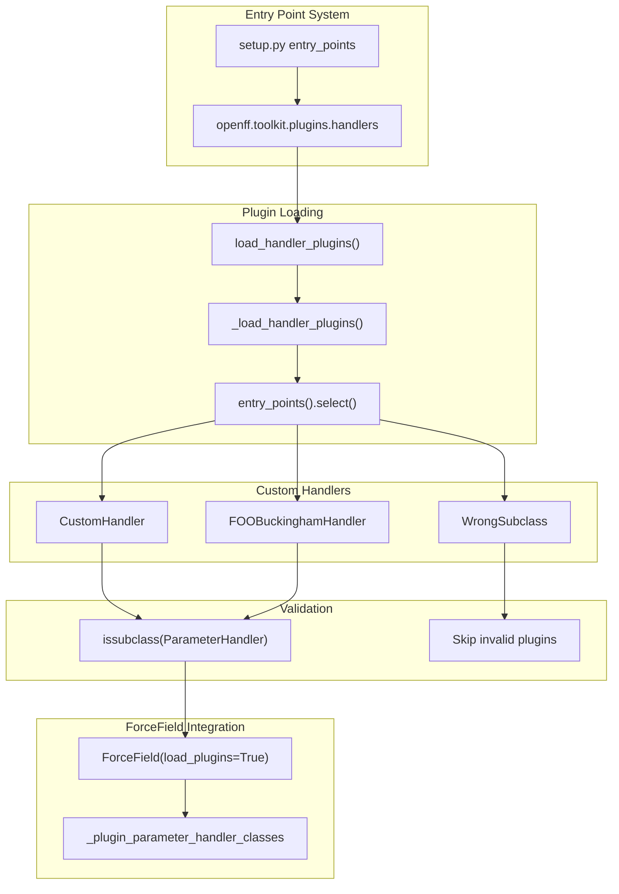
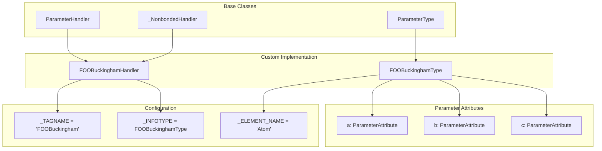
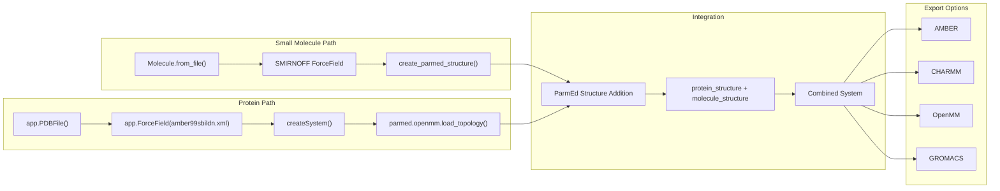
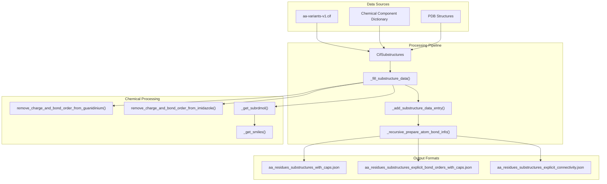
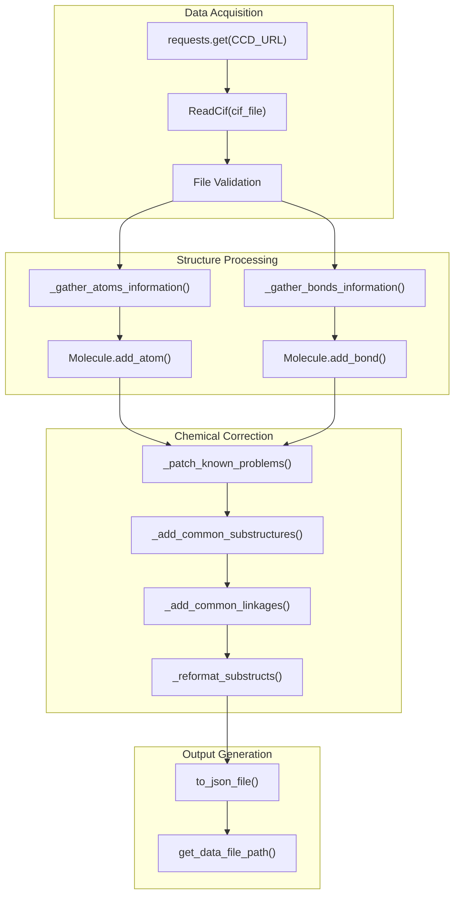

# Advanced Usage

<details>
<summary>Relevant source files</summary>

The following files were used as context for generating this wiki page:

- [examples/deprecated/mixedFF_structure/README.md](examples/deprecated/mixedFF_structure/README.md)
- [examples/deprecated/mixedFF_structure/generate_mixedFF_complex.py](examples/deprecated/mixedFF_structure/generate_mixedFF_complex.py)
- [openff/toolkit/_tests/test_parameter_plugins.py](openff/toolkit/_tests/test_parameter_plugins.py)
- [openff/toolkit/data/proteins/MainChain_CYM.pdb](openff/toolkit/data/proteins/MainChain_CYM.pdb)
- [openff/toolkit/data/proteins/aa_residues_substructures_explicit_bond_orders_with_caps.json](openff/toolkit/data/proteins/aa_residues_substructures_explicit_bond_orders_with_caps.json)
- [openff/toolkit/data/proteins/aa_residues_substructures_explicit_bond_orders_with_caps_explicit_connectivity.json](openff/toolkit/data/proteins/aa_residues_substructures_explicit_bond_orders_with_caps_explicit_connectivity.json)
- [openff/toolkit/data/proteins/aa_residues_substructures_with_caps.json](openff/toolkit/data/proteins/aa_residues_substructures_with_caps.json)
- [openff/toolkit/data/proteins/ace-ala-nh2.pdb](openff/toolkit/data/proteins/ace-ala-nh2.pdb)
- [openff/toolkit/data/systems/test_systems/PE.pdb](openff/toolkit/data/systems/test_systems/PE.pdb)
- [openff/toolkit/typing/engines/smirnoff/plugins.py](openff/toolkit/typing/engines/smirnoff/plugins.py)
- [utilities/make_substructure_dict/_cif_to_substructure_dict.py](utilities/make_substructure_dict/_cif_to_substructure_dict.py)
- [utilities/make_substructure_dict/_make_chemical_substructures.py](utilities/make_substructure_dict/_make_chemical_substructures.py)
- [utilities/make_substructure_dict/_make_metadata_assignment_substructures.py](utilities/make_substructure_dict/_make_metadata_assignment_substructures.py)
- [utilities/test_plugins/custom_plugins/handler_plugins.py](utilities/test_plugins/custom_plugins/handler_plugins.py)
- [utilities/test_plugins/setup.py](utilities/test_plugins/setup.py)

</details>


This page covers advanced usage patterns in the OpenFF toolkit, including custom parameter handlers, mixed force field workflows, and complex molecular system preparation. This material is intended for users who need to extend the toolkit's functionality beyond standard force field application scenarios.

For basic force field usage, see [Getting Started](#3.1). For plugin development details, see [Plugin Development](#4.3). For core architecture concepts, see [Core Architecture](#2).

## Custom Parameter Handlers and Plugin System

The OpenFF toolkit supports a plugin system that allows users to create custom parameter handlers for specialized force field terms or novel potential functions. This system uses Python's entry point mechanism to dynamically load custom handlers at runtime.

### Plugin Architecture



The plugin system loads custom parameter handlers through the entry point mechanism. Plugins must inherit from `ParameterHandler` to be considered valid, and invalid plugins are automatically skipped with logging.

**Sources:** [openff/toolkit/typing/engines/smirnoff/plugins.py:35-94](), [openff/toolkit/_tests/test_parameter_plugins.py:48-59](), [utilities/test_plugins/setup.py:12-18]()

### Creating Custom Parameter Handlers

Custom parameter handlers extend the base `ParameterHandler` class and define specialized parameter types. The following example shows the structure of a custom Buckingham potential handler:



Custom parameter types define attributes with units and default values. The handler manages collections of these parameter types and provides methods for parameter assignment and validation.

**Sources:** [utilities/test_plugins/custom_plugins/handler_plugins.py:22-49](), [openff/toolkit/_tests/test_parameter_plugins.py:76-92]()

### Plugin Registration and Testing

Plugins are registered through `setup.py` entry points and can be tested using the standard force field loading mechanism:

```python
# In setup.py
entry_points={
    "openff.toolkit.plugins.handlers": [
        "CustomHandler = custom_plugins.handler_plugins:CustomHandler",
        "FOOBuckinghamHandler = custom_plugins.handler_plugins:FOOBuckinghamHandler",
    ]
}
```

The testing framework verifies that plugins load correctly and integrate with the force field system. Force fields can explicitly enable plugin loading using the `load_plugins=True` parameter.

**Sources:** [utilities/test_plugins/setup.py:8-19](), [openff/toolkit/_tests/test_parameter_plugins.py:14-46]()

## Mixed Force Field Workflows

The toolkit supports combining SMIRNOFF-parameterized small molecules with traditionally parameterized proteins using ParmEd as an integration layer. This enables hybrid simulations where different force field methodologies are applied to different components of the system.

### Mixed Force Field Architecture



The workflow creates separate ParmEd structures for each component, then combines them through structure concatenation. The ordering matters - typically the protein structure is added first to preserve box vectors.

**Sources:** [examples/deprecated/mixedFF_structure/README.md:1-46](), [examples/deprecated/mixedFF_structure/generate_mixedFF_complex.py:1-57]()

### Implementation Details

The mixed force field approach requires careful coordination between different parameterization engines:

1. **Small Molecule Processing**: SMIRNOFF force fields parameterize the ligand using chemical perception and SMIRKS patterns
2. **Protein Processing**: Traditional force fields (AMBER, CHARMM) parameterize the protein using residue templates
3. **Structure Combination**: ParmEd provides the infrastructure to merge force field parameters from different sources
4. **System Validation**: The combined system maintains consistent energy units and parameter compatibility

Key considerations include solvent treatment, periodic boundary conditions, and ensuring no parameter conflicts between the different force field components.

**Sources:** [examples/deprecated/mixedFF_structure/generate_mixedFF_complex.py:11-56]()

## Advanced Molecular Structure Handling

The toolkit provides sophisticated support for complex molecular structures, particularly protein systems with extensive amino acid variant handling and chemical substructure libraries.

### Protein Substructure System



The system processes crystallographic data to generate comprehensive libraries of amino acid substructures with explicit chemical connectivity and multiple protonation states.

**Sources:** [utilities/make_substructure_dict/_cif_to_substructure_dict.py:79-606](), [utilities/make_substructure_dict/_make_chemical_substructures.py:21-46]()

### Chemical Perception Enhancements

The substructure processing includes specialized handling for problematic chemical groups:

1. **Resonance State Management**: Guanidinium and imidazole groups have their formal charges and bond orders modified to handle resonance ambiguity
2. **Leaving Atom Processing**: The system generates multiple variants by systematically removing "leaving" atoms to create chemically relevant derivatives
3. **Connectivity Specification**: Explicit bond order and connectivity information ensures unambiguous chemical matching

The processing generates SMARTS patterns with atom mapping that can be used for precise substructure identification in complex molecular systems.

**Sources:** [utilities/make_substructure_dict/_cif_to_substructure_dict.py:24-77](), [utilities/make_substructure_dict/_cif_to_substructure_dict.py:316-362]()

### Substructure Data Formats

The toolkit maintains multiple substructure libraries with different levels of chemical detail:

| Format | Purpose | Chemical Detail |
|--------|---------|----------------|
| `aa_residues_substructures_with_caps.json` | Basic residue matching | SMILES with leaving atoms |
| `aa_residues_substructures_explicit_bond_orders_with_caps.json` | Precise chemical matching | Explicit bond orders and stereochemistry |
| `aa_residues_substructures_explicit_connectivity.json` | Maximum specificity | Full connectivity with neighbor specifications |

These libraries support increasingly sophisticated chemical perception requirements, from basic residue identification to precise force field parameter assignment.

**Sources:** [openff/toolkit/data/proteins/aa_residues_substructures_with_caps.json:1-50](), [openff/toolkit/data/proteins/aa_residues_substructures_explicit_bond_orders_with_caps.json:1-50]()

## Complex System Preparation

Advanced usage often involves preparing complex molecular systems with specialized requirements such as non-standard residues, custom modifications, or unusual chemical environments.

### Automated Processing Workflows

The toolkit provides utilities for automated processing of complex chemical data:



The automated pipeline handles data acquisition, chemical processing, error correction, and output generation without manual intervention.

**Sources:** [utilities/make_substructure_dict/_make_chemical_substructures.py:7-46](), [utilities/make_substructure_dict/_make_metadata_assignment_substructures.py:7-35]()

### Error Handling and Validation

The system includes comprehensive error handling for chemical data processing:

1. **Import Error Management**: Failed plugin imports are logged but don't stop processing
2. **Chemical Validation**: Invalid chemical structures are identified and either corrected or skipped
3. **Compatibility Checking**: Parameter handler compatibility is verified before integration
4. **Data Integrity**: Output files are validated for chemical consistency and completeness

This robust error handling ensures that complex processing pipelines can handle real-world chemical data with its inherent inconsistencies and edge cases.

**Sources:** [openff/toolkit/typing/engines/smirnoff/plugins.py:63-82](), [utilities/make_substructure_dict/_cif_to_substructure_dict.py:608-683]()

---