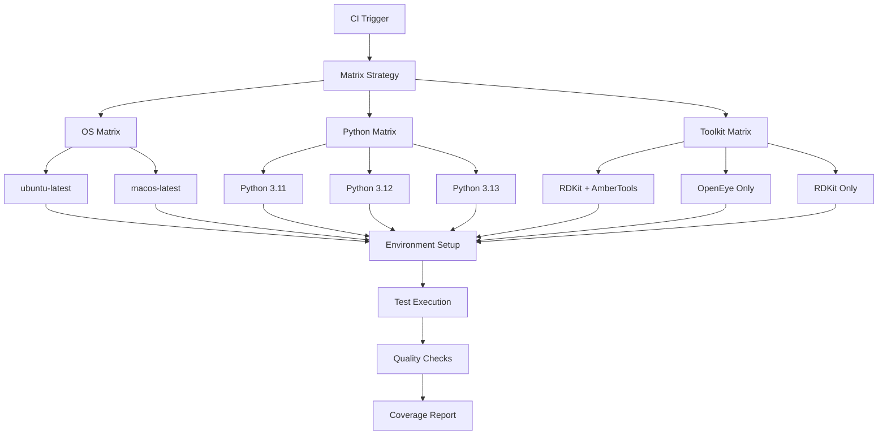
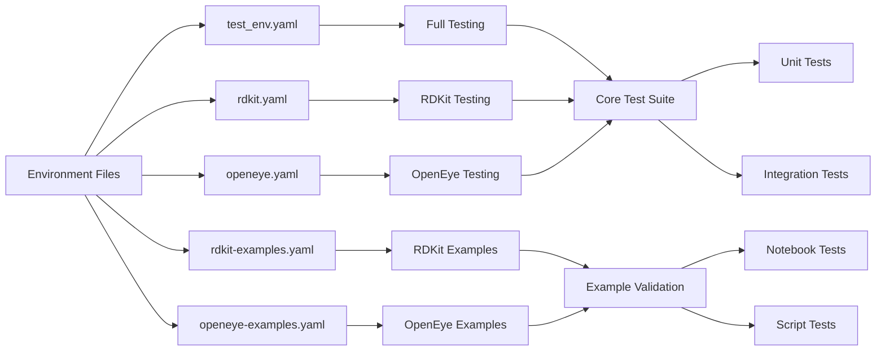
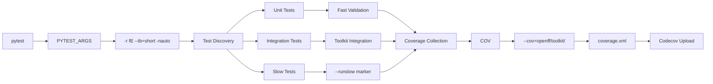
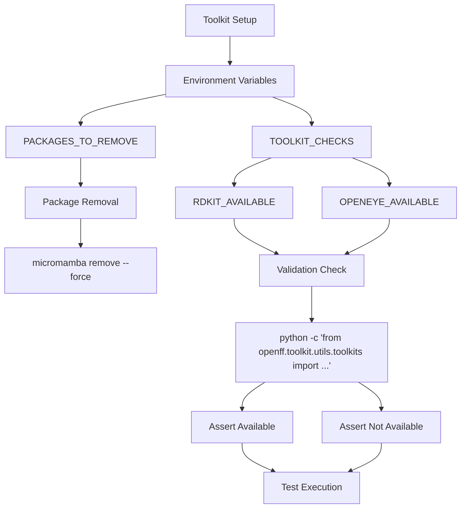
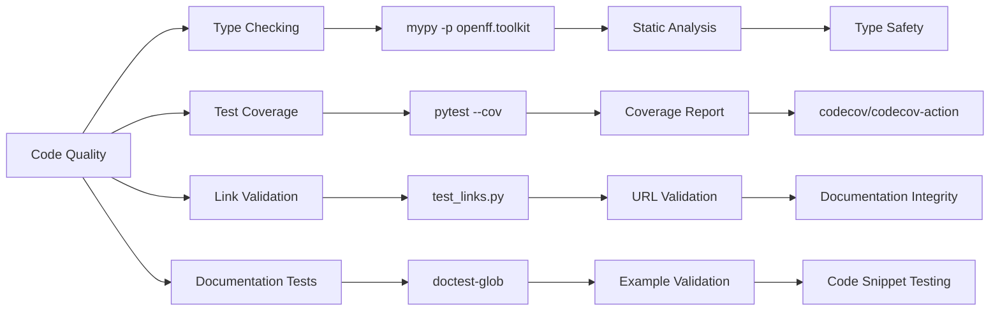
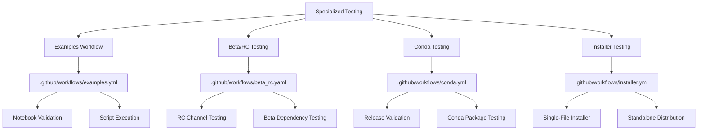
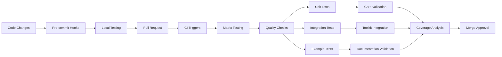
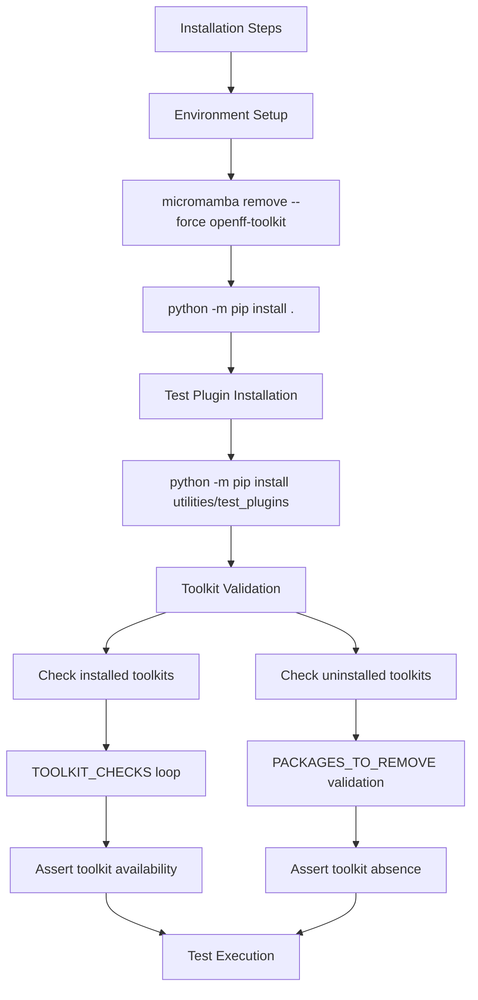

# Development

Relevant source files

The following files were used as context for generating this wiki page:

- [.github/workflows/CI.yml](.github/workflows/CI.yml)
- [.github/workflows/beta_rc.yaml](.github/workflows/beta_rc.yaml)
- [.github/workflows/conda.yml](.github/workflows/conda.yml)
- [.github/workflows/examples.yml](.github/workflows/examples.yml)
- [.github/workflows/installer.yml](.github/workflows/installer.yml)
- [devtools/conda-envs/conda.yaml](devtools/conda-envs/conda.yaml)
- [devtools/conda-envs/conda_oe.yaml](devtools/conda-envs/conda_oe.yaml)
- [devtools/conda-envs/openeye-examples.yaml](devtools/conda-envs/openeye-examples.yaml)
- [devtools/conda-envs/openeye.yaml](devtools/conda-envs/openeye.yaml)
- [devtools/conda-envs/rdkit-examples.yaml](devtools/conda-envs/rdkit-examples.yaml)
- [devtools/conda-envs/rdkit.yaml](devtools/conda-envs/rdkit.yaml)
- [devtools/conda-envs/test_env.yaml](devtools/conda-envs/test_env.yaml)
- [docs/typing.rst](docs/typing.rst)
- [openff/toolkit/_tests/test_forcefield.py](openff/toolkit/_tests/test_forcefield.py)
- [openff/toolkit/_tests/test_molecule.py](openff/toolkit/_tests/test_molecule.py)
- [openff/toolkit/_tests/test_parameters.py](openff/toolkit/_tests/test_parameters.py)

This document provides a comprehensive guide for developers contributing to the OpenFF toolkit repository. It covers the testing infrastructure, development workflows, environment setup, and quality assurance processes that ensure the toolkit maintains high standards across multiple platforms and toolkit combinations.

For information about the core toolkit architecture and design patterns, see [Core Architecture](#2). For user-focused guidance on installation and usage, see [Getting Started](#3.1).

## Overview

The OpenFF toolkit development process is built around a robust continuous integration system that validates code changes across multiple dimensions: operating systems, Python versions, and cheminformatics toolkit combinations. The development workflow ensures compatibility with both open-source (RDKit, AmberTools) and commercial (OpenEye) backend toolkits while maintaining comprehensive test coverage.

Sources: [.github/workflows/CI.yml:1-183](), [devtools/conda-envs/test_env.yaml:1-51]()

## Continuous Integration Architecture

The CI system forms the backbone of the development process, orchestrating testing across multiple configurations and ensuring code quality before integration.

### CI Workflow Matrix

Sources: [.github/workflows/CI.yml:18-37](), [.github/workflows/CI.yml:49-70]()

### Environment Configuration System

Sources: [devtools/conda-envs/test_env.yaml:1-51](), [devtools/conda-envs/rdkit.yaml:1-42](), [devtools/conda-envs/openeye.yaml:1-53]()

## Testing Framework

The testing system is organized around comprehensive validation of molecular representations, force field parameterization, and toolkit integrations.

### Test Organization Structure

```mermaid
graph TD
    A["Test Suite"] --> B["Core Tests"]
    A --> C["Integration Tests"]
    A --> D["Example Tests"]
    A --> E["Documentation Tests"]
    
    B --> B1["test_molecule.py"]
    B --> B2["test_parameters.py"]
    B --> B3["test_forcefield.py"]
    B --> B4["test_topology.py"]
    
    C --> C1["test_toolkits.py"]
    C --> C2["test_links.py"]
    C --> C3["Cross-toolkit validation"]
    
    D --> D1["test_examples.py"]
    D --> D2["Notebook validation"]
    D --> D3["Script execution"]
    
    E --> E1["Docstring examples"]
    E --> E2["RST/MD doctests"]
    E --> E3["API documentation"]
    
    B1 --> F["Molecule serialization"]
    B1 --> G["SMILES parsing"]
    B1 --> H["Conformer handling"]
    
    B2 --> I["Parameter validation"]
    B2 --> J["Handler behavior"]
    B2 --> K["SMIRNOFF compliance"]
    
    B3 --> L["System creation"]
    B3 --> M["Force assignment"]
    B3 --> N["Charge methods"]
```

Sources: [openff/toolkit/_tests/test_molecule.py:1-50](), [openff/toolkit/_tests/test_parameters.py:1-50](), [openff/toolkit/_tests/test_forcefield.py:1-50]()

### Test Execution Pipeline

Sources: [.github/workflows/CI.yml:41-42](), [.github/workflows/CI.yml:149-158](), [.github/workflows/CI.yml:176-182]()

## Environment Management

The development environment system supports multiple toolkit combinations and testing scenarios through carefully configured conda environments.

### Dependency Resolution Matrix

| Environment | RDKit | OpenEye | AmberTools | Purpose |
|-------------|--------|---------|------------|---------|
| `test_env.yaml` | ✓ | ✓ | ✓ | Full testing matrix |
| `rdkit.yaml` | ✓ | ✗ | ✓ | RDKit-only validation |
| `openeye.yaml` | ✗ | ✓ | ✗ | OpenEye-only validation |
| `rdkit-examples.yaml` | ✓ | ✗ | ✓ | Example notebooks (RDKit) |
| `openeye-examples.yaml` | ✗ | ✓ | ✗ | Example notebooks (OpenEye) |

Sources: [devtools/conda-envs/test_env.yaml:25-31](), [devtools/conda-envs/rdkit.yaml:25-27](), [devtools/conda-envs/openeye.yaml:26-26]()

### Toolkit Validation System

Sources: [.github/workflows/CI.yml:109-122](), [.github/workflows/CI.yml:97-103]()

## Quality Assurance Pipeline

The quality assurance system ensures code correctness, style compliance, and comprehensive validation across all supported configurations.

### Code Quality Checks

Sources: [.github/workflows/CI.yml:140-147](), [.github/workflows/CI.yml:136-138](), [.github/workflows/CI.yml:159-175]()

### Testing Specialization

Sources: [.github/workflows/examples.yml:1-140](), [.github/workflows/beta_rc.yaml:1-87](), [.github/workflows/conda.yml:1-132](), [.github/workflows/installer.yml:1-112]()

## Development Workflow

The development process integrates multiple validation stages to ensure code quality and compatibility across the supported ecosystem.

### Contribution Pipeline

Sources: [.github/workflows/CI.yml:4-11](), [.github/workflows/examples.yml:4-11]()

### Package Installation Process

Sources: [.github/workflows/CI.yml:84-96](), [.github/workflows/CI.yml:94-96](), [.github/workflows/CI.yml:109-122]()

This development infrastructure ensures that the OpenFF toolkit maintains high quality standards while supporting a diverse ecosystem of cheminformatics backends and deployment environments. The comprehensive testing matrix validates functionality across all supported configurations, while the quality assurance pipeline ensures code correctness and documentation integrity.

---